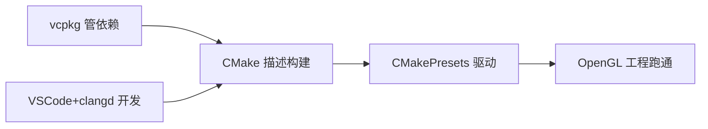

# CMake + vcpkg：从零到 OpenGL（Windows 11 + VSCode）

写给从 JS/TS 工具链（npm / webpack / VSCode）转到 C++ 的前端游戏开发工程师：CMake 是构建系统生成器（≈ webpack/vite 的「配置即代码」），vcpkg 是依赖管理器（≈ npm）。全系列用你熟悉的 npm 概念做类比锚点，终点是一个 GLFW + glad 的 OpenGL 蓝三角形窗口。

## 你将学会什么

1. CMake 的三阶段模型与目标（target）体系——现代 CMake 只把设置挂 target 上
2. 用 `CMakePresets.json` 把命令行固化成具名预设，一条 `cmake --preset` 完成配置
3. vcpkg manifest 模式：`vcpkg.json` 声明依赖，configure 时自动安装
4. 三者接线：toolchain 文件让 `find_package` 直接找到 vcpkg 装好的库
5. VSCode 工作流：CMake Tools 一键构建调试，clangd 精准跳转补全
6. 毕业项目：`glfw3` + `glad` 画三角形，与 `dx:cpp-learning` 的图形 API 方向衔接

## 路线图

| 部 | 主题 | 课 |
|---|---|---|
| part-01 | CMake 基础与工程化 | 01 工具链安装 → 02 VSCode 工作流（clangd）→ 03 第一个项目 → 04 目标与用法要求 → 05 库 → 06 变量与缓存 → 07 依赖三方案 → 08 预设与测试 |
| part-02 | vcpkg | 01 上手与 manifest → 02 triplets → 03 版本控制 → 04 缓存与 registries |
| part-03 | 集成实战 | 01 toolchain 接线 → 02 OpenGL 环境（毕业项目） |

vcpkg 负责「库从哪来」，CMake 负责「怎么编」，VSCode 负责「在哪写」。三者在 part-03 汇合。

## 示例代码与验证状态

全部示例集中在 [code/](code/README.md)，每个目录对应一课，均可独立构建。本系列所有命令与代码已于 2026-11-14 在 Windows 11 + 上述环境逐个跑通（含毕业项目的 800×600 窗口）。构建产物（`build/`、`vcpkg_installed/`）不入库，进 `.gitignore`。

## 阅读约定

- 命令默认在 PowerShell 执行；需要 MSVC 编译环境的命令会注明
- 「npm 类比」仅在概念映射时出现，语义不总是一一对应，以正文为准
- 术语统一：目标（target）、用法要求（usage requirement）、预设（preset）、三元组（triplet）
