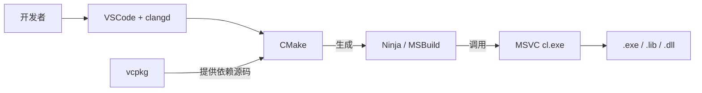

# 工具链安装：MSVC + CMake + vcpkg

先认识每个工具的角色，再安装并验证。整套工具链的关系：



CMake 不编译代码——它把 `CMakeLists.txt` 翻译成 Ninja 或 MSBuild 的构建脚本，真正调 `cl.exe` 的是后者。vcpkg 不参与编译你的代码——它把第三方库按当前平台编译好，供 CMake 的 `find_package` 消费。

## 你将学会什么

装好四个工具，跑通三条验证命令，理解「编辑（VSCode）→ 生成（CMake）→ 构建+编译→ 包管理」的分工。

## 安装步骤

1. 安装 Visual Studio 2022 Community：<https://visualstudio.microsoft.com/>。安装器中勾选工作负载「使用 C++ 的桌面开发」，它包含 MSVC 编译器、Windows SDK，以及 VS 自带的 CMake 和 Ninja（不必单独勾选）
2. 安装 VSCode：<https://code.visualstudio.com/>（扩展下一课装）
3. 安装 CMake（可选，二选一）：
   - 用 VS 自带的 CMake（无需任何操作）
   - 或从 <https://cmake.org/download/> 装独立版并勾选「加入 PATH」——本教程验证环境用的是独立版 3.29.2
4. 安装 vcpkg（装到**不含空格和中文**的路径，推荐 `C:\dev\vcpkg`）：

```bash
git clone https://github.com/microsoft/vcpkg.git C:\dev\vcpkg
cd C:\dev\vcpkg
.\bootstrap-vcpkg.bat
```

5. 把 `C:\dev\vcpkg` 加入 PATH（系统设置 → 环境变量），重开终端

> ⚠️ bootstrap 需要从 GitHub 下载 vcpkg 主程序；失败基本都是网络问题，重跑一次 `.\bootstrap-vcpkg.bat` 即可，已下载的部分不会重复下载。

## 验证

依次执行，输出应与下面同构（版本号以你安装时为准）：

```powershell
PS> cmake --version
cmake version 3.29.2

PS> vcpkg version
vcpkg package management program version 2026-10-29-139f2e53438b1529e178f6295bc563f4e0de734f

PS> & "C:\Program Files\Microsoft Visual Studio\2022\Community\VC\Auxiliary\Build\vcvars64.bat"   # 临时进入 MSVC 环境
PS> cl
用于 x86 的 Microsoft (R) C/C++ 优化编译器 19.39.33519 版
```

`cl` 不在默认 PATH 是正常的：MSVC 工具需要 `vcvars64.bat` 先设置一整套环境变量。日常开发不手动跑它——VSCode 的 CMake Tools 扩展会自动处理（下一课）。

## 角色速查表

| 工具 | 角色 | npm 世界类比 |
|---|---|---|
| MSVC（`cl.exe`） | 编译器 | 无（V8 之类运行时自带） |
| Ninja / MSBuild | 构建执行器 | 无（tsc --build 的增量调度部分） |
| CMake | 构建系统生成器 | webpack / vite 配置层 |
| vcpkg | 依赖管理器 | npm + node_modules |
| VSCode + clangd | 编辑器 + 语言服务 | VSCode + tsserver |

## 下一步

进入 [02 · VSCode 工作流（CMake Tools + clangd）](02-vscode-workflow.md)。
