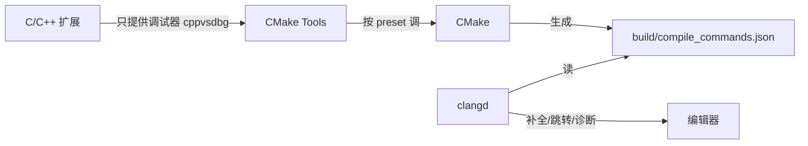

# VSCode 工作流：CMake Tools + clangd

三个扩展各司其职，协作关系如下：



clangd 的一切智能都来自 `compile_commands.json`（编译数据库：每个源文件的真实编译命令）。**只有 Ninja 生成器会产出它，VS 生成器不会**——这是本教程全线使用 Ninja 的根本原因。

## 你将学会什么

装对扩展、写对 `.vscode/settings.json`、理解 kit 与 `compile_commands.json` 的来龙去脉，最后用 F5 调试。

## 安装扩展

1. `Ctrl+Shift+X` 打开扩展面板，依次安装：

| 扩展 | ID | 职责 |
|---|---|---|
| CMake Tools | `ms-vscode.cmake-tools` | 选 kit、configure、build、debug、preset 切换 |
| clangd | `llvm-vs-code-extensions.vscode-clangd` | 补全、跳转、诊断、重构（基于编译数据库） |
| C/C++ | `ms-vscode.cpptools` | 只用它的 MSVC 调试器（cppvsdbg），**IntelliSense 必须关** |

2. 打开任意 CMake 工程目录，`Ctrl+Shift+P` → `CMake: Select Kit` → 选 **Visual Studio Community 2022 Release - amd64**（不要选 GCC/MinGW kit，那是另一套 ABI，见 part-02/02）
3. `Ctrl+Shift+P` → `CMake: Select Configure Preset` 选预设（工程有 `CMakePresets.json` 时）——CMake Tools 会自动激活 MSVC 环境，等价于帮你跑了 `vcvars64.bat`

## 项目配置：.vscode/settings.json

放在工程根 `.vscode/` 下，随仓库提交：

```json
{
  "cmake.configureOnOpen": true,
  "C_Cpp.intelliSenseEngine": "disabled",
  "clangd.arguments": [
    "--background-index",
    "--completion-style=detailed",
    "--header-insertion=iwyu"
  ]
}
```

- `C_Cpp.intelliSenseEngine: "disabled"`：cpptools 与 clangd 的语言服务冲突，关掉前者（clangd 扩展也会主动提示这一项）
- `cmake.configureOnOpen`：打开工程自动 configure，产出 `build/compile_commands.json`
- `clangd.arguments`：后台索引、详细补全、按需插入头文件（iwyu = include-what-you-use）

## 代码风格：.clang-format

clangd 顺带托管格式化（≈ Prettier）。工程根放 `.clang-format`：

```yaml
BasedOnStyle: Google
IndentWidth: 4
ColumnLimit: 100
DerivePointerAlignment: false
PointerAlignment: Left
```

`Shift+Alt+F` 格式化。风格字段速查：<https://clang.llvm.org/docs/ClangFormatStyleOptions.html>

## 调试：F5

1. 底部状态栏点 **Build**（或 `F7`）构建当前 preset
2. 点 Build 旁的目标名选要调试的可执行文件，再点 **小虫子图标**——CMake Tools 会用 cpptools 的 `cppvsdbg`（原生 MSVC 调试器）启动，断点、监视、调用栈与 VS 一致

> ⚠️ clangd 报「找不到头文件/compile_commands.json」时，先确认：preset 用的是 Ninja 生成器、`CMAKE_EXPORT_COMPILE_COMMANDS` 为 `ON`、且至少 configure 过一次。

## 与 tsserver 的对照

| 需求 | TS 世界 | 本工作流 |
|---|---|---|
| 补全跳转 | tsserver | clangd + compile_commands.json |
| 构建任务 | npm scripts | CMake Tools preset |
| 调试 | launch.json + js-debug | CMake Tools + cppvsdbg |
| 格式化 | Prettier | .clang-format |

## 下一步

进 [03 · 第一个项目](03-first-project.md)，亲手跑通 configure → build → run。
