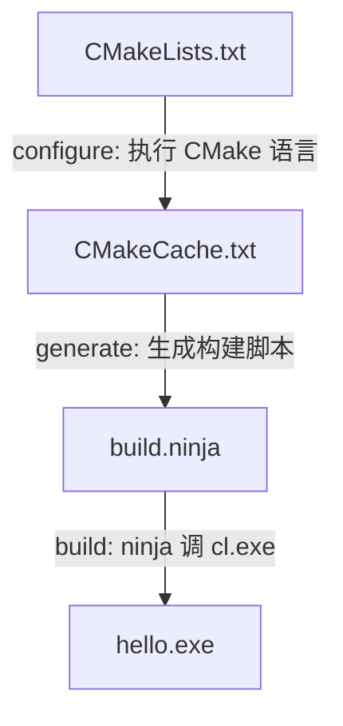

# 第一个项目：三阶段模型与 out-of-source

示例代码：[code/part-01-03-hello](../code/part-01-03-hello/)。整个工程只有两个文件：

```cmake
# CMakeLists.txt
cmake_minimum_required(VERSION 3.28)          # 声明最低版本，同时锁定策略行为
project(hello VERSION 0.1.0 LANGUAGES CXX)    # 工程名/版本/语言，必须先于其他命令

set(CMAKE_CXX_STANDARD 17)            # 目标默认用 C++17
set(CMAKE_CXX_STANDARD_REQUIRED ON)   # 编译器不支持就报错，而不是静默降级

add_executable(hello main.cpp)        # 声明一个目标：可执行文件 hello
```

```cpp
// main.cpp
#include <cstdio>

int main() {
    std::puts("Hello, CMake!");
    return 0;
}
```

## 你将学会什么

三阶段模型的每一步产物是什么、命令行怎么驱动、为什么构建永远发生在独立的 `build/` 目录。

## 三阶段模型



- **configure（配置）**：CMake 执行 `CMakeLists.txt`，探测编译器/依赖，结果缓存进 `build/CMakeCache.txt`
- **generate（生成）**：按缓存生成原生构建脚本（Ninja 的 `build.ninja`）
- **build（构建）**：构建器增量编译链接，产出二进制

三阶段在命令行上是两条命令（configure 与 generate 由 `cmake -B` 一并完成）：

```powershell
PS> cmake -S . -B build        # -S 源码目录 -B 构建目录：configure + generate
PS> cmake --build build        # 驱动 Ninja 增量构建
PS> .\build\hello.exe          # Ninja 单配置：产物直接在 build/ 下
Hello, CMake!
```

## out-of-source：构建目录与源码分离

所有生成物只落在 `build/`，源码目录永远干净——删 `build/` 即可完全重置（≈ 删 `node_modules` 重装）。`.gitignore` 里写上 `build/`。

> ⚠️ 永远不要在源码目录直接 `cmake .`（in-source 构建）：生成物污染源码树，且之后无法切换生成器。忘了一次就要手动清理 `CMakeCache.txt` 等文件。

## 生成器：Ninja 还是 Visual Studio？

`-G` 参数选择生成器，本教程两条线都会碰到：

| 生成器 | 配置模型 | compile_commands.json | 命令行需要 vcvars？ |
|---|---|---|---|
| Ninja | 单配置（`CMAKE_BUILD_TYPE` 决定 Debug/Release） | ✅ 产出（clangd 依赖） | 需要（VSCode/CI 里由工具代劳） |
| Visual Studio 17 2022 | 多配置（build 时 `--config Debug`） | ❌ 不产出 | 不需要 |

教程与工程主线用 **Ninja**（clangd + 更快的增量）；VS 生成器作为「在命令行快速验证、不想开 vcvars」的备选——产物路径多一层 `build/Release/`。

## 下一步

跑通后进 [04 · 目标与用法要求](04-targets-and-usage.md)——现代 CMake 的核心抽象。
