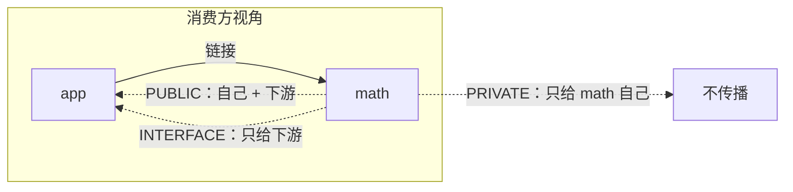

# 目标与用法要求：PRIVATE / PUBLIC / INTERFACE

target（目标）是 CMake 的核心抽象：`add_executable` / `add_library` 创建的一切都是 target。现代 CMake 的原则：**所有设置挂在 target 上，让 CMake 沿依赖图自动传播**——不写全局命令。

用法要求（usage requirement）指「消费这个 target 需要什么」：include 路径、编译选项、链接哪些库。传播方向由三个关键字决定：



| 关键字 | math 自身用到？ | 链接 math 的下游得到？ |
|---|---|---|
| `PRIVATE` | ✅ | ❌ |
| `PUBLIC` | ✅ | ✅ |
| `INTERFACE` | ❌ | ✅ |

## 你将学会什么

用 `target_*` 三件套声明依赖关系，选对传播关键字，看懂链接错误的定位思路。

## 示例：app 链接 math 静态库

示例代码：[code/part-01-04-targets](../code/part-01-04-targets/)。目录结构：

```text
part-01-04-targets/
├── CMakeLists.txt
├── include/math.h      # 对外头文件
├── src/math.cpp        # 实现
└── main.cpp            # 可执行文件
```

```cmake
# 静态库：产物是 math.lib，供下游链接
add_library(math STATIC src/math.cpp)
# PUBLIC：include 既用于编译 math 自身（math.cpp include 了它），也必须传播给 app（main.cpp include 了它）
target_include_directories(math PUBLIC include)

add_executable(app main.cpp)
# PRIVATE：app 消费 math 的接口；app 没有下游，无需传播
target_link_libraries(app PRIVATE math)
```

判断口诀：**头文件里出现的东西（类型、include）→ 用法要求必须 PUBLIC/INTERFACE；只在 .cpp 里出现 → PRIVATE**。`main.cpp` include 了 `math.h`，所以 include 目录必须是 `PUBLIC`；`app` 链接 `math` 后没有更下游，所以用 `PRIVATE`。

构建运行（本机验证输出）：

```powershell
PS> cmake -S . -B build
PS> cmake --build build
PS> .\build\app.exe
1 + 2 = 3
```

## 为什么不用全局命令？

老式写法 `include_directories(include)` / `link_libraries(math)` 作用于其后的**所有** target——等价于把依赖装成全局变量，随着工程增长必然出现「看不见的耦合」。`target_*` 系列把信息封闭在 target 边界内，谁链接谁获得，链接图即依赖图。

## 别名：给库一个命名空间

```cmake
add_library(myproj::math ALIAS math)   # 只读别名，下游统一用 myproj::math 链接
```

第三方库的导入目标都带命名空间（`fmt::fmt`、`glad::glad`），part-03 会反复见到。

## 排查链接错误的姿势

「无法解析的外部符号」（LNK2019）= 声明了、没链接实现。排查顺序：① 目标真的被 `target_link_libraries` 了吗 ② 库的源文件在 `add_library` 列表里吗 ③ 库和可执行文件是同一 ABI 吗（part-02/02 的 triplet 主题）。

## 下一步

[05 · 库的类型与 header-only](05-libraries.md)。
