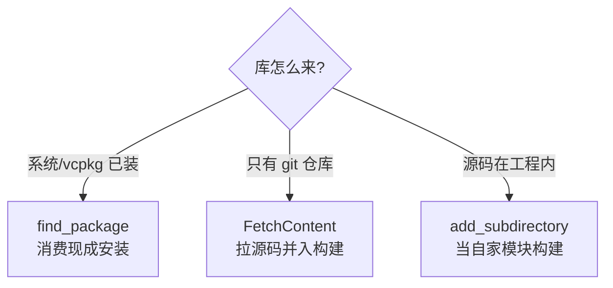

# 依赖三方案：find_package / FetchContent / add_subdirectory



三条路径**产物都是 target**——链接时三者写法相同（`target_link_libraries(app PRIVATE fmt::fmt)`），差异只在「库从哪来」。

## 你将学会什么

三条路径的适用边界、`find_package` 两种模式、FetchContent 固定版本的正确姿势。

## 方案一：find_package——消费现成安装

```cmake
find_package(fmt CONFIG REQUIRED)   # REQUIRED：找不到直接报错终止
target_link_libraries(app PRIVATE fmt::fmt)
```

两种查找模式：
- **CONFIG 模式**（优先）：读库安装时提供的 `fmtConfig.cmake`，直接拿到导入 target（`fmt::fmt`）。vcpkg 装的库全是这种
- **MODULE 模式**：找 CMake 自带/你写的 `FindXXX.cmake` 脚本，常见于系统库（Threads、OpenGL）

目标名从哪查：库的文档，或 `<安装前缀>/share/<库名>/` 下的 `*-config.cmake`。part-02 会用 `vcpkg` 的安装目录直接验证。

## 方案二：FetchContent——拉源码并入构建

示例代码：[code/part-01-07-deps](../code/part-01-07-deps/)（本机验证输出附后）：

```cmake
include(FetchContent)
FetchContent_Declare(
    fmt
    GIT_REPOSITORY https://github.com/fmtlib/fmt.git
    GIT_TAG        11.1.4   # 永远固定 tag/commit，不用可变的分支名
)
FetchContent_MakeAvailable(fmt)   # 首次 configure 时克隆+并入构建

add_executable(app main.cpp)
target_link_libraries(app PRIVATE fmt::fmt)
```

机制：首次 configure 时把仓库克隆进 `build/_deps/`，然后等价于 `add_subdirectory`——依赖与你的代码在**同一次构建**里用同一编译器、同一套选项编译。首次下载后进缓存，增量构建不再联网。

```powershell
PS> .\build\app.exe
Hello, FetchContent! (fmt 110104)
```

## 方案三：add_subdirectory——工程内模块

```cmake
add_subdirectory(src/engine)   # 进入子目录执行它的 CMakeLists.txt
```

你自己的代码按模块拆分时的标准做法；第三方库只有「源码被 vendor 进仓库」时才用它。

## 决策规则

| 场景 | 选择 | 理由 |
|---|---|---|
| vcpkg 有 port（绝大多数知名库） | find_package + vcpkg（part-03） | 统一 ABI、二进制缓存、版本由 manifest 锁 |
| 冷门库/仅 git 有 | FetchContent | 无需 port，版本固定即可 |
| 自己的模块 | add_subdirectory | 就是一家人 |

> ⚠️ 不要让同一个库同时走两条路径（vcpkg 装 fmt 又 FetchContent fmt）——两个同名导入 target 冲突，链接期还可能撞重复符号。

## 下一步

[08 · 预设与测试](08-presets-and-testing.md)——把命令行固化成 preset。
