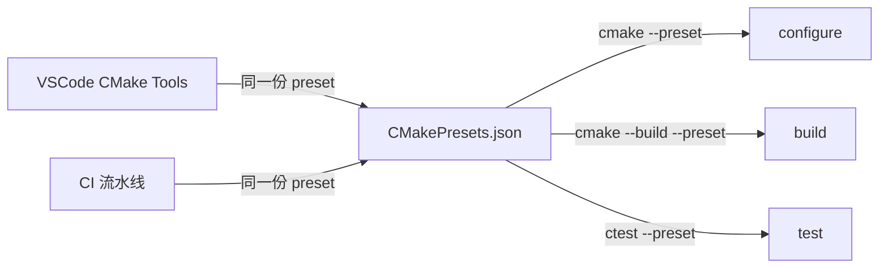

# CMakePresets 与 CTest：一键配置、构建、测试

`cmake -S . -B build -G Ninja -DCMAKE_BUILD_TYPE=Debug -DCMAKE_TOOLCHAIN_FILE=...` 这种命令没人记得住。preset 把它变成仓库里**可提交、可继承**的声明式配置（≈ `package.json` 的 scripts，但作用在工具链层）：



## 你将学会什么

写一份三类齐全的 `CMakePresets.json`，注册并运行 CTest，本地/VSCode/CI 共用同一套预设。

## CMakePresets.json

示例代码：[code/part-01-08-presets](../code/part-01-08-presets/)：

```json
{
  "version": 3,
  "configurePresets": [
    {
      "name": "msvc-debug",
      "displayName": "MSVC x64 Debug (Ninja)",
      "generator": "Ninja",
      "binaryDir": "${sourceDir}/build",
      "cacheVariables": {
        "CMAKE_BUILD_TYPE": "Debug",
        "CMAKE_EXPORT_COMPILE_COMMANDS": "ON"
      }
    }
  ],
  "buildPresets": [{ "name": "msvc-debug", "configurePreset": "msvc-debug" }],
  "testPresets": [
    {
      "name": "msvc-debug",
      "configurePreset": "msvc-debug",
      "output": { "outputOnFailure": true }
    }
  ]
}
```

字段要点：
- `version: 3` 需要 CMake ≥ 3.21；`binaryDir` 建议显式写（默认 `build/` 但显式更稳）
- `cacheVariables` 就是 `-D` 的清单；`CMAKE_EXPORT_COMPILE_COMMANDS` 给 clangd 供料（02 课）
- build/test preset 用 `configurePreset` 关联同名配置
- `inherit` 可做基类预设（如公共 toolchain 抽成 `base`，debug/release 继承），capstone（part-03/02）展示了双 preset 写法

## CTest

```cmake
enable_testing()                          # 在根 CMakeLists.txt 打开
add_executable(tests_sum tests/test_sum.cpp)
target_link_libraries(tests_sum PRIVATE core)   # 测试链接库，不是链接 app
add_test(NAME sum COMMAND tests_sum)      # 注册为名字为 sum 的测试
```

> ⚠️ `add_test` 注册的是**可执行文件**：要测的函数必须在库里（`core`），不能定义在 `app` 的 `main.cpp` 里，否则链接期 LNK2019——这是把「被测逻辑放库、可执行文件只做壳」的结构性理由。

运行（本机验证）：

```powershell
PS> cmake --preset msvc-debug
PS> cmake --build --preset msvc-debug
PS> ctest --preset msvc-debug
1/1 Test #1: sum ..............................   Passed    0.11 sec
```

## VSCode 联动

`Ctrl+Shift+P` → `CMake: Select Configure Preset` 后，底部状态栏的 Build/Run/Test 按钮全部按当前 preset 走——本地与命令行/CI 用同一份配置，不存在「我机器上要加个参数」。

> ⚠️ 个人专属覆盖（如本地 toolchain 路径）写 `CMakeUserPresets.json`，它**不提交**；`CMakePresets.json` 提交共享。

## 下一步

CMake 部分结业。进 [part-02/01 · vcpkg 上手与 manifest 模式](../part-02-vcpkg/01-get-started.md)。
