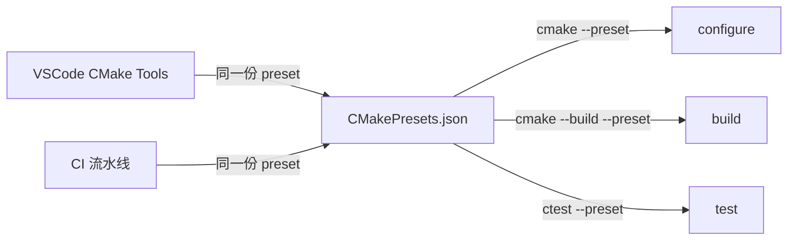
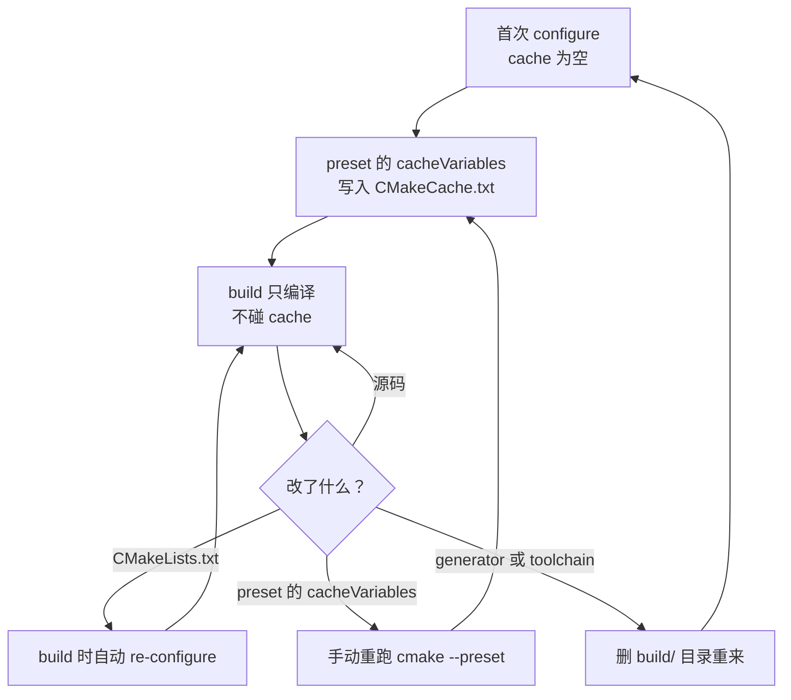

# CMakePresets 与 CTest：一键配置、构建、测试

`cmake -S . -B build -G Ninja -DCMAKE_BUILD_TYPE=Debug -DCMAKE_TOOLCHAIN_FILE=...` 这种命令没人记得住。预设把它变成仓库里**可提交、可继承**的声明式配置（≈ `package.json` 的 scripts，但作用在工具链层）：



## 你将学会什么

写一份三类齐全的 `CMakePresets.json`（含 `inherits` 基类继承），弄清 cache 粘性与重新 configure 的时机、单/多配置下的双预设组织，注册并运行 CTest，本地/VSCode/CI 共用同一套预设。

## CMakePresets.json

示例代码：[code/part-01-08-presets](../code/part-01-08-presets/)：

```json
{
  "version": 3,
  "configurePresets": [
    {
      "name": "msvc-debug",
      "displayName": "MSVC x64 Debug (Ninja)",
      "generator": "Ninja",
      "binaryDir": "${sourceDir}/build",
      "cacheVariables": {
        "CMAKE_BUILD_TYPE": "Debug",
        "CMAKE_EXPORT_COMPILE_COMMANDS": "ON"
      }
    }
  ],
  "buildPresets": [{ "name": "msvc-debug", "configurePreset": "msvc-debug" }],
  "testPresets": [
    {
      "name": "msvc-debug",
      "configurePreset": "msvc-debug",
      "output": { "outputOnFailure": true }
    }
  ]
}
```

字段要点：
- `version: 3` 需要 CMake ≥ 3.21；`binaryDir` 建议显式写（默认 `build/` 但显式更稳）
- `cacheVariables` 就是 `-D` 的清单；`CMAKE_EXPORT_COMPILE_COMMANDS` 给 clangd 供料（02 课）
- build/test 预设用 `configurePreset` 关联同名 configure 预设
- 公共参数可用 `inherits` 抽成基类预设（见下文），capstone（part-03/02）是双预设的实例

### 哪些变量值得写进 `cacheVariables`

预设里值得写的 `-D` 参数（缓存变量机制见 06 课），实战中常驻的只有四类：

| 变量 | 何时需要 | 说明 |
|---|---|---|
| `CMAKE_BUILD_TYPE` | Ninja/Makefiles 等单配置生成器 | VS/Xcode 不用设，见下文「双预设与单/多配置生成器」 |
| `CMAKE_TOOLCHAIN_FILE` | 用 vcpkg 时必写 | 指向 `vcpkg/scripts/buildsystems/vcpkg.cmake`，part-02/01 详讲 |
| `CMAKE_EXPORT_COMPILE_COMMANDS` | 用 clangd/clang-tidy | 生成 `compile_commands.json` 给编辑器（02 课） |
| 项目自定义 `option()` | 按需 | 如 06 课的 `MYPROJ_BUILD_TOOLS`，可写 `"MYPROJ_BUILD_TOOLS": "OFF"` 整组关掉 |

想看全部可调项：跑完一次 configure 后打开 `cmake-gui build/`（终端用 `ccmake`）浏览整个 cache——那是本项目所有旋钮的全景。

### cache 的粘性与重新 configure 的时机

`CMakeCache.txt` 既是 configure 的产物、也是下一次 configure 的输入——一个躺在 `binaryDir` 里的持久 KV 存储。记住这一点，「什么时候需要重新 configure」就是一张流程图：



结论：**改了预设必须重跑 `cmake --preset`，`cmake --build` 不会帮你更新 cache**；换 `generator` 或 toolchain 时旧 cache 会直接报错，删目录重来是唯一解。

> ⚠️ cache 是**粘的**：手动 `-D` 传过一次的值会留在 cache 里，之后从预设中删掉对应条目，旧值依然生效——典型症状是「明明没配它，结果却不对」。遇到诡异状态，第一反应是删除 `build/` 重新 configure：cache 是唯一的持久状态，删了就回到出厂。

### 用 `inherits` 抽公共基类

capstone（part-03/02）要 Debug/Release 两套预设，直白写法是复制粘贴（`buildPresets` 同样两份，略）：

```json
{
  "version": 3,
  "configurePresets": [
    {
      "name": "msvc-debug",
      "displayName": "MSVC x64 Debug (Ninja)",
      "generator": "Ninja",
      "binaryDir": "${sourceDir}/build",
      "cacheVariables": {
        "CMAKE_BUILD_TYPE": "Debug",
        "CMAKE_TOOLCHAIN_FILE": "$env{VCPKG_ROOT}/scripts/buildsystems/vcpkg.cmake",
        "CMAKE_EXPORT_COMPILE_COMMANDS": "ON"
      }
    },
    {
      "name": "msvc-release",
      "displayName": "MSVC x64 Release (Ninja)",
      "generator": "Ninja",
      "binaryDir": "${sourceDir}/build",
      "cacheVariables": {
        "CMAKE_BUILD_TYPE": "Release",
        "CMAKE_TOOLCHAIN_FILE": "$env{VCPKG_ROOT}/scripts/buildsystems/vcpkg.cmake",
        "CMAKE_EXPORT_COMPILE_COMMANDS": "ON"
      }
    }
  ]
}
```

两个预设只有 `CMAKE_BUILD_TYPE` 一行不同，其余全部重复。公共部分抽成 `hidden` 基类：

```json
{
  "version": 3,
  "configurePresets": [
    {
      "name": "base",
      "hidden": true,
      "generator": "Ninja",
      "binaryDir": "${sourceDir}/build",
      "cacheVariables": {
        "CMAKE_TOOLCHAIN_FILE": "$env{VCPKG_ROOT}/scripts/buildsystems/vcpkg.cmake",
        "CMAKE_EXPORT_COMPILE_COMMANDS": "ON"
      }
    },
    {
      "name": "msvc-debug",
      "inherits": "base",
      "displayName": "MSVC x64 Debug (Ninja)",
      "cacheVariables": { "CMAKE_BUILD_TYPE": "Debug" }
    },
    {
      "name": "msvc-release",
      "inherits": "base",
      "displayName": "MSVC x64 Release (Ninja)",
      "cacheVariables": { "CMAKE_BUILD_TYPE": "Release" }
    }
  ]
}
```

规则三句话：

- 字段名是 `inherits`（复数，可接数组实现多继承）；`hidden: true` 的预设不出现在 `cmake --list-presets` 里，只能被继承——类比 JS 里不 `export` 的基类。
- `cacheVariables` **按键合并**：基类给 toolchain、子类给 `CMAKE_BUILD_TYPE`，结果两者都有；同键则子覆盖父。`generator`、`binaryDir` 等其余字段子类写了就整体覆盖、没写就沿用基类。
- 上例已用 `$env{VCPKG_ROOT}` 引环境变量（presets schema ≥ v3 支持 `$env{}`）：vcpkg 装在哪台机器、哪个目录，由第 01 课设置的 `VCPKG_ROOT` 决定，共享文件里零个人路径。另一条路是 `CMakeUserPresets.json`（不提交），子预设写 `"inherits": ["base", "local"]` 叠加个人预设。

> ⚠️ 上面的重构写法已在本机验证：`cmake --list-presets` 只列出两个子预设（`base` 被隐藏），configure 后 cache 中 `CMAKE_BUILD_TYPE`（子类）与 `CMAKE_TOOLCHAIN_FILE`（基类）均合并生效，全链路 ctest `1/1 Passed`。

## 双预设与单/多配置生成器

06 课留过一个悬念：「要 Debug 和 Release 两份就配两个构建目录（presets 自动帮你分）」。兑现它——单配置生成器（Ninja）下 `CMAKE_BUILD_TYPE` 在 configure 期定死，双预设的关键是**各分一个 `binaryDir`**，让两套 cache 互不污染：

```json
{
  "name": "msvc-debug",
  "inherits": "base",
  "binaryDir": "${sourceDir}/build/debug",
  "cacheVariables": { "CMAKE_BUILD_TYPE": "Debug" }
},
{
  "name": "msvc-release",
  "inherits": "base",
  "binaryDir": "${sourceDir}/build/release",
  "cacheVariables": { "CMAKE_BUILD_TYPE": "Release" }
}
```

`cmake --preset msvc-debug` 与 `--preset msvc-release` 各进各的目录、各自的 cache 里锁着各自的构建类型——这就是「presets 自动帮你分」的全部含义，也回应了 06 课「忘记设 `CMAKE_BUILD_TYPE` 时是空字符串」的坑：预设把这一行显式钉死，想忘都忘不掉。

多配置生成器（VS/Xcode）则是另一个世界：configure 一次生成含全部配置的工程，`CMAKE_BUILD_TYPE` 是空操作；配置在 build/test 阶段现选——命令行是 `cmake --build build --config Release` 与 `ctest -C Release`，预设里则写 build/test 预设的 `configuration` 字段，不需要两个 configure 预设。本系列全程 Ninja 单配置，VS 用户出预设时把 `CMAKE_BUILD_TYPE` 换成 `configuration` 字段即可。

## CTest

```cmake
enable_testing()                          # 在根 CMakeLists.txt 打开
add_executable(tests_sum tests/test_sum.cpp)
target_link_libraries(tests_sum PRIVATE core)   # 测试链接库，不是链接 app
add_test(NAME sum COMMAND tests_sum)      # 注册为名字为 sum 的测试
```

> ⚠️ `add_test` 注册的是**可执行文件**：要测的函数必须在库里（`core`），不能定义在 `app` 的 `main.cpp` 里，否则链接期 LNK2019——这是把「被测逻辑放库、可执行文件只做壳」的结构性理由。

运行（本机验证）：

```powershell
PS> cmake --preset msvc-debug
PS> cmake --build --preset msvc-debug
PS> ctest --preset msvc-debug
1/1 Test #1: sum ..............................   Passed    0.11 sec
```

## VSCode 联动

`Ctrl+Shift+P` → `CMake: Select Configure Preset` 后，底部状态栏的 Build/Run/Test 按钮全部按当前预设走——本地与命令行/CI 用同一份配置，不存在「我机器上要加个参数」。

> ⚠️ 个人专属覆盖（如本地 toolchain 路径）写 `CMakeUserPresets.json`，它**不提交**；`CMakePresets.json` 提交共享。

## 下一步

[09 · CTest 实战：筛选、属性与只跑测试](09-ctest-in-practice.md)——从「全量跑」到「只跑想跑的」，顺便认识 workflow 一键三连。
