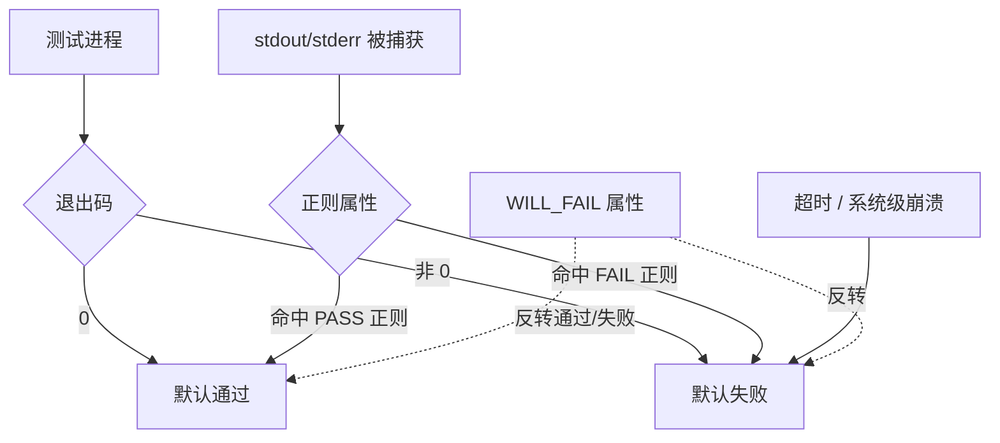

# CTest 实战：筛选、属性与只跑测试

08 课把 CTest 用起来了，但只停留在「全量跑」。日常真正的痛点是：**只想跑某几个测试、只想构建测试相关的东西、CI 里防假绿**。这一课把 CTest 从「能用」带到「顺手」。示例代码：[code/part-01-09-ctest](../code/part-01-09-ctest/)。

## 判定模型：退出码即判定

CTest 对一个测试的判定输入只有一个基准：**进程退出码**——0 即通过，非 0 即失败（崩溃也计入失败）。stdout/stderr 默认被 CTest 捕获吞掉，只在三种情况下影响判定或输出（见 [ctest(1) 手册](https://cmake.org/cmake/help/v3.29/manual/ctest.1.html)）：



由此两条日常纪律：

- **通过时完全静默**。08 课的 `outputOnFailure` 只在失败时放行输出；想看测试自己的 `printf` 调试输出，用 `-V`（全量显示）单跑：`ctest --test-dir build -R sum -V`。
- **粒度按可执行文件**。裸 `add_test` 一条 = 一个 exe；exe 里第几个断言挂了，CTest 只知道「这条红了」。所以一个测试 exe 别塞太多职责——正解见最后一节框架集成。

> ⚠️ 本机制下用 `<cassert>` 写测试有个 Windows 坑：MSVC Debug 的 assert 会**弹对话框**，本课验证时它让一条失败测试拖了 10 秒（无人值守的 CI 会更惨）。示例改用返回非零的 `CHECK` 宏代替 assert——判定效果相同，即时失败、不弹窗。

## 只构建、只跑测试

先立心智模型：`cmake --build` 是**增量的**（只重编改动文件），且 `ctest` 只运行已构建的测试二进制、从不构建。于是「只想要 test」有三层答案：

**1. 什么都不改，纯跑测试**（代码没变，重跑一遍）：

```powershell
ctest --preset msvc-debug
```

**2. 只构建测试相关目标**（跳过 `app` 等无关目标）。日常 `--build` 构建的是默认目标 `all`；指定目标名就只构建它和它的依赖（`core` 会被依赖图自动带出来，已验证 `app.exe` 不产生）：

```powershell
cmake --build --preset msvc-debug --target tests_sum tests_twice
ctest --preset msvc-debug
```

把它固化成 build 预设（08 课 `targets` 字段的应用），团队共享、VSCode 可选：

```json
"buildPresets": [
  { "name": "msvc-debug", "configurePreset": "msvc-debug" },
  {
    "name": "tests-only",
    "configurePreset": "msvc-debug",
    "targets": ["tests_sum", "tests_twice"]
  }
]
```

**3. 一键三连：workflow 预设**。schema v6（CMake 3.25+）新增 `workflowPresets`，把 configure → build → test 串成一条命令——官方对这个「每步各自独立」问题的正面回答（见 [cmake-presets(7)](https://cmake.org/cmake/help/v3.29/manual/cmake-presets.7.html)）：

```json
"workflowPresets": [
  {
    "name": "msvc-debug-all",
    "steps": [
      { "type": "configure", "name": "msvc-debug" },
      { "type": "build", "name": "msvc-debug" },
      { "type": "test", "name": "msvc-debug" }
    ]
  }
]
```

```powershell
PS> cmake --workflow --preset msvc-debug-all
Executing workflow step 1 of 3: configure preset "msvc-debug"
Executing workflow step 2 of 3: build preset "msvc-debug"
Executing workflow step 3 of 3: test preset "msvc-debug"
100% tests passed, 0 tests failed out of 2
```

规则：第一步必须是 configure 预设，后续接 build/test 预设。这就是 CMake 版的 `npm test`——一条命令从配置到测试全链路。

> ⚠️ ctest 跑的是**旧二进制**的活教材，本课验证时亲身踩了一次：用保留时间戳的方式恢复源码后，Ninja 认为「no work to do」，ctest 便跑着带 bug 的旧 exe。链路永远是先 build 再 test；怀疑二进制过期，`cmake --build` 的输出 `ninja: no work to do` 反而是「确实没重编」的证据。

另外有个内置 `test` 目标：`cmake --build build --target test` 让构建工具转发执行 CTest（本机 3.29.2 + Ninja 实测：`build.ninja` 里它就是一条裸 `ctest.exe --force-new-ctest-process`，对任何编译目标无依赖——官方手册未明说此行为，属实测结论）。它不构建任何东西，价值只在能和 `--target tests_sum` 写在同一行：`cmake --build build --target tests_sum tests_twice test`。

## 筛选与重跑

| 旗标 | 作用 | 示例 |
|---|---|---|
| `-R <正则>` | 只跑名字匹配的 | `ctest -R sum` |
| `-E <正则>` | 排除名字匹配的 | `ctest -E twice` |
| `-L <正则>` | 只跑**标签**匹配的（可多个，多个 `-L` 为**与**：每个正则都须命中至少一个标签，实测） | `ctest -L smoke` |
| `--rerun-failed` | 只重跑上次失败的（会忽略 `-R` 等筛选旗标） | `ctest --rerun-failed` |
| `-j [N]` | 并行；3.29 起可省数值（取 CPU 数与 2 的较大者） | `ctest -j` |
| `--test-dir <目录>` | 指定构建目录，可在仓库根直接跑（3.20+） | `ctest --test-dir build` |

标签用 `LABELS` 属性挂（下一节），比名字正则更适合稳定分组（`unit`/`integration`/`smoke`）——测试改名不会破坏 CI 的分组逻辑。并行注意：`-j` 下执行顺序不再有保证（本课实测顺序就翻转过），测试间有依赖要用 fixture，不能靠「`add_test` 写在前面」。

失败路径（本机实测）：

```text
PS> ctest --preset msvc-debug
1/2 Test #1: sum ..............................***Failed    0.04 sec
FAIL: ctest_demo::twice(2) == 5 (...tests\test_sum.cpp:16)    ← outputOnFailure 放行的输出
2/2 Test #2: twice ............................   Passed    0.02 sec
The following tests FAILED:
	  1 - sum (Failed)
... 修复后 ...
PS> ctest --test-dir build --rerun-failed
    Start 1: sum
1/1 Test #1: sum ..............................   Passed    0.04 sec   ← 只重跑了 sum
```

## 测试属性：把元数据挂在测试上

`add_test` 之后用 `set_tests_properties` 挂属性（只能在创建测试的目录里设置）。示例工程用了四个高频属性：

```cmake
add_test(NAME twice COMMAND tests_twice
  WORKING_DIRECTORY ${CMAKE_CURRENT_SOURCE_DIR})   # 也可直接在 add_test 上写
set_tests_properties(twice PROPERTIES
  TIMEOUT 10                       # 超时杀进程，防 CI 挂死
  LABELS "unit;smoke"              # 分组标签，供 -L 筛选
  ENVIRONMENT "CTEST_DEMO_LANG=C++")  # 单测注入环境变量，不影响其他测试
```

- `WORKING_DIRECTORY` 缺省是**构建目录**（手册原文），不是源码目录——示例的 `twice` 测试靠它才能用相对路径读到 `data/answer.txt`。
- `TIMEOUT` 属性优先于命令行 `--timeout`（后者只对没设属性的测试生效）。
- `DEPENDS` 只是「跑在后面」，**不看前者的结果**（手册：it is really just a run after relationship）。要「setup 成功才继续」，用 fixture 三件套：`FIXTURES_SETUP`（整组只跑一次）/ `FIXTURES_REQUIRED` / `FIXTURES_CLEANUP`。

冷门但救命的属性一览（判定模型图的具体落点，均出自 [ctest(1)](https://cmake.org/cmake/help/v3.29/manual/ctest.1.html)）：

| 属性 | 效果 |
|---|---|
| `WILL_FAIL` | 反转通过/失败判定——但超时、段错误等系统级失败**仍然算失败** |
| `SKIP_RETURN_CODE <n>` | 退出码为 n 记为 Not Run（跳过）而非失败 |
| `DISABLED` | 彻底不跑，不计入测试总数 |
| `PASS_REGULAR_EXPRESSION` | 输出命中即通过，**忽略退出码**（驯服不守规矩的第三方程序） |

## Windows 双坑

**工作目录与资源文件**：多配置生成器（VS）把测试 exe 放进 `build/Debug/` 子目录，相对路径找资源文件的问题会被放大。官方论坛的建议（社区经验）：别强行压平输出目录，按 `GENERATOR_IS_MULTI_CONFIG` 区分，或构建后把数据文件复制到 `$<TARGET_FILE_DIR:tests_twice>`（[discourse.cmake.org/t/2632](https://discourse.cmake.org/t/2632)）。

**DLL 找不到**（报 0xc0000135）：测试 exe 依赖的 DLL 不在旁边。维护者推荐的现代解法（3.27+，本系列环境可用）：用 `TARGET_RUNTIME_DLLS` 生成器表达式把目标依赖的 DLL 复制到 exe 旁；或用 `ENVIRONMENT_MODIFICATION` 属性（3.22+）向 `PATH` 追加目录（[discourse.cmake.org/t/9630](https://discourse.cmake.org/t/9630)，社区经验）。vcpkg 的 applocal 部署在 build 阶段拷 DLL——又一次「先 build 再 ctest」。

## CI 化

三条 CI 专属配置（本机 3.29.2 实测退出码）：

- **防「0 个测试」假绿**：`ctest --no-tests=error`——筛选条件下没匹配到任何测试时，退出码 8（明确非零）；不加它，同样的情况退出码是 **0**，CI 直接绿。`No tests were found` 十有八九是 `enable_testing()` 没写在根 `CMakeLists.txt`（手册：ctest expects to find a test file in the build directory root，见 [enable_testing() 文档](https://cmake.org/cmake/help/v3.29/command/enable_testing.html)与 [discourse.cmake.org/t/8118](https://discourse.cmake.org/t/8118)）。
- **出报告**：`ctest --output-junit results.xml`（3.21+；注意路径要写绝对路径或相对构建目录解析）；预设等价物是 test 预设的 `output.outputJUnitFile`（v6+）。
- **细粒度控制**进 test 预设的 `execution` 字段：`stopOnFailure`（首败即停）、`jobs`、`noTestsAction: "error"`、`repeat`（反复跑排查偶发失败）、`timeout`。CI 只看 ctest 退出码即可（手册只保证非零即失败，未定义具体数值）。

顺带一提 CMake 4.4 新增了 `test_prep` 目标（只构建测试的前置依赖），是「只构建测试」的官方未来答案——3.29 用本文的 `targets` 字段等价达成。

## 走向真测试框架

裸 `add_test` 的粒度天花板很快会到。真项目接 GoogleTest 或 Catch2 后，用发现机制把**每个用例**注册成独立 CTest 条目：

- GoogleTest：`include(GoogleTest)` + `gtest_discover_tests(target)`——运行编译后的 exe 枚举用例，为每个 TEST 建独立条目（[GoogleTest 模块文档](https://cmake.org/cmake/help/latest/module/GoogleTest.html)）；交叉编译/DLL 环境用 `DISCOVERY_MODE PRE_TEST`，把发现推迟到目标环境。
- Catch2：`include(CTest)` + `include(Catch)` + `catch_discover_tests(target)` 等价（[Catch2 CMake 集成](https://github.com/catchorg/Catch2/blob/devel/docs/cmake-integration.md)；FetchContent 用法下记得把 `${catch2_SOURCE_DIR}/extras` 加进 `CMAKE_MODULE_PATH`，官方文档明示的坑）。

到那时 `-R`/`-L`/`--rerun-failed` 的价值翻倍——粒度从「每个 exe」细化到「每个用例」。part-02 引入 vcpkg 后有真实依赖可测，是接框架的时机。

## 下一步

CMake 部分到此结业。进 [part-02/01 · vcpkg 上手与 manifest 模式](../part-02-vcpkg/01-get-started.md)。
