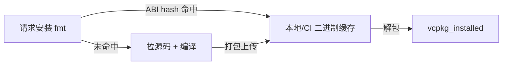

# 缓存与 registries：提速与私有依赖

vcpkg 的哲学是从源码构建（保证与你的编译器/选项天然一致），代价是慢。binary caching 解决这个矛盾：



每个 port 按「源码版本 + triplet + 编译器 + 特性」算出 ABI hash 作缓存键。本机实测对比：glfw3 + glad 首次源码构建 36 秒；第二个项目用同依赖，configure 总耗时 8.8 秒（含 CMake 自身），依赖解包即用。

## 你将学会什么

缓存机制与实测数据、默认缓存位置、CI 集成思路、registries/overlay 的用途边界。

## 本地缓存：默认就开着

默认缓存目录：`%LOCALAPPDATA%\vcpkg\archives`（无需配置）。换项目、删 `build/` 重来都命中——**首次慢是特性不是 bug**，之后整台机器共享。

## CI 集成：GitHub Actions Cache

裸 CI 每次都是冷缓存（源码重编）。标准解法是给 vcpkg 挂共享后端，CI 之间传缓存包：

```yaml
# GitHub Actions 里最常用的环境变量接法
env:
  VCPKG_BINARY_SOURCES: "clear;x-gha,readwrite"
```

`x-gha` 后端直接用 GitHub Actions Cache 存取，社区 action `lukka/run-vcpkg` 封装了完整流程。官方文档：<https://learn.microsoft.com/en-us/vcpkg/users/binarycaching>

## asset caching（一句话）

binary cache 缓存「编译产物」，asset cache 缓存「下载的源码压缩包」——内网/镜像场景加速下载。官方文档：<https://learn.microsoft.com/en-us/vcpkg/users/assetcaching>

## registries：自定义 ports 集合

官方 ports tree 没有的库（或公司私有库），自建 registry（一个 git 仓库，装着 port 配方），manifest 里声明来源：

```json
{
  "registries": [
    {
      "kind": "git",
      "repository": "https://git.internal.example.com/my-ports.git",
      "baseline": "<该仓库的 commit hash>",
      "packages": [ "my-internal-lib" ]
    }
  ]
}
```

官方文档：<https://learn.microsoft.com/en-us/vcpkg/users/registries>。

## overlay 与自制 port（选修）

- **overlay ports**：`--overlay-ports=<目录>` 临时替换/追加个别 port——调试 port 或给官方 port 打补丁的路径
- **自制 port**：`vcpkg new`（生成骨架）+ 写 `portfile.cmake`（拉源码→打补丁→`vcpkg_cmake_configure/build/install`）→ 私有库走 registry，一次性试验走 overlay

自制 port 是进阶主题，主线不需要；等某个库官方没收录且要多项目复用时再回来。

## part-02 结业

vcpkg 三板斧齐了：manifest 声明依赖、triplet 定 ABI、baseline 锁版本。进 [part-03/01 · toolchain 接线](../part-03-integration/01-toolchain-integration.md)把两条线焊起来。
