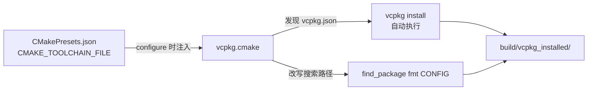

# toolchain 接线：vcpkg × CMake

part-01 的 `find_package` 只能找到「系统里已经装好」的库；part-02 的 vcpkg 把库装进了 `vcpkg_installed/`。中间缺一根线：**告诉 CMake 去那里找**。这根线就是 vcpkg 自带的工具链文件：



## 你将学会什么

三行完成接线、理解自动安装与 DLL 部署的来源、踩到「toolchain 没生效」时知道为什么。

## 接线：preset 里一个变量

示例代码：[code/part-03-01-fmt-vcpkg](../code/part-03-01-fmt-vcpkg/)。`CMakePresets.json` 的 `cacheVariables` 加一项，`CMakeLists.txt` 照常 `find_package`：

```json
"cacheVariables": {
  "CMAKE_TOOLCHAIN_FILE": "C:/dev/vcpkg/scripts/buildsystems/vcpkg.cmake"
}
```

```cmake
find_package(fmt CONFIG REQUIRED)      # 现在能找到了
add_executable(app main.cpp)
target_link_libraries(app PRIVATE fmt::fmt)
```

configure 的输出会多出两行（本机实测）：

```text
-- Running vcpkg install
-- Running vcpkg install - done
```

也就是**声明即安装**：改 `vcpkg.json` 加依赖 → 重新 configure → vcpkg 自动装。显式跑 `vcpkg install` 都省了。

## DLL 自动部署

`x64-windows` 是动态库 triplet，运行期要找到 `fmt.dll`。构建时工具链给每个 exe 挂了 POST_BUILD 步骤自动复制（本机实测日志）：

```text
build\vcpkg_installed\x64-windows\debug\bin\fmtd.dll -> build\fmtd.dll done
```

于是 `build\app.exe` 双击/调试都直接能跑，没有「找不到 dll」环节。

> ⚠️ `CMAKE_TOOLCHAIN_FILE` **必须在第一次 configure 就设置**——它进缓存。第一次没带、后来补上时，CMake 不会重新应用，必须删掉 `build/` 重来。preset 固化就是为了杜绝这种事。

## 换 triplet

preset 的 `cacheVariables` 加 `"VCPKG_TARGET_TRIPLET": "x64-windows-static-md"` 即可（part-02/02）。换了 triplet 同样要删 `build/`。

## 与 FetchContent 的边界（复述 part-01/07）

| 库的状态 | 路径 |
|---|---|
| vcpkg 有 port | `find_package` + toolchain（本课） |
| 没有 port | `FetchContent` 兜底 |

两者可混用，但**同一个库只能走一条**。

## 下一步

[02 · OpenGL 环境（毕业项目）](02-opengl-environment.md)。
