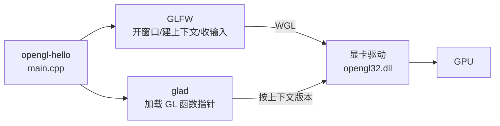

# 毕业项目：OpenGL 环境（GLFW + glad）

现代 OpenGL 在 Windows 上需要三个角色协作：



- **GLFW**：窗口、GL 上下文、键盘鼠标——平台差异（Win32/ Cocoa/ X11）它全包
- **glad**：生成 loader——OpenGL 的函数是运行期从驱动取的指针，不 load 就调用不了 `glGenVertexArrays` 这类现代入口
- 你的代码只面对 `GLFW/glfw3.h` 和 `glad/glad.h` 两个稳定接口

## 你将学会什么

把 part-01/02/03-01 的全部件组装成一个可长期演进的游戏/图形工程骨架。

## 工程总览

示例代码：[code/part-03-02-opengl](../code/part-03-02-opengl/)：

```text
part-03-02-opengl/
├── CMakeLists.txt       # find_package 三方库 + 系统 OpenGL + /utf-8
├── CMakePresets.json    # msvc-debug / msvc-release 双预设（$env{VCPKG_ROOT}）
├── vcpkg.json           # glfw3 + glm + glad(features)，baseline 锁版
├── .vscode/settings.json# CMake Tools 走 presets + clangd
└── main.cpp             # 800×600 窗口画三角形
```

## 依赖声明：vcpkg.json

```json
{
  "name": "opengl-hello",
  "version-string": "0.1.0",
  "builtin-baseline": "91f0baffae4e06a68a961d7f6493e8a1ca6775eb",
  "dependencies": [
    "glfw3",
    "glm",
    { "name": "glad", "features": ["gl-api-43", "loader"] }
  ]
}
```

- `glm`：header-only 数学库（向量、MVP 矩阵），图形学习刚需，先挂上
- `glad` 用对象写法开 features：`gl-api-43` 生成到 GL 4.3 的入口声明（≥ 本工程的 3.3 上下文即可，留升级余量），`loader` 带运行期加载器

port 目标名速查（装一次就忘不了）：glfw3 提供 `glfw`，glm 提供 `glm::glm`，glad 提供 `glad::glad`——去 `build/vcpkg_installed/x64-windows/share/<port>/` 看配置包即可自证。

## 构建声明：CMakeLists.txt

```cmake
cmake_minimum_required(VERSION 3.20)
project(opengl-hello LANGUAGES CXX)

set(CMAKE_CXX_STANDARD 20)
set(CMAKE_CXX_STANDARD_REQUIRED ON)

find_package(OpenGL REQUIRED)        # 系统组件（opengl32）：CMake 内置 FindOpenGL，不经 vcpkg
find_package(glfw3 CONFIG REQUIRED)
find_package(glm CONFIG REQUIRED)
find_package(glad CONFIG REQUIRED)

add_executable(opengl-hello main.cpp)

target_compile_definitions(opengl-hello PRIVATE GLFW_INCLUDE_NONE)
target_link_libraries(opengl-hello PRIVATE glfw glm::glm glad::glad OpenGL::GL)

if(MSVC)
    target_compile_options(opengl-hello PRIVATE /utf-8)
endif()
```

三处新面孔：

- `GLFW_INCLUDE_NONE`：禁止 `glfw3.h` 自己拉起 GL 头——GL 声明由 glad 独家提供，从定义层面杜绝双 GL 头冲突，比记 include 顺序更硬的保险
- `OpenGL::GL`：链接系统 `opengl32`——glad 的加载器仍依赖系统 GL 库的基础入口（wgl 与 1.1 核心）；它由 CMake 内置 `FindOpenGL` 找到，不经 vcpkg，与第三方库是两条并行供给线
- `CMAKE_CXX_STANDARD 20`：图形代码要用 `constexpr` 数学、`std::span` 等，直接定到 20

`/utf-8`：MSVC 默认按系统代码页（中文 Windows 是 GBK）读源文件，含中文注释的 UTF-8 源码会触发 C4819 警告、极端情况下乱码——一律显式声明按 UTF-8 编译（本机实测加前有警告、加后零警告）。

## 预设与 VSCode

`CMakePresets.json` 双预设（debug/release 各一，都带 `$env{VCPKG_ROOT}` 版 `CMAKE_TOOLCHAIN_FILE` 和 `CMAKE_EXPORT_COMPILE_COMMANDS`——`compile_commands.json` 只有 Ninja 这类单配置生成器才产出，clangd 靠它吃饭）。`.vscode/settings.json` 在 02 课三件套上加一行 `"cmake.useCMakePresets": "always"`，显式声明 CMake Tools 全走 presets（`auto` 也能推断，`always` 消除歧义）：

```json
{
  "cmake.useCMakePresets": "always",
  "cmake.configureOnOpen": true,
  "C_Cpp.intelliSenseEngine": "disabled",
  "clangd.arguments": [
    "--background-index",
    "--completion-style=detailed",
    "--header-insertion=iwyu"
  ]
}
```

**从此队友的标准动作只有两条**：clone 后设好 `VCPKG_ROOT`（01 课）、VSCode 打开文件夹选 preset——configure/装依赖/构建/调试全自动。

### 换个形状：Visual Studio 生成器预设

不用 clangd、想要 IDE 式多配置时，可换 VS 生成器——一个 configure preset 覆盖 Debug/Release，`buildPresets` 用 `configuration` 指定：

```json
{
  "name": "windows-msvc",
  "displayName": "Windows x64 (VS2022)",
  "generator": "Visual Studio 17 2022",
  "toolset": "host=x64",
  "architecture": "x64",
  "binaryDir": "${sourceDir}/out/build/${presetName}",
  "cacheVariables": {
    "CMAKE_TOOLCHAIN_FILE": "$env{VCPKG_ROOT}/scripts/buildsystems/vcpkg.cmake",
    "VCPKG_TARGET_TRIPLET": "x64-windows"
  }
}
```

| | Ninja（本系列主线） | Visual Studio 生成器 |
|---|---|---|
| 配置模型 | 单配置：Debug/Release 各一个 preset + 各自 `binaryDir` | 多配置：一个 preset，build 时选 `configuration` |
| `compile_commands.json` | ✓ 产出（clangd 依赖） | ✗ 不产出，IntelliSense 需换 C/C++ 扩展接 CMake |
| cl 从哪来 | 需 VSCode/终端提供 MSVC 环境 | CMake 自己定位 VS 安装 |

> ⚠️ VS 生成器下编译器由 `toolset`（如 `v143`）决定，**不要**再设 `CMAKE_CXX_COMPILER: cl.exe`——对 VS 生成器无效；`buildPresets` 的 `displayName` 只是显示名，别写成与 `configuration` 相反的配置误导队友。

## main.cpp 骨架

```cpp
#include <glad/glad.h>      // 必须在 GLFW 之前（GL 头依赖顺序）
#include <GLFW/glfw3.h>

int main() {
    glfwInit();                                          // ① 初始化 GLFW
    glfwWindowHint(GLFW_CONTEXT_VERSION_MAJOR, 3);       // ② 要求 GL 3.3
    glfwWindowHint(GLFW_CONTEXT_VERSION_MINOR, 3);       //    core profile（无旧管线）
    glfwWindowHint(GLFW_OPENGL_PROFILE, GLFW_OPENGL_CORE_PROFILE);

    GLFWwindow* window = glfwCreateWindow(800, 600, "opengl-hello", nullptr, nullptr);
    glfwMakeContextCurrent(window);

    gladLoadGLLoader((GLADloadproc)glfwGetProcAddress);  // ③ 绑定驱动函数指针

    // ④ VAO/VBO 上传顶点、编译链接 shader（GLSL 330 core）
    // ⑤ 渲染循环：clear → draw → swap → poll
    while (!glfwWindowShouldClose(window)) { /* … */ }
    glfwTerminate();
}
```

完整实现见示例目录（VBO/VAO/shader 约 60 行）。渲染循环结构与前端的游戏循环同构：`requestAnimationFrame` ≈ `glfwPollEvents` + `glfwSwapBuffers` 的组合。

## 运行（本机验证）

```powershell
PS> cmake --preset msvc-debug        # 自动装 glfw3+glm+glad
PS> cmake --build --preset msvc-debug
PS> .\build\opengl-hello.exe
# 800×600 深灰窗口，中央一个亮蓝三角形；glfw3.dll 已自动复制到 build/
```

## 常见坑

> ⚠️ 四个易错点：
> - `gladLoadGLLoader` 必须在 `glfwMakeContextCurrent` **之后**——没有上下文就没有函数可取
> - 远程桌面可能拿不到独立 GPU 的 GL 3.3 上下文（RDP 走软件渲染），在本机桌面跑
> - 头文件顺序：`glad/glad.h` 在 `GLFW/glfw3.h` 前，否则 GL 头重复定义（本工程已用 `GLFW_INCLUDE_NONE` 从根上免疫）
> - 项目根冒出 `vcpkg_installed/`：手动 `vcpkg install` 的残留，构建实际用 `build/vcpkg_installed/`（03-01 课），删掉即可

## 下一步

骨架已立，图形学习正餐开始：`dx:cpp-learning` 的 `graphics-api.md` 方向（渲染管线、缓冲、shader 数学）。后续常见演进：`vcpkg add port imgui` 加调试 UI、`stb` 加纹理加载、把渲染循环改造成任务系统（`dx:cpp-learning/job-system.md`）。
