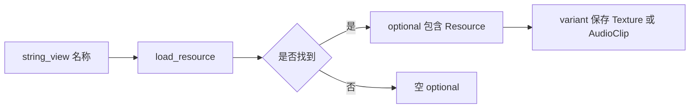

# 第一章（上）：现代语法与 RAII

适用环境：C++17、CMake 3.16 或更高版本；示例已在 Windows + MSVC 19.50 下验证。

你将学会：

- 用 RAII 将资源生命周期绑定到对象生命周期。
- 用 `auto` 和结构化绑定减少冗长代码，同时保留明确的值/引用语义。
- 用 `std::optional` 表达“可能没有结果”，用 `std::variant` 表达“结果是若干确定类型之一”。
- 用 `std::string_view` 编写非拥有字符串接口，并避免悬垂视图。

完整代码位于 [配套示例](../../code/01-modern-syntax-and-raii/main.cpp)。

## 1. RAII：资源生命周期绑定对象生命周期

游戏程序管理的不只是堆内存，还包括文件、GPU 纹理、音频设备和网络连接。RAII（Resource Acquisition Is Initialization，资源获取即初始化）让每份资源都有明确的对象负责：构造建立资源可用性，析构执行清理，异常栈展开也会销毁已完整构造的局部对象。

`std::string`、`std::vector` 和智能指针都是常见 RAII 类型。由这些成员组成的类通常不需要重复编写析构或资源清理逻辑。

本节只保留学习主线所需的入门概念。构造失败、成员销毁顺序、析构 `noexcept`、异常安全和资源包装器设计见独立专题 [C++17 RAII 与异常安全](../../../cpp17-raii/README.md)；下一课会继续讲解移动语义与智能指针。

> ⚠️ RAII 提供确定的资源清理，但不会自动解决循环所有权、悬垂引用或异步任务生命周期问题。

## 2. `auto`：让编译器推导，而不是放弃类型

`auto` 不会把 C++ 变成动态类型语言。变量类型仍在编译期确定，只是由初始化表达式推导。

配套代码用 `auto` 接收查询结果：

```cpp
const auto width = find_setting(settings, "width");
assert(width.has_value() && *width == 1920);

const auto missing_setting = find_setting(settings, "fullscreen");
assert(!missing_setting.has_value());
```

这里 `width` 的实际类型是 `const std::optional<int>`。`const auto` 中的 `const` 仍然重要；去掉 `auto` 前的引用或值类别限定符，也可能改变拷贝行为。

实践原则：

- 初始化表达式已经清楚展示类型时，使用 `auto` 减少重复。
- 类型会影响正确性、单位或所有权时，优先让接口和变量名传达语义。
- 需要修改原对象时显式写 `auto&`；只读引用写 `const auto&`；需要独立副本时写 `auto`。

## 3. 结构化绑定：一次拆开聚合结果

遍历配置表时，传统迭代器需要反复写 `it->first` 和 `it->second`。结构化绑定可以直接命名这两个元素：

```cpp
void print_settings(const std::map<std::string, int>& settings) {
    for (const auto& [name, value] : settings) {
        std::cout << "setting " << name << '=' << value << '\n';
    }
}
```

`const auto&` 让 `name` 和 `value` 绑定到原 map 元素，避免为每次循环复制字符串和值。

结构化绑定先引入一个保存初始化结果的隐藏对象，再把名称绑定到其元素或成员。因此，写 `auto [a, b]` 还是 `auto& [a, b]`，决定的是隐藏对象和绑定结果的值/引用语义，而不只是“少打几个字符”。

它适用于：

- `pair` 和 `tuple`。
- 已知长度的数组。
- 满足条件的公开数据成员聚合类型。

## 4. `std::optional`：结果可以不存在

资源查询失败不一定意味着异常。配置项不存在、资源尚未加载、实体没有某个组件，通常都是正常业务结果。

`std::optional<T>` 要么包含一个 `T`，要么为空；它管理所含值的生命周期，而不是简单保存一个可能为空的指针。

### 4.1 查询配置项

```cpp
std::optional<int> find_setting(
    const std::map<std::string, int>& settings,
    std::string_view key) {
    if (const auto it = settings.find(std::string(key)); it != settings.end()) {
        return it->second;
    }
    return std::nullopt;
}
```

这个接口同时使用了三个 C++17 工具：

- `string_view` 接收非拥有字符串视图。
- `if` 初始化语句把迭代器限制在条件语句作用域内。
- `optional` 把“找到的值”和“未找到”放进同一个返回类型。

调用方可以先检查 `has_value()`，再用 `operator*` 取值。若调用方愿意提供默认值，也可使用 `value_or()`。

> ⚠️ 对空 `optional` 直接使用 `operator*` 是未定义行为。`value()` 会检查并在为空时抛出 `std::bad_optional_access`，但仍应先明确准备采用哪种错误处理策略。

### 4.2 `optional` 不是万能的

- 需要说明失败原因时，应使用包含错误信息的返回类型。
- 需要表示“对象不存在但所有权不变”的观察接口时，指针可能更直接。
- 不要无意义地嵌套 `optional`；每一层空状态都应有不同业务含义。

## 5. `std::variant`：封闭集合中的类型安全选择

游戏资源可能有纹理、音频、字体等固定类别。若当前目标只是保存“这些类型中的一个”，`std::variant` 比手工联合体或基类指针更直接。

配套代码定义了两个拥有自身数据的资源类型：

```cpp
struct AudioClip {
    std::string name;
    int sample_rate;
    std::vector<float> samples;
};

using Resource = std::variant<Texture, AudioClip>;
```

`Resource` 任意正常时刻保存 `Texture` 或 `AudioClip`。它负责当前值的生命周期，并占用足以容纳备选类型的内部存储；这与基类指针所需的动态多态和堆分配是不同方案。

### 5.1 用访问器处理所有备选类型

```cpp
struct DescribeVisitor {
    std::string operator()(const Texture& texture) const {
        return "texture " + texture.name + ": " +
               std::to_string(texture.width) + "x" +
               std::to_string(texture.height) + ", pixels=" +
               std::to_string(texture.pixels.size());
    }

    std::string operator()(const AudioClip& clip) const {
        return "audio " + clip.name + ": sample_rate=" +
               std::to_string(clip.sample_rate) + ", samples=" +
               std::to_string(clip.samples.size());
    }
};
```

然后使用 `std::visit`：

```cpp
std::cout << std::visit(DescribeVisitor{}, *resource) << '\n';
```

访问器为每个备选类型提供处理逻辑。新增备选类型后，编译器能帮助你发现尚未覆盖的访问分支。

已知当前类型时，也可以使用 `std::get<T>`；类型不匹配会抛出 `std::bad_variant_access`。需要探测而不抛出异常时，可使用 `std::get_if<T>`。

## 6. `std::string_view`：只借来看，不取得所有权

`std::string_view` 描述一段连续字符序列，可以把它理解成“字符指针 + 长度”。它通常不拥有字符，也不要求字符序列以空字符结尾。

### 6.1 适合只读输入参数

`load_resource` 只需要在调用期间读取名称：

```cpp
std::optional<Resource> load_resource(std::string_view name) {
    if (name == "player") {
        return Resource{Texture{
            "player", 2, 2, std::vector<std::uint32_t>(4, 0xffffffffu)}};
    }
    if (name == "theme") {
        return Resource{AudioClip{
            "theme", 48000, std::vector<float>(256, 0.0F)}};
    }
    return std::nullopt;
}
```

调用方可以传入 `std::string`、字符串字面量或已有视图，而不必为了接口统一先构造一个拥有所有权的 `std::string`。

```cpp
const std::string requested_name = "player";
const std::string_view requested_view = requested_name;
auto resource = load_resource(requested_view);
assert(resource.has_value());
```

这里视图始终短于 `requested_name` 的生命周期，因此访问有效。

### 6.2 视图不会延长底层字符串的生命周期

配套代码还从已加载资源中取得名称视图：

```cpp
const auto& texture = std::get<Texture>(*resource);
const std::string_view texture_name = texture.name;
assert(texture_name == "player");
```

这段代码安全的前提是 `resource` 仍然存活，且其中的 `texture.name` 没有被修改到使字符存储失效。

使用 `string_view` 时必须回答两个问题：

1. 底层字符由谁拥有？
2. 底层字符是否会比视图活得更久？

> ⚠️ 不要让视图指向已经销毁的局部 `std::string`，也不要默认 `data()` 指向空字符结尾的 C 字符串。需要长期保存名称时，应保存 `std::string`。

## 7. 组合类型：资源加载接口

现在可以把几个工具组合起来：



这张图的核心结论是：每个类型只负责一种语义。

- `string_view`：调用期间只读借用名称。
- `optional`：加载结果可能不存在。
- `variant`：成功结果是已知资源类型之一。
- `string` 和 `vector`：拥有资源内部数据，并通过 RAII 自动释放。

类型组合让调用方不必依赖注释猜测接口行为。

## 8. 常见陷阱清单

- 把 `auto` 当作动态类型，忽略引用和 `const` 导致的语义变化。
- 对空 `optional` 直接解引用。
- 把 `variant` 当作可以保存任意类型的容器；它的备选类型集合在声明时固定。
- 将 `string_view` 保存得比底层字符串更久。
- 认为使用 RAII 后就不再需要设计所有权。
- 为已经由 `vector`、`string` 等成员正确管理资源的类重复编写析构和拷贝操作。

## 9. 练习

在配套代码上完成以下修改，并重新运行测试：

1. 为配置查询增加默认音量：找不到 `volume` 时使用 `value_or()` 返回 `100`。
2. 添加 `Font` 资源类型，并扩展 `Resource`、`load_resource()` 和 `DescribeVisitor`。
3. 为纹理增加只读函数，接收 `string_view` 并判断资源名是否包含某个子串；保证函数不保存视图。
4. 将 `print_settings()` 中的 `const auto&` 改为 `auto`，观察哪些元素会发生复制，再解释为什么原实现更适合遍历 map。
5. 画出一个局部 `Texture` 从构造到析构的资源生命周期图，标出 `string` 和 `vector` 的清理责任。

## 10. 小结

- RAII 用对象生命周期确定资源释放时机。
- `auto` 和结构化绑定减少类型重复，但必须保留值、引用与 `const` 语义。
- `optional` 表达结果可缺失，`variant` 表达封闭类型集合。
- `string_view` 是轻量非拥有视图，安全性依赖底层字符生命周期。
- 下一课将深入移动语义、Rule of Zero/Five、智能指针和资源缓存。

## 参考资料

- [cppreference：结构化绑定](https://en.cppreference.com/cpp/language/structured_binding)
- [cppreference：`std::optional`](https://en.cppreference.com/cpp/utility/optional)
- [cppreference：`std::variant`](https://en.cppreference.com/cpp/utility/variant)
- [cppreference：`std::string_view`](https://en.cppreference.com/cpp/string/basic_string_view)
- [C++ Core Guidelines](https://isocpp.github.io/CppCoreGuidelines/CppCoreGuidelines)
