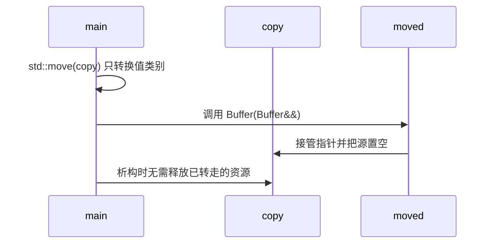
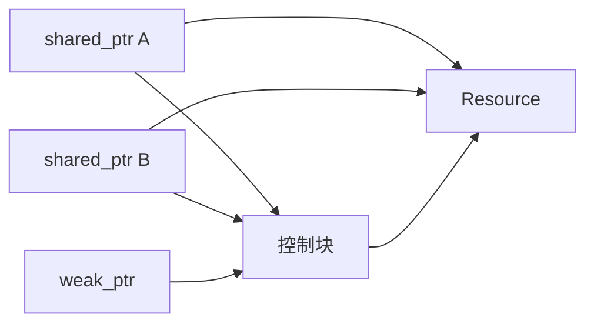

# 第一章（下）：移动语义与智能指针

适用环境：C++17、CMake 3.16 或更高版本；示例已在 Windows + MSVC 19.50 下验证。

你将学会：

- 区分拷贝与移动，理解 `std::move` 和移后对象。
- 用 Rule of Zero/Five 设计特殊成员函数。
- 解释 `unique_ptr`、`shared_ptr`、`weak_ptr` 的所有权和实现成本。
- 设计拥有与非拥有 API，并实现一个弱引用资源缓存。
- 用可重复测量验证性能判断。

完整代码位于 [资源管理示例](../../code/02-move-semantics-and-smart-pointers/main.cpp) 和 [性能测量示例](../../code/02-move-semantics-and-smart-pointers/benchmark.cpp)。

## 1. 值类别：移动为什么能发生

拷贝会复制资源内容；移动通常只转移资源句柄，例如指针和长度。编译器需要知道源对象是否可以被转移，因此表达式具有值类别。

本课只需先掌握三种常用类别：

| 类别 | 直观含义 | 示例表达式 |
|---|---|---|
| lvalue | 有稳定身份、通常可以取地址的对象 | `original` |
| prvalue | 用于初始化对象或计算结果的纯右值 | `Buffer(4)` |
| xvalue | 有身份、但资源可以被转移的将亡值 | `std::move(copy)` |

`Buffer(Buffer&&)` 中的 `other` 是右值引用类型的**名字**。在函数体内，表达式 `other` 是 lvalue；若要继续移动它，需要再次使用 `std::move(other)` 或合适的转换。

### 1.1 `std::move` 本身不移动

`std::move` 的核心作用是转换为右值引用，让重载决议能够选择移动构造或移动赋值。真正转移资源的是这些特殊成员函数。

```cpp
Buffer moved(std::move(copy));
assert(copy.size() == 0);
assert(moved.at(0) == 99);
```

执行顺序是：



### 1.2 移后对象：有效，但通常未指定

除非具体类型作出更强承诺，移后对象只能被假定为“有效但未指定”。可以销毁它，或给它赋一个新值；不要继续依赖旧内容。

本课的 `Buffer` 主动保证移后为空，所以示例可以检查 `copy.size() == 0`。这是 `Buffer` 自己提供的后置条件，不应推广为所有类型的统一规则。

### 1.3 C++17 的保证复制消除

从 prvalue 直接初始化同类型对象时，C++17 保证一类强制复制消除。例如用 `Buffer(4)` 直接初始化 `Buffer` 时，不要求先构造临时对象再调用移动构造。

这与编译器自由选择是否执行的 NRVO（命名返回值优化）不同。复制消除减少的是不必要的临时对象，不等于所有返回值都永远不会移动。

## 2. Rule of Zero 与 Rule of Five

一个直接管理资源的类通常涉及五个特殊成员：

- 析构函数。
- 拷贝构造函数。
- 拷贝赋值运算符。
- 移动构造函数。
- 移动赋值运算符。

**Rule of Zero** 是首选：让 `vector`、`string`、`unique_ptr` 等成员管理资源，自己的类不显式定义这些操作。

**Rule of Five** 用于确实需要直接管理资源的类型：一旦自定义或删除其中一个拷贝、移动或析构操作，就应整体审查五个操作，避免编译器隐式生成不符合资源语义的版本。

为了看清底层机制，本课教学用 `Buffer` 直接管理动态字节数组；生产代码若不需要定制行为，应优先考虑 `std::vector<std::uint8_t>`。

## 3. 实现一个可拷贝、可移动的 `Buffer`

### 3.1 构造与析构

```cpp
class Buffer {
public:
    explicit Buffer(std::size_t size)
        : data_(size == 0 ? nullptr : new std::uint8_t[size]), size_(size) {
        if (size_ != 0) {
            std::fill_n(data_, size_, std::uint8_t{0});
        }
    }

    ~Buffer() {
        delete[] data_;
    }
```

构造函数取得数组资源，析构函数用与 `new[]` 匹配的 `delete[]` 释放。空缓冲区用 `nullptr` 和 `0` 表示，使移动后的对象也能安全析构。

### 3.2 深拷贝

```cpp
Buffer(const Buffer& other)
    : data_(other.size_ == 0 ? nullptr : new std::uint8_t[other.size_]),
      size_(other.size_) {
    if (size_ != 0) {
        std::copy_n(other.data_, size_, data_);
    }
}
```

拷贝构造分配独立数组，因此修改副本不会影响源对象：

```cpp
Buffer copy(original);
copy.at(0) = 99;
assert(original.at(0) == 1);
assert(copy.at(0) == 99);
```

若只复制 `data_` 指针，两个对象最终会重复释放同一数组，这就是资源类不能盲目使用浅拷贝的原因。

### 3.3 拷贝赋值：先准备，再提交

```cpp
Buffer& operator=(const Buffer& other) {
    Buffer copy(other);
    swap(copy);
    return *this;
}
```

这里采用 copy-and-swap：先构造副本，再交换内容。若分配或复制抛出异常，目标对象仍保持原状态；成功后由临时副本销毁旧资源。这也自然覆盖了自拷贝赋值。

### 3.4 移动构造：接管并置空源对象

```cpp
Buffer(Buffer&& other) noexcept
    : data_(std::exchange(other.data_, nullptr)),
      size_(std::exchange(other.size_, 0)) {}
```

`std::exchange` 将源指针换成 `nullptr`，同时返回旧指针给新对象。新对象取得唯一所有权，源对象成为空缓冲区，因此不会发生双重释放。

### 3.5 移动赋值：释放旧资源并处理自赋值

```cpp
Buffer& operator=(Buffer&& other) noexcept {
    if (this != &other) {
        delete[] data_;
        data_ = std::exchange(other.data_, nullptr);
        size_ = std::exchange(other.size_, 0);
    }
    return *this;
}
```

移动赋值不能只转移源资源，还必须释放目标原先拥有的资源。自移动检查保证下面这种操作不会意外清空对象：

```cpp
void self_move(Buffer& value) {
    value = std::move(value);
}

self_move(assigned);
assert(assigned.size() == 4 && assigned.at(0) == 99);
```

`noexcept` 表示这些移动操作不会抛出异常。容器在需要维持强异常保证时，会根据元素移动是否不抛异常以及是否可复制，选择移动或复制已有元素；相关工具是 `std::move_if_noexcept`。因此，真实不抛出的移动操作应正确标记，而不是为了“优化”随意标记。

## 4. 智能指针：把所有权写进类型

智能指针不是“更好的裸指针语法”，而是不同的所有权声明。

| 类型 | 所有权语义 | 典型用途 |
|---|---|---|
| `std::unique_ptr<T>` | 独占所有权，只能移动 | 工厂返回对象、组件独占子对象 |
| `std::shared_ptr<T>` | 多个所有者共享生命周期 | 确实需要共享所有权的对象 |
| `std::weak_ptr<T>` | 不延长生命周期的观察者 | 缓存、打破循环引用 |

### 4.1 `unique_ptr`：所有权转移

```cpp
std::unique_ptr<Resource> load_unique(const std::string& name) {
    return std::make_unique<Resource>(name, 64);
}
```

工厂调用方取得独占所有权。需要把所有权转交给另一个变量时显式移动：

```cpp
auto unique = load_unique("player");
print_resource(*unique);
auto transferred = std::move(unique);
assert(unique == nullptr);
assert(transferred != nullptr);
```

`unique_ptr` 的移动后状态由标准库明确保证为空。它的正常开销接近原始指针加析构管理，但具体成本仍取决于删除器和优化结果。

### 4.2 `shared_ptr`：共享所有权与控制块

多个 `shared_ptr` 可以共同拥有同一个对象。概念上，`shared_ptr` 保存对象指针和控制块指针；控制块维护强引用计数、弱引用状态以及销毁所需信息。



最后一个 `shared_ptr` 释放所有权时对象被销毁；控制块还可能因为 `weak_ptr` 而继续存在。引用计数的线程安全不意味着被管理的 `Resource` 自动线程安全。

`std::make_shared` 通常能把对象和控制块放进一次分配，减少分配次数；但这并不意味着所有场景都优于其他创建方式，尤其要考虑自定义删除器、内存保留时间和超大对象。

### 4.3 `weak_ptr`：观察，但不续命

`weak_ptr` 不增加强引用计数。访问对象前用 `lock()` 取得一个临时 `shared_ptr`；若对象已经销毁，`lock()` 返回空指针。

循环共享所有权会让对象互相延长生命周期。把其中一条不应拥有对方的边改成 `weak_ptr`，就能打破所有权环：


选择弱边的依据不是“随便选一个”，而是明确哪一方不应延长另一方生命周期。

## 5. 所有权 API：参数类型就是契约

C++ Core Guidelines 建议：函数不管理生命周期时，不要无理由接收智能指针。

| 接口形式 | 表达的意图 |
|---|---|
| `const T&` | 必须存在的只读借用 |
| `T&` | 必须存在的可变借用 |
| `T*` | 可空或需要表达指针语义的非拥有访问 |
| `T` | 接收独立值，之后可拷贝或移动 |
| `unique_ptr<T>` 按值 | 接收独占所有权 |
| `shared_ptr<T>` 按值 | 参与共享所有权 |
| `const unique_ptr<T>&` / `const shared_ptr<T>&` | 通常不应作为普通只读访问接口 |

本课的打印函数只需要读取资源，因此接收引用：

```cpp
void print_resource(const Resource& resource) {
    std::cout << "resource " << resource.name << ": bytes="
              << resource.payload.size() << '\n';
}
```

它既能处理栈对象，也能处理由不同智能指针管理的对象，不会意外延长资源生命周期。

> ⚠️ 原始指针和引用可以表达非拥有访问，但不保证目标一定存活。接口只表达“不拥有”，调用方仍须保证借用期间的生命周期。

## 6. 实战：弱引用游戏资源缓存

资源缓存希望复用仍在使用的资源，但不应仅凭缓存自己就让所有资源永久存活。这个关系适合“外部 `shared_ptr` 拥有，缓存保存 `weak_ptr`”。

```cpp
class ResourceCache {
public:
    std::shared_ptr<Resource> acquire(const std::string& name) {
        const auto it = entries_.find(name);
        if (it != entries_.end()) {
            if (auto existing = it->second.lock()) {
                return existing;
            }
            entries_.erase(it);
        }

        auto resource = std::make_shared<Resource>(name, 128);
        entries_.emplace(name, resource);
        return resource;
    }

private:
    std::unordered_map<std::string, std::weak_ptr<Resource>> entries_;
};
```

`acquire()` 的行为是：

1. 找到仍然存活的缓存项时，返回共享所有权。
2. 找到过期项时，先清理再加载。
3. 没有缓存项时，创建资源并保存弱引用。

下面的检查验证了复用和释放：

```cpp
ResourceCache cache;
auto player = cache.acquire("player");
std::weak_ptr<Resource> observer = player;
{
    auto same_player = cache.acquire("player");
    assert(same_player.get() == player.get());
    assert(player.use_count() == 2);
    print_resource(*same_player);
}

assert(player.use_count() == 1);
assert(!observer.expired());
player.reset();
assert(observer.expired());
```

最后一个外部 `shared_ptr` 释放后，即使缓存中的弱引用尚未清理，资源也会销毁。`use_count()` 在这里用于单线程教学断言；并发代码不应把它当作同步或存活判断依据，存活判断应通过 `weak_ptr::lock()` 完成。

## 7. 测量拷贝与移动，而不是背结论

配套基准程序对 16 个 1 MiB 缓冲区分别执行深拷贝和指针转移。运行方式见系列入口；测试目标名为 `ch01_copy_move_benchmark`。

测量遵循这些原则：

- 两种路径必须产生可检查的结果，避免无效测试。
- 预分配目标容器，减少无关的容器扩容干扰。
- 使用 `steady_clock` 测量时间段。
- 多次运行并报告环境，不把单次毫秒数当成通用结论。
- 深拷贝包含分配和逐字节复制；移动只转移指针和长度，因此前者通常更昂贵，但实际差距由分配器、优化和数据规模决定。

游戏开发中的进一步问题是分配发生的时机。即使平均耗时很低，加载阶段的尖峰也可能影响帧预算；需要结合分配跟踪和帧性能分析工具继续测量。

## 8. 常见陷阱清单

- 认为 `std::move` 会自行搬运对象。
- 移动后继续依赖源对象的旧值。
- 自定义析构或拷贝操作，却忘记审查其他特殊成员。
- 移动赋值忘记释放目标旧资源或处理自移动。
- 为了“可能更快”给移动函数错误标记 `noexcept`。
- 把 `shared_ptr` 当作默认指针，引入不必要的计数和共享生命周期。
- 用 `shared_ptr` 构成所有权环。
- 让普通只读函数接收智能指针，从而把算法绑定到某种存储策略。

## 9. 练习与自测

1. 将 `Buffer` 替换为 `std::vector<std::uint8_t>`，删除五个手写特殊成员，比较代码量与行为。
2. 为 `Buffer` 增加拷贝和移动计数器，观察 `vector` 扩容时的操作；不要修改全局计数器的线程安全语义，仅在单线程中实验。
3. 给 `ResourceCache` 增加 `purge_expired()`，一次清理所有过期弱引用。
4. 设计一个只读取资源、一个转移资源、一个共享资源的函数签名，并说明各自理由。
5. 为什么 `weak_ptr::expired()` 为 `false` 不能替代并发场景中的 `lock()`？
6. 为什么“对象已销毁”和“控制块已释放”可能不是同一时刻？

## 10. 小结

- 移动语义通过特殊成员函数转移资源，`std::move` 只负责转换值类别。
- 优先 Rule of Zero；直接管理资源时完整落实 Rule of Five。
- `unique_ptr` 表达独占，`shared_ptr` 表达共享，`weak_ptr` 表达不续命的观察。
- API 参数应准确表达所有权，不要一律使用智能指针。
- 性能判断需要结合实际环境、分配行为和帧预算测量。

## 参考资料

- [Microsoft Learn：移动构造与移动赋值](https://learn.microsoft.com/en-us/cpp/cpp/move-constructors-and-move-assignment-operators-cpp?view=msvc-170)
- [Microsoft Learn：智能指针](https://learn.microsoft.com/en-us/cpp/cpp/smart-pointers-modern-cpp?view=msvc-170)
- [C++ Core Guidelines](https://isocpp.github.io/CppCoreGuidelines/CppCoreGuidelines)
- [cppreference：移动构造函数](https://en.cppreference.com/cpp/language/move_constructor)
- [cppreference：`std::move_if_noexcept`](https://en.cppreference.com/cpp/utility/move_if_noexcept)
- [cppreference：`std::shared_ptr`](https://en.cppreference.com/cpp/memory/shared_ptr)
- [cppreference：`std::make_shared`](https://en.cppreference.com/cpp/memory/shared_ptr/make_shared)
- [cppreference：`std::weak_ptr`](https://en.cppreference.com/cpp/memory/weak_ptr)
- [LearnCpp：循环依赖与 `weak_ptr`](https://www.learncpp.com/cpp-tutorial/circular-dependency-issues-with-stdshared_ptr-and-stdweak_ptr/)
