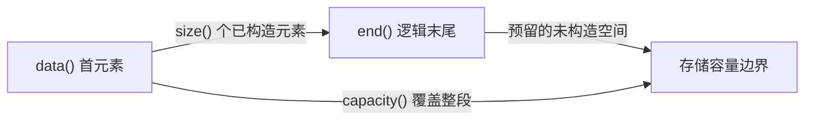
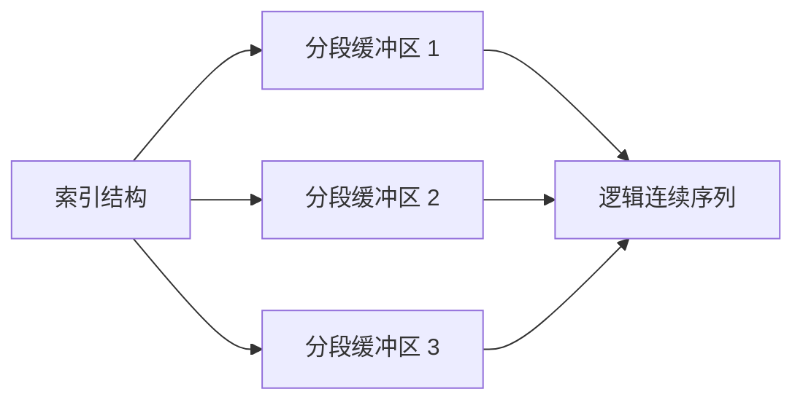

# 第二章（上）：顺序容器与内存行为

适用环境：C++17、CMake 3.16 或更高版本；示例已在 Windows + MSVC 19.50 下验证。

你将学会：

- 按访问模式、修改位置和引用稳定性选择顺序容器。
- 区分 `vector` 的元素数量与已分配容量。
- 解释重分配为何搬移元素，以及 `noexcept` 如何影响复制或移动选择。
- 区分连续存储、分段存储和节点存储的典型成本。
- 正确使用迭代器、指针和引用的失效规则。

完整代码位于 [顺序容器示例](../../code/03-sequence-containers/main.cpp)。

## 1. 先描述访问模式，再选择容器

“哪个容器最快”缺少必要前提。应先回答：

1. 主要操作是顺序遍历、随机访问，还是按位置修改？
2. 插入和删除发生在末尾、两端，还是任意位置？
3. 是否要求元素地址在容器修改后保持稳定？
4. 元素数量是否有编译期固定上限？
5. 热路径是否受帧预算和分配尖峰约束？

| 容器 | 典型存储方式 | 随机访问 | 主要优势 | 主要代价 |
|---|---|---|---|---|
| `array` | 固定大小的内联数组 | O(1) | 无动态分配，大小固定 | 不能改变元素数量 |
| `vector` | 连续动态数组 | O(1) | 连续遍历、缓存友好、末尾操作高效 | 重分配搬移元素，中间插删移动后续元素 |
| `deque` | 常见实现为分段存储 | O(1) | 两端增删，通常不重定位已有元素 | 迭代器与存储管理更复杂，不保证连续 |
| `list` | 双向节点 | O(n) | 任意已知位置稳定插删，支持 `splice` | 每节点额外指针与分配，遍历指针追逐 |
| `forward_list` | 单向节点 | O(n) | 节点开销较小，单向序列 | 只能向前遍历，接口围绕 `after` 位置 |

表中的存储方式是主流实现模型，不是所有实现必须采用的对象布局。标准直接约束的是接口、复杂度和有效性等行为。

C++ Core Guidelines 建议默认优先考虑 `vector`，理由是连续访问、较低每元素开销和缓存友好性。这是默认起点，不是禁止其他容器的规则。

## 2. `array` 与 `vector`：固定大小和动态连续存储

`std::array<T, N>` 把固定数量的元素放在对象自身内部，不会因为追加元素而分配内存：

```cpp
std::array<int, 3> fixed{{1, 2, 3}};
assert(fixed.size() == 3);
```

`std::vector<T>` 管理动态大小的连续元素序列。`data()` 返回首元素指针，因此第 `i` 个元素也可以通过 `data()[i]` 访问：

```cpp
const std::vector<int> values{10, 20, 30};
assert(values.data()[1] == values[1]);
```

连续存储意味着一次顺序遍历沿着连续地址前进。它通常有利于硬件预取和缓存利用，但具体性能仍受元素大小、访问模式和编译优化影响。

> ⚠️ `vector<bool>` 是特化形式，采用位压缩代理接口，不具备普通 `vector<T>` 的全部语义。需要常规布尔对象引用时，不应无意识使用它。

## 3. `size` 与 `capacity`：两个不同概念

`vector` 同时跟踪逻辑元素和已分配存储：

- `size()`：当前已经构造的元素数量。
- `capacity()`：在不重分配的情况下最多能容纳的元素数量。
- `empty()`：判断 `size() == 0`，与容量无关。

可以用下面的概念图理解常见实现；三个指针只是模型，不是标准要求所有实现都采用的对象布局：



`reserve(n)` 至少为 `n` 个元素准备容量，但不构造新元素：

```cpp
std::vector<int> values;
values.reserve(3);
assert(values.size() == 0);
assert(values.capacity() >= 3);
```

与之相比，`resize(n)` 会改变 `size()`，在扩容时构造元素。把两者混淆，可能得到“容量足够但元素尚不存在”的错误索引访问。

`shrink_to_fit()` 是减少容量的**非强制请求**，调用后不能假定 `capacity() == size()`。

## 4. 重分配：为什么不能继续使用旧地址

当追加元素需要超过当前容量时，`vector` 会：

1. 分配更大的存储区。
2. 把已有元素搬移到新存储区。
3. 构造新增元素。
4. 销毁旧元素并释放旧存储区。

配套示例先保留恰好三个元素的容量，再追加第四个元素：

```cpp
std::vector<int> values;
values.reserve(3);
values.insert(values.end(), {10, 20, 30});
while (values.size() < values.capacity()) {
    values.push_back(30);
}

const auto old_capacity = values.capacity();
const int* old_data = values.data();
values.push_back(40);
assert(values.capacity() > old_capacity);
assert(values.data() != old_data);
// old_data 已失效，不能再解引用。
```

保留旧指针但不解引用，是为了演示地址变化；真实代码不应保存并继续使用已经失效的指针。

重分配会使指向元素的所有迭代器、指针和引用失效，也使末尾迭代器失效。增长倍数、旧容量如何变成新容量由实现决定，不应依赖“永远翻倍”或“永远增长 1.5 倍”。

### 4.1 `reserve` 不是越多越好

预先估算元素数量可以避免多次重分配，但过大的预留会占用额外内存。适合的做法是：

- 已知或能合理估计规模时调用 `reserve()`。
- 在加载阶段集中准备存储，减少帧内分配。
- 用剖析和分配记录验证收益，而不是对所有小容器机械预留。

## 5. 扩容时为什么有时复制、有时移动

第一章介绍过 `std::move_if_noexcept`。`vector` 在重分配搬移已有元素时，需要在效率与异常保证之间选择：

- 移动构造不抛出异常时，可以移动已有元素。
- 移动可能抛出、但类型可复制时，可以复制已有元素，以维持强异常保证。
- 类型只能移动且移动可能抛出时，部分操作的异常保证会减弱，应查阅具体接口要求。

配套代码定义了两种计数类型。第一种移动构造标记为可能抛出：

```cpp
CopyPreferred(CopyPreferred&& other) noexcept(false)
    : value(other.value) {
    ++moves;
    other.value = -1;
}
```

第二种移动构造保证不抛出：

```cpp
MovePreferred(MovePreferred&& other) noexcept
    : value(other.value) {
    ++moves;
    other.value = -1;
}
```

测试向容量已满的 `vector` 再插入一个左值。新增左值本身需要复制；重分配已有元素时，第一种类型选择复制，第二种类型选择移动。

这里的设计结论比计数结果更重要：**真实不会抛出的移动构造应标记 `noexcept`，但不要为了促使容器移动而虚假标记。** 如果移动过程实际抛出，`noexcept` 会导致 `std::terminate`，而不是恢复旧容器。

## 6. `deque`：两端修改不等于连续数组

`std::deque` 支持 O(1) 随机访问，并支持均摊 O(1) 的两端插入和删除。常见实现用一组分段缓冲区及索引结构管理元素，因此不需要像 `vector` 那样在扩容时搬移整个序列。



“逻辑连续”指迭代访问顺序连续，不表示所有元素位于一块物理连续内存中。`deque` 没有与 `vector::data()` 等价的连续数组接口。

两端插入有一条容易混淆的规则：**会使迭代器失效，但不会使其他元素的引用失效。** 配套代码保存引用后在两端插入：

```cpp
std::deque<int> values{2, 3};
const int& two = values.front();
const int& three = values.back();

values.push_front(1);
values.push_back(4);
assert(two == 2);
assert(three == 3);
```

引用仍然有效，不表示旧迭代器也有效。中间插入和删除有更广泛的失效影响，必须按具体操作查表。

## 7. `list` 与 `forward_list`：稳定性换来节点成本

`std::list` 通常是双向链表，`std::forward_list` 通常是单向链表。插入不使其他元素的迭代器和引用失效，删除通常只影响被删除元素。

```cpp
std::list<int> values{1, 2, 3};
const auto second = std::next(values.begin());
const int* second_address = &*second;

values.push_front(0);
values.erase(values.begin());
assert(*second == 2);
assert(second_address == &*second);
```

这种稳定性适合“长期保存位置并频繁拼接或删除”的场景。`list::splice()` 还能在常量时间内把元素从一个链表转移到另一个链表，而不复制元素。

代价同样明确：

- 节点通常需要额外指针和独立分配。
- 遍历可能不断追逐分散地址。
- 不支持随机访问；即使知道索引，也不能像 `vector` 那样直接跳转。
- `forward_list` 为节省一个反向指针，只提供单向遍历和 `insert_after()`、`erase_after()` 等接口。

不要因为“中间删除是 O(1)”就默认链表更快。该复杂度通常以已经取得有效位置为前提，查找这个位置本身可能需要 O(n)，而且还没有计入缓存和分配成本。

## 8. 游戏开发中的选择顺序

1. 编译期固定的小数组：优先 `array`。
2. 实体列表、组件数组、命令缓冲：默认从 `vector` 开始。
3. 明确需要两端修改且随机访问：评估 `deque`。
4. 必须长期保持元素位置，并频繁使用节点拼接：评估 `list`。
5. 单向节点序列且关注节点开销：评估 `forward_list`。
6. 对热路径有异议时，用真实元素大小和操作分布进行测量。

“稳定地址”也不一定要靠链表获得。可以使用稳定 ID、句柄表或分代索引，把热点数据继续保存在连续容器中；第二章实战会展示 ID 到连续存储下标的映射。

## 9. 常见陷阱清单

- 把 `capacity()` 当作可访问元素数量。
- 在 `vector` 扩容后继续使用旧迭代器、指针或引用。
- 认为 `reserve()` 会构造元素，或 `resize()` 只改变容量。
- 假定 `shrink_to_fit()` 一定释放到恰好等于 `size()` 的容量。
- 为并不抛异常的移动构造遗漏 `noexcept`，或给可能抛出的移动构造虚假标记。
- 把 `deque` 当成另一块连续动态数组。
- 忽略查找位置的成本，只看到链表删除操作的 O(1)。
- 把某个标准库的内部布局或增长倍数当作跨平台保证。

## 10. 练习

1. 修改配套代码，分别记录 `vector` 多次 `push_back()` 后的 `size()` 和 `capacity()`；只描述本次实现结果，不推导固定增长公式。
2. 给 `CopyPreferred` 的移动构造加上 `noexcept`，预测并验证重分配计数如何变化。
3. 把 `reserve()` 改成 `resize()`，尝试解释为什么随后的下标访问语义发生变化。
4. 在 `deque` 两端插入后重新获取迭代器，分别验证“迭代器失效”和“引用有效”这两条规则。
5. 为 `list` 编写一次 `splice()`，验证元素没有复制且目标位置保持有效。
6. 选择一个游戏数据集合，写出它的遍历、插入、删除和地址稳定性需求，再给出容器选择。

## 11. 小结

- `vector` 的连续存储使其成为默认起点，但重分配会搬移元素并使旧位置全部失效。
- `size()` 是元素数量，`capacity()` 是无需重分配的存储容量。
- `noexcept` 移动构造让容器能够在维持异常保证的同时选择移动。
- `deque` 强调两端操作，`list` 和 `forward_list` 强调位置稳定性；它们都不是无条件替代品。
- 容器选择必须同时考虑算法复杂度、内存布局、访问模式和生命周期。

## 参考资料

- [cppreference：容器库](https://en.cppreference.com/cpp/container)
- [cppreference：`std::vector`](https://en.cppreference.com/cpp/container/vector)
- [cppreference：`std::deque`](https://en.cppreference.com/cpp/container/deque)
- [cppreference：`std::list`](https://en.cppreference.com/cpp/container/list)
- [cppreference：`std::forward_list`](https://en.cppreference.com/cpp/container/forward_list)
- [C++ Core Guidelines：标准库容器](https://isocpp.github.io/CppCoreGuidelines/CppCoreGuidelines.html)
- [C++17 标准草案：`vector` 修改操作](https://timsong-cpp.github.io/cppwp/std17/vector.modifiers)
