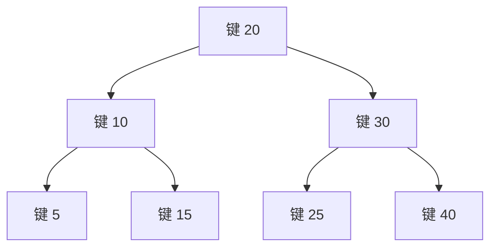
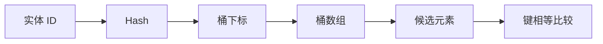

# 第二章（中）：关联容器、哈希与适配器

适用环境：C++17、CMake 3.16 或更高版本；示例已在 Windows + MSVC 19.50 下验证。

你将学会：

- 根据有序性、复杂度和遍历需求选择关联容器。
- 编写满足严格弱序的比较器。
- 解释哈希、桶、负载因子和再哈希。
- 区分再哈希对迭代器与元素引用的不同影响。
- 使用 C++17 的 `try_emplace()`、`insert_or_assign()` 和节点句柄。
- 使用 `stack`、`queue` 和 `priority_queue` 表达受限访问策略。

完整代码位于 [关联容器示例](../../code/04-associative-containers/main.cpp)。

## 1. 关联容器按“键”组织元素

顺序容器主要回答“元素在什么位置”，关联容器主要回答“哪个键对应哪个元素”。

| 容器 | 是否有序 | 唯一键/重复键 | 查找复杂度 | 典型用途 |
|---|---|---|---|---|
| `map` | 按键有序 | 唯一键 | O(log n) | 有序索引、范围遍历 |
| `multimap` | 按键有序 | 允许重复 | O(log n) | 同一键对应多个值 |
| `set` | 按键有序 | 唯一键 | O(log n) | 有序去重集合 |
| `multiset` | 按键有序 | 允许重复 | O(log n) | 有序多重集合 |
| `unordered_map` | 无序 | 唯一键 | 平均 O(1)，最差 O(n) | 高频精确键查询 |
| `unordered_multimap` | 无序 | 允许重复 | 平均 O(1)，最差 O(n) | 无序多值索引 |
| `unordered_set` | 无序 | 唯一键 | 平均 O(1)，最差 O(n) | 快速成员检测 |
| `unordered_multiset` | 无序 | 允许重复 | 平均 O(1)，最差 O(n) | 无序多重集合 |

平均 O(1) 不是“任何输入都恒定时间”，O(log n) 也不自动意味着实际帧率更差。元素规模、分配、哈希成本、缓存和访问模式都会改变结果。

## 2. `map` 与 `set`：比较关系定义顺序

`map` 和 `set` 通常实现为平衡二叉搜索树，常见具体结构是红黑树。每个节点保存值以及树连接信息，因此相比连续容器通常有更多每元素开销和指针追逐。

标准保证按键有序遍历，相关查找、插入和删除为对数复杂度；具体颜色和节点字段属于实现细节。



配套代码用乱序初始化 `map`，再验证遍历顺序：

```cpp
std::map<int, std::string> names{
    {3, "wisp"}, {1, "player"}, {2, "orc"}};

for (const auto& [id, name] : names) {
    // id 按 1、2、3 访问。
}
```

`map` 的元素类型是 `pair<const Key, T>`。键直接参与树结构，不能通过迭代器原地修改；需要换键时，应删除重插，或使用 C++17 节点句柄。

## 3. 比较器必须满足严格弱序

排序和有序关联容器使用的比较器不能只是“看起来能比较大小”。以 `comp(a, b)` 表示“a 是否应排在 b 前面”，它必须满足严格弱序的核心约束：

- 不可自反：`comp(x, x)` 必须为 `false`。
- 反对称：`comp(a, b)` 为 `true` 时，`comp(b, a)` 必须为 `false`。
- 传递性：`a < b` 且 `b < c` 时，应有 `a < c`。
- 不可比较关系也必须具有传递性。

排行榜按分数降序、同分再按 ID 升序：

```cpp
struct ByScore {
    bool operator()(const Player& lhs, const Player& rhs) const {
        if (lhs.score != rhs.score) {
            return lhs.score > rhs.score;
        }
        return lhs.id < rhs.id;
    }
};
```

第二级 ID 比较既保证确定性，也避免把“同分但 ID 不同”的玩家视为同一个键。

> ⚠️ 不要用 `lhs.score >= rhs.score` 或 `lhs.id <= rhs.id` 充当排序比较器。相等元素也会互相“排在前面”，违反容器和算法的前置条件，可能导致错误结果或未定义行为。

## 4. C++17 插入接口：区分“不存在才构造”和“覆盖”

### 4.1 `try_emplace()`：键已存在时不覆盖

```cpp
const auto [position, inserted] = names.try_emplace(2, "replacement");
assert(!inserted && position->second == "orc");
```

返回值包含元素位置和是否插入。与 `operator[]` 不同，`try_emplace()` 不要求映射值可默认构造，也不会在键已存在时覆盖原值。

它适合资源缓存“只加载一次”的语义。对昂贵值，`try_emplace()` 还避免在键已存在时构造映射值；不要把所有参数事先构造成昂贵临时对象，又误以为该接口能撤销这次构造。

### 4.2 `insert_or_assign()`：存在则更新

```cpp
names.insert_or_assign(2, "elite orc");
assert(names.at(2) == "elite orc");
```

它明确表达“没有就插入，有就赋值”，适合更新配置和实体状态。与 `try_emplace()` 的名字一起阅读，调用方无需猜测覆盖行为。

## 5. 节点句柄：换键和转移节点而不复制值

C++17 的 `extract()` 把关联容器中的一个节点取出为节点句柄。节点句柄拥有该节点，可以修改键，再插入兼容的容器：

```cpp
auto node = names.extract(1);
assert(node && names.find(1) == names.end());
node.key() = 10;

std::map<int, std::string> archive;
archive.insert(std::move(node));
assert(node.empty());
assert(archive.at(10) == "player");
```

这条路径不需要复制或移动映射值本身，适合映射值较大、不可复制或构造代价高的场景。插入前必须确保目标容器不会与该键冲突；具体返回值和失败状态按所用重载处理。

## 6. `unordered_map`：哈希把键映射到桶

无序关联容器先计算键的哈希，再通过桶定位候选元素。常见实现使用桶数组和冲突节点：



一次查询通常经历：

1. 计算哈希值。
2. 找到对应桶。
3. 在候选项中按键相等关系确认目标。

“哈希相等”不代表“键相等”。不同键可能碰撞，因此哈希之后仍需相等比较。

### 6.1 哈希与键相等必须一致

如果 `equal(a, b)` 为 `true`，则 `hash(a)` 与 `hash(b)` 必须相同。违反这条一致性会让等价键落入不同查找路径，导致已有元素无法找到。

键放入容器后，不应以会改变哈希或相等比较结果的方式修改它。自定义字符串包装、浮点键和包含缓存字段的键尤其需要明确哪些字段参与身份判断。

## 7. 负载因子与再哈希

`load_factor()` 是平均每个桶的元素数，`max_load_factor()` 是容器允许的平均负载上限。插入导致负载超过限制时，实现通常会再哈希：调整桶数量并重新分配元素到桶。

配套代码主动触发再哈希：

```cpp
const std::string* entity_two = &entities.at(2);
const auto old_bucket_count = entities.bucket_count();
entities.rehash(old_bucket_count * 4 + 1);

assert(entities.bucket_count() > old_bucket_count);
assert(entity_two == &entities.at(2));
```

规则要分开记：

- **再哈希使迭代器失效。**
- **再哈希不使元素指针或引用失效。**
- 指向桶的局部迭代器另有规则，不应与元素迭代器混用。

`reserve(n)` 为至少 `n` 个元素预留桶空间，可在已知规模时减少插入过程中的再哈希。它改变的是桶准备，不会像 `vector::reserve()` 那样直接管理连续元素容量。

### 7.1 平均 O(1) 的前提

平均常数复杂度依赖合适的哈希分布和受控负载。大量碰撞会使查询退化为更多候选比较，标准给出的最差复杂度可达 O(n)。

因此需要：

- 为自定义键提供质量足够且与相等关系一致的哈希。
- 在已知规模时合理预留，减少重复再哈希。
- 对不可信输入考虑碰撞攻击风险。
- 不把“无序容器总是最快”当作选型依据。

## 8. 重复键：用 `equal_range()` 访问等价区间

`multimap` 和 `multiset` 允许同一个键对应多个元素。等价键在有序容器中形成连续范围：

```cpp
std::multimap<int, std::string> spawns{
    {1, "north"}, {2, "south"}, {1, "cave"}};
const auto [first, last] = spawns.equal_range(1);
assert(std::distance(first, last) == 2);
```

`equal_range()` 同时给出起点和末尾，比分别查找上下界更直接。无序多键容器也能取得等价范围，但遍历顺序不应解释为排序结果。

## 9. 容器适配器：限制接口就是表达规则

`stack`、`queue` 和 `priority_queue` 不引入新的通用容器概念，而是在底层容器上提供受限接口。

| 适配器 | 默认底层容器 | 访问规则 | 游戏场景示例 |
|---|---|---|---|
| `stack` | `deque` | 只访问栈顶，后进先出 | 撤销操作、状态回退 |
| `queue` | `deque` | 队首取出、队尾加入 | 命令队列、消息分发 |
| `priority_queue` | `vector` | 只访问优先级最高元素 | 事件调度、寻路候选 |

```cpp
std::priority_queue<int> max_heap;
max_heap.push(3);
max_heap.push(9);
assert(max_heap.top() == 9);

std::priority_queue<int, std::vector<int>, std::greater<int>> min_heap;
min_heap.push(3);
min_heap.push(9);
assert(min_heap.top() == 3);
```

适配器的价值是让非法访问无法通过公开接口表达。若业务需要任意遍历、删除中间元素或稳定迭代器，就应重新评估是否该使用适配器。

## 10. 常见陷阱清单

- 需要有序遍历时选择 `unordered_map`，再对输出顺序作错误假设。
- 用 `<=` 或 `>=` 编写排序比较器。
- 通过其他结构修改已作为键使用的字段，破坏比较或哈希一致性。
- 把平均 O(1) 误解为最差 O(1)。
- 再哈希后继续使用旧迭代器。
- 混淆“元素引用有效”和“迭代器有效”。
- 使用 `operator[]` 查询时意外插入默认值；只读查询应优先考虑 `find()` 或 `at()`。
- 忽略字符串哈希、相等比较和节点分配本身的成本。

## 11. 练习

1. 给排行榜增加第三级排序键，并验证严格弱序。
2. 分别用 `operator[]`、`try_emplace()` 和 `insert_or_assign()` 更新同一键，记录语义差异。
3. 为自定义实体 ID 编写哈希与相等函数，并写测试验证等价键的哈希一致。
4. 逐步提高 `unordered_map` 的元素数量，记录 `bucket_count()` 和 `load_factor()`；不要假定固定桶增长公式。
5. 使用节点句柄在两个 `map` 之间转移一个不可复制映射值。
6. 用 `priority_queue` 实现按触发时间处理的游戏事件队列，并定义同时间事件的确定性顺序。

## 12. 小结

- 有序关联容器提供对数复杂度和有序遍历，无序关联容器提供平均常数查询但不提供排序。
- 比较器的严格弱序、哈希与键相等的一致性都是正确性前提。
- C++17 插入接口能精确表达不覆盖、覆盖和节点转移。
- 再哈希使迭代器失效，但不使元素指针或引用失效。
- 容器适配器通过限制接口表达栈、队列和优先级规则。

## 参考资料

- [cppreference：`std::map`](https://en.cppreference.com/cpp/container/map)
- [cppreference：`std::set`](https://en.cppreference.com/cpp/container/set)
- [cppreference：`std::unordered_map`](https://en.cppreference.com/cpp/container/unordered_map)
- [cppreference：`try_emplace`](https://en.cppreference.com/cpp/container/unordered_map/try_emplace)
- [cppreference：`insert_or_assign`](https://en.cppreference.com/cpp/container/unordered_map/insert_or_assign)
- [cppreference：节点句柄与 `extract`](https://en.cppreference.com/cpp/container/unordered_map/extract)
- [cppreference：容器适配器](https://en.cppreference.com/cpp/container)
- [C++17 标准草案：无序关联容器要求](https://timsong-cpp.github.io/cppwp/std17/unord.req)
