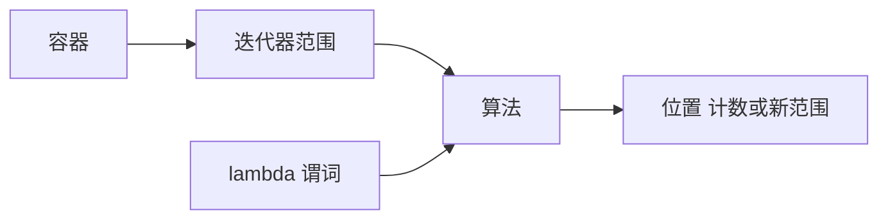

# 第二章（下）：迭代器、算法与 lambda

适用环境：C++17、CMake 3.16 或更高版本；示例已在 Windows + MSVC 19.50 下验证。

你将学会：

- 根据迭代器类别判断算法能否使用。
- 用 `find_if`、`sort`、`transform` 和 `accumulate` 表达实体处理。
- 正确选择 lambda 捕获方式和初始值类型。
- 使用 remove-erase 删除连续容器中的元素。
- 系统区分迭代器、指针和引用的失效规则。
- 安全使用非拥有的 `string_view`。

完整代码位于 [迭代器与算法示例](../../code/05-iterators-algorithms/main.cpp)。

## 1. 迭代器连接容器与算法

STL 算法通常不直接接收容器，而是接收由迭代器表示的半开范围 `[first, last)`：

- `first` 指向第一个参与运算的元素。
- `last` 指向末尾之后的位置，不参与运算。
- 空范围用 `first == last` 表示，不需要特殊指针值。

这种设计让同一个 `find_if()` 可以处理 `vector`、`list` 或其他满足要求的序列，也让算法无需了解元素的具体存储方式。



算法只获得迭代器和操作对象，因此调用者必须保证范围有效，并满足算法要求的前置条件。

## 2. 迭代器类别决定算法能力

C++17 常见迭代器类别形成能力层级：

| 类别 | 主要能力 | 示例 |
|---|---|---|
| 输入迭代器 | 单次遍历、读取 | `istream_iterator` |
| 输出迭代器 | 单次遍历、写入 | `back_inserter` 产生的迭代器 |
| 前向迭代器 | 多次遍历、可保存位置 | `forward_list::iterator` |
| 双向迭代器 | 前向能力加反向移动 | `list::iterator`、`map::iterator` |
| 随机访问迭代器 | 常数时间跳跃、距离和下标 | `vector::iterator`、`deque::iterator` |

配套代码用 `iterator_traits` 和 `static_assert` 在编译期检查类别：

```cpp
static_assert(std::is_same_v<
    std::iterator_traits<std::vector<int>::iterator>::iterator_category,
    std::random_access_iterator_tag>);
```

这能解释一些编译错误：

- `std::sort()` 需要随机访问迭代器，因此不能直接排序 `std::list`；应使用 `list::sort()`。
- `std::lower_bound()` 在随机访问范围上具有对数复杂度，在只支持前向迭代的范围上仍有线性数量的迭代器步进。
- `std::prev()` 需要双向迭代器，不能用于 `forward_list::iterator`。
- 输入流迭代器适合单次消费，不应假定保存副本后能独立重读同一序列。

算法“能编译”还不够，还必须满足有效范围、排序状态、输出空间等语义前提。

## 3. `find_if` 与 `count_if`：把条件交给 lambda

查找第一个死亡实体：

```cpp
const auto dead = std::find_if(entities.begin(), entities.end(),
    [](const Entity& entity) { return entity.health <= 0; });
if (dead != entities.end()) {
    // 使用 *dead。
}
```

返回迭代器可能是 `end()`，解引用前必须检查。统计受伤但存活的实体：

```cpp
const int damage_threshold = 30;
const auto wounded = std::count_if(entities.begin(), entities.end(),
    [damage_threshold](const Entity& entity) {
        return entity.health > 0 && entity.health < damage_threshold;
    });
```

`[damage_threshold]` 按值捕获阈值，后续修改原变量不会影响这次捕获。

### 3.1 lambda 捕获是生命周期决策

- `[]`：不捕获局部变量。
- `[x]`：按值捕获，拥有独立副本。
- `[&x]`：按引用捕获，调用时必须保证 `x` 仍存活。
- `[=]`：默认按值捕获使用到的局部变量。
- `[&]`：默认按引用捕获使用到的局部变量。
- `[this]`：捕获当前对象指针，不复制整个对象，也不延长对象生命周期。

局部同步算法中，默认引用捕获可能简洁；异步任务、回调或延迟执行中，它容易造成悬垂引用。捕获智能指针也不等于捕获裸指针：前者可能参与所有权，后者只保存地址。

## 4. `sort`：比较器同时决定顺序与有效性

下面的比较器按生命值降序，同值再按 ID 升序：

```cpp
std::sort(entities.begin(), entities.end(),
    [](const Entity& lhs, const Entity& rhs) {
        if (lhs.health != rhs.health) {
            return lhs.health > rhs.health;
        }
        return lhs.id < rhs.id;
    });
```

`sort()` 不保证等价元素的原始相对顺序。需要保持该顺序时使用 `stable_sort()`，但要接受不同的复杂度与内存取舍。

比较器仍须满足上一课的严格弱序。对 `float` 排序还要处理 NaN 等无法形成正常全序的值，不能假设任意浮点输入都天然满足算法要求。

## 5. `transform`：输入范围映射到输出范围

提取实体名称：

```cpp
std::vector<std::string> names(entities.size());
std::transform(entities.begin(), entities.end(), names.begin(),
    [](const Entity& entity) -> const std::string& { return entity.name; });
```

这里先构造与输入等大的输出容器，再把结果写入 `names.begin()`。lambda 显式返回 const 引用，避免 `auto` 返回类型推导掉引用而多产生一次中间复制；最终仍由 `std::string` 的输出元素拥有名称副本。

如果希望逐步追加，可以使用输出迭代器：

```cpp
std::vector<int> doubled;
doubled.reserve(source.size());
std::transform(source.begin(), source.end(), std::back_inserter(doubled),
    [](int value) { return value * 2; });
```

`back_inserter` 通过 `push_back()` 写入，因此输出容器不必提前 `resize()`；`reserve()` 只是减少重分配。

> ⚠️ 使用普通输出迭代器时，调用方必须保证输出空间足够。`transform()` 不会替普通指针或已构造元素的迭代器自动扩展容器。

## 6. `accumulate`：初值不仅提供起点，也决定结果类型

统计总生命值：

```cpp
const auto total_health = std::accumulate(
    entities.begin(), entities.end(), 0,
    [](int total, const Entity& entity) { return total + entity.health; });
```

初值 `0` 使结果类型为 `int`。若计算小数总和却传入整数初值，中间计算可能按整数进行；需要浮点结果时应写 `0.0` 或明确的目标类型。

`accumulate()` 按顺序折叠，适合表达总和、连接或自定义累积。需要并行执行时，下一课的 `reduce()` 对操作可结合性和可交换性有额外要求。

## 7. remove-erase：算法移动元素，容器改变大小

`std::remove_if()` 的名字容易误导。它不会调用容器的 `erase()`，也不会改变 `size()`；它把需要保留的元素移向范围前部，并返回新的逻辑末尾。

```cpp
const auto old_size = entities.size();
const auto new_end = std::remove_if(entities.begin(), entities.end(),
    [](const Entity& entity) { return entity.health <= 0; });
assert(entities.size() == old_size);

entities.erase(new_end, entities.end());
assert(entities.size() == old_size - 1);
```

逻辑过程如下：


删除 `[new_end, end())` 之后，旧尾部位置不能继续当作有效元素使用。

对 `list` 和 `forward_list`，优先使用各自的 `remove()`、`remove_if()` 成员函数。它们能直接调整节点关系，不必套用面向连续序列的 remove-erase 写法。

## 8. 失效规则：三种“位置”不能混为一谈

迭代器、指针和引用都用于访问元素，但容器修改后的规则并不相同。下表是常用操作的速查，不替代具体接口的完整条款：

| 容器与操作 | 迭代器 | 元素指针与引用 |
|---|---|---|
| `vector` 重分配 | 全部失效，包括末尾迭代器 | 全部失效 |
| `vector` 插入但未重分配 | 插入点及之后失效 | 插入点及之后失效 |
| `vector` 删除 | 删除点及之后失效 | 删除点及之后失效 |
| `deque` 两端插入 | 全部失效 | 未插入元素保持有效 |
| `deque` 中间插入 | 全部失效 | 全部失效 |
| `list` 插入 | 保持有效 | 保持有效 |
| `list` 删除 | 仅被删除元素失效 | 仅被删除元素失效 |
| `forward_list` 插入/删除 | 插入不失效；删除仅影响被删除元素 | 同左 |
| `map`/`set` 插入 | 保持有效 | 保持有效 |
| `map`/`set` 删除 | 仅被删除元素失效 | 仅被删除元素失效 |
| `unordered_map` 插入但未再哈希 | 保持有效 | 保持有效 |
| `unordered_map` 再哈希 | 元素迭代器失效 | 保持有效 |
| `unordered_map` 删除 | 仅被删除元素失效 | 仅被删除元素失效 |

`deque` 删除和末尾迭代器还有更具体的规则，`reserve()`、`swap()` 等操作也不能从表中的其他操作类推。编写长期持有位置的代码前，应回查 [cppreference 的容器失效规则](https://en.cppreference.com/cpp/container)。

> ⚠️ 不要通过“测试没崩溃”判断旧迭代器有效。失效后的使用可能恰好还能输出旧值，也仍然是错误代码。

## 9. 优先使用容器自己的高效操作

通用算法不是唯一选择：

- 对 `map` 按键查询，使用 `map::find()`，而不是对整棵树线性调用 `std::find()`。
- 对 `list` 排序，使用 `list::sort()`。
- 对 `list` 删除指定值，使用 `list::remove()`。
- 对有序 `vector` 精确键查询，使用 `lower_bound()`，而不是线性 `find()`。
- 对无序、未索引的 `vector`，`find_if()` 才是合理的线性扫描。

泛型算法强调复用，成员函数利用容器内部结构。二者冲突时，应先比较语义和复杂度，而不是机械遵守“所有循环都改算法”。

## 10. `string_view`：算法输入可以只是视图

`std::string_view` 表示非拥有的连续字符序列，适合只读参数：

```cpp
bool contains(std::string_view text, std::string_view fragment) {
    return text.find(fragment) != std::string_view::npos;
}
```

调用方可以传入 `std::string`、字面量或已有视图，无需为了匹配参数类型复制字符串：

```cpp
std::string owner = "player:fire";
const std::string_view view = owner;
assert(contains(view, "fire"));
assert(view.substr(0, 6) == "player");
```

`substr()` 返回新视图，仍不拥有字符。需要独立、长期保存的文本时，显式构造 `std::string`：

```cpp
const std::string copied{view};
```

安全性取决于底层字符：

1. 谁拥有底层字符？
2. 字符是否会比视图活得更久？
3. 修改拥有者是否会使字符存储失效？

> ⚠️ 不要返回指向局部 `std::string` 的视图，也不要把 `data()` 默认当成以空字符结尾的 C 字符串。视图可能只是一段子串。

## 11. C++17 的边界与 C++20 展望

C++17 算法主要通过迭代器对组合，尚不能普遍使用 C++20 ranges 的容器直接调用、管道视图和投影语法。本章保持 C++17 写法，不用 ranges 替代当前示例。

学习时应抓住稳定部分：半开范围、迭代器能力、算法前置条件、操作对象和生命周期。未来切换到 ranges，这些契约仍然重要。

## 12. 常见陷阱清单

- 解引用 `find_if()` 返回的 `end()`。
- 对 `list` 调用需要随机访问迭代器的 `std::sort()`。
- 在异步 lambda 中无意识地按引用捕获局部变量。
- `accumulate()` 的初值类型与期望结果类型不一致。
- 调用 `remove_if()` 后忘记 `erase()`。
- 向未预留足够空间的普通输出迭代器写入。
- 容器修改后继续使用失效迭代器，并把“没崩溃”当作有效证明。
- 保存 `string_view`，却没有保存其底层字符的生命周期。

## 13. 练习

1. 编写一个只依赖前向迭代器的通用 `count_if` 版本，并分别用 `forward_list` 和 `vector` 测试。
2. 把实体排序改成稳定排序，构造等价键并观察两种算法的顺序差异。
3. 将名称输出容器从预 `resize()` 改为 `back_inserter()`，解释两种输出方式。
4. 把 `accumulate()` 的初值改为错误类型，观察结果或编译诊断，再修正。
5. 给 `vector` 编写删除循环，确保每次删除后重新取得有效位置，不跳过后续元素。
6. 编写一个返回 `string_view` 的接口，用注释和测试明确其调用方生命周期要求。

## 14. 小结

- 迭代器类别决定算法可用能力和部分复杂度。
- lambda 让算法适配业务条件，但捕获方式同时决定复制和生命周期。
- `remove_if()` 只重排并返回新末尾，必须由容器 `erase()` 完成实际删除。
- 迭代器、指针和引用的失效规则必须分别判断。
- `string_view` 减少只读字符串参数的复制，但不提供所有权。

## 参考资料

- [cppreference：迭代器库](https://en.cppreference.com/cpp/iterator)
- [cppreference：算法库](https://en.cppreference.com/cpp/algorithm)
- [cppreference：`std::sort`](https://en.cppreference.com/cpp/algorithm/sort)
- [cppreference：`std::transform`](https://en.cppreference.com/cpp/algorithm/transform)
- [cppreference：`std::accumulate`](https://en.cppreference.com/cpp/algorithm/accumulate)
- [cppreference：`std::remove`](https://en.cppreference.com/cpp/algorithm/remove)
- [cppreference：容器失效规则](https://en.cppreference.com/cpp/container)
- [cppreference：`std::string_view`](https://en.cppreference.com/cpp/string/basic_string_view)
