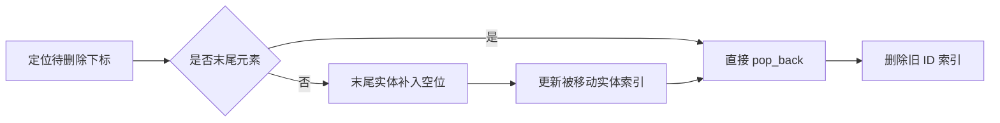
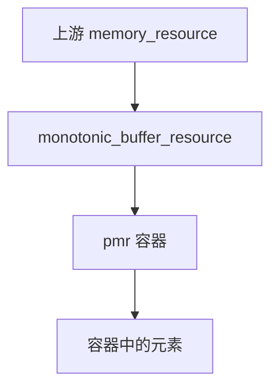

# 第二章（实战）：游戏实体存储与性能测量

适用环境：C++17、CMake 3.16 或更高版本；示例已在 Windows + MSVC 19.50 下验证。性能数字只代表运行时的软硬件、编译配置和数据分布。

你将学会：

- 用 `vector` 保存连续实体，用 `unordered_map` 建立 ID 到下标的索引。
- 实现交换删除，并同步维护被移动实体的索引。
- 比较有序向量二分查询与哈希索引的适用条件。
- 设计可检查、可重复的微基准测试。
- 用 `pmr::monotonic_buffer_resource` 集中管理临时分配。
- 检测并使用 C++17 并行算法，同时理解其正确性前提。

完整代码位于 [实体存储](../../code/06-game-entity-storage/main.cpp)、[性能测量](../../code/06-game-entity-storage/benchmark.cpp)、[`pmr`](../../code/06-game-entity-storage/pmr.cpp) 和 [并行算法](../../code/06-game-entity-storage/parallel.cpp)。

## 1. 从访问模式推导存储结构

假设实体系统有以下需求：

- 每帧顺序遍历所有实体。
- 通过稳定实体 ID 查询对象。
- 创建和删除实体。
- 删除后不要求保持原有遍历顺序。

一种直接组合是：

- `vector<Entity>`：拥有实体，提供连续遍历。
- `unordered_map<EntityId, size_t>`：保存 ID 到 `vector` 下标的映射。


这个结构并不让 ID 本身失效。失效的是实体下标：交换删除或中间插入会改变某些实体的位置，因此索引必须由存储类统一维护，外部不能长期保存下标。

返回 `Entity*` 的查询接口只表达短生命周期借用。调用方在下一次可能修改存储的操作后，必须重新检查指针是否有效；需要长期身份时保存 ID，而不是指针。

## 2. 创建实体：让两份存储保持一致

配套 `EntityStore::add()` 先检查重复 ID，再追加实体，最后建立索引：

```cpp
bool add(Entity entity) {
    const auto id = entity.id;
    if (positions_.find(id) != positions_.end()) {
        return false;
    }

    entities_.push_back(std::move(entity));
    const auto index = entities_.size() - 1;
    try {
        const auto result = positions_.emplace(id, index);
        assert(result.second);
    } catch (...) {
        entities_.pop_back();
        throw;
    }
    return true;
}
```

如果索引分配抛出异常，回滚刚刚追加的实体，再向调用方传递异常。这样不会让 `vector` 多出一个索引中不存在的实体。

这段代码只处理单线程存储。并发创建和查询需要额外的同步与生命周期设计，不能只在 `unordered_map` 外加一把锁就默认完成整个协议。

## 3. 交换删除：用顺序换删除成本

若允许改变实体顺序，可以把末尾元素移到被删除位置，再弹出末尾：

```cpp
const auto index = position->second;
const auto last_index = entities_.size() - 1;
if (index != last_index) {
    const auto moved_id = entities_.back().id;
    entities_[index] = entities_.back();
    positions_.find(moved_id)->second = index;
}

entities_.pop_back();
positions_.erase(position);
```

关键步骤是更新 `moved_id` 对应的下标。遗漏这一步后，实体本身仍然正确，但下一次按 ID 查询会访问旧位置。

删除前后关系如下：



对元素析构不抛异常的本例，`pop_back()` 和索引更新可以维持一致状态。交换删除通常适合不要求稳定顺序的实体集合；若渲染层、网络协议或回放系统依赖顺序，就不能随意采用。

### 3.1 批量删除死亡实体

遍历中调用交换删除后，空位已经补入一个尚未检查的新元素，因此不能无条件递增下标：

```cpp
std::size_t index = 0;
while (index < entities_.size()) {
    if (entities_[index].health <= 0) {
        erase(entities_[index].id);
    } else {
        ++index;
    }
}
```

只有保留当前元素时才前进。若删除后前进，就可能跳过被交换到当前位置的实体。

## 4. 有序 `vector`：二分查询与连续存储的折中

另一种方案是让实体向量始终按 ID 有序，再用 `lower_bound()` 查询：

```cpp
const auto found = std::lower_bound(sorted.begin(), sorted.end(), EntityId{2},
    [](const Entity& entity, EntityId id) { return entity.id < id; });
if (found != sorted.end() && found->id == 2) {
    // 找到实体。
}
```

| 方案 | 精确查询 | 插入/删除 | 遍历与顺序 | 额外索引 |
|---|---|---|---|---|
| 有序 `vector` | O(log n) | 中间移动元素，O(n) | 连续且有序 | 不需要 |
| `vector + unordered_map` | 平均 O(1) | 末尾追加高效；交换删除平均 O(1) | 连续，交换删除改变顺序 | 需要额外哈希表 |
| `map` 独立存储 | O(log n) | O(log n) | 有序，常见节点遍历 | 树节点自身 |
| 线性扫描 `vector` | O(n) | 末尾追加高效 | 连续，无需排序 | 不需要 |

选择规则：

- 数据量小或查询很少：线性扫描可能最简单，也足够快。
- 需要有序遍历且修改不频繁：有序 `vector` 值得评估。
- 高频 ID 查询且接受额外索引：哈希索引值得评估。
- 同时要求有序、节点位置稳定和频繁关联修改：有序关联容器更直接。

“连续”只描述主实体数组。`vector + unordered_map` 仍有哈希表的额外存储与指针追逐，不应把它描述成完全没有节点开销。

## 5. 微基准：测量具体工作负载，而不是容器名声

配套基准固定生成 20,000 个实体和 50,000 个查询，比较：

- `vector` 顺序遍历与 `list` 顺序遍历。
- 有序 `vector` 二分查询与 `unordered_map` 精确键查询。

它遵循以下原则：

1. 两种实现处理同一批数据。
2. 累加并打印校验值，让计算结果可观察。
3. 使用 `steady_clock` 测量单调时间段。
4. 对哈希表提前 `reserve()`，避免把构建过程混入查询计时。
5. 不断言某个容器必须更快，只输出当前结果。
6. 使用固定随机种子，便于重复运行相同查询序列。

在仓库根目录构建 Release 版本：

```bash
cmake -S tutorials/cpp17-game-dev/code -B .tmp/cpp17-game-dev-release

cmake --build .tmp/cpp17-game-dev-release --config Release
```

直接运行基准可观察计时输出（Visual Studio 多配置生成器的可执行文件位于目标的 `Release` 子目录，路径随生成器不同而不同）：

```bash
.tmp/cpp17-game-dev-release/06-game-entity-storage/Release/ch02_stl_benchmark.exe
```

也可以从构建目录执行测试：

```bash
ctest --test-dir .tmp/cpp17-game-dev-release -C Release -R ch02_stl_benchmark --output-on-failure
```

CTest 默认隐藏通过测试的输出；需要直接观察计时时，可添加 `--verbose`，或运行构建目录中的 `ch02_stl_benchmark` 可执行文件。性能比较应使用 Release 等优化构建，并重复多轮；调试构建主要验证正确性。

> ⚠️ 微基准不能替代完整游戏剖析。实体大小、缓存状态、分支、内存分配、查询命中率和编译器优化都会改变结果，最终应以真实场景和帧时间分布为准。

## 6. `pmr`：把分配策略从元素类型中分离

C++17 的多态内存资源（Polymorphic Memory Resource，PMR）允许容器在运行时选择内存资源。`std::pmr::vector<T>` 是使用多态分配器的容器别名：

```cpp
std::pmr::vector<int> frame_values(&arena);
```

它与默认分配器的 `std::vector<int>` 是不同类型。函数若需要同时接收两者，可考虑模板、非拥有视图或明确接口边界，不能直接假定类型相同。

### 6.1 单调资源：单独释放不是目标

`monotonic_buffer_resource` 从缓冲区或上游资源取得内存，分配持续推进；对单次 `deallocate()` 通常不回收已用空间，而在 `release()` 或资源销毁时集中释放上游块。

配套示例用很小的本地缓冲区迫使资源向上游申请，并记录上游分配与释放次数：

```cpp
CountingResource upstream;
{
    alignas(std::max_align_t) std::array<std::byte, 64> local_buffer{};
    std::pmr::monotonic_buffer_resource arena(
        local_buffer.data(), local_buffer.size(), &upstream);
    {
        std::pmr::vector<int> frame_values(&arena);
        // 添加本帧临时数据。
    }
    assert(upstream.deallocations() == 0);
}
assert(upstream.deallocations() > 0);
```

计数属于示例自定义上游，不是标准库固定分配次数。测试验证的是集中释放行为，而不是性能排名。

### 6.2 生命周期必须向外排列



销毁顺序应反过来：先销毁容器，再释放资源，最后释放上游。若资源比容器先销毁，容器析构时就会访问失效的分配器。

单调资源适合有明确集中释放点的临时数据，例如一帧内的 Scratch 数据。长期对象、不同生命周期的对象混用同一资源，会推迟内存回收，不能只因“分配快”就全局使用。

## 7. C++17 并行算法：允许并行，不保证加速

部分算法提供接收执行策略的重载：

```cpp
const auto total = std::reduce(
    std::execution::par, values.begin(), values.end(), std::uint64_t{0});
```

`std::execution::par` 允许实现并行执行。它不等于创建固定数量线程，也不保证小数据集一定更快。任务调度、数据规模和内存带宽都可能抵消收益。

并行化前必须检查：

- 元素访问和回调之间是否存在数据竞争。
- 操作是否满足算法对结合、交换等性质的要求。
- 回调是否安全地被不同线程调用。
- 随机数发生器、共享计数器、输出容器等共享状态是否需要同步。
- 当前标准库是否提供该重载，以及后端是否需要额外依赖。

`reduce()` 与 `accumulate()` 不同：并行折叠允许重新分组，因此用于浮点数或不满足相应代数性质的自定义操作时，结果和正确性都需要重新评估。整数加法示例满足相应性质。

配套 CMake 用 `check_cxx_source_compiles()` 实际编译、链接一段 `execution::par + reduce` 代码；不可用时示例退回串行 `accumulate()` 并明确打印回退信息。这样不会把“头文件存在”误认为“当前工具链可完整运行并行算法”。

## 8. 把正确性测试和性能测试分开

本章将实体存储、容器规则、`pmr` 和并行求和都接入 CTest。性能目标也注册为测试，用于确认基准能运行，但测试不断言耗时排名。

推荐工作流：

1. 在 Debug 构建中运行 CTest，验证逻辑和断言。
2. 在优化构建中重复运行基准，记录工具链和环境。
3. 用真实实体规模与查询分布复核。
4. 使用剖析器确认热点，再决定是否改数据结构。
5. 优化后再次运行全部正确性测试。

先建立不变量和回归测试，再调整存储，能避免用错误结果换来漂亮计时。

## 9. 常见陷阱清单

- 交换删除后忘记更新被移动实体的 ID 到下标映射。
- 外部长期保存实体下标或指针，却允许存储随后重排。
- 批量交换删除时跳过刚补入空位的元素。
- 为很少查询的小集合引入复杂索引，却没有测量维护成本。
- 把微基准结果推广为所有数据规模下的固定结论。
- 让 `pmr` 容器比其内存资源或上游活得更久。
- 用单调资源管理生命周期不同的长期对象。
- 给并行算法传入会竞争修改共享状态的 lambda。
- 只检查 `<execution>` 头文件，不验证编译、链接和运行支持。

## 10. 练习

1. 给 `EntityStore` 增加遍历接口，并用测试验证交换删除后每个 ID 都映射到正确实体。
2. 修改批量删除逻辑，构造连续两个死亡实体，检查是否发生跳过。
3. 实现保持顺序的删除版本，比较它与交换删除的复杂度和索引更新成本。
4. 把基准中的实体规模改成 100、10,000 和 1,000,000，记录排名是否变化，并分析原因。
5. 为 `pmr` 示例增加第二个不同生命周期的容器，用作用域验证资源释放顺序。
6. 将并行求和改成并行实体变换，先识别共享状态，再用测试比较串行与并行结果。

## 11. 小结

- 连续实体数组和哈希 ID 索引可以组合，但两份结构必须同步维护。
- 交换删除用遍历顺序换取删除效率，索引更新是正确性的核心。
- 有序向量、哈希索引和树容器分别适应不同查询、修改和顺序需求。
- 性能判断必须绑定环境、数据分布和测量方法。
- `pmr` 提供分配策略接入点，资源生命周期仍是调用方责任。
- 并行算法首先引入正确性约束，其次才是可能的性能收益。

## 参考资料

- [cppreference：`std::lower_bound`](https://en.cppreference.com/cpp/algorithm/lower_bound)
- [cppreference：`std::unordered_map`](https://en.cppreference.com/cpp/container/unordered_map)
- [cppreference：`std::pmr::memory_resource`](https://en.cppreference.com/cpp/memory/memory_resource)
- [cppreference：`std::pmr::monotonic_buffer_resource`](https://en.cppreference.com/cpp/memory/monotonic_buffer_resource)
- [cppreference：`std::pmr::vector`](https://en.cppreference.com/cpp/container/vector)
- [cppreference：执行策略](https://en.cppreference.com/cpp/algorithm/execution_policy_tag_t)
- [cppreference：`std::reduce`](https://en.cppreference.com/cpp/numeric/reduce)
- [Microsoft C++ Team Blog：C++17 并行算法](https://devblogs.microsoft.com/cppblog/using-c17-parallel-algorithms-for-better-performance/)
- [Game AI Pro：游戏引擎中的 STL 容器](http://www.gameaipro.com/GameAIProOnlineEdition2021/GameAIProOnlineEdition2021_Chapter15_Should_STL_containers_be_used_in_game_engines.pdf)
