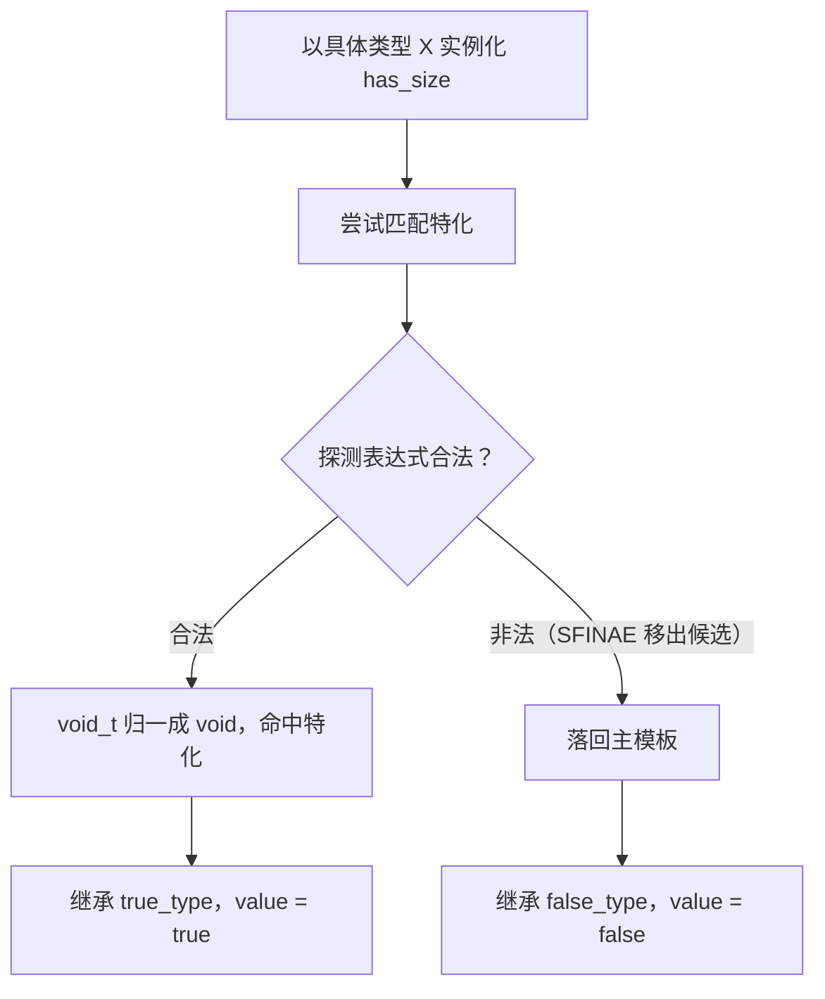

# 第三章（中）：变参模板与编译期分支

适用环境：C++17、CMake 3.16 或更高版本；示例已在 Windows + MSVC 19.50 下验证。

你将学会：

- 用参数包与折叠表达式处理任意数量的参数。
- 用 `if constexpr` 把「按类型选择实现」写进同一个函数。
- 手写 `void_t` 探测与 `is_one_of` 两类常见 traits。
- 读懂旧代码里的 `enable_if`/SFINAE 与 tag dispatch。

完整代码位于 [编译期编程示例](../code/08-compile-time/main.cpp)。

## 1. 参数包与折叠表达式

变参模板用 `typename...` 声明参数包，C++17 的折叠表达式把「对包里每个元素做同一个运算」压缩成一行：

```cpp
template <typename... Args>
constexpr int sum(Args... values) {
    return (0 + ... + values);   // 一元左折叠：0 + v1 + v2 + ... + vn
}
```

四种折叠形态记法：`(pack op ...)`、`(... op pack)`、`(pack op ... op init)`、`(init op ... op pack)`。带 `init` 的版本可以在空包时也有定义——`sum()` 返回 `0`，而空包上的一元折叠只对 `&&`、`||`、`,` 有合法结果。

配合完美转发，可以写日志、事件触发这类「转发一切」的函数：

```cpp
template <typename... Args>
void log_line(Args&&... parts) {
    (std::cout << ... << std::forward<Args>(parts));  // 右折叠进流
}
```

对包逐项调用则用逗号折叠：

```cpp
template <typename... Systems>
std::size_t invoke_all(Systems&&... systems) {
    (systems.update(), ...);   // 按顺序逐个 update
    return sizeof...(systems); // sizeof... 求包长度
}
```

引擎里的典型用途：逐个调用子系统 `update`、把组件列表一次性转发给构造函数、变参事件派发。

## 2. `if constexpr`：编译期分支

`if constexpr` 在编译期丢弃不成立的分支，让「按类型选实现」写在同一个函数里：

```cpp
template <typename T>
std::string describe(const T& value) {
    if constexpr (std::is_integral_v<T>) {
        return "integral:" + std::to_string(value);
    } else if constexpr (std::is_floating_point_v<T>) {
        return "floating:" + std::to_string(value);
    } else {
        return "other";
    }
}
```

它替代的经典 SFINAE 场景：旧代码为了「有某成员走 A 路径，否则走 B 路径」要写两个互相约束的重载；C++17 只需一个函数加一个编译期条件。被丢弃的分支**不参与实例化语义检查**（只要依赖模板参数），因此可以有「这个类型走不到」的调用：

```cpp
template <typename T>
auto size_or_zero(const T& container) {
    if constexpr (has_size<T>::value) {
        return container.size();
    } else {
        return 0;
    }
}
```

> ⚠️ 「丢弃分支不检查」只对依赖模板参数的代码成立。分支里写一个与模板参数无关的语法错误，仍然会在定义处报错。

## 3. 手写 type traits

traits 是「关于类型的函数」，返回编译期常量或类型。两类最常用的手写 traits：

### 3.1 前置概念：五行代码背后的四件事

`has_size` 的五行代码同时用到四个概念，任何一个不熟，整段就是天书。先补齐：

- **`std::true_type` / `std::false_type`**：标准库的空结构体，自带一个静态常量，大意是 `struct true_type { static constexpr bool value = true; };`。写 `struct has_size : std::false_type {}` 就是让 `has_size` 继承这个 `value` 成员——**继承 true/false_type，等于给 traits 一个「返回值」**，之后用 `has_size<某类型>::value` 取到。
- **`decltype(expr)`**：只问类型、不执行。编译器回答「这个表达式的类型是什么」，表达式本身不求值：`decltype(x + 1.0)` 得到 `double`，但 `x + 1.0` 并没有真的发生。
- **`std::declval<T&>()`**：不求值语境里的「纸面对象」。想问 `T` 有没有 `.size()`，就得写出 `对象.size()`，可此时并没有对象；`declval<T&>()` 代表「假装有一个 `T&`」，只能在 `decltype` 这类不求值语境中使用，运行期零成本。
- **SFINAE**（Substitution Failure Is Not An Error）：拿具体类型替换模板参数时，若替换结果非法，编译器不报错，只是**把该候选移出候选集合**，继续试下一个候选。探测技法的全部魔术都建立在这一条规则上。

### 3.2 `has_size`：逐行拆解

**探测成员**——`void_t` 技法：能对 `T` 调 `.size()` 的类型命中特化版本：

```cpp
template <typename, typename = void>   // 主模板：兜底，默认答案 false
struct has_size : std::false_type {};

template <typename T>                  // 偏特化（下文简称特化）：探测成功，答案 true
struct has_size<T, std::void_t<decltype(std::declval<T&>().size())>>
    : std::true_type {};

static_assert(has_size<std::vector<int>>::value);
static_assert(!has_size<int>::value);
```

主模板的两个模板参数：第一个连名字都没给——这里用不到它，占位只为与特化的形态对齐；第二个默认 `void`，所以 `has_size<X>` 实际是 `has_size<X, void>`。任何没命中特化的类型都落到它，`::value` 一律 `false`。

特化那一坨要**从里往外读**：

```cpp
std::declval<T&>().size()   // ① 假装有个 T&，调用它的 .size()
decltype( ... )             // ② 问编译器：这个调用返回什么类型？（不求值）
std::void_t< ... >          // ③ 把 ② 算出的任意类型，统一归一成 void
```

③ 必须存在：主模板第二个参数默认是 `void`，特化必须「恰好算出 void」才能被匹配上，而 `.size()` 返回的是 `size_t`。`std::void_t<任意合法类型>` 恒等于 `void`，就是那个归一化适配器。

换个角度看这道题的本质：**整个表达式的值没人用——答案不重要，能不能算出来才重要**。用实验把「归一化」的必要性钉死，造一个 `size()` 返回 `void` 的怪类型：

```cpp
struct Weird { void size(); };   // size() 返回 void 的怪类型

// 不加 void_t：特化第二参数直接写 decltype(...)，只匹配「返回类型恰好是 void」的类型
template <typename, typename = void>
struct only_void_size : std::false_type {};
template <typename T>
struct only_void_size<T, decltype(std::declval<T&>().size())> : std::true_type {};

static_assert( only_void_size<Weird>::value);             // 返回 void，恰好对上
static_assert(!only_void_size<std::vector<int>>::value);  // 返回 size_t，反而不命中！
```

不加 `void_t` 时，`std::vector<int>` 竟然探测失败——特化匹配的是「返回类型恰好是 void」，不是「能调 `.size()`」。加上归一化后两者都命中。所以 ③ 的准确读法是：**只要能调 `.size()`，无论返回什么，都算成功并归一成 void**——探测的是可调用性，不是返回类型。

`void_t` 的真身只有一行，且参数可以放任意多个探针，**全部合法才算成功**，天然支持「同时要求多个成员」：

```cpp
template <class...> using void_t = void;   // 真身：不管给什么，都吐 void

template <typename, typename = void>
struct sized_and_iterable : std::false_type {};
template <typename T>
struct sized_and_iterable<T, std::void_t<
    decltype(std::declval<T&>().size()),      // 探针 1：有 size
    decltype(std::declval<T&>().begin())>>    // 探针 2：有 begin
    : std::true_type {};

static_assert(sized_and_iterable<std::vector<int>>::value);  // size + begin 都有
static_assert(!sized_and_iterable<Weird>::value);            // 有 size 没有 begin
```

编译器匹配 `has_size<X>` 的完整流程：



记住这个记忆模型就抓住了本质：**特化是 try 分支，主模板是 catch 兜底**——编译器替你试调 `.size()`，试得通走 true，试不通的候选被 SFINAE 移出、落回 false。

两个具体类型的对比例子：

| 步骤 | `has_size<std::vector<int>>` | `has_size<int>` |
| --- | --- | --- |
| 填默认参数 | `has_size<vector<int>, void>` | `has_size<int, void>` |
| 尝试匹配特化 | `declval<vector&>().size()` 合法 | `declval<int&>().size()` 非法 |
| 匹配结果 | 特化命中 | 特化被 SFINAE 移出候选，只剩主模板 |
| `::value` | `true` | `false` |

熟悉 TypeScript 条件类型的话，这是同款结构，可以对照着记：

```typescript
type HasSize<T> = 'size' extends keyof T ? true : false;
```

特化对应 `extends` 成立的 true 分支，主模板对应不成立的 false 分支，`void_t` + `decltype` 对应「试一下」这个动作本身。

### 3.3 `is_one_of`：编译期的集合判断

**类型集合判断**——变参 traits 用折叠表达式一行写完：

```cpp
template <typename T, typename... Ts>
struct is_one_of : std::bool_constant<(std::is_same_v<T, Ts> || ...)>;
```

- 折叠表达式 `(std::is_same_v<T, Ts> || ...)` 机械展开为 `is_same_v<T, Ts1> || is_same_v<T, Ts2> || ...`：**T 等于包里任意一个类型即为 true**，相当于编译期的 `Ts.includes(T)`。
- `std::bool_constant<b>` 是「自定义 value 的 true/false_type」，用折叠结果现场决定继承哪个。

```cpp
is_one_of<float, int, float, double>::value  // false || true || false → true
is_one_of<char, int, float>::value           // false || false → false
```

它与 `has_size` 构成一组对照：`is_same_v` 对任何类型都合法，**永远答得出 true/false**；`has_size` 的探测表达式对非法类型根本算不出来，**靠 SFINAE 移出候选来表达 false**。

引擎源码里大量出现这两类形态（UE 的 `TIsDerivedFrom`、检测 `GetTypeHash` 是否存在等），认出结构就能读懂：看到 `struct X : std::false_type {}` 紧跟一个 `struct X<T, std::void_t<...>> : std::true_type`，那就是一道编译期判断题，不必逐字推导替换过程。

## 4. `enable_if` 与 SFINAE：读懂旧代码

`enable_if` 是 SFINAE（定义见 3.1）的标准封装，把「准入条件」写进函数签名：

```cpp
template <typename T, typename = std::enable_if_t<std::is_integral_v<T>>>
int score_of(T value) {
    return static_cast<int>(value) * 2;
}
// score_of(21)   OK
// score_of(1.5)  编译错误：浮点类型被移出候选，无可行函数
```

注意：「非法不报错」只在**模板替换语境**中成立——`enable_if_t<...>` 里的 `T` 是编译器正在代入的类型，替换失败才退化为「移出候选」。同一个探测表达式写在普通代码里就是硬错误：直接写 `using X = std::void_t<decltype(std::declval<int&>().size())>;` 会得到 `error C2228`。**SFINAE 是语境的属性，不是表达式的属性**：它只保护「编译器正在拿具体类型套模板」的那一刻。

### 4.1 同一个问题，两代写法

以「整数走 A 路径，其他走 B 路径」为例，新旧对照最能看出 `if constexpr` 消灭了什么。

旧写法：两个互补约束的重载，准入条件写在签名里：

```cpp
template <typename T, std::enable_if_t<std::is_integral_v<T>, int> = 0>
std::string describe(T value) { return "integral:" + std::to_string(value); }

template <typename T, std::enable_if_t<!std::is_integral_v<T>, int> = 0>
std::string describe(T value) { return "other"; }
```

新写法：一个函数，条件进函数体：

```cpp
template <typename T>
std::string describe(T value) {
    if constexpr (std::is_integral_v<T>) {
        return "integral:" + std::to_string(value);
    } else {
        return "other";
    }
}
```

| | SFINAE 旧写法 | `if constexpr` 新写法 |
| --- | --- | --- |
| 函数体数量 | 2 个，逻辑被劈开 | 1 个，逻辑集中 |
| 条件写在哪 | 模板参数列表（签名里） | 函数体里 |
| 选择机制 | 重载决议「选函数」 | 编译期分支「选代码」 |
| 加第三种情况 | 再加一个重载 + 互补条件 | 加一个 `else if constexpr` |

3.2 的 `size_or_zero` 同构，旧写法形状相同：

```cpp
template <typename T, std::enable_if_t<has_size<T>::value, int> = 0>
auto size_or_zero(const T& c) { return c.size(); }

template <typename T, std::enable_if_t<!has_size<T>::value, int> = 0>
auto size_or_zero(const T& c) { return 0; }
```

### 4.2 约束接口：`if constexpr` 替代不了的场景

`if constexpr` 只能在函数体内部做分支，做不了「这个类型根本别进这个函数」。最多用 `static_assert` 仿一个：

```cpp
template <typename T>
int score_of_sa(T v) {
    static_assert(std::is_integral_v<T>, "score_of 只接受整数");  // 进门之后才炸
    return static_cast<int>(v) * 2;
}
```

但两者行为有本质差别：

| | SFINAE（`enable_if`） | `static_assert` |
| --- | --- | --- |
| 失败时机 | 重载决议阶段：函数不进候选 | 函数体已进入，才报错 |
| 有别的重载时 | 别的重载接住，整体正常工作 | 直接编译失败 |
| 报错形态 | `no matching overloaded function` | 你自己写的消息 |

给 `score_of` 补一个互补约束的浮点重载（写成 4.3 坑 1 的 `int = 0` 形式）后，`score_of(1.5)` 被它接住正常返回 `3.0`。在泛型代码里被调用时这是生死差别：`static_assert` 版会炸掉整个编译，SFINAE 版让候选集合自然分流。这就是「跨函数分派」。

### 4.3 读旧代码的两个经典坑（实测复现）

**坑 1：为什么旧代码用 `int = 0` 而不是 `typename = void`？**

用默认类型参数给两个「重载」写互补约束：

```cpp
template <typename T, typename = std::enable_if_t<std::is_integral_v<T>>>
std::string f(T value) { return "int"; }
template <typename T, typename = std::enable_if_t<!std::is_integral_v<T>>>
std::string f(T value) { return "other"; }
// error C2995: "std::string f(T)": 函数模板已经定义
```

**默认模板实参不参与签名区分**——这两个「重载」在编译器眼里是同一个函数被定义了两次。所以孪生重载一律写成非类型参数 `enable_if_t<条件, int> = 0`：`int = 0` 属于模板参数列表，能区分两个函数模板。本节开头的单函数 `score_of` 只约束自己，用 `typename = void` 形式没有问题。

**坑 2：互补条件缺一不可。**

第二个重载忘了加 `!`（或干脆不写约束），对某些类型两个候选同时留下，产生 `error C2668` 重载歧义。互补条件不是风格偏好，是正确性要求。

### 4.4 形状识别口诀

看到签名里的准入条件：

```cpp
template <typename T, std::enable_if_t<某条件, int> = 0>
```

就翻译成：「这个函数只对满足条件的类型存在，附近多半还有一个 `!某条件` 的孪生重载」。两个函数体合起来读才是完整逻辑——这正是 `if constexpr` 把它们合并回去的原因。

C++17 的实践建议：

- **新代码**：能用 `if constexpr` 就不用 SFINAE——一个函数、一眼读懂。
- **读旧代码**：看到 `enable_if` 就理解为「类型约束」，找出条件是什么即可，不必逐字推导替换过程（4.4 的口诀够用）。
- **约束接口**：需要让「不满足条件的重载」继续留在候选里让别的重载接住时（见 4.2，`if constexpr` 做不到跨函数分派），SFINAE 仍是正解。

## 5. tag dispatch：用类型选择实现路径

另一种编译期分派是给函数传一个**空类型标签**，让重载决议选择实现：

```cpp
struct forward_tag {};
struct random_access_tag {};

constexpr forward_tag       select_tag(std::forward_iterator_tag) { return {}; }
constexpr random_access_tag select_tag(std::random_access_iterator_tag) { return {}; }

template <typename Iter>
auto category_of(Iter) {
    using cat = typename std::iterator_traits<Iter>::iterator_category;
    return select_tag(cat{});   // 返回类型由重载决议决定
}
```

`vector` 的迭代器带 `random_access_iterator_tag`，于是 `category_of` 返回 `random_access_tag`。运行期零开销——标签只是编译期的「分支标记」。算法库内部（`std::advance` 对双向与随机访问迭代器走不同实现）就是这个模式，引擎的任务系统里也常见「串行 tag / 并行 tag」的重载。

## 6. 何时停手：元编程的度

模板是引擎源码的通用语，但教程目标定在「读懂」而不是「炫技」：

- 该用：容器与算法的泛型化、变参转发、`if constexpr` 类型分派、存在性探测。
- 慎用：深度递归元编程、为两行代码引入一整套 traits 体系、用模板实现本可用运行期多态或查表的逻辑。
- 代价指标：编译时间、报错长度、同事读懂所需时间。三者同时超标就停手。

## 7. 常见误区

- 在空参数包上写一元折叠：`(pack + ...)` 没有初值，空包直接编译错误；用 `(0 + ... + pack)`。
- 把「丢弃分支不做语义检查」扩大到与模板参数无关的错误。
- 读到 `enable_if` 就重写整个调用链：多数时候只需理解约束条件本身。
- 用元编程替代简单查表：编译期算十个常量没问题，编译期生成状态机就是另一个量级。

## 8. 练习

1. 给 `sum` 写空包调用，分别尝试一元与二元折叠，记录编译器报错差异。
2. 写 `has_reserve<T>` 探测 `reserve(size_t)` 成员，用 `static_assert` 验证 `vector` 为真、`list` 为假。
3. 用 `if constexpr` 写一个 `serialize(const T&)`：整数走 `to_string`，浮点走定点缩放，容器类型逐元素递归。
4. 把 `describe(std::string)` 的普通函数重载删掉，观察现在 `describe(std::string{"hi"})` 落到哪个候选，解释原因。
5. 在引擎源码里找一处 `enable_if` 或 `void_t` 的真实用法，用自己的话写出它约束了什么。

## 9. 小结

- 折叠表达式把对参数包的逐项运算压成一行；空包要带初值。
- `if constexpr` 是编译期分支，替代大部分 SFINAE 场景；丢弃分支需依赖模板参数。
- `void_t` 探测成员、变参折叠判断类型集合，是读引擎源码的两类高频结构。
- `enable_if` 是类型约束；新代码优先 `if constexpr`，旧代码读懂即可。
- tag dispatch 用空类型标签做零开销的编译期分派。

## 参考资料

- [cppreference：折叠表达式](https://en.cppreference.com/w/cpp/language/fold)
- [cppreference：`if constexpr`](https://en.cppreference.com/w/cpp/language/if)
- [cppreference：`std::enable_if`](https://en.cppreference.com/w/cpp/types/enable_if)
- [cppreference：`std::void_t` 探测技法说明](https://en.cppreference.com/w/cpp/types/void_t)
- [Template Metaprogramming with C++：Type Traits 与 SFINAE 章节](https://www.oreilly.com/library/view/template-metaprogramming-with/9781803243450/B18367_05_ePub.xhtml)
- 第三章调研与确认记录：[ch03-research](../resources/ch03-research.md)
