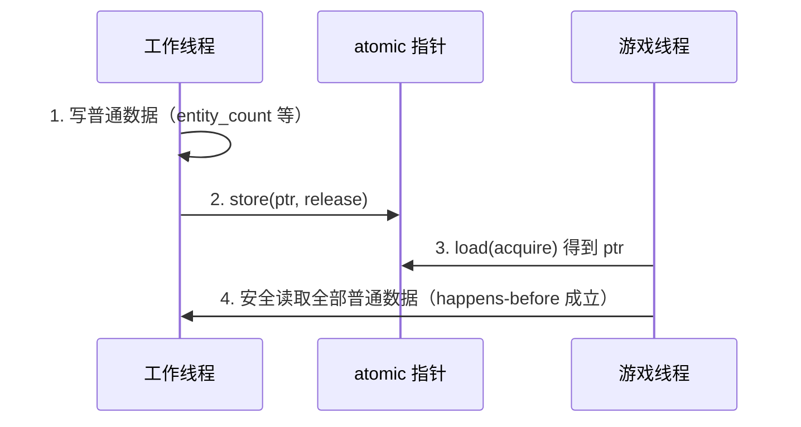

# 第三章（下）：原子操作与内存序

适用环境：C++17、CMake 3.16 或更高版本；示例已在 Windows + MSVC 19.50 下验证。

你将学会：

- 使用 `load`/`store`/`fetch_add`/CAS 循环完成原子读改写。
- 在六档 `memory_order` 中为场景选档：默认 `seq_cst`，跨线程传数据用 acquire/release。
- 解释 `relaxed` 计数能做什么、不能做什么。
- 用 `atomic_flag` 写极简自旋锁。
- 识别 false sharing，用 cache line 对齐消除它。

完整代码位于 [原子示例](../code/10-atomics/main.cpp)。

## 1. atomic 基础：不可分割的读改写

`std::atomic<T>` 保证单个操作不可分割且无数据竞争：

```cpp
std::atomic<int> counter{0};
counter.store(10, std::memory_order_relaxed);
counter.fetch_add(5, std::memory_order_relaxed);   // 原子的读-改-写
int v = counter.load(std::memory_order_relaxed);
```

`counter++` 在 atomic 上也不安全——它是一次 `load` 加一次 `store`，中间可以插队。复合更新必须用 `fetch_add` 或 CAS 循环：

```cpp
int expected = 15;
bool won = counter.compare_exchange_strong(expected, 20); // 成功：写入 20
bool lost = counter.compare_exchange_strong(expected, 99); // 失败：expected 被刷新为当前值
```

CAS（compare-and-swap）是所有无锁结构的积木：「我以为它是 expected，是就换成 desired；不是就把真值还给我」。输掉的一方拿真值重试，形成 CAS 循环。`atomic<T>` 不可复制也不可移动——复制的瞬间值就可能过期，标准直接禁掉。

## 2. 六档 memory_order 速查

`memory_order` 决定「本操作周围的其他内存访问可以如何被重排、何时对别的线程可见」。日常只需记住三档加两个禁手：

| 档位 | 语义 | 典型用途 |
|---|---|---|
| `seq_cst`（默认） | 全局全序，最直观也最贵 | 不确定时的默认值 |
| `acquire`（读） | 之后的读写不得重排到本次之前 | 读「发布完成」的标志 |
| `release`（写） | 之前的读写不得重排到本次之后 | 写「发布完成」的标志 |
| `acq_rel` | 读改写同时具备两侧约束 | RMW 操作既读又写时 |
| `relaxed` | 只保证本操作原子，无同步 | 纯计数（见第 3 节） |
| `consume` | 依赖序加载 | **禁手**：实现一律退化为 acquire |

社区共识（abseil 的提醒尤其直白）：非专家不要手写无锁结构。本课目标是用对 acquire/release 配对、读懂他人的内存序选择，而不是设计新的无锁队列。

## 3. relaxed 计数：能做什么，不能做什么

`relaxed` 适合「只关心自身总和、不借它传别的数据」的计数：

```cpp
hits.fetch_add(1, std::memory_order_relaxed);
```

四个线程各加一万次，join 后读到精确总和——join 本身提供了必要的同步。**relaxed 不能做**的是「用标志放行另一组写入」：写线程先写普通数据再 relaxed 写标志，读线程 relaxed 读到标志后，**不保证**看到那些普通数据。放行数据必须用下一节的 acquire/release。

## 4. acquire/release：跨线程发布数据的标准配对

游戏场景：工作线程打包一帧数据，游戏线程在「已发布」后读取：



```cpp
FramePacket packet;                       // 普通变量
std::atomic<FramePacket*> published{nullptr};

// 工作线程：先写数据，再发布
packet.entity_count = 512;
published.store(&packet, std::memory_order_release);

// 游戏线程：acquire 读到指针后，release 前的所有写入可见
FramePacket* seen = published.load(std::memory_order_acquire);
```

规则是成对出现：release 写与 acquire 读**指向同一原子变量**时，建立 synchronizes-with 关系，进而形成 happens-before。任务系统里「提交任务 = release store 任务指针，worker = acquire load」正是同一模型——第四章（实战）会反复用到。

> ⚠️ acquire/release 只解决「可见性与顺序」，不解决「等没等到」：读到 `nullptr` 说明还没发布，需要循环重试或换条件变量。原子不是等待机制。

## 5. atomic_flag 自旋锁：最轻量的锁

```cpp
std::atomic_flag flag = ATOMIC_FLAG_INIT;  // C++17 必须显式初始化

void lock()   { while (flag.test_and_set(std::memory_order_acquire)) {} }
void unlock() { flag.clear(std::memory_order_release); }
```

自旋锁适合「临界区极短、竞争者少」的场景：等待者忙等，临界区一结束立刻接管，比内核参与的 mutex 延迟低。反过来，临界区一长（微秒以上）或竞争者一多，忙等就在烧 CPU，此时必须换 mutex。`std::mutex` 的 release/acquire 语义与这里完全一致——锁本身就是「release 写、acquire 读」的封装。

## 6. false sharing：看不见的性能税

两个线程各自频繁写**同一条 cache line 上的不同变量**，硬件要在核心间来回搬运这条 line 的所有权（ping-pong），吞吐骤降。示例把两个计数器并排放与按 64 字节对齐分开测：

```cpp
struct PackedCounters {                     // a、b 同一条 cache line
    std::atomic<long long> a{0};
    std::atomic<long long> b{0};
};

struct alignas(64) Padded {                 // 独占一条 cache line
    std::atomic<long long> value{0};
};
```

本机实测（2,000,000 次自增 × 2 线程）：packed 48032 µs，padded 14234 µs——填充后快了三倍多。比例随机器与编译器而异，但方向稳定：并行写的变量必须各占一条 cache line。

> ⚠️ C++17 有 `std::hardware_destructive_interference_size`，但部分实现上尚未稳定或与 ABI 绑定过紧。教程用固定 64；工程上确认目标平台的实际 line size 后再取值。

排查思路：对「多线程各自写、却莫名慢」的热点，先查共享对象的内存邻接（数组、相邻成员、池分配），再查锁与原子本身。工具上 perf 的 cache-miss 事件或 Intel VTune 的 contention 分析都能直接暴露。

## 7. 常见误区

- 在 atomic 上用 `++` 期待原子复合更新：拆成 load+store，中间可插队。
- 用 relaxed 写标志放行普通数据：需要 acquire/release 配对。
- 单侧内存序：release 没有配对的 acquire 读就什么都没同步。
- 把多个并行写的原子变量放进同一个数组/结构体挨着放：false sharing。
- 用原子替代一切锁：复合不变量（两个变量要一起变）必须用 mutex。

## 8. 练习

1. 把 CAS 示例改成「CAS 循环直到成功」，完成一个与 `fetch_add` 等价的计数器，比较两者语义差异。
2. 把发布示例的 `release` 改成 `relaxed`，多跑几次并用断言观察数据是否可能不完整；再改回并解释。
3. 用 `atomic_flag` 实现 `try_lock()`（`test_and_set` 失败立即返回），用于「帧内只初始化一次」的守卫。
4. 把 `Padded` 的对齐改成 32（假设 cache line 64），验证两个 `Padded` 又可能落进同一条 line，恢复性能差异。
5. 在任务系统或引擎源码里找一处 `memory_order_release`，说明它与哪条 acquire 配对、放行了哪些数据。

## 9. 小结

- atomic 保证单操作原子；复合更新用 `fetch_add` 或 CAS 循环。
- 默认 `seq_cst`；跨线程传数据的标配是 release 写 + acquire 读；`consume` 禁用。
- relaxed 只适合不携带数据的纯计数；join 等外部同步补足可见性。
- 自旋锁只适合短临界区、少竞争；其余场景用 mutex。
- 并行写的热点数据各占一条 cache line，消除 false sharing。

## 参考资料

- [cppreference：`std::memory_order`](https://en.cppreference.com/w/cpp/atomic/memory_order)
- [cppreference：`std::atomic`](https://en.cppreference.com/w/cpp/atomic/atomic)
- [abseil：The Danger of Atomic Operations](https://abseil.io/docs/cpp/atomic_danger)
- [Arm Learning Paths：C++ Memory Model and Atomics](https://learn.arm.com/learning-paths/servers-and-cloud-computing/arm-cpp-memory-model/2/)
- [Manning：C++ Concurrency in Action 内存序概念](https://livebook.manning.com/learn/concepts/memory-ordering--domain-concept/c-plus-plus-concurrency-in-action-second-edition)
- 第三章调研与确认记录：[ch03-research](../resources/ch03-research.md)
