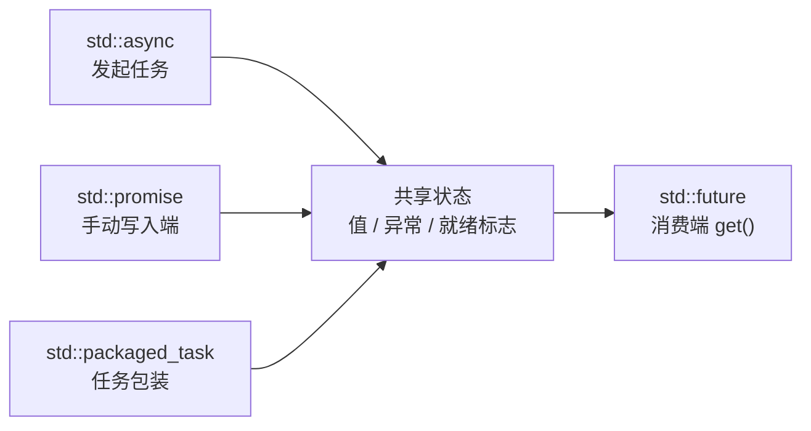

# 第三章（实战）：异步与线程池

适用环境：C++17、CMake 3.16 或更高版本；示例已在 Windows + MSVC 19.50 下验证。

你将学会：

- 区分 `std::launch::async` 与 `deferred` 的真实行为。
- 避开 `std::async` 的三大陷阱（析构阻塞、默认 policy、deferred 丢弃不执行）。
- 用 `promise`/`future` 跨线程传值与传异常。
- 手写一个 `submit` 返回 `future` 的线程池，把前三课的成果串起来。

完整代码位于 [异步与线程池示例](../code/11-async-thread-pool/main.cpp)。

## 1. 异步 ≠ 多线程

异步描述「发起后不等待结果」，实现可以是线程、事件循环或协程（JS 的 `await` 就是事件循环式异步）。C++17 标准库的异步原语只有 future 一族，它们共享一个「共享状态」对象——生产者写入值/异常，消费者读取：



四件套分工：`async` 是最方便的发起方式；`promise` 是手动写入端；`packaged_task` 把可调用体包成「可手动执行、结果自动进 future」的任务；`future` 统一消费。线程池的 `submit` 本质上就是 `packaged_task` + 队列。

## 2. launch policy 与三大陷阱

`std::async(policy, f)` 的两种显式策略行为完全不同：

```cpp
std::launch::async    // 保证在新线程上立即执行
std::launch::deferred // 不执行；首次 get()/wait() 时在「调用线程」上执行
```

**陷阱一：丢弃的 async future 析构时阻塞。** 标准规定：`std::async(launch::async)` 返回的 future 析构时必须等待任务完成。于是「fire and forget」是假的：

```cpp
for (int i = 0; i < 2; ++i) {
    std::future<int> discarded = std::async(std::launch::async, slow_task);
    (void)discarded; // 立即离开作用域：析构阻塞 100 ms
}
// 实测：整个循环阻塞约 200 ms，两个任务完全串行
```

示例中的任务各睡 100 ms，实测丢弃循环耗时 200 ms——「异步」退化为同步，还叠加了线程创建开销。MSVC（/W4）甚至对直接丢弃返回值发出 C4858 警告。真正需要后台执行就把 future 存进容器，帧末统一收；需要结果就地取。

**陷阱二：默认 policy 由实现裁量。** 不传 policy 等于 `async|deferred`，运行时可能开线程、也可能推迟到 `get()`，无法保证并发。需要并发就显式写 `std::launch::async`。

**陷阱三：deferred 丢弃后任务不执行。** deferred 的 future 析构不阻塞也不运行任务——惰性任务被直接作废。示例里这个 lambda 里放了 `abort()`，测试通过即证明它从未运行。

> ⚠️ 三大陷阱的共同根源：future 的生命周期绑定了任务的执行方式。任何把 future 当「一次性句柄」随手丢弃的写法都值得警惕。

## 3. promise 与异常传递

任务线程的未捕获异常会经 `promise` 存入共享状态，`get()` 时在消费线程重抛：

```cpp
std::promise<int> promise;
std::future<int> future = promise.get_future();

std::thread producer([&promise] {
    try {
        throw std::runtime_error("asset decode failed");
    } catch (...) {
        promise.set_exception(std::current_exception());
    }
});

try {
    future.get();                       // 在消费线程重抛
} catch (const std::runtime_error& e) {
    // "asset decode failed"
}
```

两条纪律：`get()` 之后 future 失效（多处消费用 `shared_future`）；**异常不 `get()` 就永久吞掉**——异步路径必须显式消费结果，测试与日志里都要能看见失败。

## 4. packaged_task：手动执行的任务

`packaged_task` 把「可调用体 + 共享状态」打包成一个可手动触发的对象：

```cpp
std::packaged_task<int(int, int)> task{[](int a, int b) { return a + b; }};
std::future<int> result = task.get_future();
task(20, 22);      // 手动执行（此处当前线程），结果自动进入 future
result.get();      // 42
```

它可搬移不可复制，正好塞进任务队列；执行权在队列消费者手里，而结果走 future——这就是线程池 `submit` 的核心机制。

## 5. 手写线程池

前三课的所有积木在这里合体：mutex 保护队列、条件变量唤醒 worker、`packaged_task` 类型擦除并返回 future：

```cpp
class ThreadPool {
public:
    explicit ThreadPool(std::size_t thread_count);  // 启动常驻 worker
    ~ThreadPool();                                  // 置 stop，排空队列，join

    template <typename F>
    auto submit(F&& task) -> std::future<std::invoke_result_t<std::decay_t<F>&>>;

private:
    void worker_loop();
    std::vector<std::thread> workers_;
    std::queue<std::packaged_task<void()>> tasks_;
    std::mutex mutex_;
    std::condition_variable cv_;
    bool stop_ = false;
};
```

三个关键点：

1. **`submit` 的类型擦除**：`packaged_task<Result()>` 包住任意可调用体，再用 lambda 捕获（move-only 可行）转成统一的 `packaged_task<void()>` 入队，返回 `future<Result>`。
2. **worker 循环的退出条件**：`stop_ && tasks_.empty()`——先等队列排空再退出，析构不丢任务。等待用谓词版 `cv_.wait`，防虚假唤醒。
3. **锁外执行任务**：弹出任务后立刻释放锁再执行，长任务不会阻塞其他 worker 取队列。

教学版刻意省略的能力：有界队列（防止积压吃爆内存）、任务优先级、work stealing。这些正是第四章任务系统的主题——本池是它的垫脚石。

## 6. 游戏场景：帧末 join 的异步加载

```cpp
ThreadPool pool{std::max(2u, std::thread::hardware_concurrency())};

std::vector<std::future<int>> loads;
for (int id = 0; id < 8; ++id) {
    loads.push_back(pool.submit([id] {
        std::this_thread::sleep_for(std::chrono::milliseconds(5));
        return id * 2;   // 假想的解码结果
    }));
}
// 帧末同步点：逐个 get() 收结果；此时才允许使用加载产物
for (int id = 0; id < 8; ++id) {
    loads[id].get();
}
```

结构对应引擎里的「异步资源加载」：游戏线程提交请求不阻塞；帧末（或加载完成点）统一 join。注意这个 join 语义与第四章任务系统的 join 完全同源，差别在调度质量：每次 `get()` 都可能阻塞游戏线程，任务系统用依赖 DAG 让 worker 汇聚完成，游戏线程只在真正的同步点等一次。

## 7. 常见误区

- 把 `std::async` 当「安全的 fire-and-forget」：丢弃 future 就是同步调用。
- 不写 launch policy：并发与否由实现裁量。
- 吞掉异步异常：`future` 不 `get`，异常永远无人看见。
- 线程池析构不排空队列：任务静默丢失。
- 用 `std::async` 做帧内高频并行：每次调用都可能新建线程，粒度太重——那是任务系统的活。

## 8. 练习

1. 把丢弃示例改成把 future 存入 `vector<future<int>>`，帧末统一 `get()`，实测总耗时从 200 ms 降回约 100 ms。
2. 给 `ThreadPool` 加 `pending()` 返回队列长度，验证析构前队列已排空。
3. 用 `shared_future` 让两个消费者读同一结果，验证 future 失效问题的解法。
4. 给 `submit` 加移动-only 任务（如捕获 `unique_ptr` 的 lambda），确认 `packaged_task` 能接纳，并解释 `std::function` 为什么不行。
5. 把示例中 8 个加载任务改为「每个返回异常」之一，验证 `get()` 逐个重抛且其余任务仍完成。

## 9. 小结

- future 一族共享状态分工明确：async 发起、promise 手写、packaged_task 打包、future 消费。
- 三大陷阱：async future 析构阻塞、默认 policy 裁量、deferred 丢弃作废。
- 异常经共享状态跨线程传递，必须在消费端显式 `get()`。
- 线程池 = mutex 队列 + 条件变量 + packaged_task，析构排空。
- 帧末 join 是游戏线程与异步任务的通用同步形态，任务系统会把它升级成依赖 DAG。

## 参考资料

- [Effective Modern C++ 第 7 章：任务式优于线程式](https://www.oreilly.com/library/view/effective-modern-c/9781491908419/ch07.html)
- [Scott Meyers：std::futures from std::async aren't special](http://scottmeyers.blogspot.com/2013/03/stdfutures-from-stdasync-arent-special.html)
- [cppreference：`std::async`](https://en.cppreference.com/w/cpp/thread/async)
- [cppreference：`std::packaged_task`](https://en.cppreference.com/w/cpp/thread/packaged_task)
- [Concurrency Ninja：Futures 与 Pitfalls Catalog](https://p0w.github.io/concurrency-ninja/ch07-futures.html)
- [Manning：C++ Concurrency in Action 第 4 章目录](https://livebook.manning.com/learn/c-plus-plus-concurrency-in-action-second-edition/chapter-4)
- 第三章调研与确认记录：[ch03-research](../resources/ch03-research.md)
