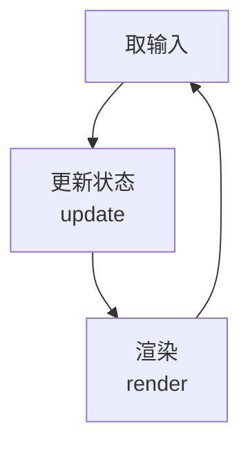

# 第四章（上）：游戏循环与时间

适用环境：C++17、CMake 3.16 或更高版本；示例已在 Windows + MSVC 19.50 下验证。

你将学会：

- 说明游戏主循环每帧的三件事与渲染/模拟解耦的动机。
- 用固定步长 + 累加器构造确定性的模拟循环。
- 解释死亡螺旋并用帧时间钳制防住它。
- 用插值系数生成渲染状态，并守住「模拟不读插值」的纪律。
- 用整数刻度累积时间，避开浮点秒数漂移。

完整代码位于 [游戏循环示例](../code/12-game-loop/main.cpp)。示例不接真实时钟，全部用合成帧时间驱动，保证每次运行结果一致。

## 1. 主循环每帧做什么

最小游戏循环是三件事：处理输入（不阻塞）→ 更新状态 → 渲染。用时间差控制节奏：



前端工程师熟悉 `requestAnimationFrame`：Web 游戏把帧调度权交给浏览器，回调频率跟随显示器刷新。C++ 游戏主循环自己持有调度权——这既是自由（可固定步长、可多线程拆分），也是责任（时间处理错误全靠自己防）。

## 2. 变步长的问题：帧抖动放大误差

最朴素的写法把「上一帧到这一帧的真实时长」直接当 dt：`x += v * dt`。示例用一维弹道对比了两种 dt 策略——快帧约 1.7 ms、慢帧约 31.7 ms 交替，总时长精确 1 秒：

```text
variable dt error: 0.150833
fixed   dt error: 0.0833333
```

同样的积分器、同样的总时长，变步长误差几乎翻倍。原因：半隐式欧拉对恒定加速度的速度更新是精确的，误差出在位置对时间的加权积分上；步长忽大忽小时，大步的权重放大了误差。更重要的是**确定性**：联机对战、录像回放、物理回归测试都要求「同样的输入跑出同样的轨迹」，变步长把显示器刷新率变成了游戏逻辑的一部分。

## 3. 固定步长 + 累加器

标准解法（Glenn Fiedler 的「Fix Your Timestep!」）：模拟按固定 dt 推进，真实帧时间存进累加器，够一步跑一步：

```cpp
accumulator += min(frame_dt, max_frame_time);
while (accumulator >= step_dt) {
    previous = current;
    step(current, step_dt);      // 每一步严格等长
    accumulator -= step_dt;
}
```

帧快了就少跑几步（甚至零步），帧慢了就多跑几步，模拟时钟与真实时间解耦。每一步等长带来确定性：60 帧的数据在任何机器上逐位一致。

**整数刻度的坑**：示例最初用浮点秒数累加，结果 60 步被吃成 59 步——每对帧时间的浮点和比理论值差一点点，最后一帧差得凑不出一步，整整一步的模拟时间卡在累加器里出不来。修法是引擎通行做法：把时间换算成整数刻度（示例用 1/600 秒一刻度）再累加，零漂移。

> ⚠️ 如果你发现固定步长循环「偶尔少跑一步」或 alpha 一直贴着 0/1 跳变，先查累加器的浮点漂移，再查帧时间测量。

## 4. 死亡螺旋与钳制

掉帧尖峰（如卡顿 0.5 秒）到来时，朴素累加器会一次性补 30 步。补步本身耗时，下一帧欠账更多，补得更多——无限循环，游戏永远追不上真实时间。这就是**死亡螺旋（spiral of death）**。

防法是钳制单帧最多消费的时间：

```cpp
accumulator += min(frame_dt, max_frame_time);  // 0.5 秒被钳到 0.25 秒
```

示例实测：尖峰帧从 30 步被压到 15 步。代价是那半秒被裁掉的部分表现为「游戏整体慢放一瞬」——宁可慢放，不可卡死。`max_frame_time` 通常取 0.1～0.25 秒。

## 5. 渲染插值：两态之间的第三种状态

固定步长跑完，累加器常有剩余（例如 5 刻度 / 步长 10 刻度 = 0.5）。此时渲染时刻落在「上一步」与「当前步」之间，直接画当前状态会在高刷屏上出现肉眼可见的跳动（144 Hz 屏幕上多数帧没有新模拟步）。

解法是给渲染单独生成插值状态：

```cpp
alpha = accumulator / step_dt;                    // [0, 1)
render_x = previous_x + (current_x - previous_x) * alpha;
```

纪律只有一条：**插值状态只服务渲染**。物理、AI、网络同步读的永远是模拟状态；读插值态会让游戏逻辑依赖渲染节奏，把刚建立的确定性又交出去。旋转要沿最短弧插值（四元数 slerp），位置、相机同理；瞬移的对象（传送）跳过插值。

## 6. 与前端 rAF 的对照

| 维度 | Web（rAF） | 原生（本课） |
|---|---|---|
| 帧调度权 | 浏览器，跟随刷新率 | 自己，可固定步长 |
| dt 来源 | rAF 时间戳差 | 高精度计时器（整数刻度） |
| 掉帧表现 | 回调变稀，逻辑同步变慢 | 累加器补步 + 钳制 |
| 多线程 | 主线程限定 | update/render 可拆线程 |

把本课的循环与第三章的任务系统接起来：update 内部把动画、粒子、物理宽相位拆成任务提交，帧末 join——这正是第四章（实战）的内容。

## 7. 常见误区

- 用变步长还指望物理确定性。
- 浮点秒数直接累加：长时间运行后漂移肉眼可见。
- 只钳制不补步的「一步一帧」：高分屏上速度与刷新率耦合。
- 游戏逻辑读插值状态。
- 钳制值取太小（如 0.05 秒）：一次卡顿等于游戏慢放半秒以上。

## 8. 练习

1. 把示例的步长从 10 刻度改成 6 刻度（1/100 秒），观察 steps 与 alpha 的变化，验证插值仍在两态之间。
2. 去掉钳制，把尖峰帧改成 2 秒，记录补步数并解释死亡螺旋的触发条件。
3. 把整数刻度改回浮点秒数累加，跑 10 次统计实际步数分布，复现「59 步」漂移。
4. 给插值加一个「传送标记」，验证瞬移对象跳过插值的实现方式。
5. 在你的 Web 游戏里把 rAF 回调改成「固定步长 + 插值」结构，对比 144 Hz 屏上的平滑度。

## 9. 小结

- 主循环三件事：输入、update、render；C++ 把帧调度权拿在自己手里。
- 变步长牺牲确定性与精度；固定步长 + 累加器是标准解。
- 累加器用整数刻度，浮点秒数会漂移掉步。
- 钳制单帧消费量防死亡螺旋，代价是短暂慢放。
- 插值只给渲染，模拟永不读插值态。

## 参考资料

- [Glenn Fiedler：Fix Your Timestep!](https://gafferongames.com/post/fix_your_timestep/)
- [Game Programming Patterns：Game Loop](http://gameprogrammingpatterns.com/game-loop.html)
- [Comfy Engine：Fixed timestep game loop](https://comfyengine.org/blog/fixed-timestep-game-loop/)
- [fromscratchlab：The Game Loop & Fixed Timestep](https://www.fromscratchlab.com/GameDev/game-loop)
- [domwillia.ms：Devlog #1 fixed timestep](https://domwillia.ms/devlog1/)
- 第四章调研与确认记录：[ch04-research](../resources/ch04-research.md)
