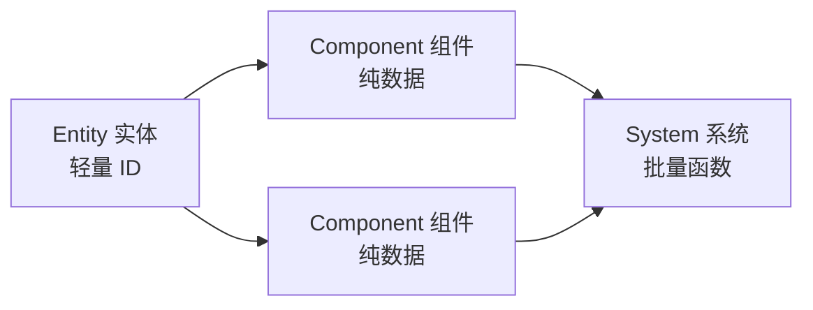
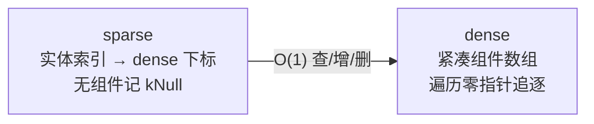

# 第四章（中）：实体架构与 ECS

适用环境：C++17、CMake 3.16 或更高版本；示例已在 Windows + MSVC 19.50 下验证。

你将学会：

- 说明继承式对象模型在大规模游戏对象上的三个崩坏点。
- 用「索引 + 代数」构造安全的实体句柄。
- 实现 sparse set 组件池：sparse 存映射、dense 存数据。
- 写出按最小集合迭代的 view，并遵守「先收集后销毁」的遍历纪律。
- 对照 EnTT 的 API 理解工业实现的同构概念。

完整代码位于 [迷你 ECS 示例](../code/13-ecs/main.cpp)；EnTT 对照示例见 [entt_demo.cpp](../code/13-ecs/entt_demo.cpp)（vendored EnTT v3.13.2，位于 `code/third_party/entt/`，无需网络）。

## 1. 继承式对象模型的崩坏

新手引擎的经典结构：`Entity` 基类派生 `FlyingEnemy`、`SwimmingEnemy`、`FlyingSwimmingBoss`……三个崩坏点：

1. **组合爆炸**：能力正交（会飞、会游泳、会远程攻击），继承树却是一维的，每种组合一个类。
2. **God class**：`Entity` 基类为所有子类预留字段与虚函数，多数实体一辈子用不到大半。
3. **缓存极差**：每个对象一块堆内存，更新循环沿指针跳来跳去，预取器失效——第二章的教训在这里全面兑现。

前端类比：这就像把所有组件写成一个 2000 行的 React class 并把 state 全挂在根节点——功能能跑，但没有任何复用与性能可言。

## 2. Component 模式：组合优于继承

Game Programming Patterns 的 Component 模式把「能力」拆成可插拔的组件对象（`PhysicsComponent`、`RenderComponent`、`AiComponent`），实体持有组件引用。继承爆炸消失：新能力 = 新组件类型。

ECS 把这条路线推到底，拆出三个正交概念：



- **Entity**：不是对象，是一个轻量 ID。
- **Component**：纯数据结构体（`Position`、`Velocity`、`Health`），没有方法。
- **System**：普通函数，每帧批量处理拥有特定组件组合的全部实体。

数据按组件类型分列存储（类似 SoA），系统只碰自己关心的列——与缓存友好、按类型并行天然契合。

## 3. 实体句柄：索引 + 代数

实体 ID 要跨系统、跨帧传递，而实体随时可能销毁。裸索引无法区分「这个槽位现在住的是谁」，解法是给每个槽位配一个代数（generation）：

```cpp
struct Entity {
    std::uint32_t index;
    std::uint32_t generation;
};
```

创建时返回 `(槽位, 当时代数)`；销毁时槽位回池、代数加一。任何旧句柄下次使用时，代数对不上即判失效——悬垂访问从「未定义行为」降级为「可检测的空结果」。这与第四章（下）的资源句柄是同一个模式，EnTT 的实体标识同构（`to_entity` 取索引、`to_version` 取代数）。

## 4. sparse set 组件池

组件池解决「按类型紧凑存数据，又能 O(1) 查任意实体有没有这个组件」：



- **sparse**：按实体索引直接寻址，存 dense 下标或 `kNull`。
- **dense**：组件连续排布——系统遍历时内存顺序前进，预取友好。
- **删除用 swap-remove**：把末尾元素搬进空洞，dense 永远紧凑，代价是元素顺序不稳定。

实现里 sparse 与实体一起惰性增长，dense 旁边平行存属主实体，view 才能把「组件」连回「实体」。

## 5. View：按最小集合迭代

`view<Position, Velocity>` 的职责：取出「同时拥有这两种组件」的所有实体。策略是拿一个池当驱动（实现里选了 head 池），逐个检查其余池的成员资格：

```cpp
view(registry.positions(), registry.velocities())
    .each([dt](Entity, Position& p, const Velocity& v) {
        p.x += v.dx * dt;
        p.y += v.dy * dt;
    });
```

没有 `Velocity` 的实体被自然跳过——「只有位置的静态物体」不需要任何 if。组件即过滤器、系统即循环，这就是 ECS 的全部运行时形态。

**遍历纪律**：swap-remove 会移动 dense 数组里的元素，遍历途中销毁实体会打乱迭代位置。正确做法是系统只收集待销毁实体，遍历结束后统一销毁。EnTT 文档同样要求 each 途中不得增删组件。

## 6. 规模实测

示例创建 10 万实体（一半带速度），跑 60 帧移动系统：

```text
moved 100000 entities x 60 frames in 97 ms
```

约 0.16 ms/帧的量级——dense 数组的顺序访问让「每帧全量更新十万实体」成为轻量操作。同样的结构换成指针追逐式对象列表，耗时通常数倍于此（第二章实体存储实验的结论在此复现）。

## 7. EnTT 对照

工业实现推荐从 EnTT 读起（Minecraft、很多独立引擎在用）。它同样是 sparse set 模型，API 与手写版一一对应：

| 概念 | 手写迷你 ECS | EnTT v3.13 |
|---|---|---|
| 创建/销毁实体 | `registry.create()/destroy()` | `registry.create()/destroy()` |
| 挂/取组件 | `positions().add(e, v)` | `registry.emplace<Position>(e, v)` |
| 有效检查 | `registry.alive(e)` | `registry.valid(e)` |
| 组合视图 | `view(positions, velocities).each(...)` | `registry.view<Position, Velocity>().each(...)` |
| 更新组件值 | `dense()[i] = ...` | `registry.patch<Position>(e, fn)` |

示例验证了三个行为：销毁后句柄失效、普通 `create()` 回收同槽位且代数加一、view 迭代纪律相同。两个 **EnTT 特有注意点**：

1. `create(hint)` 面向快照恢复等场景，实测传过期句柄会把过期句柄**原样复活**（valid 再次变 true）——不要把它当「在旧索引上重建」用。
2. sparse set 模型下，跨组件迭代只有首个组件保证内存连续；对多组件热路径，EnTT 提供 group 把多个组件物理重排到一起（每个组件只能属于一个 group）。archetype 模型（Flecs、Unity DOTS）则天生按组合分桶——两种存储路线没有绝对优劣，访问模式决定选择。

> ⚠️ 手写实现把三个池写死为成员，教学优先；通用注册表要用类型擦除的池映射（EnTT 的做法）。先读懂手写版，再看 `registry.hpp` 就不会迷路。

## 8. 常见误区

- 把 ECS 等同于「性能魔法」：小项目里继承更直观，收益来自数据规模与系统并行需求。
- 组件里塞行为与回调：组件退回 God class，ECS 的数据导向优势清零。
- 遍历途中增删组件：swap-remove 打乱迭代位置，必须先收集后处理。
- 裸索引当实体 ID 跨帧传递：代数不校验就是悬垂访问。
- 拿单次迭代耗时推广「ECS 必快」：性能取决于访问模式与数据布局，不是架构名字。

## 9. 练习

1. 给迷你 ECS 增加 `Entity handle_generation` 打印，验证销毁-复用后旧句柄全部失效。
2. 实现 `view<Position>`（单池）与 `view<Health, Position>`（驱动池选择），思考 head 池应选 dense 最小的那个。
3. 把移动系统改成并行：按 dense 块分片提交任务（第三章线程池），帧末 join 后再跑伤害系统。
4. 在 EnTT 示例里销毁一个带组件的实体，用 `valid` 与 `orphan` 验证组件清理行为。
5. 阅读 EnTT wiki 的 group 一节，用一段话对比 sparse set 与 archetype 的迭代成本模型。

## 10. 小结

- 继承在能力正交、实体海量时崩坏；Component 走组合，ECS 走数据导向。
- 实体 = 索引 + 代数；销毁即递增代数，悬垂句柄可检测。
- sparse set 池：sparse 查资格、dense 供遍历，swap-remove 保持紧凑。
- view 按池驱动 + 资格检查；遍历中先收集后销毁。
- EnTT 是同构的工业实现；跨组件连续性与 group/archetype 是选型要点。

## 参考资料

- [EnTT：Crash Course](https://skypjack.github.io/entt/md_docs_2md_2entity.html)
- [EnTT Wiki：Entity Component System](https://github.com/skypjack/entt/wiki/Entity-Component-System)
- [flecs：Entity Component System FAQ](http://www.flecs.dev/ecs-faq/)
- [Bevy：ECS 概念](https://bevy.org/learn/quick-start/getting-started/ecs/)
- [studyplan.dev：Implementing ECS in C++](https://www.studyplan.dev/ecs/entity-component-system)
- [Game Programming Patterns：Component](http://gameprogrammingpatterns.com/component.html)
- 第四章调研与确认记录：[ch04-research](../resources/ch04-research.md)
