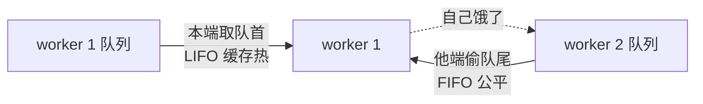

# 第四章（实战）：任务系统

适用环境：C++17、CMake 3.16 或更高版本；示例已在 Windows + MSVC 19.50 下验证。

你将学会：

- 说明任务系统与线程池的本质差别（依赖 DAG + work stealing）。
- 用依赖计数的 fork/join 写 `parallel_for`，并守住帧同步点纪律。
- 理解每 worker 双端队列的偷取方向（本端 LIFO、他端 FIFO）。
- 识别 join 嵌套死锁、忘记 join、异常吞掉三大陷阱。

完整代码位于 [任务系统示例](../code/16-job-system/main.cpp)。教学实现用互斥队列近似工业调度器（UE Tasks System、Unity Job System、Chase-Lev 无锁队列），结构一一对应。

## 1. 为什么线程池不够用

第三章的线程池回答了「线程怎么复用」；帧内并行还差两个问题：

1. **依赖表达**：动画更新完才能物理，物理完才能动画混合——`future::get` 逐个阻塞游戏线程，等待点越多扩展性越差（UE 官方纪律：优先建图，少显式等待）。
2. **负载均衡**：固定派发的队列会有的 worker 吃撑、有的闲着；空闲 worker 应该去偷别人的活。

任务系统 = 线程池 + 依赖 DAG + work stealing。UE 的 TaskGraph / Tasks System、Unity Job System 同属这一模型——本课把它拆到最小可运行。

## 2. 依赖 DAG：任务图驱动调度

任务带依赖集合，依赖全部完成才可调度：


实现机制是**依赖计数**：任务创建时 `pending = 依赖数`；每个依赖完成时对其后继 `fetch_sub`，从 1 减到 0 的那次减法负责把任务入队——恰好满足一次，不会重复调度：

```cpp
Job* b = system.submit(fn, {a});        // b.pending = 1
// a 完成 → b.pending 减到 0 → b 入队
system.wait(c);                          // c 完成蕴含 a、b 全部完成
```

示例用原子序号记录 A、B、C 的执行顺序，断言 `order(A) < order(B) < order(C)`——DAG 把「先于关系」从约定变成机制。依赖可以在其前驱完成**之后**再提交：注册时检查 `completed`，已完成的前驱不计数，直接可调度。

## 3. fork/join 与 parallel_for

帧内并行的主形态是 fork/join：主线程拆任务（fork），依赖汇聚处收拢（join），join 点是读共享结果的唯一合法时机：

```cpp
system.parallel_for(0, kCount, 128, [&squares](int i) {
    squares[i] = i * i;     // 每块只写自己的下标区间：写分离，无需加锁
});
// parallel_for 内部已 join：从这里开始读 squares 才合法
```

`parallel_for` 把范围切成块，每块一个任务；fan-in 一个空任务依赖全部块，`wait` 它一次就完成 join。**写分离**是不加锁的前提：并行任务可共享读、不共享写；写冲突要靠任务依赖串行化，而不是靠锁。

**帧同步点纪律**：游戏线程只在 join 后读权威状态。示例刻意写了反例注释——submit 写任务后立即读，读到的是旧值或竞态。每帧最大的 join 点是渲染提交：动画、粒子、物理宽相位全部 join 之后才允许生成渲染命令。

## 4. work stealing：本端 LIFO，他端 FIFO

固定派发的线程池解决不了负载不均。任务系统给每个 worker 一条自己的双端队列：



- **本端从队首取（LIFO）**：刚提交的任务最可能在缓存里；fork 出的子任务也倾向本端消化。
- **他端从队尾偷（FIFO）**：偷走最老的批次，与属主正在处理的新任务错开，减少两者对同一数据的缓存争抢。

示例把 2000 个小任务轮转派发到 4 条队列，worker 饿了先偷：全部任务恰好执行一次（原子计数断言），偷取次数只打印不断言——它取决于时序。生产实现的差异在于**无锁**：Chase-Lev 队列让本端与偷取者无锁并发；教学版用每队列一把 mutex，结构与方向完全一致。理解了方向与动机，读 Chase-Lev 论文与 TBB 源码才不会迷路。

## 5. 等待与三大陷阱

教学版 `wait` 用自旋 + `yield`；生产实现会挂起线程或用任务依赖接管当前任务（继续调度别的任务而不是空转）——这正是「优先建图、少显式等待」的性能根据。三个必须防的陷阱：

1. **join 嵌套死锁**：worker 在任务里同步 `wait` 另一个未调度的任务，可能所有 worker 都在等、没人干活。正解是依赖声明或 continuation，不是嵌套等待。
2. **忘记 join**：提交后直接读结果，读到旧值或竞态。join 点纪律（第 3 节）用测试断言固化。
3. **异常被吞**：任务线程的异常没人 `get` 就永久消失。仿第三章 future 的异常传递：完成时捕获存起，join 时在提交线程重抛。

## 6. 从教学实现到引擎

| 概念 | 教学实现 | UE Tasks System | Unity Job System |
|---|---|---|---|
| 任务 | `Job{fn, pending}` | Task（prerequisites 依赖） | Job struct |
| 依赖 | 计数 + 后继列表 | prerequisites DAG | `AddDependency` |
| 循环并行 | `parallel_for` 分块 | `ParallelFor` | `IJobParallelFor` + 分批 |
| 偷取 | mutex 双端队列 | 无锁（共享调度后端） | 每核队列偷半批 |
| 等待 | 自旋 `wait` | 优先依赖建图 | `JobHandle.Complete()` |

UE5.5 起 oversubscription（唤醒 standby 线程）替代 busy-waiting，方向与「别自旋」一致。跨帧任务（异步加载等）走独立低优先级队列，不占帧预算。系列第五部分（UE 与图形 API）会进入官方 API 的实战。

## 7. 常见误区

- 把任务系统当「更快的线程池」：价值在依赖图与负载均衡，不在线程创建。
- 并行任务共享写状态靠加锁解决：应依赖声明 + 写分离。
- 在任务里 `wait` 另一个任务：join 嵌套死锁的经典入口。
- join 前读结果：帧同步点纪律失守，偶发且难复现。
- 任务粒度极端化：太细调度开销吞掉收益，太粗负载不均；以「单任务 ≥ 数十微秒」起判，实测校准。

## 8. 练习

1. 把 `parallel_for` 的块大小从 128 改成 1 与 100000，分别记录耗时，找到本机的粒度甜点。
2. 用 `future` 给教学任务系统加异常传递：任务抛异常，`wait` 后在主线程重抛。
3. 故意写一个 join 嵌套（任务 A 在回调里 `wait` 任务 B 且 B 依赖队列深度），观察死锁或显著变慢，再用依赖声明修复。
4. 给 worker 加 `sleep_for(1ms)` 模拟慢消费者，统计偷取次数分布，验证偷取方向（他端 FIFO）让负载更均衡。
5. 阅读 UE Tasks System 文档的 prerequisites 一节，把示例的三任务 DAG 翻译成 UE API 调用序列。

## 9. 小结

- 任务系统 = 线程池 + 依赖 DAG + work stealing；UE/Unity 同模型。
- 依赖计数：完成 `fetch_sub` 后继计数，减到 0 入队；join 点是读共享结果的唯一合法时机。
- 每 worker 双端队列：本端 LIFO 缓存热，他端 FIFO 公平；生产实现是无锁队列。
- 三陷阱：join 嵌套死锁、忘记 join、异常吞掉。
- 优先用依赖建图替代显式等待——等待损害扩展性。

## 参考资料

- [UE：Tasks Systems in Unreal Engine](https://dev.epicgames.com/documentation/en-us/unreal-engine/tasks-systems-in-unreal-engine)
- [Unity：Parallel jobs（ParallelFor 分批与偷取）](https://docs.unity.com/en-us/engine/6000.6/manual/scripting/programming-distribute-work-threads/job-system/parallel-for-jobs)
- [Mighty Professional：Job Systems from Scratch](https://mightyprofessionalgaming.com/tutorials/job-systems-from-scratch.html)
- [rismosch：Building a JobSystem](https://www.rismosch.com/article?id=building-a-job-system)
- [Intel GTS：Terminology](https://gametechdev.github.io/GTS-GamesTaskScheduler/documentation/html/dev_guide_prog_mod_terminology.html)
- 第四章调研与确认记录：[ch04-research](../resources/ch04-research.md)
