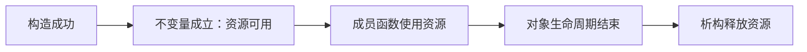

# 01 生命周期与类不变量

适用环境：C++17；配套代码为 [`01_lifetime.cpp`](code/01_lifetime.cpp)。

## 1. RAII 不只是自动 `delete`

RAII（Resource Acquisition Is Initialization，资源获取即初始化）将资源生命周期绑定到对象生命周期。资源包括：

- 动态内存、文件、套接字和锁。
- GPU 句柄、音频设备、数据库连接。
- 需要成对恢复的临时状态，例如渲染状态或事务。

强大之处在于：对象构造成功后，调用方可以把“资源可用”当作类不变量，不必在每个成员函数中重复检查初始化是否完成。



若构造失败，就不存在可使用的完整对象；已建立的子对象仍会被清理，第 02 章详细展开。

## 2. 一个带观测日志的资源对象

配套代码使用 `Ticket` 模拟不可复制的独占资源：

```cpp
class Ticket {
public:
    Ticket(int id, std::vector<int>& events) : id_(id), events_(events) {
        ++live_count_;
        events_.push_back(id_);
    }

    ~Ticket() {
        --live_count_;
        events_.push_back(-id_);
    }

    Ticket(const Ticket&) = delete;
    Ticket& operator=(const Ticket&) = delete;
```

`events_` 是测试观察通道，不是被管理的资源；`Ticket` 负责让存活计数与构造/析构一一对应。禁止复制可避免两个对象无意中共享同一份独占责任。

## 3. 成员按声明逆序销毁

```cpp
struct FrameResources {
    Ticket texture;
    Ticket vertex_buffer;
};
```

`FrameResources` 不需要自定义析构。其成员先构造 `texture`，再构造 `vertex_buffer`；销毁顺序相反：

```cpp
std::vector<int> events;
{
    FrameResources resources{{1, events}, {2, events}};
    assert(Ticket::live_count() == 2);
    assert((events == std::vector<int>{1, 2}));
}

assert(Ticket::live_count() == 0);
assert((events == std::vector<int>{1, 2, -2, -1}));
```

事件序列 `1, 2, -2, -1` 验证了逆序销毁。若资源 B 的释放依赖资源 A，成员声明顺序就必须体现这种依赖。

## 4. 对象存储期决定销毁触发方式

| 对象类别 | 常见销毁时机 |
|---|---|
| 自动局部对象 | 离开作用域，包括正常返回和异常栈展开 |
| 临时对象 | 通常在完整表达式结束时，生命周期延长规则除外 |
| 动态对象 | 由拥有者执行销毁，例如 `unique_ptr` 删除 |
| 静态/线程局部对象 | 程序或线程终止阶段，需额外注意销毁顺序 |

RAII 并不要求对象一定在栈上。动态分配的资源包装器仍然可以执行 RAII，关键是它的销毁由另一个明确所有者负责。

## 5. 与垃圾回收和 `finally` 的区别

- RAII 在对象生命周期结束时确定执行清理，不等待垃圾回收器。
- 清理责任随对象移动和组合，而不是依赖每个函数手写退出块。
- `finally` 可以清理当前作用域，但不能替代成员资源的所有权设计。

RAII 不保证所有逻辑问题自动消失：循环所有权、悬垂引用和错误的异步捕获仍需另行设计。

## 6. 练习

1. 为 `FrameResources` 增加第三个 `Ticket`，预测并验证事件顺序。
2. 交换两个成员的声明顺序，说明释放依赖会发生什么变化。
3. 分别用 `unique_ptr<Ticket>` 和原始指针保存动态对象，比较销毁责任。
4. 找出一个非内存资源，写出它的“取得—使用—释放”不变量。

## 小结

RAII 的核心不是析构函数语法，而是**明确所有权、建立类不变量、让语言在生命周期结束时执行清理**。

## 参考资料

- [cppreference：RAII](https://en.cppreference.com/cpp/language/raii)
- [cppreference：对象生命周期](https://en.cppreference.com/cpp/language/lifetime)
- [cppreference：析构函数](https://en.cppreference.com/cpp/language/destructor)
