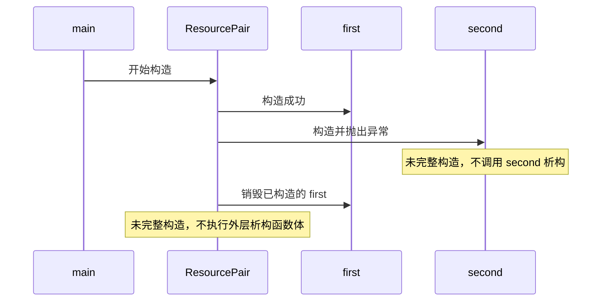

# 02 构造失败与栈展开

适用环境：C++17；配套代码为 [`02_construction.cpp`](code/02_construction.cpp)。

## 1. 构造函数负责建立不变量

一个资源包装器通常有两种设计：

- **全有或全无**：构造成功即资源可用；失败则抛出异常或经由工厂返回失败。
- **可安全销毁的空状态**：对象可以不含资源，但必须通过接口明确表达空状态。

不要让调用方面对“对象看似构造成功，但成员只初始化了一半”的状态。若资源是类使用的前提，构造失败通常应阻止完整对象诞生。

## 2. 成员构造顺序由声明决定

```cpp
struct ResourcePair {
    std::vector<int>& events;
    Probe first;
    Probe second;

    ResourcePair(std::vector<int>& events, bool fail_second)
        : events(events), first(1, events), second(2, events, fail_second) {}

    ~ResourcePair() {
        events.push_back(99);
    }
};
```

成员按声明顺序构造，而不是按初始化列表的书写顺序。当前顺序是 `events`、`first`、`second`。

`99` 用来观测外层 `ResourcePair` 的析构函数体是否执行。

## 3. 第二个成员构造失败会发生什么

`Probe` 在记录成功构造之前可以抛出异常：

```cpp
Probe(int id, std::vector<int>& events, bool fail = false)
    : id_(id), events_(events) {
    if (fail) {
        throw std::runtime_error("resource acquisition failed");
    }
    ++live_count_;
    events_.push_back(id_);
}
```

测试故意让 `second` 失败：

```cpp
events.clear();
try {
    ResourcePair pair(events, true);
    static_cast<void>(pair);
    assert(false);
} catch (const std::runtime_error&) {
}

assert(Probe::live_count() == 0);
assert((events == std::vector<int>{1, -1}));
```

精确过程是：



所以事件只有 `1, -1`，没有 `99`，也没有 `-2`。编译器生成的构造清理逻辑避免了手动 `catch → delete first → rethrow`。

## 4. 在构造函数体中抛出

如果所有成员都已构造成功，但构造函数体随后抛出异常，这些成员仍会全部析构；外层对象自身的析构函数体仍不会执行，因为它从未完整构造。

这条规则让“成员各自拥有资源”的组合天然适合异常路径。相反，在构造函数中用原始指针保存多份动态资源，往往需要额外清理逻辑。

## 5. 工厂与错误表达

构造函数无法返回值。若失败属于正常业务结果，可以使用工厂返回 `std::optional<T>`、智能指针或带错误信息的结果类型；若失败意味着无法满足类不变量，构造函数抛出异常能让语言自动清理部分构造结果。

选择依据是错误语义和调用环境，而不是“异常一定慢”或“工厂一定更安全”。

## 6. 常见误区

- 认为外层析构会处理构造失败；实际上外层对象尚未完整存在。
- 在构造函数中手工管理多份裸资源，遗漏中途失败路径。
- 根据初始化列表顺序推测成员构造顺序。
- 在尚未建立不变量时把 `this` 发布给其他线程或回调。

## 7. 练习

1. 让 `first` 构造失败，验证没有任何 `Probe` 需要析构。
2. 将失败移到 `ResourcePair` 构造函数体，观察两个成员都析构但没有 `99`。
3. 交换成员声明但保留初始化列表，解释事件顺序为何仍由声明决定。
4. 将两个裸指针成员改为 `unique_ptr`，比较构造失败时的清理代码。

## 小结

构造失败安全的关键是：每个已完整构造的子对象负责自己的资源，未完整构造的对象不执行自身析构。

## 参考资料

- [cppreference：析构函数与构造失败](https://en.cppreference.com/cpp/language/destructor)
- [cppreference：抛出异常](https://en.cppreference.com/cpp/language/throw)
- [Microsoft Learn：异常处理实践](https://learn.microsoft.com/en-us/cpp/cpp/errors-and-exception-handling-modern-cpp?view=msvc-170)
