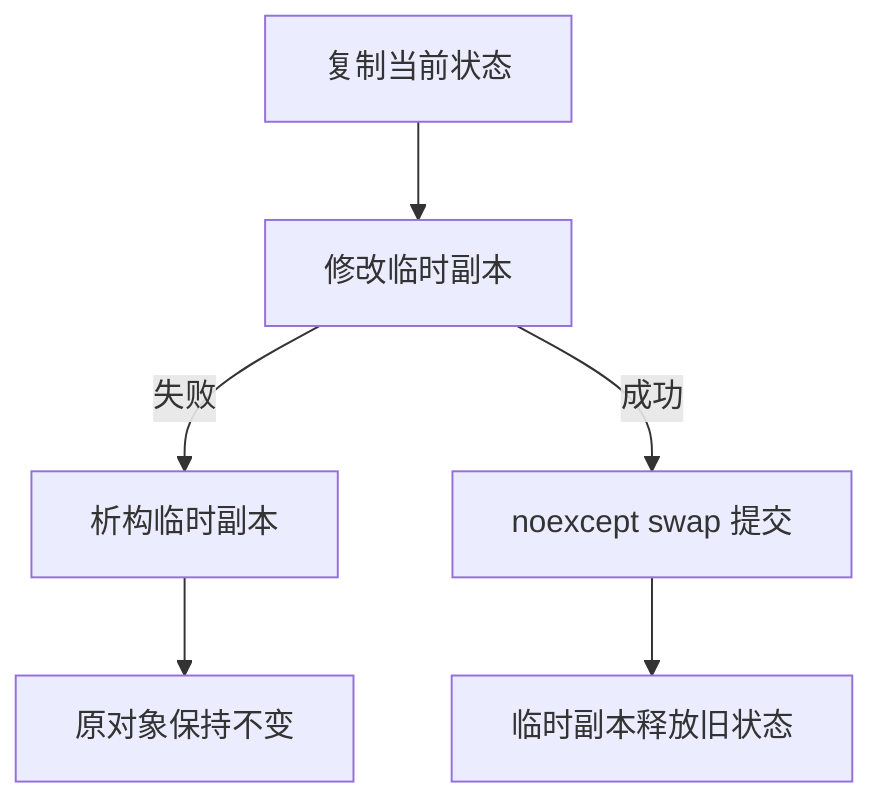

# 05 异常安全与组合

适用环境：C++17；配套代码为 [`05_exception_safety.cpp`](code/05_exception_safety.cpp)。

## 1. 异常安全不只是“不泄漏”

一个操作抛出异常时，需要同时回答：

- 已取得的资源是否释放？
- 对象是否仍满足类不变量？
- 调用方看到的是原状态、部分状态，还是未知状态？

RAII 解决资源释放，并通过良好组合帮助维持状态不变量；但“用了智能指针”并不自动意味着操作具有强异常保证。

## 2. 三种常见保证

| 保证 | 失败后的承诺 |
|---|---|
| 基本保证 | 对象有效、不变量成立、无资源泄漏，但内容可能已改变 |
| 强保证 | 操作要么完整成功，要么保持调用前状态 |
| 不抛保证 | 操作不通过异常报告失败，通常标记 `noexcept` |

若连基本保证都无法提供，异常后的对象通常只能销毁，不能继续使用。

## 3. 强保证：先准备，再提交

`PlayerState` 由标准库 RAII 成员组成：

```cpp
class PlayerState {
public:
    void apply(const PlayerEvent& event) {
        PlayerState updated(*this);
        updated.player_name_ = event.player_name;
        if (event.item == "invalid") {
            throw std::invalid_argument("invalid item");
        }
        updated.inventory_.push_back(event.item);
        swap(updated);
    }

    void swap(PlayerState& other) noexcept {
        std::swap(player_name_, other.player_name_);
        std::swap(inventory_, other.inventory_);
    }
```

所有可能失败的复制和修改都发生在临时副本 `updated` 上。最后的 `swap` 不抛异常，一次性提交新状态。



## 4. 测试必须覆盖“修改后失败”

示例故意在临时副本已经改名后抛出异常：

```cpp
PlayerState state;
try {
    state.apply({"alice", "invalid"});
    assert(false);
} catch (const std::invalid_argument&) {
}

assert(state.player_name() == "anonymous");
assert(state.inventory().empty());
```

如果失败只发生在复制之前，测试无法证明强保证。这里原对象仍为 `anonymous`，临时副本负责释放自己已经修改的状态。

成功路径则完整提交：

```cpp
state.apply({"alice", "potion"});
assert(state.player_name() == "alice");
assert(state.inventory().size() == 1);
assert(state.inventory()[0] == "potion");
```

## 5. 强保证不是永远的最佳选择

复制整个状态可能很昂贵。可以选择：

- 小范围日志和回滚，而非复制整个对象。
- 将操作拆成可单独提交的小步骤。
- 只提供基本保证，并在文档中说明可能改变的内容。
- 对真正不可失败的操作提供 `noexcept`。

选择取决于状态大小、失败频率和调用方需求，不能为了“强保证”牺牲所有性能而不测量。

## 6. 作用域守卫与事务

对于“失败时恢复状态、成功时取消恢复”的操作，可以实现作用域守卫：析构检查是否提交，未提交则回滚，成功后调用 `dismiss()`/`release()` 取消动作。

作用域守卫仍属于 RAII：它管理的是一项必须成对完成的动作。守卫析构中的回滚也不应抛异常。

## 7. 组合原则

1. 每个成员先满足自己的资源与异常安全契约。
2. 外层操作明确提供哪种保证。
3. 把可能失败的步骤放在提交之前。
4. 提交步骤尽量简单且不抛异常。
5. 测试失败发生前、中、后的所有路径。

## 8. 练习

1. 将 `PlayerState` 改为只提供基本保证，比较实现和失败后的可见状态。
2. 为临时副本注入一次 `push_back` 失败，验证原对象仍不变。
3. 实现一个作用域守卫，在异常时恢复渲染状态，正常完成后取消恢复。
4. 分析 copy-and-swap 的内存开销，说明何时不适合大对象。

## 小结

RAII 是异常安全的基础设施；强保证还需要事务式状态设计。把失败留在临时副本，把提交变成不抛异常的一步。

## 参考资料

- [Microsoft Learn：异常安全设计](https://learn.microsoft.com/en-us/cpp/cpp/how-to-design-for-exception-safety?view=msvc-170)
- [C++ Core Guidelines](https://isocpp.github.io/CppCoreGuidelines/CppCoreGuidelines)
- [cppreference：RAII](https://en.cppreference.com/cpp/language/raii)
