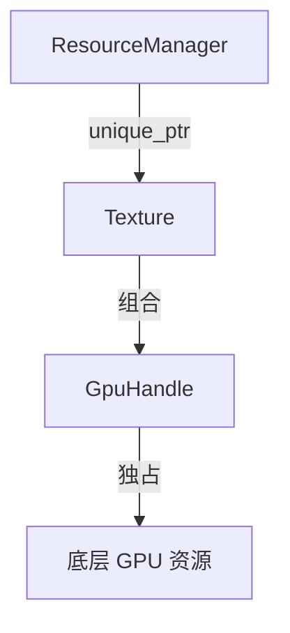

# 06 游戏资源管理实战

适用环境：C++17；配套代码为 [`06_game_resources.cpp`](code/06_game_resources.cpp)。

## 1. 分层所有权

示例将资源责任分为三层：



- `ResourceManager` 决定纹理对象的保存和清除。
- `Texture` 组合名称与 GPU 句柄。
- `GpuHandle` 只负责底层句柄的取得、转移和释放。
- `unique_ptr` 让 map 中的纹理具有明确独占所有者。

每层只管理自己的资源，外层无需知道 `GpuHandle` 的具体释放细节。

## 2. `GpuHandle`：不可复制、只可移动

```cpp
class GpuHandle {
public:
    explicit GpuHandle(int id) : id_(id) {
        ++live_count_;
    }

    ~GpuHandle() {
        release();
    }

    GpuHandle(const GpuHandle&) = delete;
    GpuHandle& operator=(const GpuHandle&) = delete;

    GpuHandle(GpuHandle&& other) noexcept
        : id_(std::exchange(other.id_, -1)) {}
```

GPU 句柄包装器禁止复制，防止两个对象释放同一底层资源。移动时源对象被置为空，析构只释放当前仍持有的句柄。

真实项目应将示例中的计数替换为图形 API 的创建和销毁函数，并遵守对应线程与设备生命周期要求。

## 3. `Texture` 使用组合而不是重复清理

```cpp
struct Texture {
    std::string name;
    GpuHandle handle;
};
```

`Texture` 不需要编写析构：`name` 自己释放字符，`handle` 自己释放 GPU 资源。由于 `GpuHandle` 不可复制，`Texture` 的复制也自然被禁止；移动语义则由成员组合得到。

## 4. 管理器拥有纹理

```cpp
Texture& acquire(std::string_view name) {
    if (name.empty()) {
        throw std::invalid_argument("resource name cannot be empty");
    }

    std::string key(name);
    auto it = textures_.find(key);
    if (it == textures_.end()) {
        auto texture = std::make_unique<Texture>(
            Texture{key, GpuHandle(next_id_++)});
        it = textures_.emplace(key, std::move(texture)).first;
    }
    return *it->second;
}
```

`acquire()` 先验证名称，再创建完整 `Texture`。`make_unique` 确保新对象立即进入独占管理；插入 map 失败时，智能指针仍会销毁对象及其 GPU 句柄。

返回 `Texture&` 表示非拥有借用，调用方不负责 `delete`，但生命周期受管理器控制。

## 5. 验证复用、清空与退出清理

```cpp
ResourceManager manager;
Texture& player = manager.acquire("player");
Texture& same_player = manager.acquire("player");
assert(&player == &same_player);
assert(manager.size() == 1);
assert(GpuHandle::live_count() == 1);

manager.acquire("enemy");
assert(GpuHandle::live_count() == 2);

manager.clear();
assert(GpuHandle::live_count() == 0);
```

重复获取复用同一个对象；`clear()` 销毁 map 中的 `unique_ptr`，进而销毁纹理和句柄。

外层作用域结束也会执行同样清理：

```cpp
manager.acquire("terrain");
assert(GpuHandle::live_count() == 1);
```

示例随后离开管理器作用域并断言存活句柄数回到 `0`。

> ⚠️ `player` 引用在 `clear()` 后已经悬垂，不能再访问。若需要跨清除或跨管理器生命周期使用，应改用共享所有权、稳定句柄表或其他明确方案。

## 6. 异步任务边界

不要仅因为“资源当前存在”就把 `Texture&` 捕获到可能下一帧才执行的任务中。任务排队后，管理器可能先清空或销毁。

可选设计包括：

- 任务持有合适的 `shared_ptr`，明确共享资源生命周期。
- 使用可检测失效的弱引用或代际句柄。
- 将销毁命令延迟到所有相关任务完成之后。
- 把资源访问集中在拥有资源的线程或系统。

选择取决于是否需要共享所有权和引擎任务模型；RAII 本身不会自动延长被捕获引用的生命周期。

## 7. 失败路径

```cpp
try {
    manager.acquire("");
    assert(false);
} catch (const std::invalid_argument&) {
}
assert(GpuHandle::live_count() == 0);
```

空名称在取得 GPU 资源前被拒绝，因此没有泄漏。更复杂的加载失败则由第 02 章的部分构造规则和第 05 章的事务式提交共同处理。

## 8. 练习

1. 为 `ResourceManager` 增加 `erase(name)`，测试借用引用在删除后的使用边界。
2. 将返回值改为代际句柄，使调用方能检测资源已被替换。
3. 为 GPU 创建函数注入失败，验证名称字符串和已有资源均不泄漏。
4. 设计一个异步加载流程，明确任务、管理器和渲染线程分别拥有什么。
5. 若多个系统确实共享纹理，将独占方案改为 `shared_ptr`/`weak_ptr` 并说明代价。

## 小结

可靠的资源管理来自分层 RAII：底层包装器管理一个资源，中层类型组合不变量，上层管理器决定对象存活时间，异步边界另行表达生命周期。

## 参考资料

- [cppreference：RAII](https://en.cppreference.com/cpp/language/raii)
- [Microsoft Learn：智能指针](https://learn.microsoft.com/en-us/cpp/cpp/smart-pointers-modern-cpp?view=msvc-170)
- [C++ Core Guidelines](https://isocpp.github.io/CppCoreGuidelines/CppCoreGuidelines)
