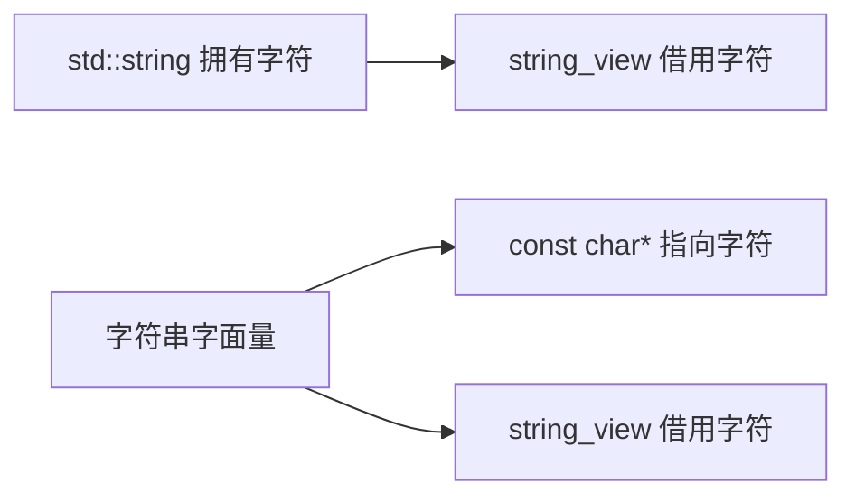

# 01 字符串类型与接口设计

适用环境：C++17；配套代码为 [`01_types.cpp`](code/01_types.cpp)。

你将学会区分字符串的**存储内容**与**所有权**，并据此设计函数参数和成员变量。

## 1. 三种常见类型不是同义词

| 类型 | 是否拥有字符 | 是否保证空字符结尾 | 典型用途 |
|---|---|---|---|
| `std::string` | 是 | `c_str()`/`data()` 可提供 | 长期保存、修改、返回拥有值 |
| `std::string_view` | 否 | 否 | 只读参数、临时切片 |
| `const char*` | 否 | 取决于调用约定 | C API、字符串字面量、遗留接口 |

`const char*` 只说明指向字符的指针本身不拥有数据；它甚至可能为空。若接口要求空字符结尾，必须在文档和实现中明确这一前提。



选择顺序可以是：

1. 需要保存或修改内容：使用 `std::string`。
2. 只在调用期间读取：优先考虑 `std::string_view`。
3. 必须满足 C 接口或特定空字符约定：使用明确的指针接口。

## 2. 只读参数使用视图

```cpp
std::size_t text_length(std::string_view text) {
    return text.size();
}

bool has_prefix(std::string_view text, std::string_view prefix) {
    return text.size() >= prefix.size() &&
           text.substr(0, prefix.size()) == prefix;
}
```

`text_length()` 能接收 `string`、字符串字面量或已有视图，不要求调用方为了匹配参数类型构造新的 `string`。

```cpp
const char* literal = "player";
const std::string owned = "alice";
const std::string_view borrowed = owned;

assert(text_length(literal) == 6);
assert(text_length(borrowed) == 5);
assert(has_prefix(owned, "ali"));
```

这里构造 `string_view` 不会复制字符；`owned` 必须继续存活，且不能发生使字符存储失效的修改。

## 3. 写入拥有字符串时明确复制

`rename_player()` 会保留新名称，因此最终必须写入拥有对象：

```cpp
void rename_player(std::string& player_name, std::string_view new_name) {
    player_name.assign(new_name.data(), new_name.size());
}
```

使用 `data() + size()` 能正确复制包含内嵌空字符的视图，也不会误把视图当成空字符结尾的 C 字符串。

需要长期保存时，同样构造拥有副本：

```cpp
struct PlayerProfile {
    std::string name;
};

PlayerProfile profile{std::string(borrowed)};
assert(profile.name == owned);
```

若直接把成员声明为 `string_view`，`PlayerProfile` 就会依赖外部字符存储，生命周期管理将变得更复杂。

## 4. 字符串可以包含内嵌空字符

`std::string` 和 `std::string_view` 都通过长度确定内容范围，而不是遇到第一个 `'\0'` 就结束：

```cpp
const std::string embedded_null("a\0b", 3);
assert(embedded_null.size() == 3);
```

把它交给只接收 `const char*` 且没有长度参数的 C API 时，API 通常只能看到第一个空字符之前的内容。二进制协议和文本协议的边界不能混淆。

## 5. 常见错误与练习

- 用 `string_view` 保存需要长期存在的内容。
- 默认所有字符串都以空字符结尾。
- 为了只读参数而强制调用方构造 `string`。
- 忽略 `const char*` 可能为空或包含截断语义。

练习：设计 `load_name()`、`print_name()` 和 `Player::name` 的类型，分别说明它们为什么需要拥有、借用或转移内容。

## 小结

所有权是类型选择的第一原则：保存用 `string`，临时只读用 `string_view`，与 C API 交互时明确 `const char*` 的额外约定。

## 参考资料

- [cppreference：`std::basic_string`](https://en.cppreference.com/cpp/string/basic_string)
- [cppreference：`std::string_view`](https://en.cppreference.com/cpp/string/basic_string_view)
- [C++ Core Guidelines：字符串指南](https://isocpp.github.io/CppCoreGuidelines/CppCoreGuidelines)
