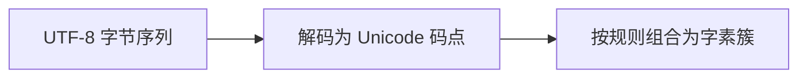

# 04 UTF-8 与文本处理

适用环境：C++17；配套代码为 [`04_utf8.cpp`](code/04_utf8.cpp)。源码按 UTF-8 保存，MSVC 通过 `/utf-8` 编译。

## 1. `std::string` 本身不理解 Unicode

`std::string` 保存一串 `char`。当它保存 UTF-8 文本时，每个 `char` 是一个 8 位码元，也就是一个字节；`size()` 返回字节数。

需要区分三层概念：

| 概念 | 含义 |
|---|---|
| UTF-8 码元/字节 | 编码存储单位，一个码点占 1 至 4 个 |
| Unicode 码点 | Unicode 编码空间中的一个值 |
| 字素簇 | 用户通常感知的一个字符，可能由多个码点组成 |



因此，“限制玩家名称为 16 个字符”必须先说明限制的是字节、码点还是用户感知字符。

## 2. 字节数不等于字符数

```cpp
const std::string ascii = "A";
const std::string cjk = u8"界";
const std::string combined = u8"A界";

assert(ascii.size() == 1);
assert(cjk.size() == 3);
assert(combined.size() == 4);
```

在 C++17 中，`u8` 字符串字面量仍可初始化 `std::string`。示例使用 UTF-8 源码和编译选项，确保字节序列符合预期。

> ⚠️ 不要把这里的 UTF-8 字节数推广到任意编码。若 `string` 保存的是其他编码或二进制数据，相同接口只反映实际字节内容。

## 3. 对已知有效 UTF-8 统计码点

UTF-8 续字节满足高位模式 `10xxxxxx`。对**已经验证有效**的 UTF-8，可以统计非续字节数量：

```cpp
std::size_t count_code_points_in_valid_utf8(std::string_view text) {
    std::size_t count = 0;
    for (const unsigned char byte : text) {
        if ((byte & 0xc0u) != 0x80u) {
            ++count;
        }
    }
    return count;
}
```

```cpp
assert(count_code_points_in_valid_utf8(combined) == 2);
```

这个函数不验证非法续字节、过长编码、代理码点或超出 Unicode 范围的值，不能作为不可信输入的验证器。

## 4. 码点数仍不等于用户感知字符数

`e` 与组合 acute 重音符号 `U+0301` 可以共同显示为一个 `é`：

```cpp
const std::string combining = u8"é";

assert(combining.size() == 3);
assert(count_code_points_in_valid_utf8(combining) == 2);
```

这里包含 3 个 UTF-8 字节、2 个码点，但通常被用户看作 1 个字符。表情符号序列、组合标记和区域指示符还可能形成更复杂的字素簇。

## 5. 哪些操作需要 Unicode 库

仅按 ASCII 分隔符查找、在网络协议边界传递 UTF-8 字节，通常可以直接使用 `string`/`string_view`。以下任务不能靠简单字节循环正确完成：

- Unicode 大小写转换和排序。
- 按字素簇截断显示文本。
- 规范化等价文本。
- 处理复杂换行、双向文本和字体排版。

这类任务应使用 ICU 等 Unicode 库，而不是自行添加几条字符判断规则。

> ⚠️ 在任意字节下标调用 `substr()` 可能切断一个 UTF-8 码点。即使切在码点边界，也可能切断一个字素簇。

## 6. 编译与输入边界

- 明确源文件编码；本教程 MSVC 使用 `/utf-8`。
- 明确文件、网络、操作系统 API 使用的编码，不在边界处猜测。
- 对不可信输入先验证 UTF-8，再执行依赖有效编码的算法。
- 避免在内部无意义地反复转换编码。

## 7. 练习

1. 用只含 ASCII、含中文、含组合标记的三组输入比较字节数和码点数。
2. 为聊天输入制定长度限制，明确使用字节、码点还是字素簇。
3. 研究项目当前文本库的 UTF-8 验证、规范化和字素簇能力。
4. 解释为什么“每个字节的高位为 0 就是完整 ASCII 文本”的判断不能验证任意 UTF-8。

## 小结

`std::string` 是字节容器；UTF-8 码点计数只是文本处理的一层。玩家可见文本的截断、排序和规范化需要真正的 Unicode 规则。

## 参考资料

- [Unicode FAQ：UTF-8、UTF-16、UTF-32 与 BOM](https://unicode.org/faq/utf_bom.html)
- [Unicode FAQ：字符与组合标记](https://www.unicode.org/faq/char_combmark.html)
- [Unicode FAQ：编程问题](https://unicode.org/faq/programming.html)
- [ICU 官方文档](https://unicode-org.github.io/icu/)
