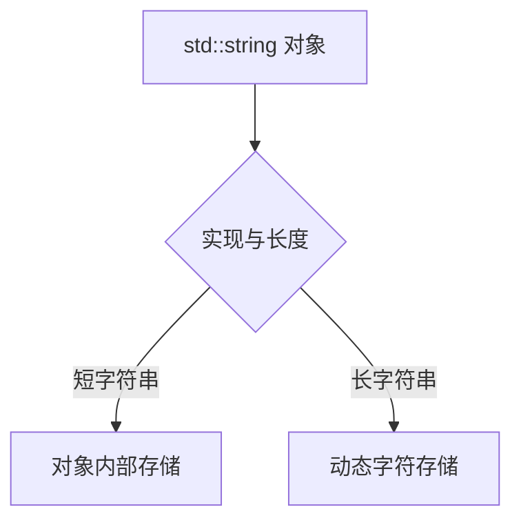

# 05 内存与移动

适用环境：C++17；配套代码为 [`05_memory.cpp`](code/05_memory.cpp)。

## 1. 字符串对象与字符存储

`std::string` 对象保存管理字符所需的状态。字符可能存放在对象内部，也可能位于动态分配的存储中。

SSO（Small String Optimization，小字符串优化）允许实现把短字符串直接放入对象，减少一次动态分配。标准不强制 SSO，也不统一短串容量、对象大小或扩容策略。



不要根据某个平台的 15 或 22 字节阈值编写通用逻辑，也不要用 `sizeof(std::string)` 估算字符串总内存；动态字符存储不包含在该数值中。

## 2. `size` 与 `capacity`

- `size()`：当前字符数量。
- `capacity()`：在重新分配前可容纳的字符数量。
- `capacity() >= size()` 始终成立。

容量是存储能力，不是内容长度。预留容量不会制造新字符。

## 3. `reserve`：只预留容量

```cpp
std::string text;
text.reserve(1024);
const auto reserved_capacity = text.capacity();
assert(text.size() == 0);
assert(reserved_capacity >= 1024);

const char* original_data = text.data();
while (text.size() < 1024) {
    text.push_back('x');
}
assert(text.size() == 1024);
assert(text.capacity() == reserved_capacity);
assert(text.data() == original_data);
```

已知最终大小时，`reserve()` 可以避免增长过程中的多次重新分配。本例在容量范围内追加，因此字符地址保持不变。

过度预留会浪费内存；不知道规模时，不应随意填写巨大容量。

## 4. `resize`：改变实际长度

```cpp
text.resize(16, 'a');
assert(text.size() == 16);
assert(text[15] == 'x');
text.resize(20, 'a');
assert(text.size() == 20);
assert(text[19] == 'a');
```

缩小长度不会用 `'a'` 重写保留下来的旧字符，所以第 15 项仍为原来的 `'x'`。从 16 扩大到 20 时，新增字符才初始化为 `'a'`。

`resize()` 可能改变内容并触发分配；`reserve()` 只管理容量。

## 5. `shrink_to_fit`：非强制请求

```cpp
text.shrink_to_fit();
assert(text.size() == 20);
```

`shrink_to_fit()` 请求减少未使用容量，但实现可以忽略。不能断言调用后 `capacity() == size()`，也不能为了每次小修改都调用它，因为重新分配本身有成本。

## 6. 移动字符串

```cpp
std::string source(4096, 'x');
std::string destination = std::move(source);
assert(destination.size() == 4096);
source = "reused";
assert(source == "reused");
```

移动通常转移长字符串的内部指针，避免复制字符；短字符串仍可能复制对象内部内容。移动后 `source` 有效但未指定，不应假设它一定为空。示例通过赋新值重新使用它。

不要为了让返回语句“更快”而机械地给局部具名变量添加 `std::move`，这可能干扰正常返回值优化。

## 7. 指针和视图失效

```cpp
std::string changing = "short";
const char* before = changing.data();
changing.reserve(8192);
const char* after = changing.data();
std::cout << "pointer_changed_after_growth=" << (before != after) << '\n';
```

示例只报告当前运行是否改变地址，不断言一定改变。若 `reserve()` 导致重新分配，旧指针、引用和迭代器会失效；基于这些地址创建的 `string_view` 也不能继续使用。

安全做法是完成可能扩容的操作后重新调用 `data()` 或重新构造视图。

## 8. 优化检查表

1. 是否确实出现了分配或拷贝热点？
2. 能否复用已有字符串而不是每帧创建？
3. 是否能合理 `reserve()`，而不是过度预留？
4. 是否把 `resize()` 和 `reserve()` 混用？
5. 是否仍保存着扩容前的指针或视图？
6. 是否依赖 SSO 阈值或移后为空等未保证行为？

## 小结

字符串优化首先是分配管理。理解容量和失效规则，比记忆某个标准库的 SSO 数字更可靠。

## 参考资料

- [cppreference：`std::basic_string`](https://en.cppreference.com/cpp/string/basic_string)
- [cppreference：`reserve`](https://en.cppreference.com/cpp/string/basic_string/reserve)
- [cppreference：`resize`](https://en.cppreference.com/cpp/string/basic_string/resize)
- [cppreference：`shrink_to_fit`](https://en.cppreference.com/cpp/string/basic_string/shrink_to_fit)
