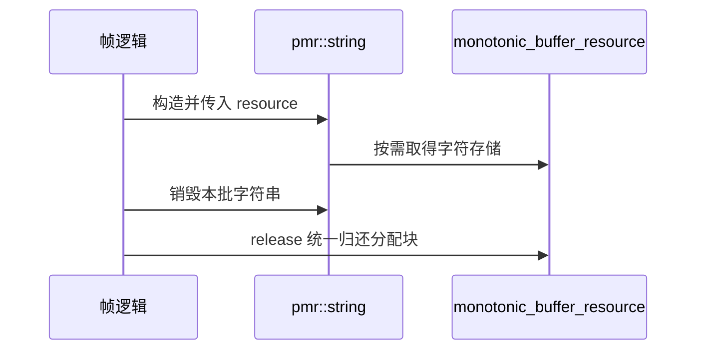

# 07 游戏开发优化

适用环境：C++17；配套代码为 [`07_pmr.cpp`](code/07_pmr.cpp)。

## 1. 先找分配时机，再谈字符串快慢

游戏循环中的字符串问题通常不是一次 `append()` 的指令成本，而是分配抖动、内存碎片和缓存行为。

常见热点包括：

- 每帧重建不变的 HUD 文本。
- 在战斗日志循环中反复扩容。
- 为解析配置临时复制大量子串。
- 为数值转换反复创建字符串流。
- 把短生命周期文本和长期对象混在同一个所有权模型中。

优化前先记录分配次数、调用位置和帧内峰值。若文本只在加载或保存时出现，复杂优化可能没有实际价值。

## 2. 按场景选择手段

| 场景 | 优先手段 |
|---|---|
| 临时解析已有文本 | `string_view` 切片 |
| 已知输出规模的拼接 | `reserve()` + `append()` |
| 数值转文本 | `to_chars()` 写入已有缓冲区 |
| 每帧不变文本 | 仅在数据变化时重建或缓存 |
| 一批文本统一释放 | `pmr` 单调内存资源 |

这些手段可以组合，但每一种都应以正确生命周期为前提。

## 3. `pmr::string` 使用多态分配器

`std::pmr::string` 是使用 `std::pmr::polymorphic_allocator<char>` 的字符串别名。它与默认分配器的 `std::string` 是不同类型：

```cpp
static_assert(!std::is_same_v<std::string, std::pmr::string>);
```

这意味着跨接口传递时需要考虑类型和分配器，不是把现有 `std::string` 全局搜索替换就完成优化。

## 4. 帧局部文本示例

```cpp
std::array<std::byte, 4096> arena{};
std::pmr::monotonic_buffer_resource resource(
    arena.data(), arena.size(), std::pmr::null_memory_resource());

{
    std::pmr::string combat_text(&resource);
    combat_text.reserve(512);
    combat_text.append("critical:");
    std::array<char, 32> number{};
    const auto conversion = std::to_chars(
        number.data(), number.data() + number.size(), 1200);
    assert(conversion.ec == std::errc{});
    combat_text.append(number.data(), conversion.ptr);
    combat_text.append(";target:");
    combat_text.append("slime");

    std::pmr::string status_text(&resource);
    status_text.assign("ready");

    assert(combat_text == "critical:1200;target:slime");
    assert(status_text == "ready");
    std::cout << combat_text << ", " << status_text << '\n';
}

resource.release();
```

执行顺序如下：



`resource` 先于字符串创建、后于字符串销毁，因此字符串析构时内存资源仍然有效。`release()` 也放在字符串作用域结束之后。

> ⚠️ 内存资源必须比使用它的字符串活得更久。不能让字符串逃出资源作用域后继续访问或销毁。

## 5. 单调资源的适用边界

`monotonic_buffer_resource` 的特点是快速取得内存，并在资源销毁或 `release()` 时统一释放上游块；单个字符串释放不会把对应区域立即还给上游供任意复用。

适合：

- 一帧、一阶段或一次请求内共同结束的临时对象。
- 分配数量较多但整体生命周期清晰的文本。

不适合：

- 生命周期差异很大的长期缓存。
- 无界增长且无法集中释放的文本流。
- 未估算容量的极端输入。

本例的 `null_memory_resource()` 作为上游使容量不足时的分配失败更容易暴露；真实项目应明确缓冲区规模和失败策略。SSO 仍可能让短字符串不访问内存资源。

## 6. 优化检查表

1. 在 Release 配置下测量，确认热点位于字符串操作。
2. 先消除不必要重建，再优化剩余构造。
3. 对临时解析使用视图，对长期保存使用拥有字符串。
4. 合理预留容量，避免过度预留。
5. 使用 `pmr` 前证明整批对象可以统一释放。
6. 优化后运行正确性测试，并检查内存峰值。

## 7. 练习

1. 将战斗文本改成一组 `pmr::string`，确保容器和字符串使用正确的内存资源。
2. 让缓冲区故意不足，观察并处理 `std::bad_alloc`。
3. 比较默认分配器与 `pmr` 的分配次数和帧内峰值，而不只比较总耗时。
4. 找出一个每帧不变的 UI 字符串，将它改为数据变化时才更新。

## 小结

游戏字符串优化的目标是减少热路径上的不必要工作，并让分配时机符合帧生命周期。`pmr` 是生命周期工具，不是无条件的加速开关。

## 参考资料

- [cppreference：`std::pmr::basic_string`](https://en.cppreference.com/cpp/string/basic_string)
- [cppreference：`monotonic_buffer_resource`](https://en.cppreference.com/cpp/memory/monotonic_buffer_resource)
- [cppreference：`monotonic_buffer_resource::release`](https://en.cppreference.com/cpp/memory/monotonic_buffer_resource/release)
- [cppreference：`to_chars`](https://en.cppreference.com/cpp/utility/to_chars)
