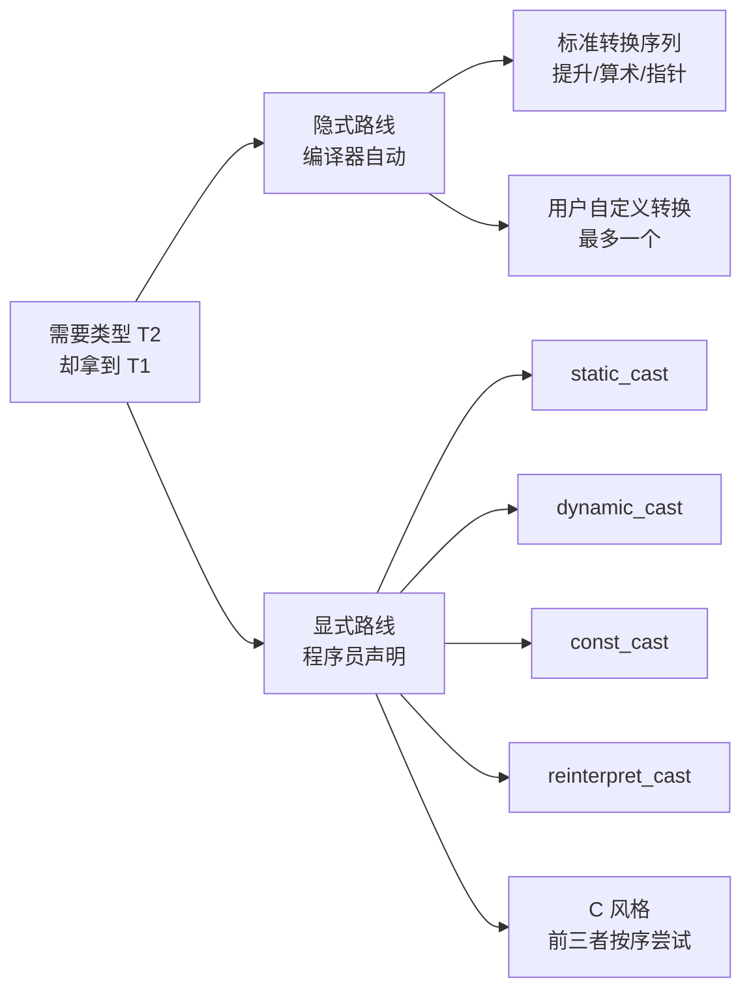

# 01 转换全景

适用环境：C++17；配套代码为 [`01_overview.cpp`](code/01_overview.cpp)。

## 1. 转换只有两条路线

C++ 里把一个 `T1` 的值当成 `T2` 用，只有两条路线：

- **隐式转换**：你没写 cast，编译器按语言规则自动做。规则来自两套体系：标准转换序列（整型提升、算术转换、指针转换等）和用户自定义转换（转换构造函数、转换运算符）。
- **显式转换**：你明确写了转换意图——四个命名 cast（`static_cast`、`dynamic_cast`、`const_cast`、`reinterpret_cast`）、函数式转换 `T(x)`、C 风格转换 `(T)x`。



图里的关键分支是「用户自定义转换最多一个」：隐式转换链里最多出现一次转换构造函数或转换运算符，两跳连转编译器直接拒绝（第 3 章展开）。

## 2. 转换发生的六个语境

转换不是只有赋值时才发生。以下语境都会触发，看到它们就要意识到「类型可能被改了」：

| 语境 | 例子 | 隐式？ |
|---|---|---|
| 初始化 | `int a = 3.9;` | 是 |
| 函数实参 | `print(42)`（形参 `double`） | 是 |
| 运算符操作数 | `uc + uc`（`unsigned char` 提升为 `int`） | 是 |
| `return` 语句 | `return d;`（返回类型 `int`） | 是 |
| 列表初始化 | `int b{3.9}` | 窄化直接禁止 |
| 显式 cast | `static_cast<int>(3.9)` | 否，自己声明 |

配套代码逐个演示了这些语境，运行输出：

```text
窄化拷贝初始化 int a = 3.9 -> 3；显式转换后 {static_cast} -> 3
print_length 收到 42.00 米
unsigned char 250 + 250 = 500（类型为 int，不是 unsigned char）
return 处转换 7.90 -> 7
explicit 构造只能直接初始化或 static_cast：5.0 米
static_cast<Meters>(6.5) -> 6.5 米
```

注意第一行与第三行：`int a = 3.9` 静默截断成 3（编译期只有一条 C4244 警告）；而 `unsigned char + unsigned char` 并没有在 `unsigned char` 里回绕——两个操作数先各自提升为 `int` 再相加。**隐式转换不需要你写任何东西，这正是它危险的原因。**

## 3. 安全等级阶梯

不是所有转换同等危险。把常见转换按「值是否保持」排成阶梯，写代码时自查处于哪一级：

| 等级 | 转换 | 风险 |
|---|---|---|
| 1 无损 | 整型提升（`char`→`int`）、上行转换（`Derived*`→`Base*`）、加 `const` | 值与语义都保持 |
| 2 可能丢值 | 窄化：`double`→`int`、`long long`→`float`、大整数→小整数 | 静默截断或丢精度 |
| 3 语义转换 | 枚举↔整数、指针↔`bool` | 值保持，但类型含义变了 |
| 4 重新解释 | `reinterpret_cast`、`const_cast` 后写入 | 违反规则就是 UB |

> ⚠️ 等级 2 的窄化在拷贝初始化里静默发生，等级 4 的重新解释一旦违反严格别名或对象生命周期就是未定义行为。本教程第 2 章对付等级 2，第 6 章对付等级 4。

## 4. explicit 是路线闸门

第 1 章只需记住结论，细节在第 3 章：给单参数构造函数加 `explicit`，就把「隐式路线」的这扇门焊死——只能通过直接初始化或显式 cast 走「显式路线」。配套代码里 `Meters(double)` 加了 `explicit`，于是 `Meters m = 5.0;` 编译不过，`static_cast<Meters>(6.5)` 放行。

## 5. 什么在编译期，什么在运行期

绝大多数转换是编译期动作：生成几条机器指令，甚至零指令。唯一标配的运行期转换是 `dynamic_cast`（第 5 章）——它要在运行期查 RTTI 元数据判断「这个对象真实类型到底是不是目标类型」。UE 关掉 RTTI 后用自家反射体系替代它（第 7 章）。

## 本章要点

- 转换六语境：初始化、实参、运算符、`return`、列表初始化、显式 cast。
- 隐式 = 标准转换序列 + 至多一个用户自定义转换；显式 = 四个命名 cast + C 风格。
- 风险阶梯四档：无损 → 窄化 → 语义变化 → 重新解释（UB 区）。
- `explicit` 是把隐式路线换成显式路线的闸门。
