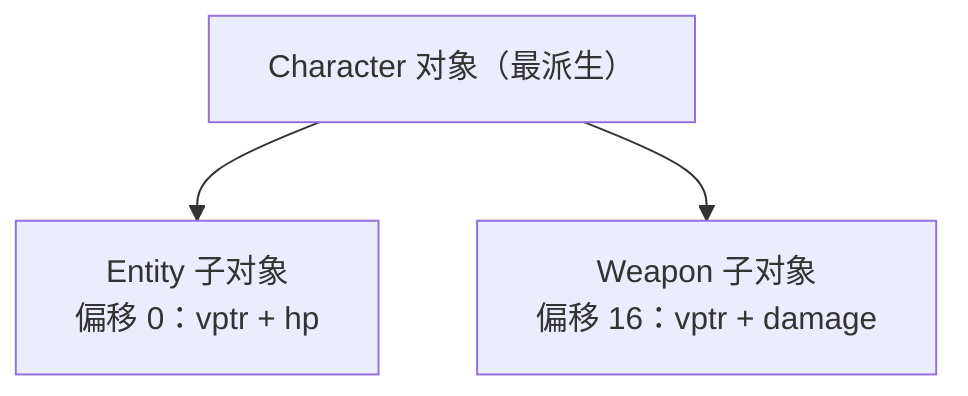

# 05 dynamic_cast 深入

适用环境：C++17；配套代码为 [`05_dynamic_cast.cpp`](code/05_dynamic_cast.cpp)。本章部分结论与 `dx:cpp-learning/knowledge/object-layout.md` 的 RTTI 节衔接。

## 1. 三种转换，两种检查

`dynamic_cast<T*>` 处理继承图上的三种移动，检查力度完全不同：

| 转换方向 | 别名 | 检查 | 成本 |
|---|---|---|---|
| 派生 → 基类 | 上行转换 | 编译期完成，等同 `static_cast` | 零 |
| 基类 → 派生 | 下行转换 | 运行期查 RTTI | 沿继承链走 |
| 基类 → 兄弟基类 | 跨类转换 | 运行期查 RTTI | 需查偏移表 |

只有后两种是「真 dynamic」：编译器无法只靠静态类型算出结果，必须问运行期元数据。前提条件：**源类型必须多态**（至少一个虚函数），否则 `dynamic_cast` 直接编译错误——没有虚表就没有 typeinfo 可查。

## 2. this 指针调整：同一个对象，多个地址

先看对象布局。`Character` 同时继承 `Entity` 和 `Weapon`：



同一个 `Character` 对象，`Entity*` 视角和 `Weapon*` 视角指向不同子对象，地址不同。上行转换时编译器插入**固定偏移**修正 `this`；实测输出：

```text
hero 对象地址 0000006C5E4FFC38，作为 Entity* 0000006C5E4FFC38，作为 Weapon* 0000006C5E4FFC48
Entity* 与 Weapon* 差值 = 16 字节（多继承的 this 调整）
```

下行转换到**已知**继承链时，偏移也是编译期常量。但**跨类转换**（`Entity*` → `Weapon*`）的偏移取决于「这个对象最派生类型到底是什么」——编译期无法知道，这正是 `dynamic_cast` 存在的理由：

```cpp
if (auto* w = dynamic_cast<Weapon*>(ep)) {   // 运行期查偏移表，完成跨类转换
    // damage = 7
}
```

## 3. 失败语义：指针返空，引用抛异常

```cpp
auto* failed = dynamic_cast<Derived*>(really_base);   // 返回 nullptr

try {
    dynamic_cast<Weapon&>(unrelated);                 // 引用失败无处放 nullptr
} catch (const std::bad_cast&) { }                    // 只能抛异常
```

指针形式把「类型假设错了」变成一个可分支的 `nullptr`；引用形式把假设错误升级为异常。写泛型代码时记得 `dynamic_cast<void*>` 返回**最派生对象的地址**，可用来判断「这两个基类指针是否指向同一个对象」——直接比较两个基类指针是靠不住的，它们可能相差 16 字节却指向同一对象。

## 4. 成本：元数据查找，实现差异巨大

Itanium C++ ABI（GCC/Clang）里 `dynamic_cast` 由 `__dynamic_cast` 实现：从源 typeinfo 出发，在 `__class_type_info` 构成的继承图上搜索目标 typeinfo，找不到偏移表就返回失败。成本随**继承深度和兄弟类数量**增长，不是常数。业界实测差距很大：同一组深层 DAG 用例，libstdc++ 约 7 ns，libc++ 曾测得 60–253 ns（其 `__dynamic_cast` 长期未利用 ABI 预留的 `src2dst_offset` 快路径，后被优化修复）。MSVC 是第三套独立实现。

本机参考（1×10⁷ 次，Debug 构建，量级仅供参考）：

```text
10000000 次：dynamic_cast 289092 us，static_cast 7394 us（本机量级参考）
```

> ⚠️ 在热路径（每帧跑百万次的循环）里，`dynamic_cast` 通常不可接受。替代方案按优先级：能改成虚函数就改（让分派交给虚表，一次间接寻址）；类型集合固定就用 visitor/double dispatch；类型已被业务逻辑证明（如刚 `new` 出来的对象）才用 `static_cast`。

## 5. RTTI 是可以被关掉的

`-fno-rtti`（GCC/Clang）或 `/GR-`（MSVC）会移除 typeinfo 元数据，`dynamic_cast` 与 `typeid` 随之不可用。嵌入式、引擎和浏览器厂商常关 RTTI 换体积与可预测性。UE 就默认关 RTTI，用自家反射体系承担类型判断职责——那是第 7 章的主题。`dx:cpp-learning/knowledge/object-layout.md` 的结论在此复述：`dynamic_cast`/`typeid` 走虚表中的 typeinfo 指针，关 RTTI 后连虚表里的槽都不存在。

## 本章要点

- 上行零成本编译期完成；下行、跨类才需要运行期查 RTTI。
- 多继承下同一对象有多个基类子对象地址，跨类偏移只有运行期知道。
- 指针失败返 `nullptr`，引用失败抛 `std::bad_cast`；同一对象的判等用 `dynamic_cast<void*>`。
- 成本随继承图复杂度增长，实现间差数倍；热路径改虚函数或 visitor。
- RTTI 可整体关闭；UE 关 RTTI 后由反射接手。

## 待深入

- Itanium ABI 的 `__si_class_type_info`（单继承）与 `__vmi_class_type_info`（多/虚继承）结构。
- 虚继承下的 `dynamic_cast` 路径（经虚表偏移槽，两次间接）。
- Stroustrup 的 Fast Dynamic Casting 提案：失败 O(1) 的模运算技巧。
