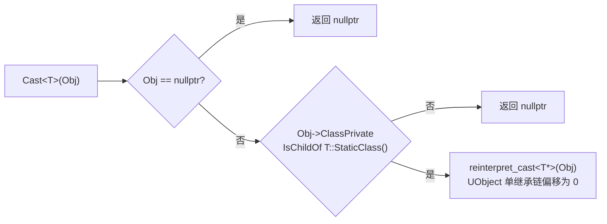

# 07 UE Cast 专题

适用环境：本课配套代码 [`07_ue_cast_sim.cpp`](code/07_ue_cast_sim.cpp) 是 UE Cast 语义的**最小模拟**（非 UE 源码），可在任何 C++17 环境运行；机制描述基于 UE 官方论坛权威帖与社区源码解析的交叉核实。

## 1. UE 为什么不用 dynamic_cast

UE 全引擎以 `/GR-`（关闭 C++ RTTI）构建。三个原因：

1. **体积与可预测性**：RTTI 元数据让每个多态类膨胀，引擎关掉它换二进制体积和加载时间（与 `dx:cpp-learning/knowledge/object-layout.md` 的 RTTI 成本结论一致）。
2. **自有反射更强大**：UE 的反射系统（`UCLASS`/`UPROPERTY`/`UFUNCTION`，由 UHT 生成 `.generated.h`）记录了完整类层级、属性和元数据，功能远超 typeinfo。
3. **GC 与序列化的基石**：`UObject` 体系需要比 RTTI 更丰富的类型信息才能做垃圾回收、蓝图互操作和序列化。

代价：标准 `dynamic_cast` 和 `typeid` 在 UE 代码里**编译不过**。类型判断全部走反射。

## 2. Cast<T> 的机制：反射判定 + 指针落实

`Cast<T>(Obj)` 是全局模板函数，工作分两步：



模拟代码用最小反射注册表复刻了这个流程（每个类型登记 `UClass{name, super}`，判型沿 `super` 链上溯，即 UE 的 `IsChildOf`）：

```cpp
template <typename To, typename From>
To* Cast(From* src) {
    if (src == nullptr) return nullptr;
    if (!src->ClassPrivate->is_child_of(*To::StaticClass())) return nullptr;
    return reinterpret_cast<To*>(src);   // 反射已担保类型，单继承链偏移 0
}
```

两个值得注意的细节：

- **为什么敢用 `reinterpret_cast`**：`UObject` 整条继承链是单继承，子对象偏移恒为 0，指针值无需调整。这正是 UE 把所有 UObject 派生设计成单继承链的原因之一。反射判定失败时提前返回 `nullptr`，`reinterpret_cast` 那行根本不会执行——但编译器实例化它时，`static_cast` 对无关类树根本编译不过，所以 UE 源码内部同样用 `reinterpret_cast` 落实。
- **失败语义与 `dynamic_cast` 相同**：返回 `nullptr`，绝不崩溃。

## 3. 与 static_cast / dynamic_cast 的对比

| 维度 | `Cast<T>(obj)` | `dynamic_cast<T*>(p)` | `static_cast<T*>(p)` |
|---|---|---|---|
| 判型依据 | UClass 反射链 | C++ RTTI typeinfo | 无 |
| UE 构建下可用 | 是 | 否（RTTI 关闭） | 是但不安全 |
| 失败行为 | `nullptr` | `nullptr` / `std::bad_cast` | 无检查 → UB |
| 非编辑器判型成本 | 接近常数 | 沿继承图走，实现差异大 | 零 |
| 编辑器判型成本 | O(继承深度)（含热重载缓存） | 同上 | 零 |
| 适用对象 | 仅 `UObject` 派生 | 任意多态类型 | 任意类型 |

社区实测（UE 官方论坛验证帖）：`Cast` 在非编辑器构建中判型成本接近常数，编辑器构建中随继承深度线性增长。对 UObject 用 `static_cast` 下行是高危动作：没有任何检查，类型错了就是 UB——**UObject 层级里永远用 `Cast`，不用 `static_cast` 下行**。

## 4. Cast 家族怎么选

| 函数 | 失败行为 | 用在哪 |
|---|---|---|
| `Cast<T>(obj)` | 返 `nullptr` | 类型确实可能不是 T，需要分支 |
| `CastChecked<T>(obj)` | 断言/崩溃（ shipping 可配置剥离） | 契约上「必须是 T」，错了就该炸 |
| `ConstCast` | — | 去除 `TObjectPtr<const T>` 的 const |
| `Cast<T>(interface_ptr)` | 返 `nullptr` | `IInterface` 交叉转换同样走反射 |

选择逻辑与普通 C++ 一致：**「可能失败」用 `Cast` 分支处理；「不可能失败，失败即 bug」用 `CastChecked` 让它当场炸出来**。模拟代码里 `CastChecked` 用抛异常复刻「失败即中断」：

```text
CastChecked 拦截错误假设：CastChecked 失败：对象不是 ACharacter
```

## 5. 非 UObject 类型怎么办

`Cast` 只服务于 `UObject` 派生类树。引擎里的原生 C++ 层（容器、数学库、渲染数据结构）没有反射，就回到标准工具：`static_cast`（语义明确时）、自定义类型标签或 visitor（RTTI 被关时替代 `dynamic_cast`，练习 5 演示思路）。一个 UE 工程同时存在两套类型系统：**UObject 层看反射，原生层看 C++**，判断「这个指针该用哪个 cast」先判断它属于哪一层。

## 本章要点

- UE 关 RTTI（`/GR-`），`dynamic_cast` 编译不过；判型由 UClass 反射承担。
- `Cast<T>` = 反射 `IsChildOf` 判定 + `reinterpret_cast` 落实；单继承链保证偏移 0。
- UObject 下行转换禁用 `static_cast`，用 `Cast`（可失败）或 `CastChecked`（契约必成）。
- 非 UObject 的原生层回到标准 C++ 工具。

## 待深入

- `TObjectPtr<T>`（UE5）与裸 `T*` 在 Cast 中的混用规则。
- UHT 生成的 `.generated.h` 到底生成了什么（结合 `dx:cpp-learning/knowledge/unreal-engine.md`）。
- `TScriptInterface` 的双指针布局与接口 Cast。
