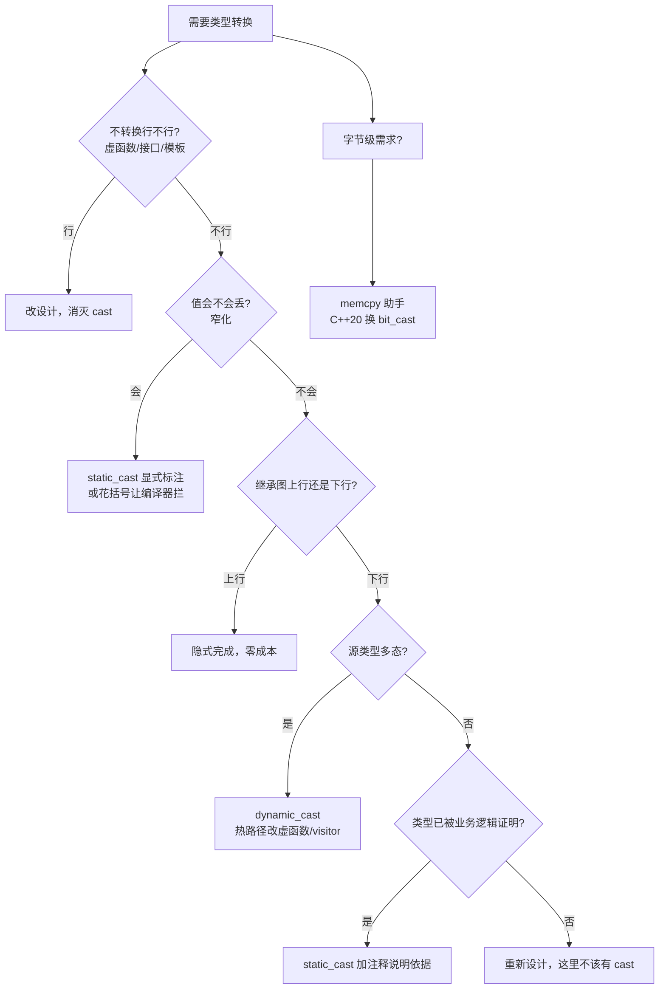

# 08 最佳实践与综合练习

适用环境：C++17；配套代码为 [`08_exercise.cpp`](code/08_exercise.cpp)（五道练习的完整解答与断言验证）。

## 1. 转换决策清单

遇到类型转换需求，按序过一遍：



图后重申三条底线：

- **消灭优于选择**：能用虚函数、模板、接口消掉的 cast，才是最好的 cast。
- **窄化必须显式**：`static_cast` 标注或花括号拦截，禁止静默发生。
- **字节级只走 memcpy/字节视角**：`reinterpret_cast` 解引用跨类型读永远是 UB。

## 2. 规范速查表

| 规则 | 内容 | 出处 |
|---|---|---|
| 单参数构造默认 `explicit` | 阻断隐式转换通道 | 第 3 章；MISRA C++ 15.1.3、AUTOSAR A12-1-2 |
| 转换运算符一律 `explicit` | 除 `explicit operator bool` | 第 3 章；AUTOSAR A13-5-2 |
| 禁用 C 风格 cast | 无声升级 + 无视访问控制 | 第 4 章；Core Guidelines |
| 混合符号运算先统一类型 | `size_t` 比较前转换 | 第 2 章 |
| UObject 下行用 `Cast`/`CastChecked` | 反射判型，失败可控 | 第 7 章；UE 官方论坛验证帖 |
| 双关双方 `static_assert` 校验 | `trivially copyable` + 大小一致 | 第 6 章 |
| 编译警告开满 | MSVC `/W4 /permissive-`；Clang/GCC `-Wall -Wextra -Wconversion` | 让 C4244 这类警告替你值班 |

## 3. 综合练习

五道题各对应一章，解答全部在 [`08_exercise.cpp`](code/08_exercise.cpp)，每题先列错误写法再给正确实现。建议先自己写，再对照。

**练习 1（第 2 章）**：实现 `countdown(int n)`，从 n 数到 0 放进 vector。错误写法是 `for (unsigned i = n; i >= 0; --i)`——`i >= 0` 对无符号恒真，0 之后回绕死循环。

**练习 2（第 3 章）**：给 `PlayerId` 加 `explicit`，让 `kick_player(42)` 编译不过、`kick_player(PlayerId(42))` 通过，并用 `static_assert(!std::is_convertible<int, PlayerId>)` 固化。

**练习 3（第 4、5 章）**：`as_turret(Entity*)` 用 `dynamic_cast` 问路，失败返 `nullptr`；对灯泡指针调用必须安全落到空指针分支。

**练习 4（第 6 章）**：`float_bits(float)` 用 `memcpy` 提取位模式；断言 `1.0f` 提取出 `0x3F800000` 并无损还原。

**练习 5（第 7 章）**：判型入口统一成一个函数，RTTI 可用走 `dynamic_cast`；思考 `-fno-rtti` 时如何换成类型标签或反射注册表（UE 的做法）。

运行输出（全部断言通过）：

```text
练习 1 通过：有符号计数，无回绕死循环
kick_player(id=42)
练习 2 通过：explicit 阻止裸 int 静默变 PlayerId
练习 3 通过：dynamic_cast 失败返 nullptr，分支兜底
练习 4 通过：memcpy 双关，1.0f -> 0x3F800000 -> 1.0f
练习 5 通过：判型入口统一，关 RTTI 时可替换实现
全部练习通过 ✔
```

## 4. 学完之后

本教程结论已回写知识库 `dx:cpp-learning/knowledge/type-conversion.md`；与对象布局的交叉话题（多继承偏移、RTTI 元数据）详见 `dx:cpp-learning/knowledge/object-layout.md`。下一步可深入：

- Itanium C++ ABI 的 typeinfo 继承体系（第 5 章「待深入」）。
- C++20 `bit_cast`、C++23 `start_lifetime_as` 对序列化的影响（第 6 章「待深入」）。
- UE 反射系统源码级阅读（第 7 章「待深入」，配合 UE 专题学习路径）。
