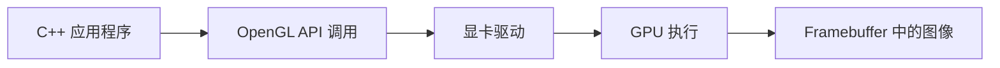
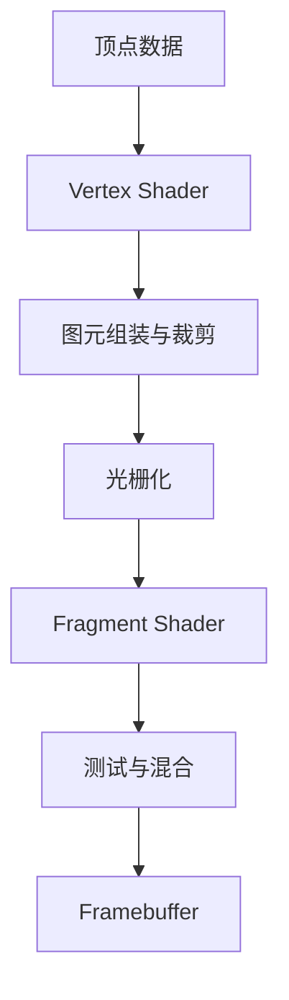
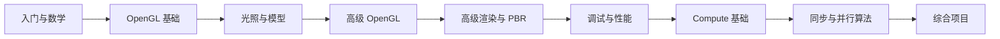

# 第一章：课程导览——从第一个三角形到 GPU 计算

适用环境：本课不依赖操作系统，也不需要安装或运行任何软件。后续课程使用 C++17，以 OpenGL 3.3 Core Profile 学习渲染基础，以 OpenGL 4.3 Core Profile 学习 Compute Shader。

你将学会：

- 用准确但直观的方式解释 OpenGL 是什么、能做什么、不能做什么。
- 说明 CPU、GPU、驱动和 Shader 在渲染程序中的分工。
- 按简化图形管线描述顶点数据如何变成屏幕图像。
- 初步理解三角形、Shader、Texture、MVP 和 Camera 五个核心术语。
- 说明 Compute Shader 为什么不等同于 Fragment Shader，以及本课程将如何逐步学习它们。

本课先建立地图，不要求记住所有术语。后续每章都会回到这张地图，把今天看到的概念变成能够独立编写的程序。

## 为什么先了解全貌

现代 OpenGL 的第一个三角形通常比想象中复杂：你需要窗口和 OpenGL Context，要准备顶点数据，还要编写并编译 Shader。第一次看到几十行陌生代码时，如果不知道每一部分负责什么，很容易把学习变成复制和试错。

先了解全貌有三个实际作用：

1. **知道代码放在哪里。** 你能区分窗口创建、资源准备、Shader 和 Draw Call，而不是把它们看成一整段固定模板。
2. **知道错误去哪里找。** 黑屏可能来自数据、矩阵、Shader、状态或同步；整体模型能帮助你缩小范围。
3. **知道为什么按这个顺序学习。** Camera 依赖坐标变换，光照依赖法线和 Shader，Compute 与渲染协作又依赖 Buffer 和同步知识。

本课只讲各模块之间的关系，具体 API 和代码留到对应课程。

## OpenGL 到底是什么

日常开发中，我们通常把 OpenGL 称为一套**图形 API**：程序调用它提供的函数，向图形系统提交数据、设置状态并发出绘制命令。

更严格地说，OpenGL 首先是一份由 Khronos 维护的**规范**。规范规定 API 应该具有什么行为；显卡厂商提供的驱动负责实现这些行为。你的 C++ 程序并不直接操纵 GPU 电路，而是通过 OpenGL API 与驱动协作，再由驱动把命令转换为 GPU 能执行的工作。这个定义可参见 [Khronos OpenGL FAQ](https://www.khronos.org/opengl/wiki/FAQ)。

可以把关系简化为：

这张图的重点不是记忆组件名称，而是理解：**你写的是应用程序，OpenGL 规定通信方式，驱动和 GPU 完成实际工作。**

### OpenGL 不负责什么

OpenGL 的关注点是图形处理，而不是完整的应用框架。它本身不负责：

- 创建窗口或处理键盘、鼠标输入。
- 加载 PNG/JPG 图片或 glTF/OBJ 模型文件。
- 保存场景中的“角色”“关卡”等高级对象。
- 提供物理系统、音频系统或完整游戏引擎功能。

因此，课程会使用其他库分担任务：GLFW 负责窗口、Context 和输入，GLAD 负责加载 OpenGL 函数，GLM 提供数学类型和运算，stb_image 与 Assimp 分别协助读取图片和模型。它们不是 OpenGL 规范本身的一部分。

> ⚠️ “创建窗口的函数能编译”并不代表 OpenGL 已初始化成功。通常必须先创建并设置当前 OpenGL Context，再加载函数，之后才能正常调用 OpenGL。第二章和第三章会详细展开。

## CPU 与 GPU 如何分工

初学者最容易混淆的一点是：C++ 代码和 Shader 都在描述画面，但它们运行的位置和职责不同。

| 角色 | 主要职责 | 本课程中的例子 |
|---|---|---|
| CPU 上的应用程序 | 管理窗口和资源，准备场景数据，设置 OpenGL 状态，发出绘制或计算命令 | 读取顶点数组、加载纹理、调用 Draw 或 Dispatch |
| OpenGL 驱动 | 接收 API 命令，管理实现细节，把工作提交给 GPU | 创建实际资源、调度 GPU 工作 |
| GPU | 并行处理大量顶点、Fragment 或 Compute Invocation | 执行 Vertex Shader、Fragment Shader、Compute Shader |
| Shader | 开发者编写的 GPU 程序，决定某一阶段如何处理数据 | 变换顶点、计算颜色、更新粒子 |

CPU 并不是“只准备工作”，GPU 也不是“只负责最后上色”。随着课程深入，GPU 还会通过 Compute Shader 更新粒子、生成可见列表或准备 Indirect Draw 参数。

但现在只需记住：**应用程序组织任务，Shader 定义 GPU 上的一部分具体处理逻辑。**

## 一个三角形怎样变成屏幕图像

下面是一条刻意简化的现代 OpenGL 图形管线。它省略了 Tessellation、Geometry Shader 等可选阶段，先保留绘制三角形所需的主线：

这条管线描述的是数据如何流动，而不是要求你现在记住所有固定功能阶段。

### 顶点数据与 Vertex Shader

三角形由三个顶点组成。每个顶点除了位置，还可以携带颜色、纹理坐标、法线等数据。

Vertex Shader 会对输入顶点进行处理，最重要的任务之一是计算顶点在裁剪空间中的位置。后面学习 MVP 时，你会看到顶点位置如何经过矩阵变换。

### 图元组装、裁剪与光栅化

OpenGL 根据绘制命令把顶点组织成三角形等图元，并处理位于可视范围之外的部分。随后，光栅化确定三角形覆盖了哪些像素区域，并产生供后续阶段处理的 Fragment。

**Fragment 不完全等于最终像素。** 它包含候选像素位置及颜色、深度等相关数据，仍可能因为 Depth Test、Stencil Test 等原因无法写入最终结果。

### Fragment Shader、测试与 Framebuffer

Fragment Shader 计算 Fragment 的输出，例如从 Texture 采样并计算光照。之后还要经过深度、模板、混合等测试与操作，结果才会写入 Framebuffer。

Framebuffer 可以理解为本次绘制的图像目标。默认情况下，最终结果最终可以呈现到窗口；离屏渲染时，也可以先写入自己创建的 Texture，再进行后处理。

官方更完整的阶段说明见 [Khronos Rendering Pipeline Overview](https://wikis.khronos.org/opengl/Rendering_Pipeline_Overview)。本课只建立简化模型，后续会逐阶段补全。

## 五个核心术语先建立直观认识

课程前期会反复出现以下术语。现在只需知道它们在整条路线中的位置。

| 术语 | 直观理解 | 后续要真正掌握的问题 |
|---|---|---|
| 三角形（Triangle） | 由三个顶点构成的基本图元，复杂模型通常由大量三角形组成 | 顶点如何存储、索引如何复用、正面与背面如何判断 |
| Shader | 在 GPU 上运行的程序 | 如何编译链接、各阶段如何输入输出、如何使用 GLSL |
| Texture | 可被 Shader 读取的数据资源，最常见的是图像 | 如何上传、采样、过滤、生成 Mipmap、作为渲染目标 |
| MVP | Model、View、Projection 三类变换的组合 | 顶点如何从模型自身坐标一步步变换到裁剪空间 |
| Camera | 观察场景的方式，不是 OpenGL 自动拥有的实体 | 如何用 View/Projection Matrix 表达位置、方向和透视 |

### MVP 与 Camera 的关系

假设模型顶点最初记录的是“相对于模型自身原点的位置”。要把它显示到屏幕上，需要回答三个问题：

1. **Model：模型放在世界中的哪里？** 包括模型的平移、旋转和缩放。
2. **View：观察者从哪里、朝哪里看？** Camera 主要通过这一部分影响场景。
3. **Projection：如何把三维视野投影到二维画面？** 透视投影会产生近大远小的效果。

所以 Camera 不是一枚必须由 OpenGL 创建的“摄像机对象”。在常见实现中，它是你根据自己的位置和方向计算出的矩阵，再交给 Shader 使用。

## Compute Shader 与渲染有什么不同

前面的图形管线围绕“绘制图元并生成图像”展开。Compute Shader 则提供另一条路径：让 GPU 执行更通用的数据并行计算，不要求经过顶点处理、光栅化和 Fragment Shader。

| 对比项 | 渲染 Shader | Compute Shader |
|---|---|---|
| 常见目的 | 处理顶点、Fragment，最终参与图像生成 | 处理数组、粒子、图像或其他通用数据 |
| 工作从哪里来 | 由 Draw 命令和图形管线驱动 | 由 Dispatch 命令启动指定数量的 Workgroup |
| 数据如何进入 | Vertex Attribute、Uniform、Texture、Buffer 等 | 主要通过 SSBO、Image、Uniform 等显式读取 |
| 结果如何输出 | 按所在阶段写入管线输出或资源 | 显式写入 SSBO、Image 等资源 |
| 是否属于光栅化图形管线 | 是，具体位置取决于 Shader Stage | 否，它独立于该管线 |

举一个后续会实现的例子：假设有一万个粒子。

1. Compute Shader 根据运动规则更新每个粒子的位置和寿命。
2. 更新结果写入 GPU Buffer。
3. 渲染程序读取同一批数据，用 Vertex Shader 和 Fragment Shader 把粒子画出来。

在这个例子里，Compute Shader 负责“更新数据”，渲染 Shader 负责“把数据画出来”。两者之间还涉及内存可见性和同步，不能简单地认为调用结束就自然可以安全读取；这些正是 Compute 后半段课程的重点。

## 完整课程路线

本系列按依赖关系安排学习顺序：

- **第 0～1 部：** 建立工程、数学、Shader、Texture、MVP、Camera 和 Depth Test 基础。
- **第 2～4 部：** 完成模型、光照、阴影、后处理、Deferred Rendering 和 PBR/IBL。
- **第 5 部：** 学习资源封装、现代 API、RenderDoc、Timer Query 和性能优化。
- **第 6～8 部：** 从零学习 Compute Shader 的执行模型、数据布局、Shared Memory、Barrier、Atomic 和并行算法。
- **第 9 部：** 完成 GPU 粒子系统或 GPU Driven 场景。
- **第 10 部：** 根据兴趣选择动画、地形、Forward+ 等扩展专题。

Compute 被放在渲染基础之后，不是因为它是“次要内容”，而是因为 SSBO、Texture、Shader 编译和 GPU 调试等共同基础能显著降低学习难度。

## 开始前需要准备什么

本课不需要安装软件。进入第三章前，再逐步搭建环境即可。

### 编程基础

后续示例使用 C++17。你不需要先成为 C++ 专家，但最好能阅读包含变量、函数、条件、循环、数组和基本类的代码。遇到影响理解的 C++ 写法时，正文会补充解释。

### 数学基础

不需要预先修完线性代数。课程会在使用时讲解向量、矩阵、点积、叉积和坐标变换，并配合小规模例子。重点不是背公式，而是理解输入、输出和几何意义。

### 硬件与系统

渲染基础以 OpenGL 3.3 Core Profile 为起点，Compute Shader 需要 OpenGL 4.3 或等价支持。开始相关章节前会检查实际版本与限制；不能只根据显卡型号或操作系统名称猜测支持情况。

## 推荐的学习方法

每一课都按下面的循环学习：

1. **先预测。** 运行示例前，先回答“这次调用会改变什么数据或状态”。
2. **再运行。** 对照正文确认实际结果和预期是否一致。
3. **做一次小修改。** 例如改变顶点颜色、纹理过滤方式或 Camera 位置。
4. **解释结果。** 不只记录“能运行”，还要说出修改为什么产生这个画面。
5. **独立完成练习。** 最后再对照示例，避免把复制成功误认为已经掌握。

如果结果是一片黑屏，也不要立即整段替换代码。后续会学习用错误日志、Debug Output 和 RenderDoc 分层定位问题。

## 本课小结

- OpenGL 是由 Khronos 维护的图形系统规范，并定义应用程序使用的图形 API；具体实现由驱动提供。
- OpenGL 不等于窗口库、模型加载器或游戏引擎，因此实际工程会配合其他库使用。
- 应用程序组织任务，GPU 执行 Shader；渲染主线把顶点数据经过多个阶段转换为 Framebuffer 中的图像。
- 三角形、Shader、Texture、MVP 和 Camera 是前期核心概念，后续会逐一落实到代码。
- Compute Shader 独立于光栅化图形管线，适合通用数据并行计算，也可以与渲染管线协作。

## 课后自测

先尝试不看答案回答：

1. 为什么“OpenGL 程序”还需要 GLFW 之类的窗口库？
2. Vertex Shader 和 Fragment Shader 的输入是否相同？它们分别处在简化管线的什么位置？
3. 为什么 Fragment 不能直接等同于最终像素？
4. Camera 是否一定是 OpenGL 创建的一种对象？
5. Compute Shader 更新粒子后，为什么还需要渲染管线才能看到粒子？

### 参考答案

1. OpenGL 不负责窗口和输入；GLFW 等库承担这些平台相关任务，并协助创建 Context。
2. 不相同。Vertex Shader 主要处理顶点，位于光栅化之前；Fragment Shader 处理光栅化产生的 Fragment。
3. Fragment 还要经过深度、模板、混合等阶段，可能被丢弃或与其他结果合并。
4. 不是。常见实现由应用程序维护 Camera 数据，并计算 View/Projection Matrix。
5. Compute 更新的是数据，不会自动把粒子光栅化到画面；仍需 Draw 和渲染 Shader 将这些数据转换为可见图像。

下一课将区分现代 OpenGL、立即模式、Core Profile 与 Compatibility Profile，解释本课程为什么选择 OpenGL 3.3 Core 作为起点。

## 参考资料

- [Khronos OpenGL FAQ](https://www.khronos.org/opengl/wiki/FAQ)：OpenGL 的定义、职责与 Context。
- [Khronos Getting Started](https://wikis.khronos.org/opengl/Getting_Started)：初始化、Context、函数加载和渲染循环。
- [Khronos Rendering Pipeline Overview](https://wikis.khronos.org/opengl/Rendering_Pipeline_Overview)：完整渲染管线与 Fragment 概念。
- [Khronos OpenGL 4.6 Core Profile Specification](https://registry.khronos.org/OpenGL/specs/gl/glspec46.core.pdf)：OpenGL 执行模型与 API 行为的一手规范。
- [LearnOpenGL Introduction](https://learnopengl.com/Introduction)：面向图形编程初学者的课程结构、先修知识与学习建议。
- [Khronos Compute Shader Wiki](https://wikis.khronos.org/opengl/Compute_Shader)：Compute 执行空间、Dispatch、资源与同步概览。
