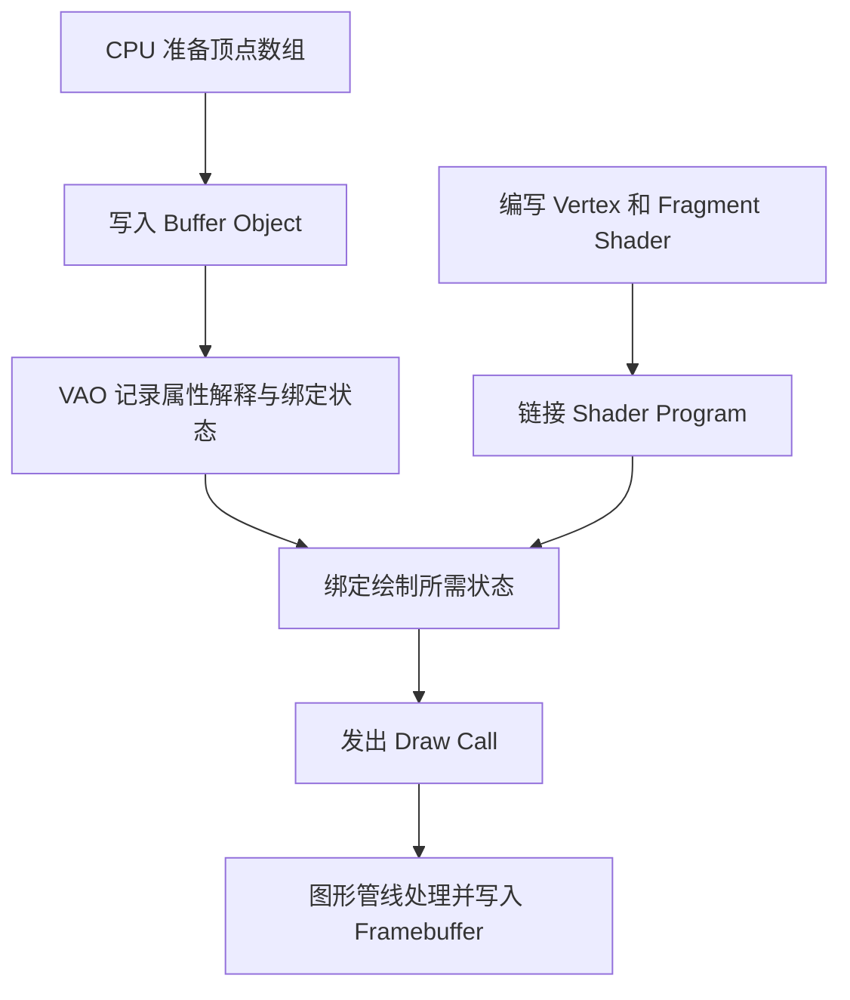

# 第二章：现代 OpenGL、立即模式与 Profile

适用环境：本课不依赖操作系统，也不需要安装或运行软件。课程以 OpenGL 3.3 Core Profile 为渲染学习起点，Compute Shader 部分再使用 OpenGL 4.3 Core Profile。

你将学会：

- 区分立即模式与固定功能管线这两个相关但不同的概念。
- 说明现代 OpenGL 为什么使用 Buffer、Shader 和 Draw Call。
- 区分 OpenGL 的版本号与 Core/Compatibility Profile。
- 识别旧教程中的常见 API，并判断它是否适合作为本课程的主要学习材料。
- 理解“现代 OpenGL”不等于“只使用最新 OpenGL 版本”。

## 为什么初学者必须先分清这些概念

搜索 OpenGL 教程时，你可能同时看到两类写法：一类使用 `glBegin`、`glVertex` 和内置矩阵函数；另一类使用 VBO、VAO、GLSL 和 `glDrawArrays`。

它们可能都能在某些环境中画出三角形，但背后的编程模型不同。如果没有先分清，就容易把两套教程的代码拼在一起，遇到“函数存在却报错”“某种 Context 下无法运行”等问题时难以判断原因。

本课不会要求你记住 OpenGL 的完整历史，而是建立四个可以长期使用的判断标准：

1. 顶点数据怎样提交？
2. 顶点和 Fragment 的处理逻辑由谁定义？
3. Context 使用什么版本和 Profile？
4. 教程中的机制是否属于本课程要学习的现代 Core 路线？

## 立即模式：逐个提交顶点属性

**立即模式（Immediate Mode）** 是旧式 OpenGL 中常见的顶点提交方式。应用程序通常在一组开始/结束调用之间，逐个指定顶点的位置、颜色、法线和纹理坐标。

这里的“立即”描述的是**顶点属性的指定方式**，不是说 GPU 会立刻完成绘制，也不代表 CPU 和 GPU 没有异步关系。

可以把它的思路理解为：

> 每准备一个顶点，就通过一次或多次 API 调用把它的属性交给 OpenGL。

这种方式在早期教学和很小的一次性示例中比较直观，因为代码看起来接近“我说一个点，系统收一个点”。但当模型包含大量顶点时，逐顶点、逐属性调用会产生很多 API 操作，静态数据也可能需要反复提交。

现代 OpenGL 的主要方式则不同：先把一批顶点数据放入 Buffer Object，配置好数据解释方式，再通过一次 Draw Call 让管线处理这批数据。

## 固定功能管线：配置内置处理逻辑

**固定功能管线（Fixed-function Pipeline）** 指旧式 OpenGL 提供的内置顶点变换、光照、材质和 Fragment 处理等机制。开发者主要通过设置状态与参数来配置它们，而不是为每个阶段编写完整 Shader。

例如，旧程序可以使用内置矩阵栈管理 Model/View 变换，使用固定功能光源和材质参数计算顶点颜色。

### 它与立即模式不是同一个概念

这两个概念经常一起出现，但回答的是不同问题：

| 概念 | 回答的问题 | 典型内容 |
|---|---|---|
| 立即模式 | 顶点属性怎样提交？ | `glBegin`/`glEnd`、`glVertex*`、`glColor*` |
| 固定功能管线 | 顶点和 Fragment 的处理逻辑由谁实现？ | 内置矩阵、固定功能光照、固定功能 Texture Environment |

一套旧式教程常常同时使用它们，所以二者容易被混为一谈。但在概念上，**数据提交方式**和**数据处理逻辑**是两个独立维度。

另外，“固定功能”也不等于现代 OpenGL 中已经没有任何不可编程阶段。光栅化、裁剪、Depth Test、Stencil Test 和 Blending 等仍包含固定功能或可配置阶段。现代 OpenGL 的变化不是“所有事情都改写成 Shader”，而是把关键的顶点与 Fragment 处理交给开发者编写 Shader。

更详细的定义见 [Khronos Fixed Function Pipeline](https://wikis.khronos.org/opengl/Fixed_Function_Pipeline)。

## 现代 OpenGL 的核心编程模型

本课程所说的**现代 OpenGL**，主要指以 Buffer Object、Shader Program 和 Draw Call 为核心的编程方式，而不是单纯指某个很高的版本号。

绘制一个三角形时，可以先建立下面的心智模型：

图中有三个新对象，现在只需要理解它们的职责：

- **Buffer Object**：保存顶点等数据，常见类型包括 VBO 和 EBO。
- **VAO（Vertex Array Object）**：记录顶点属性如何解释以及相关绑定状态；它不是简单的“顶点数据本体”。
- **Shader Program**：包含开发者编写的 Shader，让 GPU 按指定逻辑处理数据。

后续课程会逐一编写这些对象。现在最重要的是看到职责分离：**数据放在 Buffer 中，数据解释方式由 VAO 等状态描述，处理逻辑由 Shader 提供，Draw Call 启动本次绘制。**

### 为什么现代方式看起来更麻烦

旧方式可能用较少概念就画出简单图形，而现代方式在第一个三角形之前就需要理解更多组件。这是真实的学习成本，不必把初期困惑理解为能力不足。

它换来的是：

- 你可以明确控制顶点和 Fragment 的处理逻辑。
- 大量数据可以按批组织，而不是逐属性调用 API。
- 同样的模型数据可以被多次绘制，并配合不同变换或材质。
- 后续的光照、阴影、PBR、Compute 与图形协作都建立在相同的资源和 Shader 概念上。

因此，本课程会接受“第一个三角形稍慢”，但把每个组件讲清楚，而不是隐藏所有细节后只留下一段可复制模板。

## Deprecated、Removed 与 Profile

理解 Core 和 Compatibility 前，需要区分两个历史术语：

- **Deprecated（弃用）**：当前版本仍可能支持，但规范建议不要再使用，并提示未来可能移除。
- **Removed（移除）**：从相应 Core 规范的功能集合中删除；能否继续使用还要看 Context、Profile 和实现支持。

OpenGL 3.0 引入了弃用标记，OpenGL 3.1 移除了大量已弃用功能，OpenGL 3.2 引入了 Core 与 Compatibility Profile 的划分。可参考 [Khronos Deprecation](https://wikis.khronos.org/opengl/Deprecation) 和 [Khronos OpenGL Context](https://wikis.khronos.org/opengl/OpenGL_Context)。

### Core Profile

Core Profile 不包含那些已经从 Core 规范中移除的旧式功能。使用 Core Context 时，程序应当采用 Buffer、Shader 等现代机制。

对本课程而言，它有一个直接好处：如果误用某些旧 API，开发环境更容易暴露错误，而不是让旧代码和现代代码悄悄混在一起。

### Compatibility Profile

Compatibility Profile 保留被 Core 移除的旧功能，以便需要兼容历史代码的程序继续运行。它并不等于“不能写现代 OpenGL”：同一 Compatibility Context 中通常也可以使用现代功能，但这不意味着混合两套模型总是好的设计。

Compatibility Profile 是否可用取决于实现和平台，不能默认所有系统都提供。

### 版本号与 Profile 是两个维度

“OpenGL 3.3”描述版本，“Core”描述 Profile。它们需要一起说明：

| 说法 | 含义 |
|---|---|
| OpenGL 3.3 Core | 使用 3.3 版本的 Core 功能集合，不包含已移除的旧功能 |
| OpenGL 3.3 Compatibility | 使用 3.3 版本的兼容功能集合，保留旧功能 |
| OpenGL 4.3 Core | 使用更高版本的 Core 功能集合，可以包含 Compute Shader |

因此，看到“使用 OpenGL 4.x”并不能推出“一定使用 Core”；看到“使用 Core”也不能推出“一定使用最新版本”。

## 为什么本课程从 OpenGL 3.3 Core 开始

本课程选择 3.3 Core，不是因为它是最新版本，也不是因为后续功能不重要，而是因为它足以承载现代渲染的基本心智模型：

1. **核心机制完整。** Buffer、VAO、Vertex/Fragment Shader、Texture、Framebuffer、Depth Test 等基础都能在这里学习。
2. **概念可以向后延伸。** 后续更高版本通常是在相同基础上增加能力或提供更高效的接口，不会推翻早期学到的渲染原理。
3. **避免一开始增加额外复杂度。** Tessellation、DSA、Compute Shader 等会在具备基础后按版本要求单独引入。
4. **Profile 边界清楚。** Core Context 有助于避免无意中混入旧式 API。

需要特别强调：**OpenGL 3.3 不能作为本课程 Compute Shader 实验的基线。** Compute Shader 自 OpenGL 4.3 起进入 Core Profile，因此学到第 6 部时会检查并使用 OpenGL 4.3 或更高版本。

版本细节可核对 [OpenGL 3.3 Core Specification](https://registry.khronos.org/OpenGL/specs/gl/glspec33.core.pdf) 与 [OpenGL 3.3 Compatibility Specification](https://registry.khronos.org/OpenGL/specs/gl/glspec33.compatibility.pdf)。

## 如何识别旧式 OpenGL 教程

下表列出一些常见信号。它们用于帮助你判断教程路线，不是用于评价所有历史代码的价值。

| 旧式代码中的常见信号 | 原本负责什么 | 本课程将使用的现代概念 |
|---|---|---|
| `glBegin` / `glEnd` | 包围立即模式顶点指定 | Buffer Object + Draw Call |
| `glVertex*`、`glColor*`、`glNormal*` | 逐顶点设置位置、颜色、法线 | 顶点数组与 Vertex Attribute |
| `glMatrixMode`、`glLoadIdentity`、内置矩阵栈函数 | 使用内置矩阵状态 | GLM 等数学库计算矩阵，再传给 Shader |
| `glLight*`、`glMaterial*` | 配置固定功能光照与材质 | 在 Shader 中实现光照模型 |
| `GL_QUADS`、`GL_POLYGON` | 指定旧式四边形或多边形图元 | 通常拆分为三角形 |
| Display List | 记录并重复执行旧式命令序列 | 复用 GPU 资源、Draw Call 和合适的批处理策略 |

> ⚠️ 一个教程出现旧 API，不代表其中所有图形学原理都失去价值。光照、坐标变换、Camera 和纹理原理仍然可能值得学习；需要替换的是旧式 OpenGL 实现方式，而不是把所有概念一起丢弃。

### 一个实用的筛选问题

阅读教程前可以先问：

> 它是否用 Buffer 保存顶点数据，用 Shader 定义顶点和 Fragment 处理，并通过 Draw Call 绘制？

如果答案是否定的，它可能主要讲 Legacy OpenGL。你可以用它补充历史知识或图形学原理，但不应把其中的 API 直接混入本课程的 Core 示例。

## 五个常见误解

### “现代 OpenGL 就是 OpenGL 4.6”

不是。现代 OpenGL 描述编程模型，4.6 描述具体规范版本。OpenGL 3.3 Core 同样可以使用现代 Buffer + Shader 模型。

### “Core Profile 一定让程序更快”

不是。Core 的主要意义是明确功能集合，不包含被移除的旧功能。性能取决于数据组织、Draw Call、状态切换、Shader、同步和硬件等实际因素，不能只凭 Profile 名称判断。

### “Compatibility Profile 只是旧版本 OpenGL”

不是。Compatibility Profile 也有较高版本，可以保留旧功能并提供相应版本的现代功能。版本与 Profile 需要分别说明。

### “现代 OpenGL 中所有处理都由 Shader 完成”

不是。开发者编写可编程阶段，但裁剪、光栅化、Depth Test、Blending 等仍有固定功能或可配置处理。

### “只要程序显示了画面，就说明新旧 API 可以随意混用”

不是。程序可能恰好运行在 Compatibility Context 上，也可能存在尚未触发的问题。可移植性和可维护性要求你明确知道 Context 的版本、Profile 以及每段代码使用的模型。

## 实际项目应该怎样选择

- **学习现代渲染或开始新项目：** 本课程采用 Core Profile，并使用现代资源与 Shader 模型。
- **维护历史项目：** 可能需要 Compatibility Profile，但仍应明确隔离旧代码，避免新代码无意中依赖历史状态。
- **阅读旧教程：** 提取其中仍然成立的图形学原理，把 API 实现转换为现代方式，而不是机械复制。
- **学习 Compute Shader：** 在进入相关部分时升级到 OpenGL 4.3 Core 或更高版本，不为了 Compute 提前否定 3.3 基础课程的价值。

第三章创建 Context 时，我们会把这里的概念落实为明确的版本和 Profile 请求，并检查实际获得的 OpenGL 环境。

## 本课小结

- 立即模式描述逐顶点、逐属性提交数据的方式；固定功能管线描述由内置逻辑处理顶点和 Fragment 的方式，二者不是同一个概念。
- 现代 OpenGL 以 Buffer、Shader、VAO 和 Draw Call 等机制组织绘制，不等于单纯追求最高版本号。
- OpenGL 3.0 引入弃用，3.1 移除大量旧功能，3.2 引入 Core/Compatibility Profile。
- Core 不包含已移除的旧功能；Compatibility 保留这些功能以支持历史代码。
- 本课程从 OpenGL 3.3 Core 学习现代渲染基础，在 Compute Shader 部分使用 OpenGL 4.3 Core 或更高版本。
- 旧教程仍可能包含有价值的图形学原理，但其中的旧 API 不应直接混入本课程的 Core 示例。

## 课后自测

1. “立即模式”中的“立即”是否表示 GPU 立即完成绘制？
2. 固定功能管线和立即模式分别回答什么问题？
3. 现代 OpenGL 是否意味着光栅化和 Depth Test 也必须由开发者写成 Shader？
4. OpenGL 4.3 Compatibility 是否等同于 OpenGL 2.1？
5. 为什么本课程可以先使用 OpenGL 3.3 Core，却在 Compute Shader 部分要求 4.3？
6. 看到 `glBegin` 和 `glMatrixMode` 时，应该怎样对待一篇旧教程？

### 参考答案

1. 不是。它指顶点属性的指定方式，不是 GPU 完成工作的时刻。
2. 固定功能管线回答处理逻辑由谁提供；立即模式回答顶点属性如何提交。
3. 不是。现代管线仍包含固定功能和可配置阶段。
4. 不是。4.3 是版本，Compatibility 是 Profile；它仍包含相应版本的现代功能，同时保留旧功能。
5. 3.3 足以学习现代渲染基础，而 Compute Shader 自 4.3 起才进入 Core Profile。
6. 可以学习其中仍成立的原理，但不要直接复制旧 API 到 Core 项目，应改用 Buffer、Shader、矩阵传递等现代机制。

下一课将创建窗口和 OpenGL Context，加载 OpenGL 函数，并建立不断处理输入、绘制和显示结果的渲染主循环。

## 参考资料

- [Khronos Legacy OpenGL](https://wikis.khronos.org/opengl/Legacy_OpenGL)：立即模式、固定功能 API、移除功能与性能背景。
- [Khronos Fixed Function Pipeline](https://wikis.khronos.org/opengl/Fixed_Function_Pipeline)：固定功能管线的定义及与现代管线的关系。
- [Khronos Deprecation](https://wikis.khronos.org/opengl/Deprecation)：Deprecated、Removed 与 Compatibility Context。
- [Khronos OpenGL Context](https://wikis.khronos.org/opengl/OpenGL_Context)：OpenGL 3.2 Profile、Context 与实现差异。
- [OpenGL 3.3 Core Profile Specification](https://registry.khronos.org/OpenGL/specs/gl/glspec33.core.pdf)：Core 功能集合、GLSL 3.30 与弃用模型。
- [OpenGL 3.3 Compatibility Profile Specification](https://registry.khronos.org/OpenGL/specs/gl/glspec33.compatibility.pdf)：Compatibility 功能集合与 Core 的差异。
- [LearnOpenGL Introduction](https://learnopengl.com/Introduction)：现代 Core Profile 学习路线与 OpenGL 3.3 起点。
