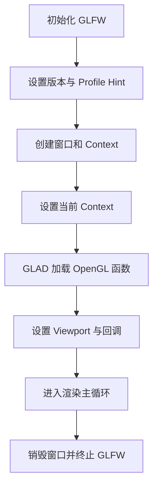

# 第三章：窗口、OpenGL Context 与渲染主循环

适用环境：C++17、CMake 3.21 或更高版本、GLFW 3、GLAD 1、OpenGL 3.3 Core。示例使用 vcpkg 管理依赖；Windows 验证细节见本章调研记录。

你将学会：

- 说明窗口、OpenGL Context 和 OpenGL 函数加载之间的关系。
- 按正确顺序初始化 GLFW、创建 Context、加载函数并设置 Viewport。
- 理解主循环中的输入、Clear、Swap Buffers 和 Poll Events。
- 构建并运行示例，使用 ESC 退出，观察缩放窗口后的效果。
- 使用隐藏窗口和固定帧数参数完成自动冒烟测试。

完整示例位于 [code/part-00-03-window](../code/part-00-03-window/)。本章只创建窗口并清空颜色，不提前加入三角形；VAO/VBO 和 Shader 留给第 1 部。

## 本章最终得到什么

正常运行后，你会看到一个 800×600 的深色窗口。程序每一帧都用同一颜色清空 Back Buffer，然后把它显示出来。按 ESC 或关闭窗口即可退出。

虽然只有一扇窗口，但它已经包含所有现代 OpenGL 程序都要经过的初始化和主循环骨架：



顺序很重要。尤其是 **GLAD 加载函数必须发生在当前 OpenGL Context 已经建立之后**。

## 为什么需要 GLFW 和 GLAD

第一章说过，OpenGL 不负责窗口、输入和函数加载的平台细节。本章用两个库补齐这些工作：

| 组件 | 负责什么 | 不负责什么 |
|---|---|---|
| GLFW | 创建窗口和 Context、处理输入与窗口事件、交换窗口 Buffer | 编写 Shader、组织模型和场景 |
| GLAD | 根据当前 Context 加载 OpenGL 函数地址，提供对应声明 | 创建窗口或决定渲染逻辑 |
| 显卡驱动 | 提供 OpenGL 实现和实际函数 | 管理你的应用程序结构 |

本例使用 GLAD 1 的 `glad/glad.h` 和 `gladLoadGLLoader`。GLAD 2 的头文件与加载函数名称不同，不要把两个版本的示例混用。

## 初始化 GLFW 并设置错误回调

完整代码首先调用 `glfwSetErrorCallback`，再调用 `glfwInit`：

```cpp
glfwSetErrorCallback(glfwErrorCallback);
if (!glfwInit()) {
    std::fprintf(stderr, "Failed to initialize GLFW\n");
    return 1;
}
```

`glfwInit` 初始化 GLFW 库，不是创建 OpenGL Context。返回值失败时不能继续假设窗口系统已经可用。

错误回调是 GLFW 报告错误的通道。示例把错误编号和文本输出到标准错误流，便于看到窗口创建失败等原因。

> ⚠️ `glfwInit` 成功后，后续提前退出也应调用 `glfwTerminate`。示例在窗口创建和 GLAD 加载失败路径上分别执行清理。

## 用 Window Hint 请求 OpenGL 3.3 Core

窗口创建前，示例设置三个 Hint：

```cpp
glfwWindowHint(GLFW_CONTEXT_VERSION_MAJOR, 3);
glfwWindowHint(GLFW_CONTEXT_VERSION_MINOR, 3);
glfwWindowHint(GLFW_OPENGL_PROFILE, GLFW_OPENGL_CORE_PROFILE);
```

前两行分别请求主版本 3、次版本 3，第三行请求 Core Profile。它们必须在 `glfwCreateWindow` 之前设置，因为 Hint 描述的是即将创建的窗口和 Context。

如果实现无法提供请求的最低版本或 Profile，窗口/Context 创建会失败。因此应该检查 `glfwCreateWindow` 的返回值，而不是继续使用空指针。

本章示例还根据 `--hidden` 参数设置 `GLFW_VISIBLE`。隐藏只表示窗口不显示，仍会创建真实 OpenGL Context，适合自动测试。

## 创建窗口与设置当前 Context

```cpp
GLFWwindow* window = glfwCreateWindow(
    800, 600, "Part 00 - Window", nullptr, nullptr);
glfwMakeContextCurrent(window);
```

实际代码在两个调用之间检查 `window` 是否为空。

`glfwCreateWindow` 同时创建窗口及其关联的 OpenGL Context。最后两个 `nullptr` 分别表示不使用全屏 Monitor、不与其他窗口共享 Context。

`glfwMakeContextCurrent(window)` 把这个 Context 设置为当前线程的当前 Context。后续 OpenGL 调用都作用于当前 Context 的状态和资源。

**窗口存在不等于 Context 已经成为当前 Context。** 对初学者而言，可以先遵守主线：创建窗口后立即设置当前 Context，再加载函数。多窗口和多线程情况留到后续专题。

## 用 GLAD 加载函数

```cpp
if (!gladLoadGLLoader(
        reinterpret_cast<GLADloadproc>(glfwGetProcAddress))) {
    // 完整示例在这里清理并退出。
}
```

`glfwGetProcAddress` 是 GLFW 提供的函数地址查询接口；GLAD 使用它加载当前 Context 对应的 OpenGL 函数。`reinterpret_cast` 用来匹配 GLAD 1 所要求的函数指针类型。

加载失败时不能继续调用现代 OpenGL 函数。加载成功后，示例才调用 `glGetString`、`glViewport` 和 `glClear` 等 API。

头文件顺序也值得注意：本例先包含 `glad/glad.h`，再包含 `GLFW/glfw3.h`，并在 CMake 中定义 `GLFW_INCLUDE_NONE`，防止 GLFW 自动包含另一套 OpenGL 头文件。

## Viewport 与窗口尺寸

Viewport 指定 OpenGL 把 Normalized Device Coordinates 映射到 Framebuffer 的哪个矩形区域：

```cpp
glViewport(0, 0, width, height);
```

前两个参数是左下角偏移，后两个是宽度和高度。示例使用 `glfwGetFramebufferSize` 获取实际 Framebuffer 尺寸，而不是始终假定它等于 800×600。

窗口缩放时，Framebuffer 尺寸可能变化，因此注册回调：

```cpp
glfwSetFramebufferSizeCallback(window, framebufferSizeCallback);
```

回调收到新尺寸后再次调用 `glViewport`。高 DPI 屏幕上，窗口逻辑尺寸和 Framebuffer 像素尺寸也可能不同，所以这里使用的是 Framebuffer 尺寸。

## 渲染主循环逐行理解

主循环在窗口应关闭之前持续执行：

```cpp
while (!glfwWindowShouldClose(window)) {
    // 处理输入、清空、交换 Buffer、处理事件。
}
```

### 处理输入

示例每帧查询 ESC：

```cpp
if (glfwGetKey(window, GLFW_KEY_ESCAPE) == GLFW_PRESS) {
    glfwSetWindowShouldClose(window, GLFW_TRUE);
}
```

这里只是设置“应该关闭”标志，循环会在本轮结束后退出。`glfwGetKey` 是状态查询，不是事件回调；两种方式都可行，本例选择较直观的一种。

### 设置 Clear Color 并清空 Buffer

```cpp
glClearColor(0.08F, 0.10F, 0.16F, 1.0F);
glClear(GL_COLOR_BUFFER_BIT);
```

`glClearColor` 设置 Clear 操作使用的颜色状态，本身不会立即清空屏幕。`glClear(GL_COLOR_BUFFER_BIT)` 才用该颜色清空当前 Color Buffer。

四个分量依次是 R、G、B、A，本例都是不直接对应字节 0～255 的浮点强度值。

### Swap Buffers

GLFW 窗口默认使用双缓冲：你向 Back Buffer 绘制，屏幕显示 Front Buffer。`glfwSwapBuffers(window)` 在帧完成后交换二者，使用户看到刚完成的图像。

如果不交换，绘制结果可能一直留在 Back Buffer，看不到正常更新。

示例还调用 `glfwSwapInterval(1)` 请求与屏幕刷新同步。它影响交换等待行为，不改变 OpenGL 场景本身。

### Poll Events

`glfwPollEvents()` 处理已经到达的窗口和输入事件，并调用相关回调。它也能让窗口系统持续得知程序仍在响应。

GLFW 不会替你自动调用它；持续渲染的程序通常每帧调用一次。只在没有事件时需要重绘的程序，可以考虑 `glfwWaitEvents`，但本课程当前使用持续渲染模型。

## 清理资源

退出循环后，示例调用：

```cpp
glfwDestroyWindow(window);
glfwTerminate();
```

前者销毁窗口及其关联 Context，后者清理 GLFW 全局状态。以后创建 VBO、VAO、Texture 等 OpenGL 对象时，还需要在 Context 仍然有效时删除它们。

## 构建、测试与运行

先安装 CMake、Ninja 和支持 C++17 的编译器，并设置 `VCPKG_ROOT` 指向已有 vcpkg。依赖和 Preset 的详细解释在第四章。

在 `code/part-00-03-window` 目录执行：

```powershell
cmake --preset debug
cmake --build --preset debug
ctest --preset debug
```

Windows 下正常运行：

```powershell
.\build\debug\ch03_window.exe
```

隐藏窗口并只渲染两帧：

```powershell
.\build\debug\ch03_window.exe --hidden --max-frames 2
```

预期输出包含 `OpenGL version` 和 `Renderer`，进程正常退出。其他平台使用构建目录中对应的可执行文件路径。

## 常见错误

| 现象 | 优先检查 |
|---|---|
| `glfwCreateWindow` 返回空 | 驱动是否支持 3.3 Core；Hint 是否合理；查看 GLFW 错误回调 |
| GLAD 加载失败 | 是否已调用 `glfwMakeContextCurrent`；GLAD 生成版本和加载函数是否匹配 |
| 调用 OpenGL 时崩溃 | 是否提前调用函数、GLAD 是否成功、头文件和加载库是否混用 |
| 窗口缩放后内容区域不正确 | 是否使用 Framebuffer 尺寸更新 Viewport |
| 窗口显示但不响应 | 主循环是否定期调用 `glfwPollEvents` |
| 画面一直不更新 | 是否向 Back Buffer 绘制后调用 `glfwSwapBuffers` |

## 练习

1. 修改 Clear Color 的 RGB 分量，预测并验证窗口颜色变化。
2. 把窗口初始尺寸改为 1024×768，确认 Viewport 仍使用真实 Framebuffer 尺寸。
3. 把 ESC 改为空格键，并说明为什么使用的是状态查询而不是 OpenGL API。
4. 临时注释 `glfwPollEvents` 后观察行为，再恢复它。不要在自动测试中做此实验，以免窗口无法正常处理事件。

下一章将拆解本例的 CMake、vcpkg、Preset 和目录结构，让工程能够被干净地重复构建。

## 参考资料

- [GLFW Getting Started](https://www.glfw.org/docs/latest/quick_guide.html)：Context Hint、窗口创建、主循环和事件处理。
- [GLFW Window Guide](https://www.glfw.org/docs/latest/window.html)：双缓冲、Swap Interval 和 Window Hint。
- [GLFW Window Reference](https://www.glfw.org/docs/latest/group__window.html)：窗口、Context、Viewport 相关 API 的详细约定。
- [GLAD 官方仓库](https://github.com/Dav1dde/glad)：GLAD 1/2 差异和函数加载说明。
- [Khronos Getting Started](https://wikis.khronos.org/opengl/Getting_Started)：OpenGL Context 与函数加载的两个初始化阶段。
