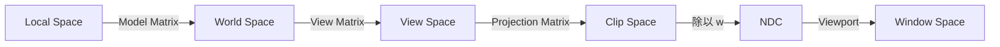

# 第六章：坐标空间、右手系与 MVP 变换链

适用环境：C++17、CMake 3.21+ 和 GLM。本章使用 CPU 上的数值示例验证变换，不需要创建 OpenGL Context。

你将学会：

- 说明 Local、World、View、Clip、Normalized Device 和 Window Space 的职责。
- 理解 Model、View、Projection Matrix 在变换链中的位置。
- 使用右手系和 `x × y = z` 检查基本方向约定。
- 解释为什么 View Space 中 Camera 前方通常是负 Z，以及透视除法如何使用 `w`。
- 把 NDC 坐标映射到指定窗口尺寸，并在 Window Space 与 NDC 之间反向换算。

完整示例位于 [code/part-00-06-coordinates](../code/part-00-06-coordinates/)。本章只研究位置和坐标，不实现完整 Camera 控制或 Shader。

## 为什么需要这么多坐标空间

一个模型顶点最初可能以模型自身原点为中心；放入场景后，它需要知道自己在世界中的位置；从 Camera 观察时，又要转换为相对于 Camera 的坐标；投影和裁剪后，才映射到窗口像素。

如果所有步骤都混在一个“坐标”概念里，一旦物体不出现在屏幕上，就很难判断是模型位置、Camera、Projection 还是 Viewport 出问题。

把变换链拆开，就能逐阶段检查：



对应本章采用的列向量写法：

\[
\mathbf{p}_{clip}=P V M\mathbf{p}_{local}
\]

最右边的 \(M\) 最先作用于局部顶点，然后是 \(V\)，最后是 \(P\)。

## 先理解“坐标系”到底是什么

一个坐标系至少要说明：**原点在哪里、坐标轴指向哪里、使用什么尺度**。一组坐标值只有相对于某个坐标系才有意义。

例如，同样是数字 `(5,3)`：

- 在 World Space 中，它可能表示“离世界原点向右 5、向上 3”。
- 在 Camera Space 中，它可能表示“离 Camera 向右 5、向上 3”。

这两个点通常不是同一个位置。因此，只写 `(5,3)` 而不说明所在空间，信息是不完整的。

### 一个不使用矩阵的二维例子

假设世界坐标中：

- 点 \(P\) 位于 `(5,3)`。
- Camera 位于 `(2,1)`。
- Camera 没有旋转，坐标轴方向与世界轴相同。

从 Camera 看，点 \(P\) 的相对位置为：

\[
P_{view}=P_{world}-C_{world}=(5,3)-(2,1)=(3,2)
\]

世界点没有移动，Camera 也没有移动。只是“用世界原点描述”改成了“用 Camera 原点描述”，数值就从 `(5,3)` 变成了 `(3,2)`。

如果 Camera 还有旋转，仅减去位置就不够了，还要把方向转换到 Camera 的坐标轴上。View Matrix 把这类参考系变化统一成一次矩阵运算。

## “坐标转换”和“坐标映射”有什么区别

本课不强行把两个术语当作完全不同的技术：它们都描述从一个空间中的表示得到另一个空间中的表示。不过可以侧重两个角度：

- **坐标转换**强调参考系改变，例如把 World Position 改为 View Position。
- **坐标映射**强调输入到输出的计算规则，例如把 `[-1,1]` 的 NDC X 映射到 `[0,width]` 的窗口 X。

管线中的每一步也不完全属于同一种运算：

| 步骤 | 计算性质 | 作用 |
|---|---|---|
| Model/View | 通常是仿射变换 | 改变位置所参考的坐标系 |
| Projection | 矩阵变换 | 产生 Clip Coordinate，并准备深度与透视信息 |
| Perspective Division | 除以 `w`，不是简单矩阵乘法 | 把 Clip Coordinate 转为 NDC |
| Viewport | 缩放加偏移 | 把 NDC 映射到 Framebuffer 区域 |
| Clipping | 判断和裁切，不是单纯换算 | 去掉或裁开不可见图元 |

### 转换坐标不一定是在移动物体

这是初学者最容易混淆的地方：

- **Model Matrix** 可以表达“把模型放到世界中的另一个位置”，因此有实际场景布置的含义。
- **View Matrix** 不会把世界里的物体真的搬走，它只是改为以 Camera 为参考重新表示这些位置。
- **Viewport** 也不会改变世界里的物体，它只决定 NDC 如何对应到窗口区域。

所以，**同一点在不同坐标系中的数值可以不同，而它在世界中的实际位置没有改变。**

## Local Space：相对于模型自身

Local Space 也叫 Model Space。顶点坐标相对于模型自己的原点和坐标轴。

例如，一个立方体可以以自身中心为原点，顶点分布在 `-1` 到 `1` 之间。无论这个立方体以后放在世界的哪个位置，这份本地顶点数据都可以保持不变。

**Model Matrix** 把 Local Position 转为 World Position，包括模型的平移、旋转和缩放。

本章示例把本地点 `(1,0,0)` 放到向 X 平移 2 的模型中，得到世界点 `(3,0,0)`。

## World Space：物体之间的共同参考

World Space 是场景共享的坐标系。模型、灯光和 Camera 的位置通常都在这个空间中表达。

例如：

- 模型 A 位于 `(3,0,0)`。
- 模型 B 位于 `(-2,1,0)`。
- Camera 位于 `(0,0,3)`。

World Space 的原点和轴向由应用约定，OpenGL 不会自动为你定义一个游戏世界。

右手系是常见约定。用互相垂直的单位轴验证：

\[
\mathbf{x}\times\mathbf{y}=\mathbf{z}
\]

本章示例通过 `glm::cross` 检查该关系。需要注意，“OpenGL 使用右手系”不应被理解为管线中每个空间都永远保持同一朝向；Projection 和深度映射还会改变 Z 的表达方式。

## View Space：以 Camera 为参考

View Space 也叫 Eye Space 或 Camera Space。经过 **View Matrix** 后，坐标改为相对于 Camera 表示。

本章使用：

```cpp
const glm::mat4 view = glm::lookAtRH(
    glm::vec3{0.0F, 0.0F, 3.0F},
    glm::vec3{0.0F, 0.0F, 0.0F},
    glm::vec3{0.0F, 1.0F, 0.0F});
```

它表示：

- Camera 位于世界坐标 `(0,0,3)`。
- 看向世界原点。
- World Up 为 `(0,1,0)`。
- `lookAtRH` 使用右手 View 约定。

在这个约定中，Camera 前方是 View Space 的负 Z。世界原点经过 View Matrix 后变成 `(0,0,-3)`：它位于 Camera 前方 3 个单位。

### 为什么 View Matrix 像“反向移动世界”

如果 Camera 向后移动到 `(0,0,3)`，但继续观察原点，等价理解之一是：把整个世界相对于 Camera 向负 Z 移动 3。

View Matrix 并不真的修改模型资源，而是把世界坐标转换到 Camera 参考系。Camera 运动和场景相对运动是同一观察关系的两种描述。

## Projection 与 Clip Space

**Projection Matrix** 把 View Space 映射到 Clip Space，并定义可见范围。常见投影包括：

- 正交投影：平行线保持平行，没有近大远小。
- 透视投影：远处物体看起来更小，适合常见三维场景。

本章使用：

```cpp
const glm::mat4 projection = glm::perspectiveRH_NO(
    glm::radians(45.0F), 800.0F / 600.0F, 0.1F, 100.0F);
```

参数依次表示垂直视场角、宽高比、Near Plane 和 Far Plane。`RH` 表示右手约定，`NO` 表示最终 NDC 的 Z 范围为 `-1` 到 `1`，与当前课程的 OpenGL 默认约定一致。

Near/Far Plane 不是“雾效距离”，而是投影可见范围的近远边界。它们也影响 Depth Buffer 精度，不能只随意设置成极大范围。

### Clip Space 不是 NDC

Projection 后得到的是四维 Clip Coordinate `(x,y,z,w)`。可见点需要满足相应裁剪范围；对 OpenGL 默认深度约定，可概括为各分量位于 `-w` 到 `w` 内。

此时还不能直接把 `x,y,z` 当成最终 NDC，因为还需要透视除法。

## 透视除法与 NDC

透视除法执行：

\[
(x_{ndc},y_{ndc},z_{ndc})=(x_{clip}/w,y_{clip}/w,z_{clip}/w)
\]

在通常的顶点管线中，这一步发生在 Vertex Shader 输出 Clip Position 之后，不需要你在 Fragment Shader 中手动再做一次。

本章 CPU 示例为了展示计算，显式定义了 `ndcFromClip`。Camera 正前方 3 个单位的点经过本章透视矩阵后，`clip.w` 为 3。

NDC 把可见范围规范化到约定范围。对本课程的 OpenGL 默认设置：

- X、Y 通常为 `-1` 到 `1`。
- Z 为 `-1` 到 `1`，Near Plane 映射到 `-1`，Far Plane 映射到 `1`。

示例分别验证 Near/Far Plane 的 Z 映射。

### 为什么远处物体更小

示例把两个 X 都为 1 的点放在不同深度：一个距 Camera 3 个单位，另一个距 Camera 6 个单位。透视除法后，较远点的 `abs(ndc.x)` 更小，也就是更靠近屏幕中心。

这就是“近大远小”在坐标中的体现：透视矩阵把深度信息带入 `w`，除以 `w` 后，相同横向偏移在更远距离下占据更小的 NDC 范围。

## Viewport 与 Window Space

NDC 仍不是像素坐标。Viewport 把 NDC 映射到实际 Framebuffer 区域。

若 Viewport 左下角为 `(0,0)`，尺寸为 `width × height`，则简单映射可写成：

\[
x_{window}=(x_{ndc}+1)\frac{width}{2}
\]

\[
y_{window}=(y_{ndc}+1)\frac{height}{2}
\]

对于 800×600：

| NDC | Window Position |
|---|---|
| `(-1,-1)` | `(0,0)` |
| `(0,0)` | `(400,300)` |
| `(1,1)` | `(800,600)` |

这里的 `(800,600)` 表示矩形右上边界，不是最后一个有效像素下标。示例只讨论坐标映射，不涉及像素采样中心。

第三章的 `glViewport` 正是在设置这一步使用的区域。窗口尺寸变化后更新 Viewport，才能保持映射区域正确。

### 为什么要先转换成 NDC

NDC 把可见区域标准化，让“左侧、中心、右侧”不再直接绑定某个分辨率：

- 无论窗口是 800×600 还是 1920×1080，NDC `(0,0)` 都是 Viewport 中心。
- NDC `x = -1` 对应左边界，`x = 1` 对应右边界。
- Viewport 再根据当前 Framebuffer 尺寸完成分辨率相关的映射。

这也是“标准化坐标”和“像素坐标”不能混用的原因。把 NDC 的 `0.5` 直接当作半个像素，或者把窗口 X 为 `400` 直接交给只需要 NDC 的计算，都会得到错误结果。

### 从窗口坐标反向映射到 NDC

前面的 Viewport 公式可以反向推导：

\[
x_{ndc}=2\frac{x_{window}}{width}-1
\]

\[
y_{ndc}=2\frac{y_{window}}{height}-1
\]

例如 800×600 窗口中的 `(400,300)`：

\[
x_{ndc}=2\times\frac{400}{800}-1=0
\]

\[
y_{ndc}=2\times\frac{300}{600}-1=0
\]

所以窗口中心又映射回 NDC `(0,0)`。鼠标拾取等操作常需要从 Window Position 反向计算，但后续还需要 Inverse Projection、Inverse View 等步骤才能回到世界空间，不能只靠这一个公式完成 Picking。

> ⚠️ 本公式采用 OpenGL 风格的窗口 Y 向上约定。很多操作系统和 UI 库的鼠标 Y 向下，此时通常先计算 `y_gl = height - y_ui`，再使用上述公式；还要根据具体 Viewport 偏移调整，不能机械套用。

## 把整条链串起来：一个完整数值示例

下面使用一个位于 Camera 右前方的点，逐步计算到 800×600 窗口。示例代码 `workedModel` 到 `workedWindow` 对每一步都有数值断言。

### 第一步：Local → World

模型本地点为：

\[
P_{local}=(0.5,0,0,1)
\]

Model Matrix 只向 X 平移 `0.5`，所以：

\[
P_{world}=M P_{local}=(1,0,0,1)
\]

这里可以理解为把模型放到世界中的指定位置。

### 第二步：World → View

Camera 位于 `(0,0,3)` 并看向原点。当前 Camera 只有平移效果，因此点在世界中的 X 保持不变，Z 变为相对于 Camera 的 `-3`：

\[
P_{view}=V P_{world}=(1,0,-3,1)
\]

负 Z 表示点位于 Camera 前方 3 个单位。这个步骤没有改变点在世界中的位置，只改变了参考系。

### 第三步：View → Clip

本章 Projection 使用 45° 垂直视场角、4:3 宽高比、Near `0.1`、Far `100`。先计算：

\[
f=\frac{1}{\tan(45°/2)}\approx2.414214
\]

\[
\text{xScale}=\frac{f}{aspect}=\frac{2.414214}{4/3}\approx1.810660
\]

代入当前 Projection Matrix，可得到近似 Clip Coordinate：

\[
P_{clip}=P P_{view}\approx(1.810660,0,2.805806,3)
\]

此时 `w = 3` 对应 View Space 中 Camera 前方的距离。还不能把 `1.810660` 直接当作 NDC X。

### 第四步：Clip → NDC

对 X、Y、Z 分别除以 `w`：

\[
P_{ndc}=\left(\frac{1.810660}{3},\frac{0}{3},\frac{2.805806}{3}\right)
\]

\[
P_{ndc}\approx(0.603553,0,0.935269)
\]

X 约为 `0.604`，表示点位于中心线右侧；Z 位于 `-1` 到 `1` 内，将用于后续深度处理，不是窗口像素位置。

### 第五步：NDC → Window

代入 Viewport 公式：

\[
x_{window}=(0.603553+1)\times\frac{800}{2}\approx641.421
\]

\[
y_{window}=(0+1)\times\frac{600}{2}=300
\]

最终得到：

\[
P_{window}\approx(641.421,300)
\]

它位于窗口水平中心右侧、垂直中心附近。现在再回看整条链：

```text
(0.5, 0, 0, 1)                  Local
      ↓ Model
(1, 0, 0, 1)                    World
      ↓ View
(1, 0, -3, 1)                   View
      ↓ Projection
(1.810660, 0, 2.805806, 3)      Clip
      ↓ 除以 w
(0.603553, 0, 0.935269)         NDC
      ↓ Viewport
(641.421, 300)                  Window
```

以后在 Vertex Shader 中看到类似 `projection * view * model * vec4(position, 1.0)`，就能知道每个乘法的职责，而不需要把它当作固定咒语。

> ⚠️ 本章用 CPU 示例显式执行所有步骤，是为了检查数值。实际 OpenGL 程序通常由 Vertex Shader 输出 Clip Position，透视除法和 Viewport 映射由后续管线完成。

## 怎样逐步排查坐标转换错误

不要只看最终黑屏或偏移，按下面顺序检查每个空间：

| 检查点 | 可以问自己的问题 |
|---|---|
| Local | 顶点数值是否来自预期模型？位置是否使用 `w = 1`？ |
| World | Model Matrix 是否把模型放到了预期位置？矩阵顺序是否符合列向量约定？ |
| View | 点是否位于 Camera 前方？右手 View 中通常要求可见点的 Z 为负 |
| Clip | Projection 是否使用正确 Aspect、Near/Far？`w` 是否为正且非零？ |
| NDC | 是否已经除以 `w`？可见点的 X/Y/Z 是否落入约定范围？ |
| Window | Viewport 的原点和尺寸是否正确？窗口 Y 与 UI 鼠标 Y 是否同向？ |

调试时优先使用容易心算的数据：世界原点、X/Y/Z 单位轴、Camera 正前方一个点。每次只改变一个矩阵，并比较变换前后的数值。不要一开始就使用包含多次旋转、缩放和层级关系的复杂模型。

## 常见错误

| 现象 | 可能原因 |
|---|---|
| 所有物体都不可见 | Camera 朝向、View Space 负 Z 约定、Near/Far Plane 或矩阵顺序错误 |
| 物体位置随 Camera 改变但方向异常 | View Matrix 构造参数或 Up 向量不正确 |
| 场景拉伸 | Projection 宽高比没有跟随 Framebuffer 尺寸 |
| 投影结果异常大或无限 | 在 `w` 为零或接近零时做透视除法，或使用了错误矩阵 |
| 直接使用 Clip XYZ 当 NDC | 忘记 Clip Space 到 NDC 之间还有除以 `w` |
| 窗口缩放后映射区域不对 | 没有根据 Framebuffer 尺寸更新 Viewport |
| 左手/右手结果混乱 | 混用了不同 handedness 的 LookAt、Projection 或自定义矩阵 |

## 构建与运行

进入 `code/part-00-06-coordinates`，执行：

```powershell
cmake --preset debug
cmake --build --preset debug
ctest --preset debug
```

直接运行：

```powershell
.\build\debug\ch06_coordinates.exe
```

程序输出世界原点在 View Space 的位置、不同深度点的 NDC、窗口中心映射和完整数值示例。CTest 还检查右手叉积、Model/View 变换、Near/Far Plane、透视缩小关系，以及 Window → NDC 的反向映射。

## 练习

1. 把 Camera 移到 `(0,0,5)`，预测世界原点在 View Space 的 Z，再修改代码验证。
2. 保持其他参数不变，把窗口尺寸改为 1024×768，计算 NDC 中心的 Window Position。
3. 修改 Projection 的 Aspect Ratio，观察同一顶点的 `ndc.x` 如何变化。
4. 比较 Near Plane 为 `0.1` 和 `1.0` 时的可见范围；不要在尚未学习 Depth Precision 前声称哪个值性能更高。
5. 用一句话分别解释 Model、View、Projection Matrix，确保三句话不重复。
6. 对 800×600 窗口中的点 `(800,0)`，手算它对应的 NDC，再用 `windowToNdc` 验证。
7. 在完整数值示例中把本地点改为 `(-0.5,0,0,1)`，先预测它会落在窗口中心左侧还是右侧，再修改代码验证。
8. 用自己的话解释：为什么世界原点经过 View Matrix 后数值变了，但世界中的物体并没有被移动。

下一章为工程加入 Debug Output、对象标签、Debug Group 和开发日志，让后续黑屏与 API 错误更容易定位。

## 参考资料

- [Khronos Coordinate Transformations](https://wikis.khronos.org/opengl/Coordinate_Transformations)：坐标变换链、齐次坐标、投影与 Viewport。
- [Khronos Rendering Pipeline Overview](https://wikis.khronos.org/opengl/Rendering_Pipeline_Overview)：裁剪、透视除法、Viewport 和光栅化在管线中的位置。
- [GLM 官方手册](https://github.com/g-truc/glm/blob/master/manual.md)：右手/左手配置与矩阵变换函数。
- [GLM `matrix_transform` 源码文档](https://github.com/g-truc/glm/blob/master/glm/ext/matrix_transform.hpp)：`lookAtRH`、Projection 和 OpenGL 约定。
- [LearnOpenGL Coordinate Systems](https://learnopengl.com/Getting-Started/Coordinate-Systems)：MVP、NDC 与透视投影示例。
