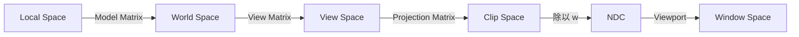

# 第六章：坐标空间、右手系与 MVP 变换链

适用环境：C++17、CMake 3.21+ 和 GLM。本章使用 CPU 上的数值示例验证变换，不需要创建 OpenGL Context。

你将学会：

- 说明 Local、World、View、Clip、Normalized Device 和 Window Space 的职责。
- 理解 Model、View、Projection Matrix 在变换链中的位置。
- 使用右手系和 `x × y = z` 检查基本方向约定。
- 解释为什么 View Space 中 Camera 前方通常是负 Z，以及透视除法如何使用 `w`。
- 把 NDC 坐标映射到指定窗口尺寸。

完整示例位于 [code/part-00-06-coordinates](../code/part-00-06-coordinates/)。本章只研究位置和坐标，不实现完整 Camera 控制或 Shader。

## 为什么需要这么多坐标空间

一个模型顶点最初可能以模型自身原点为中心；放入场景后，它需要知道自己在世界中的位置；从 Camera 观察时，又要转换为相对于 Camera 的坐标；投影和裁剪后，才映射到窗口像素。

如果所有步骤都混在一个“坐标”概念里，一旦物体不出现在屏幕上，就很难判断是模型位置、Camera、Projection 还是 Viewport 出问题。

把变换链拆开，就能逐阶段检查：



对应本章采用的列向量写法：

\[
\mathbf{p}_{clip}=P V M\mathbf{p}_{local}
\]

最右边的 \(M\) 最先作用于局部顶点，然后是 \(V\)，最后是 \(P\)。

## Local Space：相对于模型自身

Local Space 也叫 Model Space。顶点坐标相对于模型自己的原点和坐标轴。

例如，一个立方体可以以自身中心为原点，顶点分布在 `-1` 到 `1` 之间。无论这个立方体以后放在世界的哪个位置，这份本地顶点数据都可以保持不变。

**Model Matrix** 把 Local Position 转为 World Position，包括模型的平移、旋转和缩放。

本章示例把本地点 `(1,0,0)` 放到向 X 平移 2 的模型中，得到世界点 `(3,0,0)`。

## World Space：物体之间的共同参考

World Space 是场景共享的坐标系。模型、灯光和 Camera 的位置通常都在这个空间中表达。

例如：

- 模型 A 位于 `(3,0,0)`。
- 模型 B 位于 `(-2,1,0)`。
- Camera 位于 `(0,0,3)`。

World Space 的原点和轴向由应用约定，OpenGL 不会自动为你定义一个游戏世界。

右手系是常见约定。用互相垂直的单位轴验证：

\[
\mathbf{x}\times\mathbf{y}=\mathbf{z}
\]

本章示例通过 `glm::cross` 检查该关系。需要注意，“OpenGL 使用右手系”不应被理解为管线中每个空间都永远保持同一朝向；Projection 和深度映射还会改变 Z 的表达方式。

## View Space：以 Camera 为参考

View Space 也叫 Eye Space 或 Camera Space。经过 **View Matrix** 后，坐标改为相对于 Camera 表示。

本章使用：

```cpp
const glm::mat4 view = glm::lookAtRH(
    glm::vec3{0.0F, 0.0F, 3.0F},
    glm::vec3{0.0F, 0.0F, 0.0F},
    glm::vec3{0.0F, 1.0F, 0.0F});
```

它表示：

- Camera 位于世界坐标 `(0,0,3)`。
- 看向世界原点。
- World Up 为 `(0,1,0)`。
- `lookAtRH` 使用右手 View 约定。

在这个约定中，Camera 前方是 View Space 的负 Z。世界原点经过 View Matrix 后变成 `(0,0,-3)`：它位于 Camera 前方 3 个单位。

### 为什么 View Matrix 像“反向移动世界”

如果 Camera 向后移动到 `(0,0,3)`，但继续观察原点，等价理解之一是：把整个世界相对于 Camera 向负 Z 移动 3。

View Matrix 并不真的修改模型资源，而是把世界坐标转换到 Camera 参考系。Camera 运动和场景相对运动是同一观察关系的两种描述。

## Projection 与 Clip Space

**Projection Matrix** 把 View Space 映射到 Clip Space，并定义可见范围。常见投影包括：

- 正交投影：平行线保持平行，没有近大远小。
- 透视投影：远处物体看起来更小，适合常见三维场景。

本章使用：

```cpp
const glm::mat4 projection = glm::perspectiveRH_NO(
    glm::radians(45.0F), 800.0F / 600.0F, 0.1F, 100.0F);
```

参数依次表示垂直视场角、宽高比、Near Plane 和 Far Plane。`RH` 表示右手约定，`NO` 表示最终 NDC 的 Z 范围为 `-1` 到 `1`，与当前课程的 OpenGL 默认约定一致。

Near/Far Plane 不是“雾效距离”，而是投影可见范围的近远边界。它们也影响 Depth Buffer 精度，不能只随意设置成极大范围。

### Clip Space 不是 NDC

Projection 后得到的是四维 Clip Coordinate `(x,y,z,w)`。可见点需要满足相应裁剪范围；对 OpenGL 默认深度约定，可概括为各分量位于 `-w` 到 `w` 内。

此时还不能直接把 `x,y,z` 当成最终 NDC，因为还需要透视除法。

## 透视除法与 NDC

透视除法执行：

\[
(x_{ndc},y_{ndc},z_{ndc})=(x_{clip}/w,y_{clip}/w,z_{clip}/w)
\]

在通常的顶点管线中，这一步发生在 Vertex Shader 输出 Clip Position 之后，不需要你在 Fragment Shader 中手动再做一次。

本章 CPU 示例为了展示计算，显式定义了 `ndcFromClip`。Camera 正前方 3 个单位的点经过本章透视矩阵后，`clip.w` 为 3。

NDC 把可见范围规范化到约定范围。对本课程的 OpenGL 默认设置：

- X、Y 通常为 `-1` 到 `1`。
- Z 为 `-1` 到 `1`，Near Plane 映射到 `-1`，Far Plane 映射到 `1`。

示例分别验证 Near/Far Plane 的 Z 映射。

### 为什么远处物体更小

示例把两个 X 都为 1 的点放在不同深度：一个距 Camera 3 个单位，另一个距 Camera 6 个单位。透视除法后，较远点的 `abs(ndc.x)` 更小，也就是更靠近屏幕中心。

这就是“近大远小”在坐标中的体现：透视矩阵把深度信息带入 `w`，除以 `w` 后，相同横向偏移在更远距离下占据更小的 NDC 范围。

## Viewport 与 Window Space

NDC 仍不是像素坐标。Viewport 把 NDC 映射到实际 Framebuffer 区域。

若 Viewport 左下角为 `(0,0)`，尺寸为 `width × height`，则简单映射可写成：

\[
x_{window}=(x_{ndc}+1)\frac{width}{2}
\]

\[
y_{window}=(y_{ndc}+1)\frac{height}{2}
\]

对于 800×600：

| NDC | Window Position |
|---|---|
| `(-1,-1)` | `(0,0)` |
| `(0,0)` | `(400,300)` |
| `(1,1)` | `(800,600)` |

这里的 `(800,600)` 表示矩形右上边界，不是最后一个有效像素下标。示例只讨论坐标映射，不涉及像素采样中心。

第三章的 `glViewport` 正是在设置这一步使用的区域。窗口尺寸变化后更新 Viewport，才能保持映射区域正确。

## 把整条链串起来

假设模型中有一个 Local Position：

```text
local = (1, 0, 0, 1)
```

应用依次处理：

1. Model Matrix 决定它在世界中的位置。
2. View Matrix 把它转换为相对于 Camera 的位置。
3. Projection Matrix 生成 Clip Coordinate。
4. 管线执行透视除法得到 NDC。
5. Viewport 把 NDC 映射到 Window Space。

以后在 Vertex Shader 中看到类似 `projection * view * model * vec4(position, 1.0)`，就能知道每个乘法的职责，而不需要把它当作固定咒语。

> ⚠️ 本章用 CPU 示例显式执行所有步骤，是为了检查数值。实际 OpenGL 程序通常由 Vertex Shader 输出 Clip Position，透视除法和 Viewport 映射由后续管线完成。

## 常见错误

| 现象 | 可能原因 |
|---|---|
| 所有物体都不可见 | Camera 朝向、View Space 负 Z 约定、Near/Far Plane 或矩阵顺序错误 |
| 物体位置随 Camera 改变但方向异常 | View Matrix 构造参数或 Up 向量不正确 |
| 场景拉伸 | Projection 宽高比没有跟随 Framebuffer 尺寸 |
| 投影结果异常大或无限 | 在 `w` 为零或接近零时做透视除法，或使用了错误矩阵 |
| 直接使用 Clip XYZ 当 NDC | 忘记 Clip Space 到 NDC 之间还有除以 `w` |
| 窗口缩放后映射区域不对 | 没有根据 Framebuffer 尺寸更新 Viewport |
| 左手/右手结果混乱 | 混用了不同 handedness 的 LookAt、Projection 或自定义矩阵 |

## 构建与运行

进入 `code/part-00-06-coordinates`，执行：

```powershell
cmake --preset debug
cmake --build --preset debug
ctest --preset debug
```

直接运行：

```powershell
.\build\debug\ch06_coordinates.exe
```

程序输出世界原点在 View Space 的位置、不同深度点的 NDC 和窗口中心映射。CTest 还检查右手叉积、Model/View 变换、Near/Far Plane 和透视缩小关系。

## 练习

1. 把 Camera 移到 `(0,0,5)`，预测世界原点在 View Space 的 Z，再修改代码验证。
2. 保持其他参数不变，把窗口尺寸改为 1024×768，计算 NDC 中心的 Window Position。
3. 修改 Projection 的 Aspect Ratio，观察同一顶点的 `ndc.x` 如何变化。
4. 比较 Near Plane 为 `0.1` 和 `1.0` 时的可见范围；不要在尚未学习 Depth Precision 前声称哪个值性能更高。
5. 用一句话分别解释 Model、View、Projection Matrix，确保三句话不重复。

下一章为工程加入 Debug Output、对象标签、Debug Group 和开发日志，让后续黑屏与 API 错误更容易定位。

## 参考资料

- [Khronos Coordinate Transformations](https://wikis.khronos.org/opengl/Coordinate_Transformations)：坐标变换链、齐次坐标、投影与 Viewport。
- [Khronos Rendering Pipeline Overview](https://wikis.khronos.org/opengl/Rendering_Pipeline_Overview)：裁剪、透视除法、Viewport 和光栅化在管线中的位置。
- [GLM 官方手册](https://github.com/g-truc/glm/blob/master/manual.md)：右手/左手配置与矩阵变换函数。
- [GLM `matrix_transform` 源码文档](https://github.com/g-truc/glm/blob/master/glm/ext/matrix_transform.hpp)：`lookAtRH`、Projection 和 OpenGL 约定。
- [LearnOpenGL Coordinate Systems](https://learnopengl.com/Getting-Started/Coordinate-Systems)：MVP、NDC 与透视投影示例。
