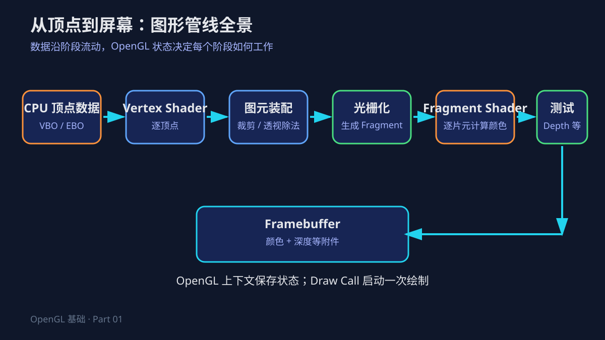

# Part 01 第 1 课：图形管线全景与 OpenGL 状态机

适用环境：C++17、OpenGL 3.3 Core、GLFW、GLAD 和 GLM。示例可在支持 OpenGL 3.3 的 Windows 或 Linux 环境运行；构建方式与第 0 部相同。

你将学会：

- 按顺序解释顶点数据如何变成 Framebuffer 中的图像。
- 区分 Vertex Shader、光栅化、Fragment Shader 和逐样本测试的职责。
- 理解 OpenGL 是有状态的 API，而不是把全部参数塞进一次函数调用的渲染器。
- 用 `glClearColor` 与 `glClear` 验证“先设置状态，再执行操作”。

完整示例位于 [code/part-01-01-pipeline](../code/part-01-01-pipeline/)。第 0 部已经建立窗口和 Context；本课从绘制前的最后一块概念拼图开始。

## 一次 Draw Call 到底做了什么

渲染不是“GPU 直接读取 C++ 数组并画图”。一次典型绘制包含两类输入：

1. **数据**：顶点位置、颜色、纹理坐标、纹理图像和 Uniform 参数。
2. **状态**：使用哪个 Program、VAO、Viewport，是否启用 Depth Test，以及颜色如何混合等。

下图省略了暂时用不到的可选阶段，保留本课程前几课会直接遇到的主线。



关键结论是：**CPU 准备资源和状态，GPU 按管线阶段处理一次绘制命令。** `glDrawArrays` 或 `glDrawElements` 是启动这条流水线的命令，而不是等待整张图在 CPU 上生成。

## CPU 与 GPU 各自负责什么

CPU 端的 C++ 程序负责：

- 创建窗口和 OpenGL Context。
- 创建 Buffer、Texture、Shader Program 等对象。
- 将顶点与图像数据上传给 GPU。
- 设置状态并提交 Draw Call。
- 交换窗口前后缓冲，使已经渲染的图像可见。

GPU 端负责：

- 并行运行 Vertex Shader 和 Fragment Shader。
- 组装三角形、裁剪、光栅化与插值。
- 执行 Depth Test 等固定功能操作。
- 将结果写入当前 Framebuffer 的附件。

“并行”意味着不能把渲染理解为一次只处理一个顶点、立即返回结果的普通函数调用。OpenGL 命令通常进入驱动和 GPU 的命令流，CPU 与 GPU 可以异步工作。

## 管线的主要阶段

### 1. 顶点获取与 Vertex Shader

顶点数据通常存在 Buffer Object 中。Vertex Array Object（VAO）记录如何从这些字节中读取属性。第 3 课会展开这些对象。

Vertex Shader 对每个被使用的顶点运行一次，至少输出 `gl_Position`。它还可以输出颜色、纹理坐标等，供后续阶段使用。

```glsl
#version 330 core
layout (location = 0) in vec3 aPos;
void main() {
    gl_Position = vec4(aPos, 1.0);
}
```

这里 `gl_Position` 是当前顶点在 Clip Space 中的齐次坐标。暂时把 `w = 1.0` 当作让二维位置直接进入后续阶段即可，第 11 课会解释透视除法。

### 2. 图元装配、裁剪与透视除法

顶点按绘制命令指定的图元类型组合。例如 `GL_TRIANGLES` 每三个顶点组成一个三角形。位于可视范围外的图元会被裁剪，Clip Space 坐标随后除以 `w`，转换到 Normalized Device Coordinates（NDC）。

Viewport 再把 NDC 映射到窗口像素范围。窗口尺寸变化时更新 `glViewport`，就是在更新这一步的状态。

### 3. 光栅化与插值

光栅化判断三角形覆盖哪些像素区域，并为这些区域生成 Fragment。Fragment 是“可能写入某个屏幕位置的候选结果”，包含位置以及经过插值的输入数据。

如果三个顶点分别输出红、绿、蓝，光栅化会在三角形内部生成连续变化的颜色，而不是让整个三角形突然变成某一种颜色。第 5 课会用彩色三角形验证。

### 4. Fragment Shader

Fragment Shader 对候选 Fragment 运行，通常输出颜色：

```glsl
#version 330 core
out vec4 FragColor;
void main() {
    FragColor = vec4(0.2, 0.7, 0.9, 1.0);
}
```

这里四个分量依次是 RGBA。本课程默认 Alpha 为 1 表示不透明；真正透明还需要 Blending，留到第 3 部。

### 5. 测试与 Framebuffer 写入

Fragment Shader 输出不会无条件覆盖屏幕。Depth Test、Stencil Test 和 Blending 等操作会决定保留、丢弃或如何混合。最终写入目标是当前 Framebuffer 的颜色、深度等附件。

默认 Framebuffer 通常由窗口系统提供。后续离屏渲染会创建自己的 Framebuffer Object。

## OpenGL 状态机：本课的最小实验

本课示例还不绘制三角形，只改变背景色。核心代码是：

```cpp
glClearColor(color.r, color.g, color.b, 1.0F);
glClear(GL_COLOR_BUFFER_BIT);
```

两个调用承担不同职责：

- `glClearColor` 设置“以后清除颜色附件时使用什么颜色”。它不立即清屏。
- `glClear` 使用当前状态执行清除；`GL_COLOR_BUFFER_BIT` 指定清除颜色附件。

示例按 `1`、`2`、`3` 修改状态，再清除窗口。若删除 `glClearColor`，清除仍会执行，但会使用上一次设置的颜色；若删除 `glClear`，新颜色只是被保存，画面不会因这个调用而清除。

这种“设置 → 使用”的模式会不断出现：

| 设置状态 | 后续操作 |
|---|---|
| `glUseProgram(program)` | Draw Call 使用该 Program |
| `glBindVertexArray(vao)` | 顶点获取使用该 VAO |
| `glViewport(...)` | NDC 到窗口映射使用该范围 |
| `glEnable(GL_DEPTH_TEST)` | 后续 Fragment 执行 Depth Test |

> ⚠️ 状态会持续到被显式修改。一个函数里开启的 Depth Test、绑定的 Texture 或修改的 Clear Color，不会在该函数返回时自动恢复。

## 运行示例

先安装第 0 部要求的 CMake、Ninja、编译器和 vcpkg，并设置 `VCPKG_ROOT`。然后在仓库根目录执行：

```powershell
cd tutorials/opengl-compute-shader/code/part-01-01-pipeline
cmake --preset debug
cmake --build --preset debug
.\build\debug\part01_01_pipeline.exe
```

Linux 下可执行文件通常没有 `.exe` 后缀。按 `1`、`2`、`3` 切换背景色，按 `Esc` 退出。

自动冒烟测试会创建隐藏窗口并运行两帧：

```powershell
ctest --preset debug
```

## 常见错误

### 把所有 OpenGL 函数都当成“立即画图”

`glClearColor`、`glEnable` 和多数 `glBind*` 只修改状态。只有 Draw Call、Clear 等操作才使用这些状态执行工作。

### 把 Fragment 等同于最终像素

Fragment 仍可能被 Depth Test 等阶段丢弃，也可能与旧颜色混合。只有完成后续测试并写入 Framebuffer，结果才成为图像的一部分。

### 每帧忘记清除

颜色附件和深度附件是否清除是两件独立的事。本课只有颜色；进入三维绘制后通常每帧同时清除两者。

## 修改实验

1. 把 `glClear` 移到主循环之前，观察背景为何不会随按键稳定更新。
2. 在循环中添加第四组颜色，并绑定到数字键 `4`。
3. 临时交换 `glClearColor` 与 `glClear` 的顺序，解释第一帧与后续帧的差异。
4. 使用 `glGetFloatv(GL_COLOR_CLEAR_VALUE, values)` 读取当前清除颜色，验证它确实是 Context 状态。

## 独立练习

不使用完整示例，仅借助第 0 部窗口工程，写出一个程序：初始背景为深蓝，按空格在两种颜色间切换。要求把“处理输入”“设置状态”“执行清除”“交换缓冲”分成四个清晰步骤，并用自己的话解释每一步。

下一课将创建 Vertex Shader 和 Fragment Shader，并把二者链接成可供 Draw Call 使用的 Program。

参考资料：[Khronos Rendering Pipeline Overview](https://wikis.khronos.org/opengl/Rendering_Pipeline_Overview)、[LearnOpenGL：OpenGL](https://learnopengl.com/Getting-started/OpenGL)。
