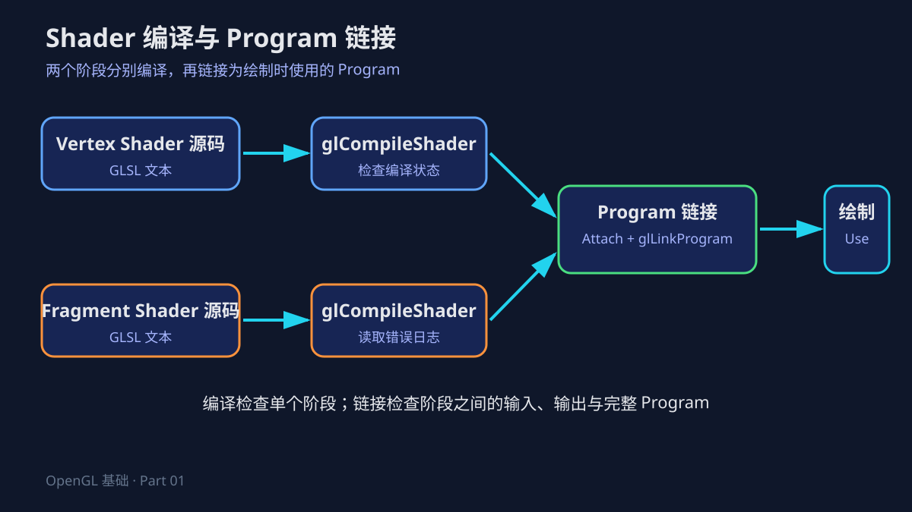

# Part 01 第 2 课：Vertex Shader、Fragment Shader 编译与链接

适用环境：C++17、OpenGL 3.3 Core 和 GLSL 330。示例使用 GLFW + GLAD，依赖由 CMake + vcpkg 管理。

你将学会：

- 区分 Shader Object 与 Program Object。
- 解释 `glShaderSource`、`glCompileShader`、`glAttachShader` 和 `glLinkProgram` 的作用。
- 查询编译、链接状态并读取日志，而不是只凭黑屏猜测。
- 理解 Vertex Shader 的 `out` 与 Fragment Shader 的 `in` 如何形成阶段接口。

完整示例位于 [code/part-01-02-shaders](../code/part-01-02-shaders/)。

## 为什么既编译又链接

C++ 程序通常先编译源文件，再链接成可执行文件。GLSL 类似：

- **编译**检查单个 Shader 阶段的语法、类型和该阶段的规则。
- **链接**把多个阶段组合成 Program，并检查阶段之间能否连接，例如 Vertex Shader 输出是否与 Fragment Shader 输入匹配。

现代 OpenGL 3.3 Core 的可编程绘制至少需要 Vertex Shader 和 Fragment Shader。其他可选阶段后续再学。



编译成功的两个 Shader 仍可能链接失败。例如 Vertex Shader 输出 `vec3 vColor`，Fragment Shader 却把同名输入声明为 `vec4 vColor`，阶段接口就不匹配。

## 本课的两个 Shader

为了不让 VBO 细节分散注意力，本课暂时用内置变量 `gl_VertexID` 生成三个位置：

```glsl
#version 330 core
const vec2 positions[3] = vec2[](
    vec2(-0.6, -0.5),
    vec2( 0.6, -0.5),
    vec2( 0.0,  0.6)
);
void main() {
    gl_Position = vec4(positions[gl_VertexID], 0.0, 1.0);
}
```

`gl_VertexID` 是当前顶点的整数编号。`glDrawArrays(GL_TRIANGLES, 0, 3)` 使它依次取 0、1、2。这个技巧只用于隔离 Shader 编译流程；下一课会改为从 VBO 读取真实顶点数据。

Fragment Shader 输出固定橙色：

```glsl
#version 330 core
out vec4 FragColor;
void main() {
    FragColor = vec4(0.95, 0.45, 0.20, 1.0);
}
```

`#version 330 core` 必须出现在 GLSL 源码开头，表示使用与 OpenGL 3.3 Core 对应的 GLSL 版本。

## 编译一个 Shader Object

示例公共函数 `compileShader` 执行以下步骤：

```cpp
GLuint shader = glCreateShader(type);
glShaderSource(shader, 1, &source, nullptr);
glCompileShader(shader);

GLint success = GL_FALSE;
glGetShaderiv(shader, GL_COMPILE_STATUS, &success);
if (success != GL_TRUE) {
    char log[4096]{};
    glGetShaderInfoLog(shader, sizeof(log), nullptr, log);
    std::fprintf(stderr, "%s\n", log);
}
```

逐个理解调用：

1. `glCreateShader(type)` 创建空 Shader Object；`type` 是 `GL_VERTEX_SHADER` 或 `GL_FRAGMENT_SHADER`。返回值为 0 表示创建失败。
2. `glShaderSource` 把源码交给对象。第二个参数是字符串数量；本例只有 1 个。最后的 `nullptr` 表示字符串以空字符结尾。
3. `glCompileShader` 请求编译，但调用返回不代表编译成功。
4. `glGetShaderiv(..., GL_COMPILE_STATUS, ...)` 查询编译状态。
5. `glGetShaderInfoLog` 读取驱动提供的诊断文本。

失败时必须删除无效 Shader，并停止链接或安全退出。不要继续拿编译失败的 Shader 渲染。

## 链接 Program

两个 Shader 编译成功后，示例执行：

```cpp
GLuint program = glCreateProgram();
glAttachShader(program, vertexShader);
glAttachShader(program, fragmentShader);
glLinkProgram(program);

GLint success = GL_FALSE;
glGetProgramiv(program, GL_LINK_STATUS, &success);
```

- `glCreateProgram` 创建 Program Object。
- `glAttachShader` 把编译后的阶段附加到 Program。
- `glLinkProgram` 执行链接。
- `glGetProgramiv(..., GL_LINK_STATUS, ...)` 查询链接结果。
- `glGetProgramInfoLog` 在失败时读取链接日志。

链接后，示例立即 `glDeleteShader` 删除两个 Shader Object。Program 已保留链接结果，不需要源码 Shader 对象继续存活；这与“删除已链接进 Program 的对象会立即破坏 Program”不同。

## 绘制时使用 Program

每帧绘制前调用：

```cpp
glUseProgram(program);
glBindVertexArray(vao);
glDrawArrays(GL_TRIANGLES, 0, 3);
```

`glUseProgram(0)` 表示解除当前 Program；在 Core Profile 中不能用固定管线替代缺失的 Program。

本例仍创建一个空 VAO 并绑定。Core Profile 的绘制要求 VAO 提供顶点获取状态，即使这个特殊的 `gl_VertexID` 示例没有启用任何顶点属性。

## 阶段接口：out 与 in

当 Vertex Shader 需要向 Fragment Shader 传颜色时，两边声明应匹配：

```glsl
// Vertex Shader
out vec3 vColor;

// Fragment Shader
in vec3 vColor;
```

变量名和类型保持一致是最清晰的写法。链接后，光栅化阶段会对 `vColor` 插值，再交给每个 Fragment 调用。

如果 Fragment Shader 没有使用某个 Vertex Shader 输出，该输出可以没有对应输入；反过来，Fragment Shader 要求的输入必须能由前置阶段提供。

## 运行与故意制造错误

```powershell
cd tutorials/opengl-compute-shader/code/part-01-02-shaders
cmake --preset debug
cmake --build --preset debug
.\build\debug\part01_02_shaders.exe
ctest --preset debug
```

正常结果是一个橙色三角形。建议复制示例后进行两项诊断实验：

1. 把 Fragment Shader 中 `vec4` 改为 `vec3`，重新运行并阅读**编译日志**。
2. 恢复源码，再让 Fragment Shader 增加一个 Vertex Shader 未提供的 `in vec3 vMissing;`，观察**链接或绘制相关诊断**；不同驱动报告时机可能不同。

> ⚠️ 不要只看“程序返回 1”。日志中的源码行号、阶段名称和具体标识符才是定位问题的关键。

## 常见错误

### 只检查函数是否返回，而不检查状态

`glCompileShader` 和 `glLinkProgram` 的返回类型都是 `void`。成功与否必须分别查询 `GL_COMPILE_STATUS` 和 `GL_LINK_STATUS`。

### 把编译和链接日志混为一谈

单个阶段语法错误看 Shader Log；阶段接口与完整 Program 问题看 Program Log。日志缓冲区也要足够大，复杂 Shader 可查询 `GL_INFO_LOG_LENGTH` 后动态分配。

### C++ 字符串生命周期过短

`glShaderSource` 需要有效源码指针。本例源码是静态字符串，因此生命周期覆盖调用。若从文件读入 `std::string`，要保证调用期间字符串仍有效，并正确使用 `c_str()`。

### 忘记 `#version`

缺少或放错版本指令可能使编译器使用意外方言。版本行之前不要插入普通代码或 BOM 文本。

## 独立练习

1. 把三角形改成绿色，并确认你修改的是 Fragment Shader。
2. 让 Vertex Shader 输出顶点编号生成的颜色，Fragment Shader 接收并显示它。
3. 把 `compileShader` 改为返回包含 ID 与错误文本的结果，由调用者统一打印错误。
4. 写出从“GLSL 文本”到“`glUseProgram`”的完整调用顺序，不看示例复述一次。

下一课将移除 `gl_VertexID` 技巧，用 VBO 和 VAO 把 C++ 顶点数组送入 Vertex Shader。

参考资料：[Khronos Shader Compilation](https://wikis.khronos.org/opengl/Shader_Compilation)、[LearnOpenGL：Hello Triangle](https://learnopengl.com/Getting-started/Hello-Triangle)。
