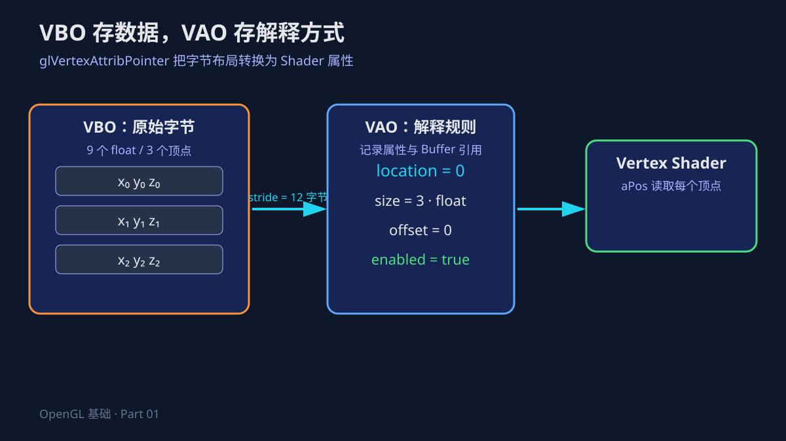

# Part 01 第 3 课：VBO、VAO 与 Vertex Attribute

适用环境：C++17、OpenGL 3.3 Core 和 GLSL 330。示例继续使用统一窗口与 Shader 编译辅助函数。

你将学会：

- 区分 Vertex Buffer Object（VBO）与 Vertex Array Object（VAO）。
- 使用 `glBufferData` 上传顶点字节。
- 用 `glVertexAttribPointer` 描述分量数量、类型、Stride 和 Offset。
- 解释 `layout(location = 0)` 与属性 0 的对应关系。

完整示例位于 [code/part-01-03-vbo-vao](../code/part-01-03-vbo-vao/)。

## VBO 与 VAO 不是同一种对象

- **VBO** 保存顶点原始字节。它不知道三个 `float` 是位置、颜色还是其他数据。
- **VAO** 保存顶点获取状态，包括属性是否启用、格式、读取位置，以及引用哪个 Buffer。
- **Vertex Shader** 通过 Attribute 接收解释后的数据。



可以用一个类比记忆：VBO 是一块数据文件，VAO 是“如何解析文件”的方案，Shader 属性是解析结果的接收变量。

> ⚠️ VAO 不拥有 VBO 中的数据，也不等同于 VBO。删除 VAO 不会自动删除 Buffer；删除 Buffer 也不会把 CPU 数组重新变回来。

## 准备顶点数组

本课使用三个三维位置：

```cpp
const float vertices[] = {
    -0.6F, -0.5F, 0.0F,
     0.6F, -0.5F, 0.0F,
     0.0F,  0.6F, 0.0F,
};
```

数组共有 9 个 `float`。由于当前没有投影变换，可把它们理解为直接位于 NDC 中的位置；`z = 0` 位于深度范围内。

Vertex Shader 声明属性 0：

```glsl
#version 330 core
layout (location = 0) in vec3 aPos;
void main() {
    gl_Position = vec4(aPos, 1.0);
}
```

`vec3` 表示每次 Vertex Shader 调用收到三个浮点分量。`location = 0` 是 CPU 与 GLSL 约定的属性编号，不是 VBO 的对象 ID。

## 创建并上传 VBO

```cpp
GLuint vao = 0;
GLuint vbo = 0;
glGenVertexArrays(1, &vao);
glGenBuffers(1, &vbo);

glBindVertexArray(vao);
glBindBuffer(GL_ARRAY_BUFFER, vbo);
glBufferData(GL_ARRAY_BUFFER, sizeof(vertices), vertices, GL_STATIC_DRAW);
```

调用含义：

1. `glGenVertexArrays` 和 `glGenBuffers` 创建对象名称。
2. `glBindVertexArray(vao)` 让后续属性设置记录到这个 VAO。
3. `glBindBuffer(GL_ARRAY_BUFFER, vbo)` 把 VBO 绑定到顶点数组 Buffer 目标。
4. `glBufferData` 为当前 `GL_ARRAY_BUFFER` 分配存储并复制数据。

`sizeof(vertices)` 是总字节数，不是顶点数量。`GL_STATIC_DRAW` 表示数据预计不常修改、常用于绘制，是给驱动的使用提示，不表示 Buffer 永远不能更新。

## 描述 Attribute 格式

```cpp
glVertexAttribPointer(
    0,                      // index：Shader 属性 location
    3,                      // size：每个顶点 3 个分量
    GL_FLOAT,               // type：分量类型
    GL_FALSE,               // normalized：不归一化整数
    3 * sizeof(float),      // stride：相邻顶点起点的字节距离
    nullptr                 // pointer：首属性在当前 Buffer 中的字节偏移
);
glEnableVertexAttribArray(0);
```

本例每个顶点占 `3 × 4 = 12` 字节，因此 Stride 为 12。第一个属性从 Buffer 起点开始，Offset 为 0。

`normalized` 对 `GL_FLOAT` 不按整数归一化规则处理，本例使用 `GL_FALSE`。它主要在整数类型被解释为浮点值时重要。

最后必须调用 `glEnableVertexAttribArray(0)`。仅描述格式但未启用，Shader 不会按预期从 VBO 获取该属性。

## 完整绑定、绘制与释放流程

下面的代码把前面分散的步骤放在一起。初始化阶段的顺序很重要：**先决定写入哪个 VAO，再绑定提供数据的 VBO，最后描述 Attribute。**

```cpp
// ---------- 初始化：只执行一次 ----------

// 1. 创建对象名称。
// vbo 表示顶点数据存储；vao 表示顶点获取状态。
GLuint vao = 0;
GLuint vbo = 0;
glGenVertexArrays(1, &vao);
glGenBuffers(1, &vbo);

// 2. 绑定 VAO。
// 后续的 Attribute 格式、启用状态和属性所用 Buffer 引用都会记录到这个 VAO。
glBindVertexArray(vao);

// 3. 把 VBO 绑定到 GL_ARRAY_BUFFER。
// 接下来的 glBufferData 和 glVertexAttribPointer 都使用这个当前绑定。
glBindBuffer(GL_ARRAY_BUFFER, vbo);

// 4. 为当前 VBO 分配 GPU 存储，并把 CPU 数组复制进去。
// sizeof(vertices) 是总字节数；GL_STATIC_DRAW 是“少修改、常用于绘制”的提示。
glBufferData(
    GL_ARRAY_BUFFER,
    sizeof(vertices),
    vertices,
    GL_STATIC_DRAW
);

// 5. 描述 location 0 如何从当前 VBO 中读取一个顶点属性。
// 调用结束后，当前 VAO 会记录这条格式规则以及对 vbo 的引用。
glVertexAttribPointer(
    0,                         // Attribute location：对应 GLSL 的 location = 0
    3,                         // 每个顶点读取 x、y、z 三个分量
    GL_FLOAT,                  // 每个分量是 float
    GL_FALSE,                  // 不执行整数归一化
    3 * sizeof(float),         // Stride：相邻顶点起点相隔 12 字节
    reinterpret_cast<void*>(0) // Offset：从每个顶点记录的第 0 字节开始
);

// 6. 在当前 VAO 中启用 location 0。
// 没有这一步，Vertex Shader 不会按上述规则从 VBO 获取 aPos。
glEnableVertexAttribArray(0);

// 7. 初始化结束，解除当前绑定，避免后续代码意外修改这些状态。
// 解绑不会删除对象，也不会清除 VAO 已记录的属性规则。
glBindBuffer(GL_ARRAY_BUFFER, 0);
glBindVertexArray(0);

// ---------- 每帧绘制 ----------

// Program 与 VAO 是两类独立状态：一个提供 Shader，一个提供顶点获取规则。
glUseProgram(program);
glBindVertexArray(vao);

// 从 VAO 描述的顶点数据中读取 3 个顶点，每三个组成一个三角形。
// 这里不需要重新绑定 VBO，因为 VAO 已记录属性 0 对 VBO 的引用。
glDrawArrays(GL_TRIANGLES, 0, 3);

// ---------- 程序结束、OpenGL Context 仍有效时 ----------

// 解绑不是释放；不再需要对象时分别删除存储和状态对象。
glDeleteBuffers(1, &vbo);
glDeleteVertexArrays(1, &vao);
glDeleteProgram(program);
```

这里的 `reinterpret_cast<void*>(0)` 与本课简化代码中的 `nullptr` 等价，都表示 Buffer 内 Offset 为 0。它不是让 OpenGL 从 CPU 空指针读取数据，因为此时属性读取的是当前 VBO。

### 绑定状态到底保存在哪里

需要区分“当前绑定”与“VAO 已保存的规则”：

| 操作 | 直接影响 |
|---|---|
| `glBindVertexArray(vao)` | 选择后续顶点获取操作使用的 VAO |
| `glBindBuffer(GL_ARRAY_BUFFER, vbo)` | 设置 Context 的当前 Array Buffer 绑定 |
| `glBufferData(...)` | 修改当前 VBO 的存储与数据，不修改 VAO |
| `glVertexAttribPointer(0, ...)` | 把属性格式和当前 VBO 引用记录到当前 VAO |
| `glEnableVertexAttribArray(0)` | 在当前 VAO 中启用属性 0 |
| `glBindBuffer(GL_ARRAY_BUFFER, 0)` | 解除当前 Array Buffer 绑定；不会移除 VAO 中已记录的 VBO 引用 |
| `glBindVertexArray(0)` | 解除当前 VAO；不会删除 VAO 或 VBO |

因此，`glBufferData` 上传完成后，CPU 数组可以离开作用域；`glBindBuffer(GL_ARRAY_BUFFER, 0)` 也不会让 VAO 丢失数据引用。

### 为什么绑定顺序不能随意交换

`glVertexAttribPointer` 使用**调用时**绑定到 `GL_ARRAY_BUFFER` 的 Buffer，并把引用记录进**调用时**绑定的 VAO。如果绑定顺序错误，格式规则可能记录到另一个 VAO，或者引用另一个 VBO。

`glDrawArrays` 的三个参数分别是图元类型、起始顶点索引和顶点数量。本例从 0 开始读取 3 个顶点，组成一个三角形。绘制前只需要恢复 Program 和 VAO，不必重复上传顶点或重新设置属性格式。

## 预览交错布局

后续顶点会同时包含位置和颜色：

```cpp
// position.xyz, color.rgb；共 6 个 float
-0.6F, -0.5F, 0.0F,  1.0F, 0.0F, 0.0F,
```

此时 Stride 变成 `6 * sizeof(float)`，颜色属性的 Offset 是 `3 * sizeof(float)`。C++ 中通过 `reinterpret_cast<void*>(3 * sizeof(float))` 表达这个字节偏移。第 5 课会完整使用。

Offset 不是“第几个 float”，而是**字节数**；这也是使用 `sizeof(float)` 而不是直接写 3 的原因。

## 运行示例

```powershell
cd tutorials/opengl-compute-shader/code/part-01-03-vbo-vao
cmake --preset debug
cmake --build --preset debug
.\build\debug\part01_03_vbo_vao.exe
ctest --preset debug
```

正常结果为青色三角形。与上一课外观相似是刻意安排：变化发生在数据来源，而不是最终颜色。

## 常见错误

### Stride 写成 0 或顶点数量

Stride 是相邻顶点之间的**字节距离**。本例应写 `3 * sizeof(float)`。在某些紧密布局中 0 可让实现推导，但显式写出更利于学习交错数据。

### 忘记启用属性

`glVertexAttribPointer` 后需要 `glEnableVertexAttribArray(location)`。黑屏时先检查这一项。

### 在错误的 VAO 或 VBO 绑定状态下设置属性

属性格式会写进当前 VAO，并引用当前 `GL_ARRAY_BUFFER`。封装函数时尤其要检查调用前后的绑定状态。

### 把 location 当成 Buffer ID

`location = 0` 只对应属性槽位 0。VBO 的 ID 可以任意，二者没有数值对应关系。

### 提前释放 GPU 对象

程序结束且 Context 仍有效时，示例调用 `glDeleteBuffers`、`glDeleteVertexArrays` 和 `glDeleteProgram`。销毁 Context 后不能再依赖这些调用。

## 修改实验与独立练习

1. 将三个顶点改成屏幕左侧的小三角形，预测再运行。
2. 添加第二个 VBO/VAO 和另一个三角形，使用同一 Program 分别绘制。
3. 把数组改为位置和颜色交错布局，为属性 1 设置正确 Stride 与 Offset。
4. 独立完成一张表，列出 VBO、VAO、Shader Program 各自保存的内容及创建/删除函数。

下一课会用 EBO 让两个三角形共享顶点，把一个矩形拆成索引绘制。

参考资料：[Khronos Vertex Specification](https://wikis.khronos.org/opengl/Vertex_Specification)、[Khronos Vertex Rendering](https://wikis.khronos.org/opengl/Vertex_Rendering)。
