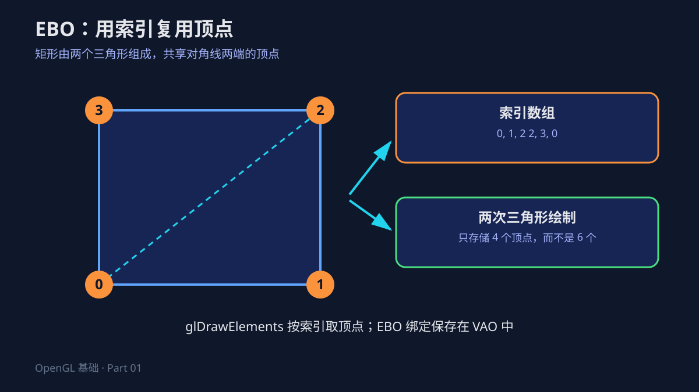

# Part 01 第 4 课：EBO 与索引绘制

适用环境：C++17、OpenGL 3.3 Core 和 GLSL 330。需要完成上一课的 VBO/VAO 配置。

你将学会：

- 为什么三角形网格需要复用顶点。
- 使用 Element Buffer Object（EBO）保存索引。
- 比较 `glDrawArrays` 与 `glDrawElements` 的数据读取方式。
- 正确理解 VAO 对 `GL_ELEMENT_ARRAY_BUFFER` 绑定的记录。

完整示例位于 [code/part-01-04-ebo](../code/part-01-04-ebo/)。

## 矩形为什么需要两个三角形

OpenGL 的常用基本图元包括点、线和三角形。矩形通常拆成两个三角形。如果直接使用 `glDrawArrays`，六个顶点会写成：

```text
三角形 A：左下、右下、右上
三角形 B：右上、左上、左下
```

右下与左上被重复存储。小矩形看似无所谓，但真实模型的大量三角形会共享边和顶点，重复位置、法线、UV 会显著浪费存储与更新带宽。

EBO 的思路是：顶点数组只保存 4 个唯一顶点，再用索引指定组合顺序。



图中的顶点顺序为：

```cpp
const float vertices[] = {
    -0.6F, -0.5F, 0.0F, // 0：左下
     0.6F, -0.5F, 0.0F, // 1：右下
     0.6F,  0.5F, 0.0F, // 2：右上
    -0.6F,  0.5F, 0.0F, // 3：左上
};
const unsigned int indices[] = {
    0, 1, 2,
    2, 3, 0,
};
```

从窗口正面观察，这两个三角形都采用逆时针（Counter-Clockwise，CCW）绕序。第 13 课讲解 Face Culling 时会再次使用这个性质。

## 创建并上传 EBO

在绑定 VAO 后配置三个对象：

```cpp
glBindVertexArray(vao);

glBindBuffer(GL_ARRAY_BUFFER, vbo);
glBufferData(GL_ARRAY_BUFFER, sizeof(vertices), vertices, GL_STATIC_DRAW);

glBindBuffer(GL_ELEMENT_ARRAY_BUFFER, ebo);
glBufferData(GL_ELEMENT_ARRAY_BUFFER, sizeof(indices), indices, GL_STATIC_DRAW);

glVertexAttribPointer(0, 3, GL_FLOAT, GL_FALSE, 3 * sizeof(float), nullptr);
glEnableVertexAttribArray(0);
```

`GL_ARRAY_BUFFER` 与 `GL_ELEMENT_ARRAY_BUFFER` 是不同绑定目标：

- 前者提供顶点属性数据。
- 后者提供 Draw Elements 使用的索引。

当前 VAO 会记录 EBO 绑定，因此之后只绑定 VAO，就能同时恢复属性状态和索引 Buffer。

> ⚠️ 在目标 VAO 仍绑定时调用 `glBindBuffer(GL_ELEMENT_ARRAY_BUFFER, 0)`，会把该 VAO 的 EBO 绑定解除。这与解绑 `GL_ARRAY_BUFFER` 的效果不同，不要机械地对所有 Target 执行“清空绑定”。

## glDrawElements 的四个参数

```cpp
glBindVertexArray(vao);
glDrawElements(GL_TRIANGLES, 6, GL_UNSIGNED_INT, nullptr);
```

依次是：

1. `GL_TRIANGLES`：每三个索引组成一个三角形。
2. `6`：读取 6 个索引，不是读取 6 个唯一顶点。
3. `GL_UNSIGNED_INT`：索引数组中每个元素的类型，必须与 EBO 数据匹配。
4. `nullptr`：从 EBO 起始位置读取；非零值表示字节偏移，不是 CPU 指针。

如果把 `indices` 改为 `unsigned short`，上传数据与第三个参数都应改为 `GL_UNSIGNED_SHORT`。类型不匹配会导致错误读取。

## 与 glDrawArrays 的比较

| 特性 | `glDrawArrays` | `glDrawElements` |
|---|---|---|
| 顶点来源 | 按连续编号读取 | 按 EBO 索引读取 |
| 是否显式复用顶点 | 否 | 是 |
| 本课矩形所需索引参数 | 6 个顶点 | 6 个索引、4 个顶点 |
| 常见用途 | 简单非索引几何 | 三角形网格、模型 |

GPU 还有 Post-transform Cache 等机制复用已经处理的顶点结果，因此索引绘制不只是节省数组字节。不过具体缓存效果由实现决定，本课不把它当作固定性能承诺。

## 线框模式观察图元

示例按 `L` 在填充与线框之间切换：

```cpp
glPolygonMode(GL_FRONT_AND_BACK, wireframe ? GL_LINE : GL_FILL);
```

`GL_FRONT_AND_BACK` 表示正面与背面都应用该多边形光栅化模式。`GL_LINE` 绘制三角形边，`GL_FILL` 恢复默认填充。

线框中能看到矩形的对角线，说明它确实由两个三角形组成。该模式适合调试几何，不应与“启用 Depth Test”混为一谈。

## 运行示例

```powershell
cd tutorials/opengl-compute-shader/code/part-01-04-ebo
cmake --preset debug
cmake --build --preset debug
.\build\debug\part01_04_ebo.exe
ctest --preset debug
```

按 `L` 切换线框，按 `Esc` 退出。自动测试使用隐藏窗口绘制两帧，验证工程能创建 Context、编译 Shader 并执行索引绘制。

## 常见错误

### EBO 上传到了错误 Target

索引必须上传到 `GL_ELEMENT_ARRAY_BUFFER`。把它上传到 `GL_ARRAY_BUFFER` 不会让 `glDrawElements` 找到索引。

### 解绑 VAO 后又期待它记住新 EBO

只有配置时绑定到目标 VAO 的 EBO 状态会被记录。先绑定 VAO，再绑定 EBO，是最稳妥的顺序。

### Count 写错

本例有 6 个索引，Count 就是 6。写成 4 只会绘制不完整图元，写成超出数组长度的值会访问无效索引数据。

### 把最后的 Offset 当 CPU 数组指针

使用 Buffer 中的索引时，最后参数是 Buffer 内字节偏移。现代写法不把 `indices` 这个 CPU 指针直接传给 `glDrawElements`。

## 修改实验与独立练习

1. 把索引顺序改为 `{0, 1, 2, 0, 2, 3}`，确认它表达同样的两个三角形。
2. 故意删除第二个三角形，观察只保留哪一半。
3. 把索引类型改为 `unsigned short`，同步修改所有相关调用。
4. 不使用示例代码，绘制一个由 5 个唯一顶点构成的五边形，并用线框模式检查三角剖分。

下一课会回到非索引三角形，为每个顶点添加颜色，观察光栅化如何插值 Attribute。

参考资料：[Khronos Vertex Rendering](https://wikis.khronos.org/opengl/Vertex_Rendering)、[LearnOpenGL：Hello Triangle](https://learnopengl.com/Getting-started/Hello-Triangle)。
