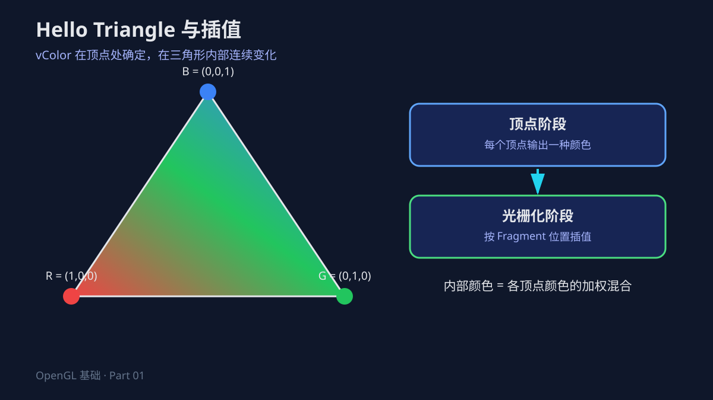

# Part 01 第 5 课：Hello Triangle 与插值

适用环境：C++17、OpenGL 3.3 Core 和 GLSL 330。示例使用非索引绘制，让注意力集中在多属性与插值上。

你将学会：

- 在一个 VBO 中交错保存位置和颜色。
- 为两个 Attribute 设置不同 Offset、相同 Stride。
- 使用 Vertex Shader 的 `out` 与 Fragment Shader 的 `in` 传递颜色。
- 解释为什么只给三个顶点赋色，整个三角形却有连续渐变。

完整示例位于 [code/part-01-05-interpolation](../code/part-01-05-interpolation/)。

## 顶点不只包含位置

一个顶点可以包含位置、颜色、纹理坐标、法线等多种属性。本课采用交错（Interleaved）布局：

```cpp
const float vertices[] = {
    // position              // color
    -0.6F, -0.5F, 0.0F,      1.0F, 0.15F, 0.15F,
     0.6F, -0.5F, 0.0F,      0.15F, 1.0F, 0.25F,
     0.0F,  0.6F, 0.0F,      0.15F, 0.35F, 1.0F,
};
```

每个顶点连续存放 6 个 `float`：前 3 个是位置，后 3 个是 RGB 颜色。交错布局把同一顶点的数据放在一起，是常见选择；也可以把位置和颜色放在不同 Buffer，本课不展开。

## 两个 Attribute 的解释规则

总 Stride 对位置和颜色都为 `6 * sizeof(float)`：

```cpp
glVertexAttribPointer(0, 3, GL_FLOAT, GL_FALSE,
    6 * sizeof(float), nullptr);
glEnableVertexAttribArray(0);

glVertexAttribPointer(1, 3, GL_FLOAT, GL_FALSE,
    6 * sizeof(float), reinterpret_cast<void*>(3 * sizeof(float)));
glEnableVertexAttribArray(1);
```

属性 0 从字节 0 开始读取位置；属性 1 跳过位置的 12 字节，再读取颜色。两个属性共用同一个 VBO，却从不同 Offset 开始。

Shader 中的 location 必须对应：

```glsl
layout (location = 0) in vec3 aPos;
layout (location = 1) in vec3 aColor;
```

如果只改 C++ 的 location 而不改 GLSL，或者反过来，数据会进入错误属性或根本没有启用对应输入。

## 把颜色传过管线

Vertex Shader 接收每顶点颜色，再输出：

```glsl
out vec3 vColor;
void main() {
    gl_Position = vec4(aPos, 1.0);
    vColor = aColor;
}
```

Fragment Shader 声明匹配输入：

```glsl
in vec3 vColor;
out vec4 FragColor;
void main() {
    FragColor = vec4(vColor, 1.0);
}
```

这里存在两段不同的数据流：

1. `aColor` 是 Attribute，每个顶点从 VBO 读取一次。
2. `vColor` 是阶段接口，Vertex Shader 输出后，由光栅化为每个 Fragment 插值。



因此 Fragment Shader 中的 `vColor` 不一定等于任一顶点原始颜色。它是当前 Fragment 位置对应的插值结果。

## 直观理解重心权重

三角形内部一点可以用三个顶点的加权组合表示：

\[
P = \lambda_0P_0 + \lambda_1P_1 + \lambda_2P_2
\]

其中：

\[
\lambda_0 + \lambda_1 + \lambda_2 = 1,\qquad \lambda_i \geq 0
\]

这些权重称为重心坐标（Barycentric Coordinates）。同一组权重也用于颜色：

\[
C = \lambda_0C_0 + \lambda_1C_1 + \lambda_2C_2
\]

靠近红色顶点时，红色顶点权重大；位于三条边或中心时，各颜色按相应比例混合。无需在本课手动计算权重，光栅化会自动完成。

> 在透视投影下，默认平滑插值会考虑透视校正，不只是屏幕空间中的简单线性加权。当前 `w = 1` 的三角形可先用上述直观模型理解。

## 一次完整 Draw Call 的数据链

本课的数据流可以概括为：

```text
C++ float 数组
  → glBufferData 上传到 VBO
  → VAO 按 location 0/1 解释位置与颜色
  → glDrawArrays 触发 3 次 Vertex Shader
  → 光栅化生成 Fragment 并插值 vColor
  → Fragment Shader 输出 RGBA
  → 默认 Framebuffer
```

这就是第 1 课管线图在一个具体彩色三角形上的落地。

## 运行示例

```powershell
cd tutorials/opengl-compute-shader/code/part-01-05-interpolation
cmake --preset debug
cmake --build --preset debug
.\build\debug\part01_05_interpolation.exe
ctest --preset debug
```

正常结果为红、绿、蓝三个角之间平滑渐变的三角形。若看到纯色，优先检查 Fragment Shader 是否仍输出固定颜色；若看到错乱颜色，检查 Stride 与 Offset。

## 常见错误

### 两个属性仍使用旧 Stride

加入颜色后，每个顶点不再只有 3 个 `float`。位置属性的 Stride 也必须更新为 6 个 `float` 的字节数。

### 把颜色 Offset 写成 3

Offset 的单位是字节，应写 `3 * sizeof(float)`。写整数 3 会从第 3 个字节开始，造成跨分量错位读取。

### 阶段接口类型或名称不一致

`out vec3 vColor` 应与 `in vec3 vColor` 对应。编译单个阶段可能成功，但链接或绘制结果会暴露接口问题。

### 误以为每个 Fragment 都重新读取 VBO

Attribute 在顶点获取阶段读取。Fragment Shader 接收的是插值后的阶段输入，不会为每个像素重新访问原始顶点数组。

## 修改实验与独立练习

1. 把三个顶点都设为相同颜色，验证渐变消失。
2. 只修改一个顶点的 Alpha 意图不会有效，因为当前颜色属性是 `vec3`；把它扩展为 `vec4` 并同步修改 Stride、Offset 和 Shader。
3. 添加 `out vec3 vPosition`，在 Fragment Shader 中根据位置而非顶点颜色生成条纹。
4. 独立绘制一个四顶点、六索引的彩色矩形，让每个角颜色不同。

下一课将系统整理 GLSL 常用类型、限定符、分量访问和内置函数，减少之后 Shader 实验中的语法障碍。

参考资料：[Khronos Rendering Pipeline Overview](https://wikis.khronos.org/opengl/Rendering_Pipeline_Overview)、[LearnOpenGL：Shaders](https://learnopengl.com/Getting-started/Shaders)。
