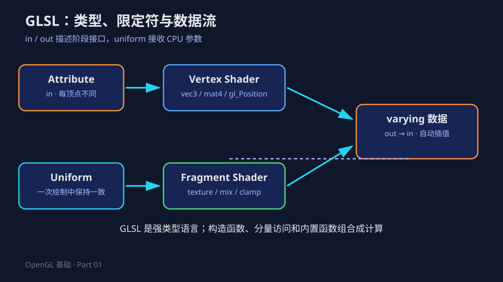

# Part 01 第 6 课：GLSL 类型、限定符与内置函数

适用环境：C++17、OpenGL 3.3 Core 和 GLSL 330。本课只使用当前三角形需要的基础语法，不试图覆盖完整语言规范。

你将学会：

- 使用标量、向量和矩阵类型，并进行明确的构造与转换。
- 区分 `in`、`out`、`uniform` 和内置变量。
- 使用分量访问、向量运算及常用数学函数。
- 读懂本课颜色条纹 Shader 的每一步。

完整示例位于 [code/part-01-06-glsl](../code/part-01-06-glsl/)。

## GLSL 是强类型语言

常见类型包括：

| 类型 | 含义 | 示例 |
|---|---|---|
| `float` | 单精度浮点标量 | `0.5` |
| `int` | 整数标量 | `3` |
| `bool` | 布尔值 | `true` |
| `vec2` / `vec3` / `vec4` | 浮点向量 | `vec3(1.0)` |
| `ivec*` / `uvec*` / `bvec*` | 整数、无符号、布尔向量 | `ivec2(0, 1)` |
| `mat3` / `mat4` | 浮点矩阵 | `mat4(1.0)` |

不要把整数和浮点表达式随意混用。例如想写浮点除法时，使用 `1.0 / 2.0`，不要让两个操作数都是整数。

构造函数可以标量扩展或组合分量：

```glsl
vec3 a = vec3(0.2);             // (0.2, 0.2, 0.2)
vec3 b = vec3(0.1, 0.2, 0.3);
vec4 c = vec4(b, 1.0);          // (0.1, 0.2, 0.3, 1.0)
vec2 d = vec2(0.4, 0.5);
```

`mat4(1.0)` 构造单位矩阵，而不是所有元素都为 1 的矩阵。

## 向量分量与运算

向量支持按语义选择分量名称：

- 位置：`x`、`y`、`z`、`w`。
- 颜色：`r`、`g`、`b`、`a`。
- 纹理坐标：`s`、`t`、`p`、`q`。

```glsl
vec4 color = vec4(0.2, 0.4, 0.6, 1.0);
vec3 rgb = color.rgb;
vec2 rg = color.rg;
float red = color.r;
```

Swizzle 可以重排或重复分量，例如 `color.bgr`。赋值目标中的同一分量不能重复出现。

向量与标量、同维向量可以逐分量运算：

```glsl
vec3 a = vec3(1.0, 2.0, 3.0);
vec3 b = a * 2.0;
vec3 c = a + vec3(0.5);
```

矩阵乘向量则遵循线性代数规则，不是逐分量乘法。`uModel * vec4(aPos, 1.0)` 的结果是变换后的齐次位置。

## 存储限定符与数据流



### Attribute：顶点输入

```glsl
layout (location = 0) in vec3 aPos;
```

Vertex Shader 的 `in` 通常来自 VAO 描述的顶点属性。每次顶点调用可能不同。

### 阶段输出与输入

```glsl
// Vertex Shader
out vec3 vColor;

// Fragment Shader
in vec3 vColor;
```

前一阶段输出经插值后成为后一阶段输入。`out`/`in` 的具体含义取决于所在阶段。

### Uniform：绘制参数

```glsl
uniform vec3 uColor;
```

Uniform 由 CPU 设置，在一次 Draw Call 的各次 Shader 调用中保持一致。下一课会完整讲解位置查询与更新。

### 内置变量

本课程已经遇到：

- `gl_VertexID`：当前顶点编号。
- `gl_Position`：Vertex Shader 必须写出的 Clip Space 位置。
- `gl_FragCoord`：当前 Fragment 的窗口坐标等内置信息，本课示例未依赖它。

内置变量由 OpenGL 定义，不需要也不能像普通变量一样随意重复声明。

## 常用数学函数

| 函数 | 作用 | 例子或用途 |
|---|---|---|
| `sin(x)` / `cos(x)` | 周期函数 | 动画、波形 |
| `clamp(x, lo, hi)` | 限制范围 | 防止颜色超出 0～1 |
| `mix(a, b, t)` | 线性插值 | `a * (1-t) + b * t` |
| `smoothstep(e0, e1, x)` | 平滑阶跃 | 柔和边缘与过渡 |
| `dot(a, b)` | 点积 | 方向关系、光照 |
| `cross(a, b)` | 叉积 | Camera 坐标轴 |
| `normalize(v)` | 单位方向 | 法线与观察方向 |
| `length(v)` | 向量长度 | 距离与衰减 |
| `pow(x, y)` | 幂 | 高光曲线 |

这些函数多数可对向量逐分量执行。`dot`、`cross` 等有特定维度与数学语义，应查阅对应函数定义。

> ⚠️ `smoothstep(edge0, edge1, x)` 要求 `edge0 < edge1` 才有定义的常规过渡；不要反转边界后仍期待同样结果。

## 逐行读懂本课 Fragment Shader

```glsl
#version 330 core
in vec3 vColor;
in vec2 vPosition;
out vec4 FragColor;

void main() {
    float wave = 0.5 + 0.5 * sin(14.0 * vPosition.x);
    float band = smoothstep(0.25, 0.75, wave);
    vec3 coolColor = vec3(0.08, 0.16, 0.30);
    vec3 rgb = mix(vColor, coolColor, 0.35 * band);
    rgb = clamp(rgb, 0.0, 1.0);
    FragColor = vec4(rgb, 1.0);
}
```

1. Vertex Shader 把 `aPos.xy` 写入 `vPosition`，光栅化后每个 Fragment 获得自己的位置。
2. `sin` 根据 X 坐标产生周期波形；乘 0.5 再加 0.5，把大致范围从 `[-1,1]` 映射到 `[0,1]`。
3. `smoothstep` 让波形中间区域平滑过渡，减少硬切换。
4. `mix` 最多把 35% 的原顶点颜色替换为冷色。
5. `clamp` 将 RGB 各分量限制在 `[0,1]`。
6. 最后补充 Alpha = 1，输出四维颜色。

这个效果没有新增 CPU  Uniform；条纹完全由 Fragment 的插值位置计算。

## 运行示例

```powershell
cd tutorials/opengl-compute-shader/code/part-01-06-glsl
cmake --preset debug
cmake --build --preset debug
.\build\debug\part01_06_glsl.exe
ctest --preset debug
```

正常结果为带柔和横向条纹的彩色三角形。修改 `14.0` 可以调整波形频率，修改 `0.35` 可以调整冷色混合强度。

## 常见错误

### 整数与浮点类型混用

GLSL 不像 C++ 那样允许所有隐式数值转换。遇到类型错误时，明确写 `float(i)` 或使用浮点字面量。

### 向量维度不匹配

`vec3 + vec4` 不合法。需要明确取 `xyz` 或补充 `w`，并确认这种转换在数学上符合意图。

### 以为 mix 会把 t 自动限制到 0～1

`mix` 的 `t` 超出范围会产生外推。需要限制时显式调用 `clamp`。

### 归一化零向量

`normalize(vec3(0.0))` 没有有效方向。Camera 和光照代码应避免对可能为零的向量直接归一化。

## 修改实验与独立练习

1. 把条纹改为由 `vPosition.y` 控制。
2. 用 `mix(vColor, coolColor, band)` 替换当前系数，比较混合强度。
3. 使用 `length(vPosition)` 生成从中心向外变化的颜色。
4. 独立写一个 Shader：根据 `gl_FragCoord.xy` 和窗口尺寸生成左右双色渐变，并解释为什么需要除以分辨率。

下一课将从 CPU 设置 Uniform，让时间和键盘输入真正控制 Shader。

参考资料：[Khronos OpenGL Shading Language](https://wikis.khronos.org/opengl/OpenGL_Shading_Language)、[GLSL 4.60 规范](https://registry.khronos.org/OpenGL/specs/gl/GLSLangSpec.4.60.html)。
