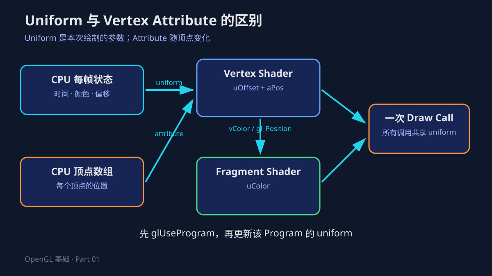

# Part 01 第 7 课：Uniform、时间与交互

适用环境：C++17、OpenGL 3.3 Core 和 GLSL 330。示例使用 GLFW 键盘输入与计时器。

你将学会：

- 解释 Uniform 为什么适合传递时间、颜色和变换矩阵。
- 使用 `glGetUniformLocation` 和 `glUniform*` 更新 Program 参数。
- 用 `glfwGetTime` 生成连续动画。
- 把键盘输入转换为顶点偏移，并限制移动范围。

完整示例位于 [code/part-01-07-uniforms](../code/part-01-07-uniforms/)。

## Uniform 与 Attribute 的区别

上一课的 Attribute 随顶点变化；Uniform 则在一次 Draw Call 中保持一致。



本课声明两个 Uniform：

```glsl
// Vertex Shader
uniform vec2 uOffset;

// Fragment Shader
uniform vec3 uColor;
```

`uOffset` 被加到每个顶点位置，`uColor` 被每个 Fragment 使用。它们不需要存进 VBO，因为并非每个顶点都有不同值。

Vertex Shader 的核心计算：

```glsl
void main() {
    gl_Position = vec4(aPos.xy + uOffset, aPos.z, 1.0);
}
```

这里使用 Swizzle 取出二维位置，与二维偏移相加，再补回 Z 和齐次 W。

## 查询 Uniform Location

OpenGL 使用 Location 标识 Program 内的 Uniform：

```cpp
const GLint offsetLocation = glGetUniformLocation(program, "uOffset");
const GLint colorLocation = glGetUniformLocation(program, "uColor");
```

名称必须与 GLSL 声明一致。本课在初始化时查询一次，避免每帧重复按名称查找。

如果 Uniform 不存在、名称错误，或被编译器优化为未使用，`glGetUniformLocation` 返回 `-1`。向 location `-1` 设置值会被静默忽略，不会帮你修正 Shader。

> ⚠️ “声明了 Uniform”不等于它一定有有效 location。若计算结果不影响输出，优化器可能移除它。调试时先确认 Shader 确实使用该变量。

## 设置值之前绑定 Program

Uniform 值保存在对应 Program 的状态中。更新流程是：

```cpp
glUseProgram(program);
glUniform2f(offsetLocation, offset.x, offset.y);
glUniform3fv(colorLocation, 1, glm::value_ptr(color));
glDrawArrays(GL_TRIANGLES, 0, 3);
```

常用函数后缀：

| 函数 | GLSL 类型 | 数据形式 |
|---|---|---|
| `glUniform1f` | `float` | 一个浮点数 |
| `glUniform1i` | `int`、`sampler2D` | 一个整数 |
| `glUniform2f` | `vec2` | 两个浮点数 |
| `glUniform3fv` | `vec3` 或数组 | 指向浮点数组 |
| `glUniformMatrix4fv` | `mat4` | 4×4 矩阵数据 |

`glUniform3fv` 的第二个参数是要设置的向量数量，本例为 1。`glm::value_ptr(color)` 提供连续分量地址。

不要把 `glUniform3f` 和 `glUniform3fv` 混用：前者直接接收三个值，后者接收指针和数量。

## 时间驱动的颜色动画

GLFW 提供从初始化后开始的高精度时间：

```cpp
const float time = static_cast<float>(glfwGetTime());
const glm::vec3 color{
    0.5F + 0.5F * std::sin(time),
    0.35F,
    0.8F - 0.3F * std::sin(time)
};
```

`sin(time)` 产生周期变化。映射到 `[0,1]` 附近后，可以作为颜色分量。由于 `uColor` 每帧更新，Fragment Shader 无需知道时间本身。

本例主循环先根据当前时间计算状态，再提交绘制。动画不是通过固定“每帧增加颜色”实现，因此颜色由绝对时间决定，不依赖累计帧数。

## 键盘控制位置

```cpp
if (glfwGetKey(window, GLFW_KEY_LEFT) == GLFW_PRESS)  offset.x -= step;
if (glfwGetKey(window, GLFW_KEY_RIGHT) == GLFW_PRESS) offset.x += step;
if (glfwGetKey(window, GLFW_KEY_UP) == GLFW_PRESS)    offset.y += step;
if (glfwGetKey(window, GLFW_KEY_DOWN) == GLFW_PRESS)  offset.y -= step;
```

`GLFW_PRESS` 表示按键当前处于按下状态，适合持续移动。`offset` 是 C++ 的 `glm::vec2`，最后限制在 `[-0.65, 0.65]`，避免三角形完全移出可视范围。

本课为隔离 Uniform 概念，移动使用固定每帧步长；这意味着不同帧率下速度不同。第 12 课会引入 `deltaTime` 修正 Camera 移动，同样的方法也适用于这里。

按 `R` 将偏移重置为零，按 `Esc` 退出。

## 每帧更新与每对象更新

Uniform 可在 Draw Call 之间改变。因此渲染多个物体时常见模式是：

```cpp
glUseProgram(program);
// 设置所有物体共享的 view、projection
for (const auto& object : objects) {
    // 设置当前物体的 model、color
    // 绘制当前物体
}
```

同一个 Program 的 Uniform 在一次绘制后会保留，直到再次修改。下一帧不要依赖“它可能刚好还是旧值”，应明确设置当前绘制需要的状态。

## 运行示例

```powershell
cd tutorials/opengl-compute-shader/code/part-01-07-uniforms
cmake --preset debug
cmake --build --preset debug
.\build\debug\part01_07_uniforms.exe
ctest --preset debug
```

三角形颜色随时间变化；方向键移动，`R` 复位。隐藏窗口自动测试只验证程序与绘制路径，不模拟键盘输入。

## 常见错误

### 更新 Uniform 时没有使用正确 Program

如果当前绑定的是另一个 Program，`glGetUniformLocation` 得到的 location 对当前对象未必有意义。养成“先 `glUseProgram`，再设置”的顺序。

### 名称拼写不一致

`uOffset` 与 `offset` 是不同名称。返回 `-1` 时先检查拼写、Shader 是否真正使用该 Uniform，以及 Program 是否链接成功。

### 把 Uniform 当成每顶点输入

若每个顶点需要不同值，应使用 Attribute 或按顶点索引读取其他资源；Uniform 不适合替代 VBO 中的逐顶点颜色。

### 用帧数直接驱动所有运动

固定每帧位移会让高刷新率设备移动更快。需要真实速度时，使用 `位移 = 速度 × deltaTime`。

## 修改实验与独立练习

1. 添加 `uniform float uScale`，用数字键调整三角形大小。
2. 把颜色动画改为三个分量不同相位，使用 `sin(time + phase)`。
3. 查询一个不存在的 Uniform，打印 location 并观察设置是否被忽略。
4. 独立实现按住空格暂停颜色动画，但保留键盘移动；思考应冻结绝对时间还是停止累计模拟时间。

下一课将引入 Texture 和 Sampler，让 Fragment Shader 从图像而不是常量或公式中取得颜色。

参考资料：[Khronos Uniform (GLSL)](https://wikis.khronos.org/opengl/Uniform_(GLSL))、[LearnOpenGL：Shaders](https://learnopengl.com/Getting-started/Shaders)。
