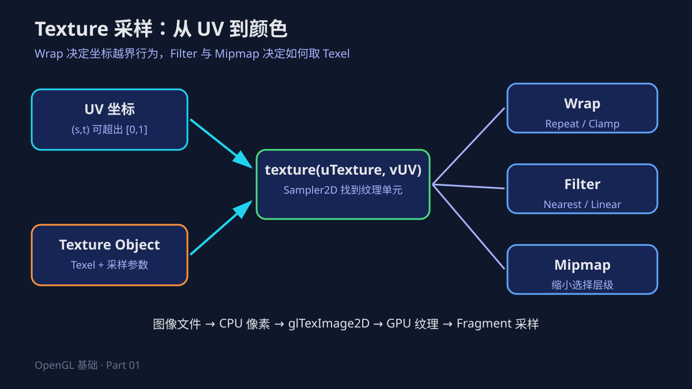

# Part 01 第 8 课：Texture、Sampler、Wrap、Filter 与 Mipmap

适用环境：C++17、OpenGL 3.3 Core 和 GLSL 330；新增依赖 stb_image。示例图像为仓库内的 PPM 文件，无需联网下载。

你将学会：

- 区分图像文件、Texture Object、Texture Unit 和 Sampler。
- 使用 UV 坐标把纹理映射到矩形。
- 设置 Wrap、Min/Mag Filter 并生成 Mipmap。
- 解释图像上下翻转的原因。

完整示例位于 [code/part-01-08-textures](../code/part-01-08-textures/)，测试图像位于 [code/part-01-assets](../code/part-01-assets/)。

## 从图像文件到 Fragment 颜色

一张图片进入最终画面要经过多次转换：

1. stb_image 解码 PNG、JPEG、PPM 等文件，得到 CPU 像素数组。
2. `glTexImage2D` 把像素上传到 Texture Object。
3. Texture Object 绑定到 Texture Unit。
4. Fragment Shader 中的 `sampler2D` 根据 UV 坐标采样。
5. 返回的颜色成为 `FragColor`。



Texture Object 不只包含像素，也保存 Wrap、Filter 等采样状态。Sampler Uniform 则是 Shader 找到纹理单元的接口。

## UV：矩形上的纹理坐标

本课顶点包含位置和 UV：

```cpp
const float vertices[] = {
    // position             // UV
    -0.7F, -0.6F, 0.0F,     0.0F, 0.0F,
     0.7F, -0.6F, 0.0F,     2.0F, 0.0F,
     0.7F,  0.6F, 0.0F,     2.0F, 2.0F,
    -0.7F,  0.6F, 0.0F,     0.0F, 2.0F,
};
```

UV 也常写作 `(s,t)`。本例故意让最大值达到 2，以观察 Repeat 与 Clamp 的区别。

Vertex Shader 原样传递，Fragment Shader 采样：

```glsl
in vec2 vUV;
uniform sampler2D uTexture;

void main() {
    FragColor = texture(uTexture, vUV);
}
```

`texture` 的第一个参数是 Sampler，第二个是纹理坐标。返回 `vec4`，包含 RGBA。

## 使用 stb_image 解码并上传

stb_image 采用单头文件实现。本示例唯一的 `.cpp` 在包含辅助头文件前定义实现宏：

```cpp
#define STB_IMAGE_IMPLEMENTATION
#include "texture_common.hpp"
```

一个程序中只能有一个翻译单元定义该宏，否则会出现重复符号；完全不定义则会在链接时报告 `stbi_load` 等未解析符号。

公共辅助函数的关键步骤：

```cpp
stbi_set_flip_vertically_on_load(1);
int width = 0, height = 0, channels = 0;
unsigned char* pixels = stbi_load(path.c_str(), &width, &height, &channels, 3);

GLuint texture = 0;
glGenTextures(1, &texture);
glBindTexture(GL_TEXTURE_2D, texture);
glTexImage2D(GL_TEXTURE_2D, 0, GL_RGB, width, height, 0,
    GL_RGB, GL_UNSIGNED_BYTE, pixels);
```

`stbi_load` 最后的 `3` 请求输出三个颜色通道；`channels` 返回原文件通道数，二者不是同一含义。

`glTexImage2D` 的关键参数：

- 第一个 `GL_TEXTURE_2D`：当前纹理目标。
- `0`：基础 Mipmap Level。
- 内部格式 `GL_RGB`：GPU 保存 RGB。
- `width`、`height`：图像尺寸。
- 边框参数 `0`：现代 Core 写法。
- 外部格式 `GL_RGB`、类型 `GL_UNSIGNED_BYTE`：描述 CPU 输入像素。
- `pixels`：CPU 数据地址。

上传完成后可以 `stbi_image_free(pixels)` 释放 CPU 解码结果，GPU 纹理已拥有自己的数据。

## 为什么经常垂直翻转

许多图像格式按“从图像顶部到底部”解码，而 OpenGL 纹理坐标的 `t = 0` 通常被当作数据第一行。若不统一约定，模型 UV 与图像方向可能相反。

```cpp
stbi_set_flip_vertically_on_load(1);
```

本课统一在加载时垂直翻转，使常见 UV 约定下显示方向符合直觉。翻转是坐标约定问题，不是所有文件都天然“上下颠倒”。若资产制作与加载约定已经匹配，就不要重复翻转。

## Wrap：UV 超出 0～1 时怎么办

```cpp
glTexParameteri(GL_TEXTURE_2D, GL_TEXTURE_WRAP_S, GL_REPEAT);
glTexParameteri(GL_TEXTURE_2D, GL_TEXTURE_WRAP_T, GL_REPEAT);
```

- `GL_REPEAT`：只使用坐标小数部分，纹理重复。
- `GL_CLAMP_TO_EDGE`：限制到边缘，边缘 Texel 向外延伸。

S 和 T 可以分别设置。示例按 `W` 同时切换二者，由于 UV 最大值为 2，Repeat 会显示重复棋盘，Clamp 会出现拉伸边缘。

## Filter：采样位置不落在 Texel 中心时怎么办

纹理放大（Magnification）时，一个 Texel 覆盖多个屏幕像素；缩小（Minification）时，一个屏幕像素可能覆盖多个 Texel。两种情形分别设置：

```cpp
glTexParameteri(GL_TEXTURE_2D, GL_TEXTURE_MAG_FILTER, GL_LINEAR);
glTexParameteri(GL_TEXTURE_2D, GL_TEXTURE_MIN_FILTER, GL_LINEAR_MIPMAP_LINEAR);
```

- `GL_NEAREST`：取最近 Texel，边缘硬朗、像素感明显。
- `GL_LINEAR`：对附近 Texel 做线性混合，更平滑。
- `GL_LINEAR_MIPMAP_LINEAR`：在合适 Mipmap 层级之间和 Texel 之间过滤，常用于缩小采样。

示例按 `F` 切换最近邻与线性路径。当前固定大小矩形上差异可能不如远看纹理明显，可结合窗口缩放观察。

## Mipmap：纹理的缩小金字塔

Mipmap 是从原图逐级减半的一组图像。纹理远离 Camera、在屏幕上变小时，直接只采样原图可能跳过许多 Texel，产生闪烁和摩尔纹。选择合适缩小层级能改善稳定性与缓存访问。

```cpp
glGenerateMipmap(GL_TEXTURE_2D);
```

本例在基础图像上传后生成完整层级，再把 Min Filter 设为 Mipmap 过滤模式。Mag Filter 不使用 Mipmap 模式；放大时只需要 `GL_NEAREST` 或 `GL_LINEAR`。

> ⚠️ 使用 Mipmap Min Filter 却没有完整 Mipmap 链，会导致纹理不完整、采样结果异常。非 2 的幂尺寸在现代 OpenGL 可以生成 Mipmap，但仍要正确调用生成或提供各层数据。

## Sampler 指向 Texture Unit 0

```cpp
glActiveTexture(GL_TEXTURE0);
glBindTexture(GL_TEXTURE_2D, texture);
glUseProgram(program);
glUniform1i(glGetUniformLocation(program, "uTexture"), 0);
```

最后一个 `0` 是 Texture Unit 编号，不是 Texture Object ID。下一课会使用两个单元，进一步区分它们。

## 运行示例

```powershell
cd tutorials/opengl-compute-shader/code/part-01-08-textures
cmake --preset debug
cmake --build --preset debug
.\build\debug\part01_08_textures.exe
ctest --preset debug
```

按 `F` 切换 Filter，按 `W` 切换 Wrap，按 `Esc` 退出。CMake 会把资产目录定义为绝对路径，因此从构建目录运行测试也能找到 PPM。

## 常见错误

### 图像路径相对于错误工作目录

相对路径由进程工作目录解释，不是由 `.cpp` 文件位置解释。示例用编译定义传入资产目录，避免 Debug 构建目录改变路径。

### 格式和通道不匹配

请求 RGB 就上传 `GL_RGB`；请求 RGBA 就使用 `GL_RGBA`。不要让 stb 输出通道数与 `glTexImage2D` 外部格式互相矛盾。

### 只设置 Mag Filter，忽略 Min Filter

常规观察距离下常发生缩小。若 Min Filter 使用默认 Mipmap 模式而未生成 Mipmap，纹理可能不完整。

### 纹理全黑时只怀疑图像文件

还应检查 Program、VAO、UV、Sampler Unit、绑定目标和纹理完整性。可先把 Fragment Shader 改为输出 `vec4(vUV, 0.0, 1.0)`，验证 UV 是否正确。

## 修改实验与独立练习

1. 把 UV 范围改为 `[0,1]`，再比较 Repeat 与 Clamp 的视觉差异。
2. 让 S 使用 Repeat、T 使用 Clamp To Edge。
3. 将 Mag Filter 改为 Nearest，保留 Min Filter 的 Mipmap 模式。
4. 独立加载一张自己的 RGB 图片，记录它的尺寸、请求通道数与翻转设置，并解释每项选择。

下一课将同时绑定棋盘与渐变纹理，用两个 Sampler 在 Fragment Shader 中混合。

参考资料：[Khronos Texture](https://wikis.khronos.org/opengl/Texture)、[Khronos Sampler Object](https://wikis.khronos.org/opengl/Sampler_Object)、[stb_image](https://github.com/nothings/stb/blob/master/stb_image.h)。
