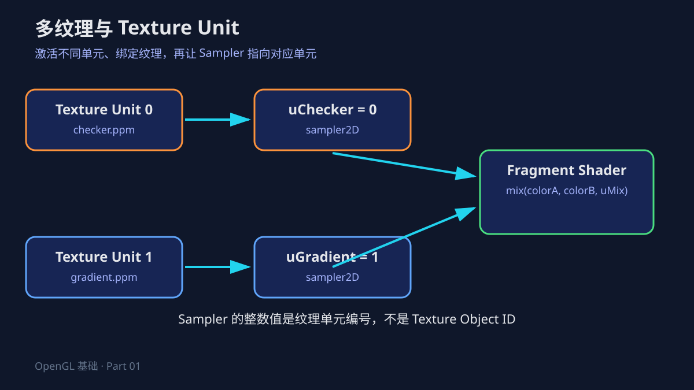

# Part 01 第 9 课：多纹理与 Texture Unit

适用环境：C++17、OpenGL 3.3 Core、GLSL 330 和 stb_image。沿用上一课的纹理加载函数。

你将学会：

- 解释 Texture Unit 在 Shader 与 Texture Object 之间的桥梁作用。
- 为两个 Sampler 设置不同整数单元编号。
- 使用 `mix` 和 Uniform 控制纹理混合比例。
- 诊断“第二张纹理显示成第一张”的常见绑定错误。

完整示例位于 [code/part-01-09-multitexture](../code/part-01-09-multitexture/)。

## 为什么不能只反复 glBindTexture

Fragment Shader 要在同一次调用中读取两张纹理。如果只在单一目标上反复绑定，后一次绑定会覆盖前一次状态，无法让两个 Sampler 同时获得不同纹理。

Texture Unit 提供多个并行插槽：



本课对应关系是：

| Shader Sampler | Uniform 整数值 | 单元 | 绑定纹理 |
|---|---:|---|---|
| `uChecker` | 0 | `GL_TEXTURE0` | `checker` |
| `uGradient` | 1 | `GL_TEXTURE1` | `gradient` |

Texture Object ID 是 `glGenTextures` 返回的对象名称；Sampler 的整数值是单元编号。两者用途完全不同。

## 两个 Sampler 与混合计算

```glsl
#version 330 core
in vec2 vUV;
out vec4 FragColor;
uniform sampler2D uChecker;
uniform sampler2D uGradient;
uniform float uMix;

void main() {
    vec4 a = texture(uChecker, vUV);
    vec4 b = texture(uGradient, vUV);
    FragColor = mix(a, b, uMix);
}
```

两个 `texture` 调用使用同一 UV，但通过不同 Sampler 读取不同纹理。`mix(a,b,t)` 等价于：

\[
a(1-t)+bt
\]

因此：

- `uMix = 0`：完全显示棋盘。
- `uMix = 1`：完全显示渐变。
- 中间值：两个 RGBA 分量逐分量混合。

若两张图 UV 方向不一致，混合会暴露出翻转或错位。本课使用同一个加载函数和相同翻转约定。

## 初始化 Sampler Uniform

Program 链接成功后：

```cpp
glUseProgram(program);
tutorial::setInt(program, "uChecker", 0);
tutorial::setInt(program, "uGradient", 1);
```

这些值通常初始化一次即可，因为 Program 会保存 Uniform 状态。但每次绘制前仍要保证使用正确 Program，并把纹理绑定到预期单元。

不要写成：

```cpp
// 错误：把 Texture Object ID 当成 Sampler 单元编号
// glUniform1i(location, checker);
```

对象 ID 可能恰好是 0、1 以外的值，它不是 `glActiveTexture` 的单元索引。

## 每帧绑定两个单元

```cpp
glActiveTexture(GL_TEXTURE0);
glBindTexture(GL_TEXTURE_2D, checker);

glActiveTexture(GL_TEXTURE1);
glBindTexture(GL_TEXTURE_2D, gradient);
```

`glActiveTexture` 选择当前活动单元，之后的 `glBindTexture(GL_TEXTURE_2D, ...)` 修改该单元的二维纹理绑定。

绑定纹理和 `glUseProgram` 的先后顺序在这个流程中可以调整，关键是 Draw Call 时三者关系都正确：Program 已使用、Sampler 指向单元、单元绑定正确纹理。

## 交互控制混合比例

```cpp
if (glfwGetKey(window, GLFW_KEY_UP) == GLFW_PRESS)   blend += 0.01F;
if (glfwGetKey(window, GLFW_KEY_DOWN) == GLFW_PRESS) blend -= 0.01F;
blend = glm::clamp(blend, 0.0F, 1.0F);

glUseProgram(program);
tutorial::setFloat(program, "uMix", blend);
```

本课继续使用固定交互步长，重点是 Uniform 与纹理绑定。实际产品可把步长乘以 `deltaTime`，或根据 UI 控件的绝对值设置。

## 查询可用单元数量

OpenGL 3.3 对 Fragment 阶段有最低可用纹理单元保障，但具体设备可提供更多。需要查询时可以使用：

```cpp
GLint units = 0;
glGetIntegerv(GL_MAX_TEXTURE_IMAGE_UNITS, &units);
```

这里查询的是 Fragment Shader 可访问的纹理图像单元上限。不要把它与 Texture Object 数量或显存大小混淆。

## 运行示例

```powershell
cd tutorials/opengl-compute-shader/code/part-01-09-multitexture
cmake --preset debug
cmake --build --preset debug
.\build\debug\part01_09_multitexture.exe
ctest --preset debug
```

按上、下方向键调整混合比例。正常结果是橙色棋盘与蓝紫渐变之间连续混合。

## 常见错误

### 两个 Sampler 都设置为 0

它们会读取同一单元，因此即使绑定了两个 Texture Object，也只会采样当前单元 0 的纹理。

### 忘记切换 Active Texture

如果两次 `glBindTexture` 之间没有 `glActiveTexture`，第二次会覆盖同一单元的绑定。

### 把纹理绑定到错误目标

`GL_TEXTURE_2D`、`GL_TEXTURE_CUBE_MAP` 等是不同目标。本课 Sampler 是 `sampler2D`，应绑定二维纹理。

### 在初始化 Sampler 时未绑定 Program

`glUniform1i` 更新当前 Program。若当前 Program 不对，目标 Sampler 不会得到预期值。

## 修改实验与独立练习

1. 把 `uGradient` 错设为 0，验证两个 Sampler 读取同一纹理。
2. 让两张纹理使用不同 UV：新增 `vUV2 = aUV * 2.0` 后采样渐变图。
3. 使用 `uTime` 让 `uMix = 0.5 + 0.5 * sin(uTime)`，形成自动淡入淡出。
4. 独立实现三纹理混合，明确列出每个 Sampler 的单元编号和绑定顺序。

下一课会把位置和颜色顶点交给 GLM 变换矩阵，实现平移、旋转和缩放组合。

参考资料：[Khronos Texture](https://wikis.khronos.org/opengl/Texture)、[LearnOpenGL：Textures](https://learnopengl.com/Getting-started/Textures)。
